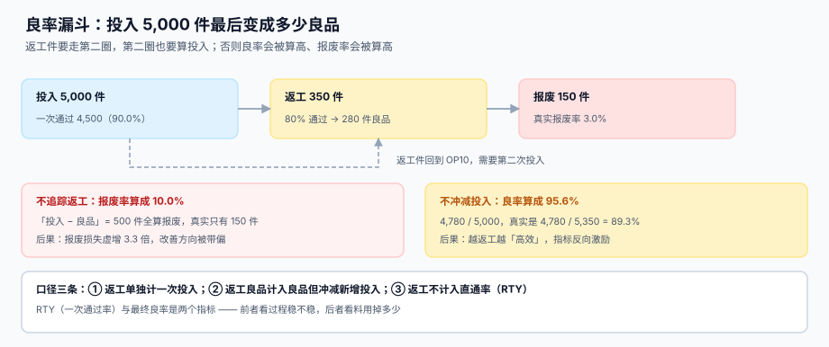

# 过程质检、返工与让步接收

<p style="text-align:center;"></p>

质量在系统里经常被写成「一个合格标记」。但车间真实发生的是四种处置：**放行、返工、报废、让步接收**——前三种都要动数量，第四种不动数量只动责任。把四种处置压成一个 `qc_pass` 布尔字段，是返工回路永远算不清的根源。

本页判据族 `MFQ-A` ~ `MFQ-H`，共 8 条，定义在第六节。

## 一、返工是「第二圈投入」，不然后面全错



本机读数（投入 5,000 件，一次通过 90%，返工 7%，报废 3%，返工通过率 80%）：

| 口径 | 计算 | 结果 |
| --- | --- | --- |
| 一次通过良品 | 5,000 × 90% | 4,500 件 |
| 返工件 | 5,000 × 7% | 350 件 |
| 报废件 | 5,000 × 3% | 150 件 |
| 返工后再通过 | 350 × 80% | 280 件 |
| 最终良品 | 4,500 + 280 | 4,780 件 |

三种算法给出三个完全不同的「良率」：

| 指标 | 公式 | 结果 | 回答什么问题 |
| --- | --- | --- | --- |
| 直通率 RTY | 一次通过 ÷ 投入 = 4,500 ÷ 5,000 | **90.0%** | 过程稳不稳 |
| 最终良率 | 最终良品 ÷ 总投入 = 4,780 ÷ 5,350 | **89.3%** | 料用掉多少 |
| 「投入 − 良品」当报废 | (5,000 − 4,500) ÷ 5,000 | 10.0% | **错**：把返工算成了报废 |

::: danger 两种算法错误的连锁后果
1. **不追踪返工 → 报废率算成 10.0%**（真实 3.0%）：报废损失虚增 3.3 倍，改善资源全投到「降报废」上，而真问题是返工。
2. **不冲减新增投入 → 良率算成 95.6%**（4,780 ÷ 5,000，真实 89.3%）：**越返工越「高效」**，因为返工带来的额外良品被算进了分子，而第二次投入没进分母。
:::

正确的记法是给返工一个「第二圈」的身份：

```sql
-- 返工单是独立工单，parent_order_no 指回原单
INSERT INTO mf_order(order_no, prod_order_no, sku, qty, route_version, bom_version,
                     due_date, promise_date, kind)
VALUES('MO-1001-R1', NULL, 'FG-A', 52, 'RT-FG-A-REWORK', 'BV-7', :due, :promise, 'REWORK');
```

这样「返工 52 件、二次通过 46 件」在账上是两笔投入、两笔产出，RTY 与最终良率各算各的，谁也不污染谁。

## 二、抽检：样本量与判定规则不能凭感觉

过程检验最常见的错误是「抽 5 件，全好就放行」。抽样方案的样本量由**批量**与**检验水平**决定，判定数（Ac / Re）由**AQL**决定，三样都必须查标准表，不能凭经验。

下表是 **GB/T 2828.1（等同采用 ISO 2859-1）一般检验水平 II** 的样本量片段——**只列样本量，不列判定数**，因为 Ac / Re 要按 AQL 逐格查原表：

| 批量范围 | 样本代码 | 样本量 n |
| --- | --- | --- |
| 151 ~ 280 | G | 32 |
| 281 ~ 500 | H | 50 |
| 501 ~ 1,200 | J | 80 |
| 1,201 ~ 3,200 | K | 125 |
| 3,201 ~ 10,000 | L | 200 |

判定数按 AQL 查同一张原表。两个最常用的格子（代码 J、n = 80）是：

| AQL | Ac（判接收） | Re（判拒收） |
| --- | --- | --- |
| 1.0 | 2 | 3 |
| 2.5 | 5 | 6 |

读法：批量 1,000 件、AQL 2.5、一般检验水平 II → 抽 **80 件**，不合格数 **≤ 5 判接收，≥ 6 判拒收**。

::: danger 表格数值不要凭记忆填进系统
判定数一旦落进配置表，就会长期生效。**本页只给出两个已核对过的格子**（J/1.0 = 2/3、J/2.5 = 5/6），其余必须对着现行标准原表逐格抄，并在配置里记下标准号与版本（如 `GB/T 2828.1—2012`）。凭记忆填错一格，等于把某个批量的接收概率整体挪动几个百分点，而且没人会发现。
:::

```sql
-- 抽样方案落表，不在代码里写 if-else
CREATE TABLE mf_qc_plan (
  sku       TEXT NOT NULL,
  stage     TEXT NOT NULL CHECK (stage IN ('IQC','IPQC','FQC')),
  lot_min   INTEGER NOT NULL,
  lot_max   INTEGER NOT NULL,
  sample_n  INTEGER NOT NULL,
  aql       REAL NOT NULL,
  ac        INTEGER NOT NULL,
  re        INTEGER NOT NULL,
  PRIMARY KEY (sku, stage, lot_min),
  CHECK (re = ac + 1)
);
```

::: warning 抽样不等于「免检」的反面
抽 80 件全好，不代表剩下 920 件全好——它只代表「在 AQL 2.5 的假设下，这批的坏品率有很大概率不超过 2.5%」。**把抽检结论写成「全部合格」是表述错误**，正确写法是「按 AQL 2.5 抽样 80 件，Ac=5，实测 2 件不合格，判接收」。
:::

## 三、四种处置，四种账

| 处置 | 数量怎么动 | 成本怎么走 | 谁批 |
| --- | --- | --- | --- |
| 放行（Accept） | 良品 +n | 正常成本 | 检验员 |
| 返工（Rework） | 良品 −n，返工单 +n | 追加返工工时与料 | 工艺 / 质量 |
| 报废（Scrap） | 报废 +n，良品不变 | 损失留在工单 | 质量 + 生产 |
| 让步接收（Concession） | 良品 +n（带偏差标签） | 正常成本 + 偏差记录 | 质量 + 客户（必要时） |

前三行都会动数量，第四行不动数量——它只给这批货打一个「已知偏差」的标签。**让步接收必须能反查到客户**：一旦客户投诉，要能立刻回答「哪些批次是让步放行的」。

```sql
CREATE TABLE mf_qc_result (
  result_id  INTEGER PRIMARY KEY AUTOINCREMENT,
  order_no   TEXT NOT NULL,
  seq        INTEGER NOT NULL,
  stage      TEXT NOT NULL,
  sample_n   INTEGER NOT NULL,
  defect_n   INTEGER NOT NULL,
  verdict    TEXT NOT NULL CHECK (verdict IN ('ACCEPT','REWORK','SCRAP','CONCESSION')),
  concession_no TEXT,                     -- 让步接收单号，其他处置必须为 NULL
  checked_by TEXT NOT NULL,
  at         TEXT NOT NULL,
  CHECK ( (verdict = 'CONCESSION' AND concession_no IS NOT NULL)
       OR (verdict != 'CONCESSION' AND concession_no IS NULL) )
);
```

::: danger 让步接收的三个坑
1. **只有结论没有单号**：出问题时无法证明「谁批的、批给哪个客户」。
2. **把让步当合格**：报表上「合格率 100%」，实际有 8% 是带偏差放行的。
3. **让步有效期无限**：一张让步单被反复引用三年，客户早就换了两轮规格。
:::

## 四、返工回路的三个断点

```text
OP20 检出不良 → 判定返工 → 建返工单 → 返工报工 → 回到 OP20 复检 → 通过 → 汇入主工单
```

| 断点 | 症状 | 修法 |
| --- | --- | --- |
| 建单断点 | 返工件在车间转，系统里没有单 | 判定返工时同步建返工单，两者同一事务 |
| 回圈断点 | 返工单完工了，主工单不知道 | 返工单完工时回写主工单 `rework_done` |
| 复检断点 | 返工后不复检直接入库 | 返工路线的最后一道必须是检验工序 |

返工工时是**额外**的，绝不能摊进标准成本：

```text
标准成本：4,500 件 × 单件标准工时 4.4 min = 330 h
实际：返工 52 件 × 返工路线 2.1 min = 1.82 h 额外
差异归因：返工工时 → 质量差异（不是效率差异）
```

## 五、质量与报工的交界：谁改数量

报工决定「做了多少」，质检决定「其中多少能用」。两者的交界只有一个字段：**良品数**。

| 时机 | 谁改 `good` | 风险 |
| --- | --- | --- |
| 报工时直接填良品 | 班组长 | 自检自报，不良被藏进返工 |
| 报工填投入，质检后回写良品 | 检验员 | 需要「待检」这个中间态 |
| 报工填投入，良品单独一张表 | 系统按质检结论累加 | 最干净，但要求质检必须及时 |

推荐第三种：`mf_op.good` 只由质检结论累加，报工只写 `qty`。代价是**待检期间的工单不能入库**，这正是应该的——没检验的货本来就不该进成品库。

## 六、判据清单

| 编号 | 判据 | 怎么验 |
| --- | --- | --- |
| `MFQ-A` | 返工是独立工单，带 `kind='REWORK'` 且指回原单 | `mf_order.kind` 存在，返工单 `parent_order_no` 非空 |
| `MFQ-B` | RTY 与最终良率分别可算，分母不同 | 两条 SQL 分母分别为投入与总投入 |
| `MFQ-C` | 抽样方案落表，`re = ac + 1` 由约束保证 | `mf_qc_plan` 存在且 `CHECK (re = ac + 1)` |
| `MFQ-D` | 四种处置是枚举，不是布尔 | `verdict` 有四个取值 |
| `MFQ-E` | 让步接收必须有单号，其他处置必须没有 | `CHECK` 双向约束 |
| `MFQ-F` | 返工工时归「质量差异」，不摊进标准成本 | 差异报表有独立的质量差异行 |
| `MFQ-G` | 良品数只由质检结论累加（或报工时显式自检并留痕） | `mf_op.good` 的写入点唯一 |
| `MFQ-H` | 让步批次可反查到客户/订单 | `concession_no` 能 join 到出货记录 |

## 七、验证方式

```shell
# 1) 让步接收必须有单号：应报 CHECK 失败
sqlite3 /tmp/mf.db "INSERT INTO mf_qc_result(order_no,seq,stage,sample_n,defect_n,verdict,concession_no,checked_by,at)
  VALUES('MO-1001',20,'IPQC',80,3,'CONCESSION',NULL,'QC-01','2026-11-01');"
# 期望：CHECK constraint failed

# 2) 非让步必须没有单号：应报 CHECK 失败
sqlite3 /tmp/mf.db "INSERT INTO mf_qc_result(order_no,seq,stage,sample_n,defect_n,verdict,concession_no,checked_by,at)
  VALUES('MO-1001',20,'IPQC',80,3,'ACCEPT','CC-2026-001','QC-01','2026-11-01');"
# 期望：CHECK constraint failed

# 3) RTY 与最终良率应不同（含返工时）
sqlite3 /tmp/mf.db "SELECT ROUND(100.0*SUM(CASE WHEN kind='NORMAL' THEN good END)/SUM(qty),1) AS rty,
                           ROUND(100.0*SUM(good)/SUM(qty),1) AS final_yield FROM mf_order;"
# 期望：rty < final_yield（返工贡献了差额）

# 4) 抽样判定：抽 80 件、AQL 2.5、Ac=5 时，6 件不良应判拒收
sqlite3 /tmp/mf.db "SELECT CASE WHEN 6 <= ac THEN 'ACCEPT' ELSE 'REJECT' END
                      FROM mf_qc_plan WHERE sku='FG-A' AND stage='IPQC' AND 1000 BETWEEN lot_min AND lot_max;"
# 期望：REJECT

# 5) 返工单必须指回原单：应输出 0
sqlite3 /tmp/mf.db "SELECT count(*) FROM mf_order WHERE kind='REWORK' AND parent_order_no IS NULL;"
# 期望：0
```

## 与「理赔作业」专题的分工（第 239 天补充）

本页判「**生产过程里的良率与返工**」，[理赔作业](../../ClaimsProcessing/Overview/index.md) 判「**事后赔出去多少**」。两册都会出现「不合格」「让步」「损失」，但判据一条不重合：

| 你关心的问题 | 该读哪一册 | 为什么不是本册 |
| --- | --- | --- |
| 「这批货返工了几件、RTY 多少」 | 本页 | 那册不看生产数量，只看赔案金额 |
| 「客户索赔 6 万，条款允许赔多少」 | [条款与责任判定](../../ClaimsProcessing/Coverage/index.md) | 本页判良率，那册判免赔、限额与责任比例 |
| 「让步接收要不要打折」 | 本页 | 那册的核减理由是目录价、重复票据、非本次事故，不含让步 |
| 「同一批不良品的赔款怎么核减」 | [查勘定损与明细核定](../../ClaimsProcessing/Assessment/index.md) | 本页只判数量，那册判逐项金额 |

::: danger 一页一坑
**让步接收的「折价」和理赔的「核减」不是一回事**：前者是**售价**让渡（同意的质量偏差换价格折让），后者是**赔款**核减（条款允许的上限）。把让步折价直接搬进理赔的 `allowed_price`，会让核减失去理由码——审计问「为什么这台车只赔 80%」，答案不能是「生产让步了」。
:::

## 与「培训与资质认证」专题的分工（第 240 天补充）

过程质量判产品，资质判人；两者唯一的交点是「操作者是否持证」：

| 问题 | 本册（质量） | 培训与资质册 |
| --- | --- | --- |
| 这批产品合不合格 | **判**：AQL 抽样、良率 | 不判 |
| 这道工序谁做的 | 记录 `operator` | 提供「他当时是否有证」 |
| 良率低是不是人的问题 | 只给相关性 | **判**：资质与培训记录 |
| 复训能不能提升良率 | 不判（需实验设计） | 提供复训前后对照的分组 |

延伸阅读：[岗位资质矩阵](../../TrainingQualification/Matrix/index.md)、[上岗准入：判定点在哪里](../../TrainingQualification/AccessGate/index.md)、[证书与有效期](../../TrainingQualification/Certificate/index.md)。

::: danger 一个只在本页成立的坑
**用良率反推培训有效性**。良率同时受设备、材料、工艺影响，本机维护册的读数说明「MTTR 高就培训维修工」常常是误判。要把培训效果量出来，必须用「同工序、同设备、同期」的对照，而不是全厂良率的前后对比。
:::

## 与「质量管理工程」专题的分工（第 248 天补充）

本页与 [质量管理工程](../../QualityManagement/index.md) 的分工写在下面这张表里，两册**不重复定义**同一件事：

| 维度 | 本页 | 另一侧 |
| --- | --- | --- |
| 本页判什么 | 这一批收不收：抽样方案落地、Ac/Re 判定、让步接收一路带到客户 | 「判定」本身 |
| 质量工程判什么 | 这个判定可不可信：量具够不够准、过程跑没跑偏、能力够不够、错了怎么改 | 「判据」本身 |
| 共用的一组数 | 批量、样本量、AQL、不合格数 | 只借用法，不重复定义 |
| 谁维护抽样表 | 本页给出 AQL 与 Ac/Re 的检索与落表 | 质量工程只引用，不重写 |

::: warning 只在本页成立的一个坑
把「抽 80 件全好」写成「批内无不合格」。抽样结论只能表述为「未发现不合格」，且必须同时给出样本量与 Ac——否则它和 [规格与能力](../../QualityManagement/Specs/index.md) 里的 Cpk 会互相矛盾：一个说「没有坏件」，一个说「预期 27 ppm」。
:::

## 参考资料

- [报工、在制品与工序交接](../Reporting/index.md)：良品数的写入点
- [完工入库、批次与追溯](../Completion/index.md)：让步批次的出库追溯
- [在制品与良率折算](../../CostAccounting/WipYield/index.md)：约当产量里的良率口径
- GB/T 2828.1—2012《计数抽样检验程序 第 1 部分：按接收质量限（AQL）检索的逐批检验抽样计划》：<https://openstd.samr.gov.cn/>
- ISO 2859-1 计数抽样检验程序：<https://www.iso.org/standard/61516.html>
- GB/T 19001—2016（ISO 9001:2015）8.7 不合格输出的控制：<https://openstd.samr.gov.cn/>
