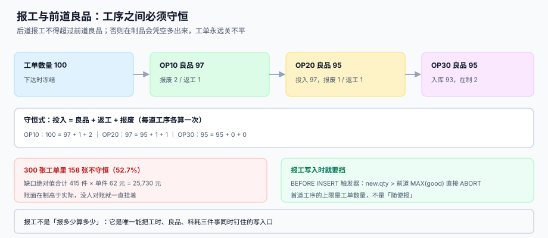

# 报工、在制品与工序交接

<p style="text-align:center;"></p>

报工是整个生产执行里**唯一会当场报错的写操作**——前提是你给了它该有的约束。没有约束的报工是一台「随便记」的机器：报多少算多少、后道可以比前道多、报废可以不写、工时可以凭空填。而这四种「随便」，最后都会变成月末对不上的在制品。

本页判据族 `MFB-A` ~ `MFB-H`，共 8 条，定义在第六节。

## 一、一条报工同时钉住三件事



一条合格报工记录必须回答四个数：**投入、良品、返工、报废**，且它们之间恒等：

```text
投入 = 良品 + 返工 + 报废
```

这一条恒等式在每一道工序上都要成立，而不只是在工单上。本机读数（工单 100 件、三道工序）：

| 工序 | 投入 | 良品 | 返工 | 报废 | 恒等 |
| --- | --- | --- | --- | --- | --- |
| OP10 下料 | 100 | 97 | 1 | 2 | 100 = 97 + 1 + 2 ✓ |
| OP20 焊接 | 97 | 95 | 1 | 1 | 97 = 95 + 1 + 1 ✓ |
| OP30 包装 | 95 | 95 | 0 | 0 | 95 = 95 + 0 + 0 ✓ |

OP20 的投入是 97 而不是 100——因为**后道的投入等于前道的良品**。这就是工序之间的守恒：每道工序的出料口对着下一道的入料口，中间不能凭空多、也不能凭空少。

```sql
CREATE TABLE mf_report (
  report_id INTEGER PRIMARY KEY AUTOINCREMENT,
  order_no  TEXT NOT NULL,
  seq       INTEGER NOT NULL,
  qty       INTEGER NOT NULL CHECK (qty > 0),        -- 投入（本道报工数）
  good      INTEGER NOT NULL CHECK (good >= 0),
  rework    INTEGER NOT NULL DEFAULT 0 CHECK (rework >= 0),
  scrap     INTEGER NOT NULL DEFAULT 0 CHECK (scrap >= 0),
  std_min   REAL NOT NULL,                            -- 报工时冻结的标准工时
  at        TEXT NOT NULL,
  FOREIGN KEY (order_no, seq) REFERENCES mf_op(order_no, seq),
  CHECK (good + rework + scrap = qty)
);
```

`std_min` 为什么要冻结在报工记录上？因为标准工时会被主数据改，而这条报工发生在改之前——差异分析必须用**当时**的标准，不是现在的。

## 二、工序守恒：后道不能比前道多

这是生产执行里最容易被漏掉的一条约束，也是最容易造成「在制凭空增长」的原因。一道工序报 98 件，前道只良品 95 件——那 3 件从哪来？

```sql
-- 报工写入前就要挡：后道投入不得超过前道良品
CREATE TRIGGER trg_flow_guard BEFORE INSERT ON mf_report
BEGIN
  SELECT CASE WHEN new.qty > COALESCE(
    (SELECT MAX(good) FROM mf_op WHERE order_no = new.order_no AND seq < new.seq),
    (SELECT qty FROM mf_order WHERE order_no = new.order_no)
  ) THEN RAISE(ABORT, 'flow_exceeded') END;
END;
```

判据只有一句：**首道工序的上限是工单数量，其余工序的上限是前道良品累计**。

::: danger 没有这条闸门时的四种「救场」
1. **先报工后补良品**：班组长发现报多了，回头改前道的良品数——历史数据被篡改，追溯失效。
2. **拆成两条报工**：把超出的 3 件拆到下一班次，账面看不出，实际前后道永远差 3 件。
3. **在「在制」字段手动加**：为了让工单能关闭，直接把 `wip` 改成 0，差异沉进成本。
4. **报废不报工**：报废件不报，投入就少了，于是后道「看起来」没超前道——但料白扣了。
:::

## 三、在制守恒：三个数必须闭合

```text
报工良品（produced） = 已入库（received） + 在制（wip）
```

本机读数（300 张工单）：**158 张不守恒（52.7%）**，缺口绝对值合计 415 件，按单件成本 62 元计，账面在制与实际相差 **25,730 元**。

| 不守恒的形态 | 症状 | 根因 |
| --- | --- | --- |
| 产出 > 入库 + 在制 | 有 5 件「报了工但既没入库也不算在制」 | 入库单漏录 |
| 产出 < 入库 + 在制 | 入库比报工还多 | 入库时把返工件也算进成品 |
| 在制为负 | `wip = produced - received` 小于 0 | 上期入库在本期录（跨期） |
| 在制永远不清 | 差 1~2 件挂在账上几个月 | 报废未报，或零头被四舍五入抹掉 |

在制是所有「小差」的沉淀池：每一处漏记最后都会变成「在制 +1」，而没有人会为一两件去查。所以要**按工单看缺口，按周清零**：

```sql
-- 每周一次：列出不守恒工单，缺口按工单排序
SELECT order_no, produced, received, wip, produced - received - wip AS gap
  FROM mf_order
 WHERE produced != received + wip
 ORDER BY ABS(produced - received - wip) DESC;
```

::: tip 在制不是一个字段，是一个核对结果
`wip` 可以是存下来的（写入时算好），也可以是查出来的（`produced - received`）。**两者必须一致**，所以要么加 `CHECK (wip = produced - received)`，要么干脆不存这一列、只在视图里算。存了又不校验，等于给自己留了一个可以随手改的假账位。
:::

## 四、工时报在哪一级

| 粒度 | 数据形态 | 成本归集精度 | 现场成本 |
| --- | --- | --- | --- |
| 按工单 | 一个工单一个总工时 | 只能按平均费率摊，误差 7.6% 起 | 最低 |
| 按工序 | 每道工序一行 | 可归到工作中心，误差 < 1% | 中（班组长每道填一次） |
| 按小时 | 每人每小时一行 | 可归到人、机、班次 | 高（需要打卡或终端） |

三种粒度的差别不是「精度」，而是**能不能回答不同的问题**：

- 「这张工单亏不亏」→ 按工单就够；
- 「哪个工作中心效率低」→ 必须按工序；
- 「哪台设备该换了」→ 必须按设备 + 小时。

::: warning 不要用「按小时」的精度要求去要求所有车间
按小时报工需要终端或扫码，投入成本高。中小车间的现实做法是**按工序报工 + 按班次汇总工时**：工序级数量保证守恒，班次级工时保证人工成本能算。两者混在一张表里会导致「一条报工既有数量又有 8 小时工时」，看起来精确，其实两项都不准。
:::

## 五、顺序问题：报工与扣料谁先

报工和倒冲是两件事，先后顺序决定失败时账面的样子：

| 顺序 | 报工成功、扣料失败 | 扣料成功、报工失败 |
| --- | --- | --- |
| 先报工后扣料 | 产量有、料没扣 → 库存虚高 | 不可能（报工失败不扣料） |
| 先扣料后报工 | 不可能 | 料扣了、产量没有 → 在制凭空少 |

**正确顺序是「同一事务内，先扣料后报工」**，因为扣料失败（库存不足）是可以回滚的，而报工成功后的扣料失败会让库存长期虚高——那种差异没有任何人会在当天发现。

```sql
BEGIN IMMEDIATE;
  -- 1) 扣料：条件更新，余额不足直接抛错
  UPDATE mf_stock SET on_hand = on_hand - :need
   WHERE item = :item AND lot = :lot AND on_hand >= :need;
  -- 若 changes() = 0 → ROLLBACK，抛「库存不足，工单挂起」
  -- 2) 写报工（触发器会校验工序守恒）
  INSERT INTO mf_report(order_no, seq, qty, good, rework, scrap, std_min, at)
  VALUES (:no, :seq, :qty, :good, :rework, :scrap, :std, :at);
  -- 3) 累计到工序与工单
  UPDATE mf_op SET reported = reported + :qty, good = good + :good
   WHERE order_no = :no AND seq = :seq;
COMMIT;
```

::: danger 三个事务边界错误
1. **每个动作各开一个事务**：报工成功、扣料失败，产量白记；重试时又报一次，产量翻倍。
2. **扣料用 `on_hand - :need` 不校验**：库存被扣成负数，系统里没有任何告警，直到下次盘点。
3. **累加用「读出来 + 内存相加」**：两个班组长同时报工，后写的覆盖先写的，产量少一半。
:::

## 六、判据清单

| 编号 | 判据 | 怎么验 |
| --- | --- | --- |
| `MFB-A` | 每条报工满足 `投入 = 良品 + 返工 + 报废` | `CHECK (good + rework + scrap = qty)` |
| `MFB-B` | 后道报工不超过前道良品，首道不超过工单数量 | `trg_flow_guard` 存在且负向用例被拒 |
| `MFB-C` | 在制守恒：`produced = received + wip` | `CHECK` 或 `wip` 为视图列 |
| `MFB-D` | 报工时冻结 `std_min`，不从主数据现读 | `mf_report.std_min` 非空 |
| `MFB-E` | 报工与扣料在同一事务，扣料用条件更新 | 事务内 `changes()` 判定，无 `on_hand - :n` 裸更新 |
| `MFB-F` | 累计用 `UPDATE ... SET x = x + :n`，不用读改写 | SQL 中无 `SELECT ... ; UPDATE ... SET x = <常量>` |
| `MFB-G` | 工序累计等于报工明细之和 | `mf_op.reported = Σ mf_report.qty` |
| `MFB-H` | 不守恒工单可被一条 SQL 列出并按缺口排序 | 存在对账 SQL 且结果可按周清零 |

## 七、验证方式

```shell
# 1) 勾稽不平必须被拒：应报 CHECK 失败
sqlite3 /tmp/mf.db "INSERT INTO mf_report(order_no,seq,qty,good,rework,scrap,std_min,at)
  VALUES('MO-1001',10,10,10,0,3,0.8,'2026-11-01');"
# 期望：CHECK constraint failed: good + rework + scrap = qty

# 2) 后道超前道必须被拒：应报 flow_exceeded
sqlite3 /tmp/mf.db "INSERT INTO mf_report(order_no,seq,qty,good,rework,scrap,std_min,at)
  VALUES('MO-1001',20,999,999,0,0,1.2,'2026-11-01');"
# 期望：flow_exceeded

# 3) 工序累计 = 明细之和：应输出 0
sqlite3 /tmp/mf.db "SELECT count(*) FROM mf_op o WHERE o.reported !=
  (SELECT COALESCE(SUM(r.qty),0) FROM mf_report r WHERE r.order_no=o.order_no AND r.seq=o.seq);"
# 期望：0

# 4) 在制守恒：应输出 0
sqlite3 /tmp/mf.db "SELECT count(*) FROM mf_order WHERE produced != received + wip;"
# 期望：0

# 5) 不守恒工单清单（按缺口排序，用于每周清零）
sqlite3 /tmp/mf.db "SELECT order_no, produced, received, wip, produced-received-wip AS gap
                      FROM mf_order WHERE produced != received + wip
                     ORDER BY ABS(gap) DESC LIMIT 10;"

# 6) 事务边界自查：报工与扣料必须在同一事务（源码级人工核对）
grep -n "BEGIN IMMEDIATE" -A 12 src/report.py
# 期望：扣料、报工、累计三段在同一个事务块内
```

## 参考资料

- [备料、领退料与倒冲](../MaterialIssue/index.md)：报工触发的倒冲
- [完工入库、批次与追溯](../Completion/index.md)：`received` 的写入点
- [在制品与良率折算](../../CostAccounting/WipYield/index.md)：在制如何折成约当产量
- ISO 22400-2 关于良品数（good quantity）与报废数（scrap quantity）的定义：<https://www.iso.org/standard/54497.html>
- ISA-95 第 2 部分工序段（Process Segment）与生产绩效模型：<https://www.isa.org/standards-and-publications/isa-standards/isa-95-series-standards>
