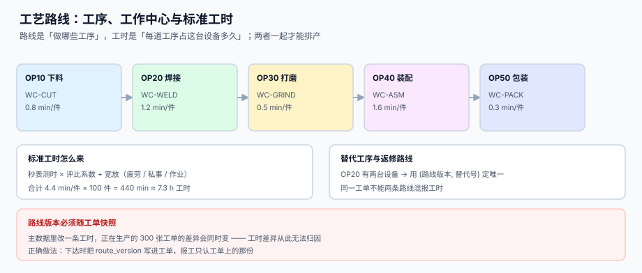

# 工艺路线、工作中心与标准工时

<p style="text-align:center;"></p>

排产要两个输入：**先做哪道工序**（路线）和**这道工序占这台设备多久**（工时）。前者是顺序问题，后者是数量问题。两个输入都来自主数据，而主数据最要命的特点是——**改了它，正在生产的所有工单都会跟着变**。

本页判据族 `MFR-A` ~ `MFR-H`，共 8 条，定义在第六节。

## 一、路线是一条链，不是一个列表



一条工艺路线由若干道工序首尾相接组成，每道工序必须同时回答四件事：

| 属性 | 含义 | 缺了会怎样 |
| --- | --- | --- |
| `seq` | 工序序号（10、20、30…，留空位便于插入） | 用 1、2、3 编号，插入新工序要重排全表 |
| `wc` | 工作中心（设备组） | 工时无法归集到设备，产能算不出来 |
| `std_min` | 单件标准工时（分钟） | 无法排产，只能按经验给交期 |
| `setup_min` | 换型（准备）时间，按批次计而非按件计 | 小批量多品种时严重低估总工时 |

序号从 10 开始、步长 10，是行业内的老习惯，好处是插入新工序时不用改别人：

```sql
CREATE TABLE mf_route_op (
  route_id  TEXT NOT NULL,
  version   TEXT NOT NULL,
  seq       INTEGER NOT NULL,             -- 10, 20, 30…
  wc        TEXT NOT NULL,
  std_min   REAL NOT NULL CHECK (std_min > 0),
  setup_min REAL NOT NULL DEFAULT 0 CHECK (setup_min >= 0),
  is_optional INTEGER NOT NULL DEFAULT 0, -- 可选工序（如抽检）
  PRIMARY KEY (route_id, version, seq)
);
```

::: danger 用「工序名」当主键的四个后果
1. **改名即断链**：把「打磨」改成「精磨」，历史工单的工序全部找不到定义。
2. **同名不同序无法表达**：同一道「检验」可能在 OP20 与 OP40 各出现一次。
3. **返修路线无处安放**：返修是另一条路线（`route_id = REWORK`），共用工序名会把它混进主路线。
4. **顺序无约束**：没有 `seq`，两道工序谁先谁后只能靠插入顺序猜。
:::

## 二、标准工时不是「测出来的那个数」

标准工时的完整算法有四个乘数：

```text
标准工时 = 观测时间 × 评比系数 × (1 + 宽放率)
```

| 项 | 取值示例 | 说明 |
| --- | --- | --- |
| 观测时间 | 0.85 min/件 | 秒表连续测 30 个周期，剔除异常值后取均值 |
| 评比系数 | 1.05 | 被观测者比「正常熟练度」快 5%，要往回调 |
| 宽放率 | 12% | 疲劳 5% + 私事 4% + 作业 3% |
| 标准工时 | 0.85 × 1.05 × 1.12 ≈ **1.00 min/件** | 这是「正常熟练工在正常条件下」的时间 |

本机读数（2,000 道工序，实际/标准的比值分布）：

| 统计量 | 读数 | 含义 |
| --- | --- | --- |
| 中位数 | 0.977 | 一半工序实际比标准**快** 2.3% |
| 均值 | 1.013 | 平均只慢 1.3%，看起来「标准很准」 |
| 偏差 > +10% | 679 道（34.0%） | 严重超时 |
| 偏差 < −10% | 770 道（38.5%） | 严重提前 |
| 合计越界 | **1,449 道（72.5%）** | 七成工序的偏差超过 ±10% |

**均值几乎无偏，个体大面积偏离**——这正是标准工时最危险的地方：

::: danger 用平均偏差证明「标准工时没问题」是错的
均值 1.013 会让人得出「标准工时很准」的结论。但按 ±10% 判定，72.5% 的工序会被判错。如果拿标准工时做计件工资或效率考核，**每 4 道工序就有 3 道判错**：快的被罚、慢的被奖，而且方向随机。正确用法只有两个：**排产**（要的是总量，均值无偏就够）与**差异分析**（要看个体，必须按工序分组）。
:::

工时折算成钱的口径：

```text
标准工时 8,000 h × 均值 1.013 = 8,104.6 h
差额 104.6 h × 45 元/h = 4,706.22 元
```

金额不大，但**方向是「实付比标准多」**——意味着按标准工时报价会低估人工成本。1,000 张工单的量级下，这个偏差会变成几十万的毛利差。

## 三、报工工时的取整：0.1 h 与 1 h 差 44%

车间报工不会报「0.37 小时」，实际系统里通常取整到 0.1 h 或 1 h。本机读数（10,000 条报工，原始值 3,235.4 h）：

| 取整粒度 | 累计工时 | 与原始值之差 | 偏差率 |
| --- | --- | --- | --- |
| 不取整 | 3,235.4 h | — | — |
| 0.1 h | 3,253.8 h | **+18.4 h** | +0.57% |
| 1 h | 1,805.0 h | **−1,430.4 h** | −44.2% |

1 小时粒度不是「误差大一点」，而是**系统性少计**：0.6 h 的报工被记成 1 h（多计），0.4 h 的被记成 0 h（少计），而车间大部分工序的报工都在 0.5 h 以下，于是「抹零」全落在少计一侧。

::: tip 取整的正确做法
**存原始值，只在展示层取整。** 如果现场只能报整数，就在报工时把最小的计量单位定成 6 分钟（0.1 h）并写进操作规范，而不是让系统去 `round()`。另外：取整必须发生在**汇总之前**，逐条取整再汇总与汇总后取整，结果不同。
:::

## 四、工作中心：工时归集的最小单位

| 概念 | 例子 | 关键约束 |
| --- | --- | --- |
| 工作中心 | `WC-WELD`（焊接组） | 一组同类设备，共享产能与费率 |
| 设备 | `WELD-03` | 单台，报工时可选填 |
| 产能 | 480 min/日（单班） | 与班次表绑定，不是常量 |
| 费率 | 55 元/h | 按中心定，不按设备定 |

工单的工时成本按工作中心归集，本机读数（4 道工序、1/2/4/3 h、费率 40/55/70/55 元）：

| 归集方式 | 结果 | 与真值之差 |
| --- | --- | --- |
| 按工序（真值） | 595.00 元 | — |
| 按工单用平均费率 55 元/h | 550.00 元 | **−45.00 元（−7.6%）** |

1,000 张工单累计归集差 **−45,000 元**。差别来自「哪个中心干的活多」：高费率中心（70 元/h）承担了 4 h，低费率中心（40 元/h）只承担 1 h，平均费率会把高费率的部分摊薄。

::: warning 报工粒度决定成本能不能归对
**只报工单不报工序，工时成本就只能按平均费率摊**，误差 7.6% 起步。工序级报工不是为了「看得细」，而是为了让费率有落点。反过来说：如果车间确实做不到工序级报工，就要在成本模型里明说「按平均费率摊」，别在报表上假装精确到分。
:::

## 五、替代工序与返修路线

```sql
-- 替代工序：同一 seq 允许多个候选，用 alt_no 区分，选一个生效
CREATE TABLE mf_route_alt (
  route_id TEXT NOT NULL,
  version  TEXT NOT NULL,
  seq      INTEGER NOT NULL,
  alt_no   INTEGER NOT NULL,
  wc       TEXT NOT NULL,
  std_min  REAL NOT NULL,
  active   INTEGER NOT NULL DEFAULT 1,
  PRIMARY KEY (route_id, version, seq, alt_no)
);

-- 返修路线是独立 route_id，不混进主路线
INSERT INTO mf_route(route_id, version, kind) VALUES('RT-FG-A-REWORK','1','REWORK');
```

三条纪律：

1. **同一工单只能激活一个替代**：`mf_order.route_alt` 记录选中的 `alt_no`，报工时按它校验。
2. **返修路线不计入标准成本**：它的工时是「额外」的，进差异而不是进标准。
3. **替代切换要留痕**：主设备故障临时换设备，必须记 `switch_reason`，否则后续的工时差异无法解释。

## 六、判据清单

| 编号 | 判据 | 怎么验 |
| --- | --- | --- |
| `MFR-A` | 工序以 `(route_id, version, seq)` 唯一，`seq` 从 10 起、步长 10 | 主键三列 + 数据抽查 |
| `MFR-B` | 每道工序都有 `wc` 与 `std_min`，均非空 | `count(*) WHERE wc IS NULL OR std_min <= 0` = 0 |
| `MFR-C` | 换型时间单列，不混进 `std_min` | 存在 `setup_min` 且排产按批累加 |
| `MFR-D` | 路线有版本，工单冻结版本号 | `mf_order.route_version` 非空且能在 `mf_route` 找到 |
| `MFR-E` | 标准工时的四个乘数可追溯（观测 / 评比 / 宽放） | 存在工时测算记录表或页内说明来源 |
| `MFR-F` | 替代工序同 `seq` 下唯一激活 | `count(active=1) GROUP BY (route,version,seq)` ≤ 1 |
| `MFR-G` | 返修路线独立 `route_id`，不进标准成本 | `kind='REWORK'` 的路线不出现在标准成本计算里 |
| `MFR-H` | 报工工时保留原始精度，取整只在展示层 | 报工表字段为 `REAL` 且无 `ROUND()` 写入 |

## 七、验证方式

```shell
# 1) 工序顺序无跳号（按 10 步长）：应输出 0
sqlite3 /tmp/mf.db "SELECT count(*) FROM (SELECT route_id, version, seq,
                       LAG(seq) OVER (PARTITION BY route_id, version ORDER BY seq) AS prev
                     FROM mf_route_op) WHERE prev IS NOT NULL AND seq - prev != 10;"
# 期望：0

# 2) 每道工序都有工作中心与工时：应输出 0
sqlite3 /tmp/mf.db "SELECT count(*) FROM mf_route_op WHERE wc IS NULL OR std_min IS NULL OR std_min <= 0;"
# 期望：0

# 3) 替代工序同 seq 只允许一个激活：应输出 0
sqlite3 /tmp/mf.db "SELECT count(*) FROM (SELECT route_id, version, seq FROM mf_route_alt
                     WHERE active = 1 GROUP BY route_id, version, seq HAVING COUNT(*) > 1);"
# 期望：0

# 4) 工单冻结的路线版本必须存在：应输出 0
sqlite3 /tmp/mf.db "SELECT count(*) FROM mf_order o WHERE NOT EXISTS
  (SELECT 1 FROM mf_route r WHERE r.route_id = o.route_id AND r.version = o.route_version);"
# 期望：0

# 5) 工时测算：标准工时 = 观测 × 评比 × (1+宽放)，误差应 < 0.01
python3 -c "print(round(0.85*1.05*1.12, 4))"
# 期望：0.9996（与 1.00 的差来自四舍五入）
```

## 参考资料

- [排产、有限产能与交期承诺](../Planning/index.md)：路线与工时如何变成排产输入
- [报工、在制品与工序交接](../Reporting/index.md)：工时在报工时如何落到工序上
- [成本核算与月末结账](../../CostAccounting/Overview/index.md)：工时如何折成人工成本
- ISO 22400-2 关于工序时间（processing time）与换型时间（setup time）的定义：<https://www.iso.org/standard/54497.html>
- 标准工时测定方法（时间研究：stopwatch time study）概述：<https://www.ascm.org/>
