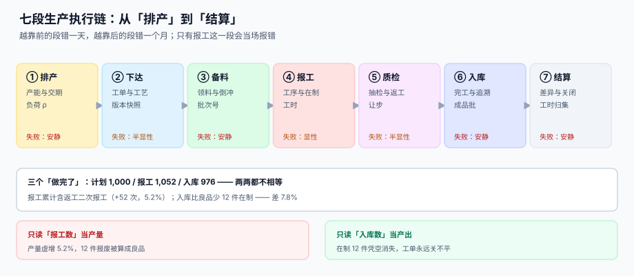

# 生产执行与工单报工

<p style="text-align:center;"></p>

车间里最容易被误读的一句话是「**这单做完了**」。计划员看到的是「排了 1,000 件」、班组长报的是「今天做了 1,052 次」、仓库收的是「入库 976 件」——三个数字都来自同一张工单，却没有任何两个相等。生产的账不是「做完了没有」，而是**在制品此刻停在哪道工序上、值多少钱、下一道能不能开工**。

::: tip 一句话理解
**生产执行不是「记产量」，而是把车间里发生的每一件物理动作，翻译成一条能被财务与仓库同时接受的记录。** 计划说「要多少」，报工说「做了多少」，入库说「收了多少」，三者靠工序守恒与批次链咬合。
:::

## 这个专题讲什么

一张工单从「排产」到「关闭」要过七道工序。本专题按这七段组织，每段都标出产物与失败方式：

| 段 | 这一段在做什么 | 产物 | 失败是否安静 |
| --- | --- | --- | --- |
| ① 排产 | 有限产能下的顺序与交期承诺 | 排产计划 + 负荷 ρ | **安静**（排错了不影响任何一笔账，只影响客户） |
| ② 下达 | 冻结工艺路线与投料清单的版本 | `mf_order` + 路线快照 | 半显性（下错了要重开） |
| ③ 备料 | 领料、退料与倒冲 | `mf_issue` + 批次号 | **安静**（少扣的料沉到期末盘点） |
| ④ 报工 | 工序良品、报废、返工与工时 | `mf_report` + `mf_op` 累计 | 显性（报不平会当场被约束挡住） |
| ⑤ 质检 | 过程检验、返工判定与让步接收 | 检验单 + 处置结论 | 半显性（让步接收会一路带到客户） |
| ⑥ 入库 | 完工入库、成品批与追溯链 | `mf_receipt` + `mf_lot_link` | **安静**（没写批次链，出事才知道召回不了） |
| ⑦ 结算 | 工单差异、工时归集与关闭 | 工单结算单 | **安静**（差异留在在制里，谁也不催） |



七段里**四段的失败是安静的**：排产、备料、入库、结算都不会当场报错，它们只会让期末的数字对不上。而唯一会当场报错的报工，恰恰是最容易被「先记账后补单」绕过的一段。

## 与其它专题的分工

库里写「生产」的册子不止一本，问的问题却不一样。先看这张表再决定读哪一册：

| 你关心的问题 | 该读哪一册 | 为什么不是本册 |
| --- | --- | --- |
| 「这批货的成本怎么算」 | [成本核算与月末结账](../CostAccounting/Overview/index.md) | 那册讲**钱怎么归集**，本册讲**活干到哪一步** |
| 「在制品怎么折成约当产量」 | [在制品与良率折算](../CostAccounting/WipYield/index.md) | 那册讲**完工率与约当产量**，本册讲**报工记录本身是否守恒** |
| 「料在哪个货位、谁去拣」 | [仓储作业与波次拣选](../WarehouseOps/Overview/index.md) | 那册讲**库内空间与路径**，本册讲**料为什么被消耗** |
| 「采购单什么时候到货」 | [采购到付款](../ProcureToPay/Overview/index.md) | 那册讲**三单匹配**，本册只取「领料单」这一端 |
| 「设备折旧怎么摊到工单」 | [资产台账与折旧摊销](../FixedAsset/Overview/index.md) | 那册讲**资产一生**，本册讲**设备可用工时** |
| 「工资怎么算」 | [薪酬核算](../Payroll/Overview/index.md) | 那册讲**发多少**，本册讲**工时怎么归到工单** |
| 「借贷怎么平」 | [复式记账与分录](../Ledger/DoubleEntry/index.md) | 那册讲**两腿相等**，本册讲**一张工单的投入产出相等** |
| 「物料编码与单位怎么统一」 | [主数据与标准](../../DB/DataGovernance/StandardsMasterData/index.md) | 那册讲**编码规则**，本册讲**BOM 与工艺路线的版本** |
| 「产能成本怎么算单位成本」 | [容量与成本](../../Ops/CapacityCost/Overview/index.md) | 那册讲**单位成本曲线**，本册讲**负荷 ρ 与交期** |

::: info 为什么不并入「成本核算」
两册的判据没有一条可以复用：成本核算判「金额守恒」——材料 + 人工 + 制造费用 = 转入成本；本册判「**数量守恒**」——投入 = 良品 + 返工 + 报废，且后道不得超前道。数量对不上时，成本一定对不上；但数量对得上、成本仍可能错（工时归错工作中心）。一个判量，一个判钱，合并只会造出第二个「基础 + 进阶」的注水章节。
:::

## 本专题的章节

- [总览：七段链与三个「做完了」](Overview/index.md)
- [排产、有限产能与交期承诺](Planning/index.md)
- [工单模型、状态机与变更](OrderModel/index.md)
- [工艺路线、工作中心与标准工时](Routing/index.md)
- [备料、领退料与倒冲](MaterialIssue/index.md)
- [报工、在制品与工序交接](Reporting/index.md)
- [过程质检、返工与让步接收](Quality/index.md)
- [完工入库、批次与追溯](Completion/index.md)
- [实战：从排产到入库的可运行闭环](Practice/index.md)
- [常见问题与分诊](FAQ/index.md)

## 版本与标准

生产执行**没有「代码大版本」概念**，因此本专题不建版本目录（如 `Spring5/`、`Spring6/` 那种）。三条理由：

1. **换代的是设备协议与集成方式，判据未变**：不管用 OPC UA、MQTT 还是老式的串口采集，「后道报工不得超过前道良品」一字不差；协议换代只是换采集器。
2. **并存的差异是行业与车间，不是代际**：离散制造按件报工、流程制造按批次与罐次报工，差异是同一张表上多两列（`uom`、`batch_uom`），不是两套内容线。
3. **真正需要版本目录的是「同一份代码两套写法」**，而本专题写的是单据模型与守恒判据。可参考按大版本组织的先例：[Spring5](../Java/Frame/Spring/Spring5/index.md) 与 [Spring6](../Java/Frame/Spring/Spring6/index.md)、[Vue2](../../Frontend/Frame/Vue/Vue2/index.md) 与 [Vue3](../../Frontend/Frame/Vue/Vue3/index.md)——它们是「同一框架两套写法」，旧版本保留并标注维护状态。

涉及外部依据时，本专题引用**长期稳定的标准编号**，而非某年的版本号：

| 依据 | 编号 / 范围 | 本专题用它说明什么 |
| --- | --- | --- |
| ISA-95（IEC 62264）层级模型 | Level 0~4，Level 3 为制造执行 | 为什么 MES 与 ERP 的边界要画在「工单」上 |
| ISA-88（IEC 61512）批次模型 | 配方 / 批次 / 单元过程 | 流程行业为什么按「罐次」而不是按「件」报工 |
| ISO 22400 制造关键指标 | OEE、达成率、在制周转的公式定义 | 三个指标的分母各不相同，混用会自相矛盾 |
| GS1-128 应用标识符 | `(01)` GTIN、`(10)` 批号、`(21)` 序列号 | 批次与序列号在条码上的标准写法 |
| GB/T 19001（ISO 9001） | 8.5.2 标识和可追溯性 | 追溯链为什么必须能在 4 小时内提供 |

::: warning 「批次」与「序列号」是两种追溯粒度，不要混着用
批次追溯的召回单位是「批」（20 件一批就停 20 件），序列号追溯的单位是「件」。同一张工单上两种粒度并存时，`mf_lot_link` 记的是批次关系，序列号要单独一张表——把序列号塞进 `lot` 字段，会让「一个批次里既有好件又有坏件」的情况无法表达。
:::

## 判据纪律

| 页 | 判据族 | 这一族管什么 | 条数 |
| --- | --- | --- | --- |
| 总览 | `MFO-A` ~ `MFO-H` | 七段产物齐全、三个口径分列、失败可归因 | 8 |
| 排产 | `MFP-A` ~ `MFP-H` | 产能有限、交期可复算、负荷可解释 | 8 |
| 工单模型 | `MFG-A` ~ `MFG-H` | 状态唯一、路线快照、变更留痕 | 8 |
| 工艺路线 | `MFR-A` ~ `MFR-H` | 工序有序、工时冻结、替代唯一 | 8 |
| 备料 | `MFI-A` ~ `MFI-H` | 领退有据、倒冲不超、批号可追 | 8 |
| 报工 | `MFB-A` ~ `MFB-H` | 工序守恒、在制可对、工时归位 | 8 |
| 质量 | `MFQ-A` ~ `MFQ-H` | 良率可算、返工回圈、让步留痕 | 8 |
| 入库 | `MFS-A` ~ `MFS-H` | 入库不重、批次成链、正反可查 | 8 |
| 实战 | `MFT-A` ~ `MFT-H` | 建库一次成功、自检恒 0、负向必拒 | 8 |
| 常见问题 | `MFX-A` ~ `MFX-H` | 分诊可落地、止血有序、术语一致 | 8 |

每条判据回答三件事：**看什么现象、判成什么、不满足时改哪里**。编号逐页唯一，可被 `utils/audit` 下的判据类巡检机械核对。

## 验证方式

```shell
# 1) 专题结构：应为 11（目录页 + 10 章），每个子目录都有 index.md
find docs/Backend/Manufacturing -name "index.md" | wc -l
# 期望：11

# 2) 每页判据族 8 条：应输出 10 行，每行前面都是 8
for f in docs/Backend/Manufacturing/*/index.md; do
  echo "$(grep -oE '`MF[A-Z]-[A-H]`' "$f" | sort -u | wc -l | tr -d ' ') $f"; done

# 3) 目录页的判据表按「区间」写，10 族 × 起止两端 = 20 个编号
grep -oE '`MF[A-Z]-[A-H]`' docs/Backend/Manufacturing/index.md | sort -u | wc -l
# 期望：20（不是 80——区间写法只出现首尾两个编号）

# 4) 全专题编号总数：10 章 × 8 条 = 80
grep -rhoE '`MF[A-Z]-[A-H]`' docs/Backend/Manufacturing/*/index.md | sort -u | wc -l
# 期望：80

# 5) 配图齐全：应为 10 张 SVG + 1 张 Logo
ls docs/Backend/Manufacturing/assets/*.svg | wc -l && ls docs/Backend/Manufacturing/assets/*.png
# 期望：10 与 mf-logo.png
```

## 参考资料

- [总览：七段链与三个「做完了」](Overview/index.md)
- [实战：从排产到入库的可运行闭环](Practice/index.md)
- ISA-95 / IEC 62264 企业控制系统集成标准概览：<https://www.isa.org/standards-and-publications/isa-standards/isa-95-series-standards>
- ISO 22400-2 制造运行管理关键绩效指标：<https://www.iso.org/standard/54497.html>
- GS1 通用规范（批号与序列号的条码表示）：<https://www.gs1.org/standards/barcodes-epcrfid-id-keys/gs1-general-specifications>
