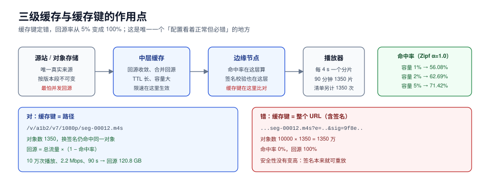

# 分发：缓存键、回源率与预热

分发这一段只做一件事：**让分片尽量从离观众最近的节点出去，尽量不回源**。它看起来是「配 CDN」，实际是两个技术决定加一个运营动作：缓存键怎么定、边缘要不要鉴权、什么时候预热。

三个决定里，**缓存键定错一次，回源率立刻从 5% 变成 100%**，而且是那种「配置看起来完全正常」的错。



本页判据族 `MDL-A` ~ `MDL-H`，共 8 条。定义表见文末「本页判据」一节。

## 一、缓存键：什么进键、什么必须剔除

CDN 的缓存键就是「哪些请求算同一个对象」。视频链路的正确键几乎永远只有**路径**：

```text
正确：  GET /v/a1b2c3/v7/1080p/seg-00012.m4s
        key = /v/a1b2c3/v7/1080p/seg-00012.m4s

错误：  GET /v/a1b2c3/v7/1080p/seg-00012.m4s?e=1793000000&sig=9f8e...
        key = 整个 URL（含 e 与 sig）→ 每个观众每个分片都是新对象
```

错误版本的后果可以精确算。假设 10,000 个观众看同一部 90 分钟的片子（1350 个分片）：

| 缓存键 | 对象数 | 命中率 | 回源 |
| --- | --- | --- | --- |
| 只有路径 | 1350 | 按热度该有 56%~88% | 12%~44% |
| 含签名参数 | 10,000 × 1350 = **1350 万** | **0%** | **100%** |

所以签名参数的正确位置是：**校验用，不进键**。多数 CDN 支持「忽略指定 query 参数」的配置（`ignore query` 白名单或黑名单），这一条必须写进配置并纳入验收。

::: danger 缓存键的四个常见错误
1. **把 `?e=&sig=` 留在键里**（上面这一条）——命中率归零。
2. **把 `Range` 头算进键**。正确做法是**分片级**缓存（每个分片一个对象），而不是对整个 MP4 做 Range 缓存；后者会让同一个对象被切成几十份部分缓存，命中率随拖动位置分散。
3. **把 `User-Agent`、`Referer` 算进键**。移动端 UA 千差万别，键会膨胀到和观众数同阶。
4. **不把版本段算进键**。给清单加了版本段却不给分片加，重新转码后新旧分片混在同一个键下，出现「同键不同内容」的花屏。
:::

## 二、回源率：热度分布决定天花板

回源率不是「优化出来的」，它由**内容热度分布**和**缓存容量**决定。用 Zipf 分布（α 越大越集中）模拟 20,000 个对象：

| α（集中度） | 缓存容量 1% | 缓存容量 2% | 缓存容量 5% |
| --- | --- | --- | --- |
| 0.8（长尾极重） | 31.43% | 38.17% | 48.64% |
| 1.0（典型 UGC） | **56.08%** | 62.69% | 71.42% |
| 1.2（头部集中） | 78.74% | 83.31% | 88.45% |

三个结论：

1. **容量从 1% 翻到 5%，命中率只涨 15~17 个百分点**（α=1.0 时 56% → 71%）。缓存扩容的收益是**递减**的，把钱全花在扩容上不如花在「减少对象数」上。
2. **长尾内容的命中率有硬天花板**。α=0.8 时即使缓存 5% 也只有 48.64%——这类内容（冷门 UGC、老片）不适合靠缓存省流量，只能靠**降码率**或**按需转码**。
3. **α 是业务属性，不是可调参数**。头部内容平台（版权长片）α 高、缓存有效；UGC 长尾平台 α 低，缓存只能解决头部。

换算成流量：10 万次播放、每次 90 秒、平均 2.2 Mbps = **2417 GB** 出口。若命中率 85%，回源 **362.5 GB**；命中率 95%，回源 **120.8 GB**；命中率 99%，回源 **24.2 GB**。**回源流量才是成本里真正被缓存影响的部分**，而 CDN 侧出口（2417 GB）一分不少。

## 三、预热：只对「头部 + 定时发布」有意义

预热（preheat）是主动把对象推到边缘节点。它只在这两种场景划算：

| 场景 | 为什么值得 | 怎么预热 |
| --- | --- | --- |
| 头部新片定时上线 | 上线瞬间会有大量并发首播，冷启动回源风暴 | 上线前 30 分钟推**前 3 个分片 + 清单 + 各档 init** |
| 直播开场 | 开播瞬间所有观众同时拉流 | 提前推清单与首个分片，边缘保持长连接 |

反过来，**对长尾内容预热是纯浪费**：预热 1000 个分片，实际只有 3 个被请求，剩下 997 个占着边缘缓存把热内容挤出去，命中率反而下降。

预热的最小集合（按一部 90 分钟片、5 档算）：

```text
master.m3u8                    × 1
1080p|720p|480p|360p|240p/index.m3u8  × 5
各档 init.mp4                  × 5
各档前 3 个分片                × 15
合计 26 个对象
```

## 四、边缘鉴权：校验放在哪一层

签名 URL 需要在某一层被校验。三个位置各有代价：

| 位置 | 做法 | 延迟 | 安全性 | 问题 |
| --- | --- | --- | --- | --- |
| 边缘（CDN 回源鉴权） | CDN 拿签名去源站换一次「放行」 | 首次 +1 RTT，之后走缓存 | 中（源站压力大） | 每个 miss 都要回源鉴权，回源率被放大 |
| 边缘（CDN 本地校验） | CDN 用共享密钥自己算 HMAC | 无额外 RTT | 高 | 密钥要下发到边缘；时钟必须同步 |
| 播放器前置（业务网关发短时 token） | 网关签发短时 token，CDN 校验 token | +1 RTT（一次） | 高 | token 生命周期与播放时长要匹配 |

HMAC 的成本可以忽略：单次 **3.79 µs**（单核），1 万次/秒只占 **3.8%** 单核。所以「边缘校验会不会太贵」不是问题，**真正的问题是时钟**：签名里带过期时间，边缘与签发端的时钟偏差超过容差就会 403。容差一般给 5~10 分钟，且两侧都必须走 NTP。

## 五、HTTP/2 与 HTTP/3：小文件多的链路收益明显

视频交付的请求特征是「**大量小对象**」：1350 个分片 + 1350 次清单刷新。这种形态下：

- **HTTP/1.1**：每域名 6 个并发连接，1350 个分片要排队；队头阻塞明显。
- **HTTP/2**：单连接多路复用，但 TCP 层队头阻塞仍在（一个包丢了，所有流等）。
- **HTTP/3（QUIC）**：流级独立，丢包只影响单流；对移动网络（丢包率 1%~5%）收益最大。

实践结论：**分片越小、网络越差，HTTP/3 的收益越大**；在内网/专线（丢包 ≈ 0）几乎无差别。开启 HTTP/3 的成本主要在证书与 UDP 端口放行，通常值得。

## 六、回源保护：三道闸

源站被回源打挂，是视频业务里最常见的雪崩形态。三道闸按顺序上：

1. **合并回源（collapsed forwarding）**：同一对象在边缘的并发 miss 只放一个请求回源，其余等待。没有它，热门新片上线瞬间会有「观众数 × 分片数」量级的并发回源。
2. **回源限速与队列**：给每个源站设置 QPS 上限，超出的请求在边缘排队或直接返回 503（让播放器重试另一个档）。
3. **降级档**：源站压力过大时，把清单里的高档位临时摘掉（只留 480p 及以下），用「清晰度换可用性」。

::: warning 降价不能靠改清单
临时改清单（删高档）会导致**已经在播的会话**切档失败（它们的播放列表里还有高档）。正确做法是让边缘对高档返回 302 到一个低档分片，或直接用「源站限速 + 播放器自动降档」。
:::

## 七、验证方式

```shell
# 1) 缓存键是否剔除了签名参数：同一分片用两个不同签名请求，看 X-Cache
curl -sI "https://cdn.example.com/v/a1b2/v7/1080p/seg-00012.m4s?e=1&sig=aaa" | grep -i x-cache
curl -sI "https://cdn.example.com/v/a1b2/v7/1080p/seg-00012.m4s?e=2&sig=bbb" | grep -i x-cache
# 预期：第二次为 HIT（若第一次是 MISS）；若两次都 MISS，说明签名进了键

# 2) 回源率：从 CDN 日志算（按小时）
# 预期：头部内容 hit_ratio > 90%，长尾内容按 Zipf 曲线落在 30%~60%

# 3) 分片是否被当作独立对象缓存（而不是整文件 Range）
curl -sI "https://cdn.example.com/v/a1b2/v7/1080p/seg-00012.m4s" | grep -iE "content-length|accept-ranges"
# 预期：Content-Length 约等于「4 s × 码率 / 8」，不是整个视频大小

# 4) 预热是否生效
for p in master.m3u8 1080p/index.m3u8 1080p/seg-00000.m4s; do
  curl -s -o /dev/null -w "%{http_code} %{time_total}\n" "https://cdn.example.com/v/a1b2/v7/$p"
done
# 预期：三个对象都在 100 ms 内返回（边缘命中），而不是 300 ms+（回源）
```

## 本页判据

| 编号 | 判据 | 看什么现象 | 不满足时改哪里 |
| --- | --- | --- | --- |
| `MDL-A` | 缓存键只含路径（+版本段） | 换签名后第二次请求返回 HIT | 配置忽略 `e`/`sig` 等参数 |
| `MDL-B` | 分片是独立缓存对象 | `Content-Length` ≈ 单分片大小 | 改成分片级对象，不用整文件 Range |
| `MDL-C` | 回源率有基线并按内容分层 | 头部 > 90%，长尾符合 Zipf 预期 | 按热度分层设置 TTL 与容量 |
| `MDL-D` | 预热只覆盖头部与定时发布 | 预热清单有明确对象列表 | 按第三节 26 个对象的最小集 |
| `MDL-E` | 鉴权位置明确且时钟同步 | 边缘校验或网关签发，二选一并写清 | 加 NTP，容差 5~10 分钟 |
| `MDL-F` | 对源站有合并回源与限速 | 源站 QPS 有上限，miss 有合并 | 开 collapsed forwarding + 限速 |
| `MDL-G` | 降级路径不破坏在播会话 | 降档靠播放器自适应或 302 | 不要热改清单删档 |
| `MDL-H` | 传输层与请求特征匹配 | 小分片 + 移动网络时启用 HTTP/3 | 开 QUIC，放行 UDP |

## 参考资料

- RFC 9111, *HTTP Caching*（缓存键与 `Vary` 的语义）：<https://www.rfc-editor.org/rfc/rfc9111>
- RFC 9114, *HTTP/3*：<https://www.rfc-editor.org/rfc/rfc9114>
- AWS CloudFront, *Caching content based on query string parameters*：<https://docs.aws.amazon.com/AmazonCloudFront/latest/DeveloperGuide/QueryStringParameters.html>
- Apple, *HLS Authoring Specification*（清单与分片的缓存建议）：<https://developer.apple.com/documentation/http_live_streaming/hls_authoring_specification_for_apple_devices>
