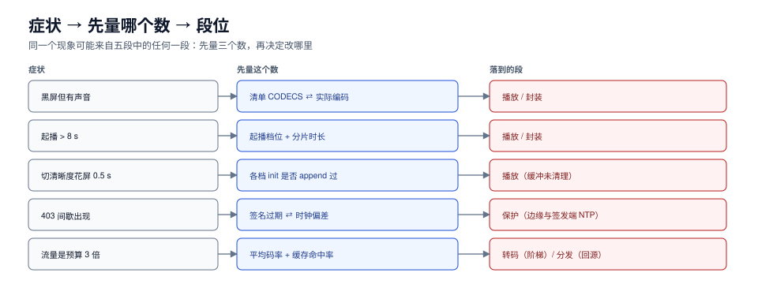

# 常见问题与分诊

这一页是排障入口。音视频的症状有个共同特点：**同一个现象可能来自五段中的任何一段**，所以先分诊、再动手，比「先改编码参数」省一天时间。



本页判据族 `MDF-A` ~ `MDF-H`，共 8 条。定义表见文末「本页判据」一节。

## 一、症状分诊表

按「先看哪一段」排序，左列是症状，右列是三步定位法。

| 症状 | 第一步看 | 第二步看 | 最可能的段 |
| --- | --- | --- | --- |
| 黑屏但有声音 | 浏览器控制台有没有 `NotSupportedError` | 清单 `CODECS` 与实际编码是否一致 | 播放 / 封装 |
| 起播 > 8 s | 起播档位是不是最高档 | 分片是不是 6 s 以上 | 播放 / 封装 |
| 播到中段必卡一次 | 卡点是否固定在同一个时间 | 该时间点附近的分片是否异常大 | 转码 / 封装 |
| 切清晰度花屏 0.5 s | 各档 `init` 段是否都 append 过 | 各档时间基是否一致 | 播放 / 封装 |
| 拖动后转圈不止 | 目标分片是否 404 | 清单是否已过 `EXT-X-ENDLIST` | 分发 |
| 清单 404 但分片正常 | 对象键里有没有版本段 | 清单是否被覆盖写 | 封装 / 分发 |
| 403 间歇出现 | 签名过期时间与当前时钟差 | 边缘与签发端时钟是否同步 | 保护 |
| 音画不同步（越播越偏） | 帧率是否按 `30000/1001` 处理 | 切片拼接后总时长是否漂移 | 转码 / 封装 |
| 字幕乱码或时间轴错位 | 字幕编码（UTF-8 vs GBK） | `X-TIMESTAMP-MAP` 是否正确 | 封装 |
| 只有低清档可选 | 高档分片是否生成 | 高档是否被边缘降级拦截 | 转码 / 分发 |
| 流量是预算的 3 倍 | 平均码率 vs 预估 | 缓存命中率 | 转码 / 分发 |
| iOS 能播、安卓不能 | 是否只有 TS 而没有 fMP4 | 是否用了 HLS 独有的标签 | 封装 |

## 二、三个「先量一下再改」的动作

排障最容易犯的错是**直接改参数**。改之前先量三个数，能省掉大半试错：

```shell
# ① 关键帧间隔（决定「切档/拖动是否花屏」）
ffprobe -v error -select_streams v:0 -skip_frame nokey -show_entries frame=pts_time \
  -of csv=p=0 seg-*.m4s | awk -F, 'NR>1{print $1-prev}{prev=$1}' | sort -u
# 输出多个值 → C2 契约破了，先修这个，别改播放器

# ② 分片大小分布（找「异常大的那一片」）
ls -l */seg-*.m4s | awk '{print $5}' | sort -n | awk '{a[NR]=$1} END{print "min",a[1],"p50",a[int(NR/2)],"max",a[NR]}'

# ③ 缓存命中（决定「流量为什么这么高」）
curl -sI "https://cdn.example.com/v/a1/v7/1080p/seg-00001.m4s?sig=x" | grep -i x-cache
```

## 三、十二问

1. **「能播」和「播得好」差在哪？** 能播只需要清单与分片可达；播得好需要分片边界对齐、起播档位合理、ABR 有缓冲意识。
2. **为什么同一部片子在 iOS 好、安卓差？** iOS 原生 HLS（走系统解码器），安卓多数走 MSE + hls.js，两条实现的缓冲策略与错误恢复完全不同。
3. **分片到底该 2 s 还是 6 s？** 点播 4~6 s、直播 2 s、低延迟 0.2~0.5 s（part）。这个数决定起播、请求数、切档粒度三件事，没有「正确答案」。
4. **GOP 是不是越短越好？** 不是。GOP 2 s 相对 6 s 的 IDR 开销从 3.9% 涨到 11.7%，且 seek 精度收益在 2 s 之后迅速递减。
5. **为什么加了 CDN 反而更慢？** 常见两个原因：回源首包慢（缓存未命中且源站远）、HTTP/2 单连接队头阻塞（大分片 + 丢包）。
6. **签名 URL 会不会让 CDN 失效？** 会——如果签名进了缓存键。正确做法是签名只做校验、不进键。
7. **AV1 能省多少？** 同质量约省 40%~50% 码率，但只有「能解 AV1 的设备占比」够高时才能兑现；否则要维护回退档，实际收益打折。
8. **为什么要两份清单（HLS + DASH）？** 因为苹果生态只认 HLS、部分安卓/电视只认 DASH；CMAF 让两者共用同一份分片，只多写一份清单。
9. **卡顿率 0.3% 是不是很好？** 要看分母。0.3% 的会话有卡顿 = 很好；0.3% 的请求卡顿 = 可能意味着 5% 的会话在卡。
10. **转码为什么要切片段并行？** 长片单片编码太慢；切片并行的前提是每片强制关键帧且时间基统一，否则拼接后出问题。
11. **DRM 上了就不用防盗链了吗？** 不是。DRM 管内容解密，签名管「谁能取分片」，两者解决不同问题，通常要一起上。
12. **预算是按码率算还是按流量算？** 按流量（= 码率 × 时长），所以「降码率」与「降观看时长」是仅有的两个杠杆；缓存只影响回源费。

## 四、五条「听起来对」的错误建议

| 建议 | 为什么听起来对 | 为什么错 |
| --- | --- | --- |
| 「把分片改小，起播就快了」 | 起播缓冲 = 片数 × 时长，确实变小 | 请求数按比例涨（2 s 分片每小时 1800 次），清单刷新也涨；弱网下小分片的请求开销反而拖慢起播 |
| 「GOP 设 1 秒，seek 最快」 | IDR 越密，seek 越准 | IDR 开销从 3.9% 涨到 20%+，码率涨了但画质没涨，成本全花在关键帧上 |
| 「缓存键加上签名更安全」 | 不同签名不同对象，看起来更严格 | 签名是可重放的，安全性没提高；命中率直接归零，回源 100% |
| 「用最高档起播，画质第一」 | 观众第一眼就是高清 | 起播在最没有缓冲的时刻选最贵的档，高概率「先卡再降」，体感更差 |
| 「卡顿率看均值就行」 | 均值直观 | 均值把「少数人卡很多次」抹平；必须同时报受影响会话占比与次数 p95 |

## 五、14 项上线自查

交付前逐项打勾，任何一项为「否」都不要上线：

| # | 自查项 | 判定方式 |
| --- | --- | --- |
| 1 | 分片边界落在 IDR 上 | 每片首帧是关键帧 |
| 2 | 分片时长是 GOP 整数倍 | `分片 / GOP` 为整数 |
| 3 | IDR 间隔恒定 | `ffprobe` 关键帧间隔只有一个值 |
| 4 | 转码关了场景切换插帧 | 参数里有 `sc_threshold 0` |
| 5 | 清单字段完整 | `TARGETDURATION`/`MAP`/`ENDLIST` 齐备 |
| 6 | 分片路径带版本段 | 路径里有 `encode_version` |
| 7 | 缓存键不含签名 | 换签名第二次请求 HIT |
| 8 | 签名绑定路径与档位 | 换路径/换档返回 403 |
| 9 | 密钥 URI 需鉴权 | 裸请求 key 返回 403 |
| 10 | 起播档位有依据 | 记忆或首片探测，不是盲选最高 |
| 11 | 缓冲上限有界并会 remove | `buffer_level` 稳定在 20~40 s |
| 12 | 四类埋点齐备 | 能复原「卡之前的水位与档位」 |
| 13 | QoE 三口径可算 | 起播分位、卡顿三数、平均码率 |
| 14 | 成本可双向核对 | 流量反算与埋点偏差 < 10% |

## 六、止损顺序：出事了先做哪一步

线上事故的正确顺序是「先保住能看，再查原因」：

1. **降档**：把清单里的高档临时摘掉，或让边缘对高档返回低档（不要热改清单，见[分发](../Delivery/index.md)第六节）。
2. **扩缓存 / 加节点**：如果是回源打满，先开合并回源与限速。
3. **换 CDN 线路**：如果是单一线路故障，切备用 CNAME。
4. **回滚版本**：如果刚发过新版本，把清单切回旧 `encode_version`（分片天然隔离）。
5. **最后才查编码参数**：编码问题几乎不会导致「突然全挂」，它通常是「一直有点糊」。

::: danger 三条排障纪律
1. **先量再改**。改一个参数之前，先把关键帧间隔、分片大小分布、命中率三个数记下来，否则改完不知道有没有用。
2. **一次只改一处**。同时改分片时长和 GOP，出了问题无法归因。
3. **不要在生产上试编码参数**。转码是长任务且结果会被缓存，试错成本按小时算。
:::

## 本页判据

| 编号 | 判据 | 看什么现象 | 不满足时改哪里 |
| --- | --- | --- | --- |
| `MDF-A` | 症状能指到段位 | 每次排障结论能落到五段之一 | 按第一节分诊表走 |
| `MDF-B` | 改参数前有三个读数 | 关键帧间隔/分片分布/命中率已记录 | 先跑第二节三条命令 |
| `MDF-C` | 分片时长有业务依据 | 能说出「为什么是 4 s」 | 按封装章曲线选点 |
| `MDF-D` | GOP 与 IDR 开销有账 | 能算出 IDR 带来的码率占比 | 按封装章表格算 |
| `MDF-E` | 签名不进缓存键 | 换签名命中同一对象 | 改 CDN 配置 |
| `MDF-F` | QoE 分母唯一 | 指标字典写清分母 | 统一为会话/播放/请求三类 |
| `MDF-G` | 上线自查 14 项全过 | 14 项都有结论 | 按第五节逐项打勾 |
| `MDF-H` | 止损有顺序 | runbook 里有降档→扩容→切线路→回滚 | 按第六节写 |

## 参考资料

- Apple, *HLS Authoring Specification*（上线前必读的编码与清单要求）：<https://developer.apple.com/documentation/http_live_streaming/hls_authoring_specification_for_apple_devices>
- RFC 8216, *HTTP Live Streaming*：<https://www.rfc-editor.org/rfc/rfc8216>
- hls.js, *Error Handling*（`MANIFEST_PARSING_ERROR` 等错误码的实际含义）：<https://github.com/video-dev/hls.js/blob/master/docs/API.md>
- FFmpeg, *FFmpeg Formats Documentation — hls*：<https://ffmpeg.org/ffmpeg-formats.html#hls-2>
