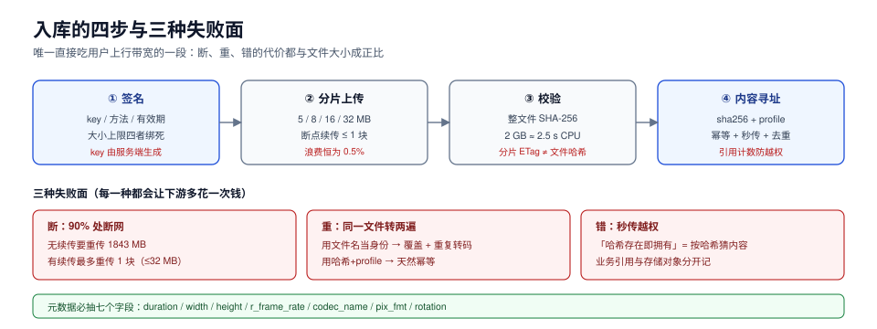

# 入库：上传、校验与内容寻址

入库这一段只做四件事：**把字节收下来、确认没坏、给它一个不重复的身份、把元数据抽出来**。听起来简单，但它是整条链路里**唯一一段会直接吃用户上行带宽**的环节，所以它的失败模式和其他四段完全不同：不是「慢了」，而是「断了要重来」「传了两遍」「同名文件互相覆盖」。

这一页讲四个决定：直传还是中转、分片多大、用什么校验、身份怎么定义。



本页判据族 `MDI-A` ~ `MDI-H`，共 8 条。定义表见文末「本页判据」一节。

## 一、直传还是中转

| 方案 | 链路 | 优点 | 代价 | 什么时候必须用 |
| --- | --- | --- | --- | --- |
| 中转 | 客户端 → 业务服务器 → 对象存储 | 服务器能看全量字节，可做实时转码/审核 | 带宽与磁盘都被业务服务器吃掉，扩容按峰值算 | 需要**边传边处理**（如实时截帧审核） |
| 直传 | 客户端 → 对象存储（凭预签名） | 业务服务器只签名，不碰字节 | 服务器看不到内容，只能靠上传后回调 | 大文件、高并发上传（绝大多数场景） |

直传的关键是**签名的作用域**。一张预签名 URL 至少要把四件事绑死：

1. **对象键**：签名只对这一个 key 有效，不能让客户端自己拼 key。
2. **方法**：`PUT` 与 `POST` 不能混用。
3. **有效期**：大文件至少给到「最慢上行 × 文件大小」的 1.5 倍，常见 30~60 分钟。
4. **内容类型与大小上限**：能绑就绑，否则签名 URL 会变成任意文件上传通道。

::: danger 签名的三个常见错误
1. **把 key 交给客户端拼接**。一旦 key 由前端生成，攻击者可以把 key 写成别人的前缀，实现**覆盖写**。正确写法是服务端生成 key（含租户前缀与随机段），客户端只能往这个 key 里写。
2. **有效期给 7 天**。签名 URL 在有效期内是**无身份凭证**——任何人拿到都能写。正确写法是按「本次上传会话」发，用完即废（回调里把 `upload_id` 标记完成）。
3. **不校验实际大小**。签名里声明 `content-length-range`，否则一个 10 KB 的签名可以推 10 GB 上来，账单和存储都爆。
:::

## 二、分片多大：三个数的兑换

分片上传（multipart upload）要同时优化三件事：**请求数、重传浪费、续传粒度**。它们互相拉扯，所以「最优点」取决于失败率。

设文件 2 GB、每块失败概率 0.5%，期望重传量 = 文件大小 × `p/(1-p)` ≈ **0.5%**，与块大小无关；真正随块大小变的是另外两个数：

| 块大小 | 块数（2 GB） | 所需请求数 | 期望失败块数 | 单块失败损失 | 续传粒度 |
| --- | --- | --- | --- | --- | --- |
| 5 MB | 410 | 410 | 2.05 | 5 MB | 5 MB |
| 8 MB | 256 | 256 | 1.28 | 8 MB | 8 MB |
| 16 MB | 128 | 128 | 0.64 | 16 MB | 16 MB |
| 32 MB | 64 | 64 | 0.32 | 32 MB | 32 MB |

读法：

- **期望浪费与块大小无关**（都是 0.5%，约 10.3 MB）。这条常被误解成「块越小越省」，其实不是——块小只是把浪费摊到更多次上。
- **块越大，请求越少、单次失败越贵**。32 MB 块失败一次要重传 32 MB；5 MB 块失败一次只丢 5 MB，但请求数是 8 倍。
- **续传粒度才是真正的分水岭**。传到 90% 时断网：没有断点续传要重传 **1843 MB**，有续传最多重传 **32 MB**（一个块）。

实践取值：**移动端 5~8 MB，桌面端 8~16 MB，专线/内网 32 MB**。低于 5 MB 会撞上对象存储的最小块限制（S3 兼容接口通常要求除最后一块外每块 ≥ 5 MB），高于 32 MB 会让「重传一块」的代价超过「重开一次」的收益。

## 三、校验：算谁的哈希、算几次

上传完成后必须回答一个问题：**服务端拿到的字节，和客户端发出的字节是不是同一份**。三种做法各有代价：

| 做法 | 客户端成本 | 服务端成本 | 能发现什么 | 漏掉什么 |
| --- | --- | --- | --- | --- |
| 只信 `Content-Length` | 0 | 0 | 截断 | 内容被替换、位翻转 |
| `Content-MD5`（单次 PUT） | 一次全文件 MD5 | 一次全文件 MD5 | 位翻转、截断 | 中间人替换（可伪造长度与 MD5） |
| 分片校验 + 整体校验 | 每块一次 + 一次整体 | 每块一次 + 一次整体 | 上述全部 | — |

成本可以算：1 MiB 的 MD5 单次约 **1.24 ms**（单核），2 GB 文件约 **2.54 s**；SHA-256 通常是它的 1.5~2 倍。这个成本在服务端是**每文件一次**，可接受；但把它放在**每个分片**上就会变成 410 次小哈希，累计开销与整体哈希相当，收益却只有「更早发现坏块」。

::: warning 分片上传的 ETag 不是文件 MD5
S3 兼容接口对分片上传返回的 `ETag` 形如 `<md5>-<块数>`，它是**各块 MD5 再取 MD5**，不是整个文件的 MD5。用它做「内容哈希」会在「同一文件用不同块大小上传」时得到不同值——秒传与去重会因此失效。要自己算整文件 SHA-256，或在上传完成后由服务端合并计算并存进元数据。
:::

## 四、身份：文件名不行，内容哈希才行

「同一个文件被转码两遍」是入库段最贵的 bug：转码是 CPU 密集的长任务，重复一次就是一次完整的 CPU 账单，而封面、字幕、清单还会互相覆盖。

身份必须是**内容哈希 + 转码配置**的组合：

```text
asset_id = sha256(source_bytes)[0:16]  +  "-"  +  profile_id
```

三个直接后果：

1. **幂等**：同一文件重复提交，返回同一个 `asset_id`，转码任务用 `ON CONFLICT DO NOTHING` 跳过。
2. **秒传**：客户端先算哈希问一句「有没有」，有就直接建立引用，一个字节都不用传。
3. **去重收益可算**：同一份素材被不同用户上传 N 次，存储与转码只花 1 次的钱。

但秒传带来一个**必须一起解决**的问题：**内容寻址与权限的耦合**。如果「哈希存在即秒传」，那么知道哈希的人就能「拥有」这个文件——这等于给了一个「按哈希猜内容」的接口。

::: danger 秒传的正确姿势
- **不要把「已存在」直接等同于「你有权访问」**。秒传只能复用**存储对象**，业务侧的引用（谁拥有这个 asset）必须单独建一条记录。
- **跨租户不共享对象键的可见性**：对象键里带租户前缀（`t/<tenant>/sha256/ab/abcdef...`），物理上同一份字节可复用（后端做引用计数），但业务上永远不跨租户暴露「这个哈希已存在」。
- **删除要引用计数**：A 用户删了自己的引用，不能把 B 用户还在用的字节删掉。
:::

## 五、元数据：ffprobe 要抽哪几个字段

入库时抽出元数据，下游三段都要用。必抽字段与用途：

| 字段 | 例子 | 谁在用 | 抽不到的后果 |
| --- | --- | --- | --- |
| `duration` | `542.4` | 分片切割、QoE 分母 | 进度条与实际不符 |
| `width` / `height` | `1920` / `1080` | 阶梯上限、封面裁剪 | 给 480p 源做 1080p 档，糊 |
| `r_frame_rate` | `30000/1001` | 时间基、GOP 换算 | 29.97 被当 30，长片音画不同步 |
| `codec_name` / `profile` | `h264` / `High` | 决定是否需要重编 | 已合规的源被无意义重编 |
| `pix_fmt` | `yuv420p10le` | 决定是否降位深 | 10 bit 源直接切，老设备黑屏 |
| `rotation` | `90` | 手机竖拍必须转 | 画面躺倒 |
| `bit_rate` | `8421000` | 阶梯起点 | 低码率源被抬高码率，画质不会变好 |

两个容易漏的点：

1. **`r_frame_rate` 是分数，不是小数**。`30000/1001` 是 29.97，用 `30` 去算时长，542 秒会差出 **0.5 秒**以上，长片更明显。
2. **旋转在容器层，不在像素里**。手机竖拍文件的 `rotation=90` 只是个元数据标记，播放器会自动转；如果转码时既没应用旋转又**保留**了标记，就会转两次——横过来。

## 六、上传过程中的可观测点

入库段要能回答四个问题，每个对应一个埋点：

| 问题 | 埋点 | 判定 |
| --- | --- | --- |
| 传完了吗 | `upload_id` + 已完成块数 / 总块数 | 块数齐了但没 `complete` → 卡在合并 |
| 传得慢在哪 | 每块的开始/结束时间 | 首块慢 = 建连/鉴权慢；后段慢 = 带宽降了 |
| 坏在哪 | 每块校验结果 | 集中在某块 = 网络；全坏 = 客户端实现错 |
| 重传了多少 | 每块尝试次数 | 尝试次数 > 块数的 1.2 倍 → 客户端重试策略有问题 |

## 七、实战取舍：一次上传的完整状态机

```text
initiated ──(签名)──> uploading ──(所有块 OK)──> completed
   │                     │                          │
   │                     ├─(超时/主动取消)──> aborted
   │                     └─(校验失败)──────> failed ──(重试 ≤3)──> uploading
   └─(签名过期)──> expired（需重新 initiated）
```

三个约束：

1. **`aborted` 必须真的释放已上传块**，否则对象存储里会留一堆孤儿分片，按月计费。
2. **`completed` 之后不可再写**，任何修改都是新 `asset_id`（这也是内容寻址的意义）。
3. **`failed` 的重试要换签名**，不要复用同一张 URL——复用会把「失败」变成「权限错误」，掩盖真实原因。

## 八、验证方式

```shell
# 1) 幂等：同一文件连续提交两次，asset_id 必须相同
curl -s -X POST https://api.example.com/assets -F "file=@sample.mp4" -F "profile=web-hd" | jq -r .asset_id
curl -s -X POST https://api.example.com/assets -F "file=@sample.mp4" -F "profile=web-hd" | jq -r .asset_id
# 预期：两行输出完全一致

# 2) 秒传：第二次上传应直接返回，不再产生 PUT 请求
# 预期：对象存储侧该 key 的 PUT 次数仍为 1

# 3) 校验：故意篡改一个字节后上传，应失败
cp sample.mp4 tampered.mp4 && printf '\x00' | dd of=tampered.mp4 bs=1 seek=1024 count=1 conv=notrunc
curl -s -o /dev/null -w '%{http_code}\n' -X POST https://api.example.com/assets -F "file=@tampered.mp4"
# 预期：400/422，且错误信息指向校验失败，而不是「未知错误」

# 4) 元数据：抽出来的字段与 ffprobe 一致
ffprobe -v error -select_streams v:0 -show_entries stream=width,height,r_frame_rate,codec_name -of csv=p=0 sample.mp4
# 预期：与 /assets/{id} 返回的 width/height/fps/codec 一致
```

## 本页判据

| 编号 | 判据 | 看什么现象 | 不满足时改哪里 |
| --- | --- | --- | --- |
| `MDI-A` | 走直传，业务服务器不碰字节 | 上传期间业务实例的出网带宽平稳 | 改成预签名 + 客户端直传 |
| `MDI-B` | 签名绑定 key/方法/有效期/大小上限 | 签名 URL 里能读出这四个约束 | 服务端生成 key，加 `content-length-range` |
| `MDI-C` | 分片大小在 5~32 MB 且可配 | 客户端配置里有明确值，不是默认值 | 按终端类型定 5/8/16/32 MB |
| `MDI-D` | 支持断点续传 | 断网后可只重传 1 个块 | 记录已完成块列表，续传前 `listParts` 对齐 |
| `MDI-E` | 身份 = 内容哈希 + profile | `asset_id` 能由文件与配置推出来 | 换成 `sha256 + profile_id`，加唯一索引 |
| `MDI-F` | 秒传不越权 | 秒传后业务侧仍有独立引用记录 | 引用计数 + 租户前缀，禁用跨租户「哈希存在」提示 |
| `MDI-G` | 元数据抽全七个字段 | `/assets/{id}` 返回里有 duration/fps/codec/rotation | 用 ffprobe 抽，分数帧率保留分子分母 |
| `MDI-H` | 上传有四类埋点 | 能回答「传完了/慢在哪/坏在哪/重传多少」 | 按第六节表格补埋点 |

## 参考资料

- AWS S3, *Uploading objects using multipart upload*（分片限制与 ETag 语义）：<https://docs.aws.amazon.com/AmazonS3/latest/userguide/mpuoverview.html>
- Apple, *HLS Authoring Specification*（源文件与编码建议）：<https://developer.apple.com/documentation/http_live_streaming/hls_authoring_specification_for_apple_devices>
- FFmpeg, *ffprobe Documentation*：<https://ffmpeg.org/ffprobe.html>
- RFC 1864, *The Content-MD5 Header Field*：<https://www.rfc-editor.org/rfc/rfc1864>
