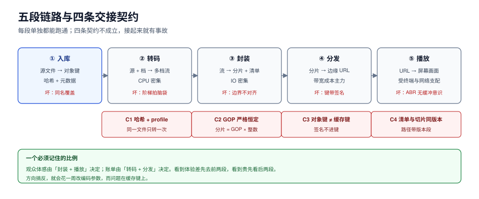

# 总览：五段链路与四条交接契约

一条视频从「创作者点上传」到「观众看到第一帧」，中间经过五段：**入库 → 转码 → 封装 → 分发 → 播放**。把五段分别测一遍，每段都能跑通；把它们串起来，最常见的产出是「能播，但起播 8 秒、拖到中段卡一下、切清晰度花屏、月底账单是预算的 3 倍」。

原因不在某一段的实现，而在**段与段之间的契约**。这一页给的是全局图、四条契约、以及每一类线上现象该由哪一段负责。



本页判据族 `MDO-A` ~ `MDO-H`，共 8 条。定义表见文末「本页判据」一节。

## 一、五段各管什么，各自怎么坏

| 段 | 输入 → 输出 | 耗时/成本特征 | 这一段坏了的典型症状 | 对应章节 |
| --- | --- | --- | --- | --- |
| 入库 | 原始文件 → 对象键 + 元数据 + 内容哈希 | 与文件大小线性相关，受上行带宽支配 | 上传总断、同一文件转码两遍、封面是黑的 | [入库](../Ingest/index.md) |
| 转码 | 源文件 + profile → 若干档码率的编码流 | CPU 密集、长任务、可并行切片 | 高码率档糊、低码率档反而更清晰、账单集中在转码 | [转码](../Transcoding/index.md) |
| 封装 | 编码流 → 分片 + 清单 | IO 密集、几乎不耗 CPU | 起播慢、切档花屏、拖动后音画不同步 | [封装](../Packaging/index.md) |
| 分发 | 分片 + 清单 → 边缘可取的 URL | 带宽成本的主战场 | 回源率异常、403 间歇出现、首包慢 | [分发](../Delivery/index.md) |
| 播放 | URL → 屏幕上的画面 | 受终端与网络支配 | 卡顿、切档抖动、seek 失败、字幕乱码 | [播放](../Playback/index.md) |

**一个必须先记住的比例**：五段里真正决定「观众体感」的只有**封装与播放**两段，但决定「账单」的是**转码与分发**两段。所以看到「体验差」先去封装/播放，看到「贵」先去看阶梯与命中率——搞反方向会白改一周。

## 二、四条交接契约，每条都有一个默认错误

段与段之间的契约，是事故最喜欢藏的地方：**两边各自都对，接起来就错**。

| 编号 | 契约 | 默认错误 | 后果 | 怎么钉死 |
| --- | --- | --- | --- | --- |
| C1 | 入库 → 转码：`source_sha256` + `profile_id` 唯一确定一个 `asset_id` | 用文件名或上传时间做幂等键 | 同一文件被转两遍，账单翻倍、封面互相覆盖 | 幂等键 = 内容哈希 + profile；重复提交返回同一个 `asset_id` |
| C2 | 转码 → 封装：**关键帧间隔必须严格恒定，且时间基固定** | 编码器用「场景切换自动插 IDR」 | 分片边界找不到关键帧，被迫补 IDR，码率抖动 | 转码时锁 `-g` 与 `-keyint_min`，并关掉场景切换插帧 |
| C3 | 封装 → 分发：**对象键 ≠ 缓存键** | 把签名参数留在 URL 里直接当缓存键 | 命中率归零、回源等于全量 | 缓存键只取路径（+ 必要的版本段），签名参数一律忽略 |
| C4 | 分发 → 播放：清单版本与切片命名必须能一起回滚 | 只回滚清单、切片被覆盖 | 播放器拿到新清单指向旧切片，花屏或 404 | 切片路径带内容版本段，清单整体切换，旧版本保留一个窗口 |

四条契约里，C2 与 C3 是最容易被判成「实现细节」而漏掉的。它们都不是细节：

- **C2 的代价可以量化**。GOP 2 s 配分片 4 s，60 秒里 30 个 IDR，相对码率开销 **+11.7%**；GOP 4 s 配分片 4 s 只 15 个 IDR、开销 **+5.8%**。如果 GOP 是 3 s 而分片是 4 s，IDR 间隔会在 **1/2/3 s** 之间抖动——播放器按「每片 4 s」估算缓冲，实际解码帧数忽多忽少，这就是「同一网络下有时卡有时不卡」的来源。
- **C3 的代价更大**。按 Zipf α=1.0 的热度分布、缓存容量为对象总数的 1%，理论上该有 **56.08%** 的命中率；一旦签名参数进了缓存键，每个观众的每个分片 URL 都唯一，命中率 **0%**，回源流量等于全部播放流量。

## 三、一次播放的请求时间轴

把五段摊在一次播放里，才能看出「起播慢」到底慢在哪：

```text
t=0      播放器解析主清单（master playlist）        ← 1 次请求，KB 级
t=80ms   选档（默认或按上次记忆），拉媒体清单        ← 1 次请求
t=160ms  取第 1 个分片（按 480p 1 Mbps、2 Mbps 带宽估算 ≈ 0.5 s）
t=660ms  取第 2 个分片
t=1.2s   取第 3 个分片 → 缓冲 12 s（4 s × 3 片）→ 可以起播
t=1.3s   首帧上屏；同时开始按带宽选下一档
```

三个读法：

1. **起播时间 ≈ 清单往返 + 「起播缓冲片数 × 分片时长 ÷ 有效带宽」**。分片从 4 s 改成 2 s，起播缓冲从 12 s 变 6 s（起播快一倍），但每小时请求数从 900 变 1800（翻倍）。**这条曲线没有最优点，只有取舍点**。
2. **清单刷新的次数被分片时长放大**。90 分钟的片子、2 s 分片 = 2700 个切片、清单至少刷新 2700 次；改成 6 s 分片是 900 次。清单请求很小，但它是**串行依赖**：每次刷新失败一次，播放器就要等一个 RTT。
3. **第 1 片的取用带宽决定了后面所有决策**。如果起播时盲选 1080p（4 Mbps）而实际带宽 2 Mbps，第 1 片要下 2 s、缓冲迟迟不满，播放器会先卡一下再跌落码率——**这就是「一进来就模糊一下」的根因**，不是编码问题。

## 四、四个必失点

所谓必失点，是不做就会有、而且不报错的东西。五段各一个（多出来的那个在「跨段」上）：

| 位置 | 必失点 | 为什么会失 | 一条可执行的守卫 |
| --- | --- | --- | --- |
| 入库 | 用文件名当身份 | 同名文件互相覆盖；不同名同内容转两遍 | 键 = `sha256/前两位/sha256`，元数据里另存原始文件名 |
| 转码 | 阶梯拍脑袋 | 所有片源用一张固定阶梯，简单内容被抬高码率（实测平均多花 **35.7%**，最坏单段 **1.82×**） | 阶梯必须来自「按片定码率」的实测，或至少按内容类型分两三套 |
| 封装 | 分片时长与 GOP 不成整数倍 | 边界处强制插 IDR，间隔抖动 | 分片时长 = GOP × k，且转码时锁死 GOP |
| 分发 | 缓存键带一次性参数 | 命中率归零 | 缓存键规则写成配置并纳入验收（见[分发](../Delivery/index.md)） |
| 跨段 | QoE 只有均值 | 均值掩盖长尾 | 会话级分位 + 受影响会话占比，见[体验与成本](../QoE/index.md) |

## 五、五问决策：先定这五件事，再选技术

音视频方案的分歧，八成不是因为选了哪个编码器，而是因为下面五个问题没答案：

1. **观众在哪**：国内/海外决定 CDN 与编码兼容策略；移动端占比决定低码率档的重要性。
2. **延迟要求**：点播（分钟级容忍）、准直播（10~30 s）、实时（< 1 s）是三套完全不同的架构，缓冲模型相反。
3. **内容形态**：UGC 长尾（数量大、单片观看少）与版权长片（数量少、单片观看多）对缓存与预热的要求相反。
4. **是否要 DRM**：不要 DRM 时签名 URL 就够；要 DRM 时密钥服务、许可证服务、设备等级都要进架构。
5. **成本上限**：出口单价 × 平均码率 × 观看时长 ≈ 成本，倒推能承受的平均码率，再倒推阶梯。

这五问的答案会互相冲突（比如「要 4K」与「成本上限」），冲突必须在方案阶段显式取舍，而不是上线后被账单教育。

## 六、把「能播」和「交付合格」分开

「能播」是最低标准，几乎任何实现都能达到。交付合格至少要同时满足：

| 维度 | 合格线（可按业务调整，但必须显式写下来） | 怎么测 |
| --- | --- | --- |
| 起播 | p75 < 2 s、p95 < 4 s（4 s 分片、3 片起播缓冲） | 播放器埋点，按会话取分位 |
| 卡顿 | 有卡顿的会话占比 < 3%，卡顿时长/播放时长 < 0.5% | 两个口径都要报 |
| 清晰度 | 平均码率达到阶梯的 60% 分位档 | 按会话加权，不按请求数 |
| 错误 | 分片请求失败率 < 0.5%，且失败能在 2 个分片内自愈 | 播放器错误事件 + CDN 日志对齐 |
| 成本 | 单次播放出口成本 ≤ 预算值（算式见 QoE 章） | 码率 × 时长 × 单价 |

这五条的关键是**每一条都有分母**：会话、播放、请求三者不能混用，混用之后数字看起来都很漂亮。下一节把「分母」这件事单列出来，因为它是本专题里最常被糊弄的一处。

## 七、为什么先做管道再谈优化

新手常见路径是「先优化编码参数，把码率压下去」。这条路径在这里行不通，原因是**编码优化的收益会被下游浪费掉**：

- 把平均码率从 2.4 Mbps 压到 2.0 Mbps（−17%），但如果缓存键带签名导致命中率 0，回源成本一分没省；
- 把起播缓冲从 3 片降到 2 片，起播快了，但如果 GOP 与分片不对齐，第 3 片开始就会出现等待关键帧的空转；
- 上了 AV1 省 30% 码率，但老设备解不了、只能回退到 H.264，实际平均只省了 8%。

**先让管道自洽（四条契约都成立），再谈每一段的参数**——这是本专题所有章节的共同前提。

## 本页判据

| 编号 | 判据 | 看什么现象 | 不满足时改哪里 |
| --- | --- | --- | --- |
| `MDO-A` | 五段各有独立耗时与失败指标 | 监控里入库/转码/封装/分发/播放各有 p95 与错误率 | 拆 span，别只报一个「播放成功率」 |
| `MDO-B` | 四条交接契约各有断言 | C1~C4 各有可执行校验（重复提交、IDR 间隔、缓存键、清单版本） | 按第二节表格逐条补 |
| `MDO-C` | 分片时长与 GOP 成整数倍 | 转码参数里 `-g` 与分片时长可直接相除 | 锁 GOP、关场景切换插帧 |
| `MDO-D` | 对象键与缓存键分离 | CDN 缓存键配置里没有签名字段 | 改缓存键规则并加回归用例 |
| `MDO-E` | 起播/卡顿/清晰度/错误/成本五项都有合格线 | 五项都有写下来的阈值与分母 | 按第六节表格补齐 |
| `MDO-F` | 分母口径唯一 | 全站只用一个「会话」定义 | 统一 `session_id` 生成规则 |
| `MDO-G` | 阶梯有来源 | 每档码率能指到一次实测或一个公式 | 用按片定码率重算（见转码章） |
| `MDO-H` | 排查先定位段 | 每次「体感差」的结论能指到某一段 | 按第三节时间轴逐段量一次 |

## 参考资料

- RFC 8216, *HTTP Live Streaming*（HLS 的规范文本）：<https://www.rfc-editor.org/rfc/rfc8216>
- ISO/IEC 23009-1, *Dynamic Adaptive Streaming over HTTP (DASH)*：<https://www.iso.org/standard/83314.html>
- ISO/IEC 23000-19, *Common Media Application Format (CMAF)*：<https://www.iso.org/standard/85618.html>
- W3C, *Media Source Extensions*（推荐标准，2016-11-17）：<https://www.w3.org/TR/media-source/>
- Apple, *HLS Authoring Specification for Apple Devices*（分片时长与编码建议）：<https://developer.apple.com/documentation/http_live_streaming/hls_authoring_specification_for_apple_devices>
