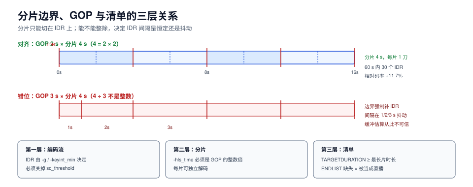

# 封装：分片、GOP 对齐与清单

封装这一段做的是**切**：把一条连续的编码流，切成几千个「能被独立解码、能被单独缓存、能被乱序请求」的小块，再写一份告诉播放器「先取哪个、每块多长、有几档」的清单。

切法一旦定错，后面两段（分发、播放）怎么优化都救不回来：**分片边界没落在关键帧上，播放器只能等；分片太长，起播必慢；清单标错版本，老播放器直接不认**。



本页判据族 `MDG-A` ~ `MDG-H`，共 8 条。定义表见文末「本页判据」一节。

## 一、两种容器：TS 与 fMP4

| 维度 | MPEG-TS（`.ts`） | fMP4 / CMAF（`.m4s` + `init.mp4`） |
| --- | --- | --- |
| 结构 | 188 字节固定包，自带同步字节 | ISO BMFF 盒子结构，需先取 `init` 段 |
| 开销 | 每包 4 字节头，约 **2%~4%** | 盒子头，通常 < 1% |
| 一份分片能否同时给 HLS 与 DASH | 不能（DASH 要 fMP4） | **能**（CMAF 的设计目的） |
| 老设备兼容 | 极好（智能电视、机顶盒） | 较新设备 |
| 独立解码 | 每片自带 PAT/PMT，可直接解 | 必须先有 `init` 段（`EXT-X-MAP`） |

**结论**：新建链路一律 fMP4/CMAF；只有「存量机顶盒必须支持」时才保留一路 TS。代价是**同一份内容存两份**：10 分钟片源、4 档码率合计 3.9 Mbps，一份约 **0.3 GB**，两份 0.6 GB；60 分钟片源一份 **1.7 GB**，两份 3.4 GB——这个数字乘以片库规模就是存储账单，所以「为了兼容再多存一份 TS」必须显式决策。

## 二、分片多长：一条没有最优点的曲线

分片时长同时影响四件事：起播缓冲、请求数、切档粒度、缓存效率。按「起播要缓冲 3 片」算：

| 分片时长 | 起播缓冲 | 起播下载（1 Mbps 档 / 2 Mbps 带宽） | 每小时请求数 | 90 分钟影片的切片数 |
| --- | --- | --- | --- | --- |
| 2 s | 6 s | 0.38 s | **1800** | **2700** |
| 4 s | 12 s | 0.75 s | 900 | 1350 |
| 6 s | 18 s | 1.12 s | 600 | 900 |
| 10 s | 30 s | 1.88 s | 360 | 540 |

三个读法：

1. **起播时间与请求数成反比**。2 s 分片起播只要 6 秒缓冲，但每小时 1800 次请求；10 s 分片请求只有 360 次，起播却要 30 秒缓冲。**没有最优点，只有按业务取舍的点**。
2. **90 分钟的片子，2 s 分片要 2700 个切片、清单至少刷新 2700 次**。清单很小（KB 级），但它是**串行依赖**：刷新失败一次，播放器就等一个 RTT。这是「看长片时每隔几秒顿一下」的常见原因之一。
3. **切档粒度 = 分片时长**。想在 1 秒内响应带宽变化，就必须用 1~2 s 分片；用 6 s 分片时，带宽骤降后播放器最多要等 6 秒才能换档，这 6 秒里它要么卡，要么把缓冲吃空。

实践取值：**点播 4~6 s**（Apple 对 VOD 的建议是 6 s），**直播 2 s**，**低延迟用 LL-HLS 的 part（0.2~0.5 s）**。

::: warning LL-HLS 不是「把分片改小」那么简单
LL-HLS 用 `EXT-X-PART` 把每个分片再切成若干 part，配合阻塞式清单刷新（`_HLS_msn` / `_HLS_part` 参数）实现亚秒级延迟。代价有三：① 请求数放大 4~10 倍；② 边缘缓存出现大量「不完整分片」，命中率下降；③ 清单必须能表达「这个 part 还没生成」。**如果没有强需求，不要为了「看起来先进」上 LL-HLS。**
:::

## 三、GOP 对齐：一条必须写进转码参数的契约

分片边界**必须落在关键帧（IDR）上**，否则播放器拿到分片后要先找到最近的关键帧，前面的帧全丢——表现就是「每次切档/拖动都闪过一下」或「前 0.5 秒是花的」。

更隐蔽的是**对齐不整除**的情况。IDR 由编码器的 GOP 决定，分片由封装器决定，两者如果不能整除，封装器只能在边界**强制插入 IDR**，于是 IDR 间隔开始抖动：

| GOP | 分片 | 60 秒内 IDR 数 | IDR 间隔 | 相对码率开销 |
| --- | --- | --- | --- | --- |
| 2 s | 4 s | 30 | 恒定 2 s | **+11.7%** |
| 3 s | 4 s | 30 | **1 / 2 / 3 s 抖动** | +11.7% |
| 4 s | 4 s | 15 | 恒定 4 s | **+5.8%** |
| 2 s | 6 s | 30 | 恒定 2 s | +11.7% |
| 3 s | 6 s | 20 | 恒定 3 s | +7.8% |
| 6 s | 6 s | 10 | 恒定 6 s | +3.9% |

表里有两件事值得单独说：

1. **IDR 越多，码率越贵**。IDR 帧不参考任何帧，体积约为平均帧的 8 倍；从「每 6 秒一个」变成「每 2 秒一个」，相对码率开销从 **3.9%** 涨到 **11.7%**。GOP 不能为了「方便 seek」无限缩短。
2. **抖动比「多」更糟**。GOP 3 s 配 4 s 分片，IDR 数量与 GOP 2 s 一样多，但间隔在 1/2/3 s 之间跳。播放器按「每片 4 秒」估算缓冲与下载时间，实际每片包含的帧数忽多忽少，**这就是「同一网络下有时卡有时不卡」的机械原因**。

**正确做法**：转码时锁死 GOP（`-g` + `-keyint_min` + `-sc_threshold 0`），并让分片时长 = GOP × 整数。推荐 **GOP 2 s、分片 4 s 或 6 s**（兼顾 seek 精度与码率），直播则 **GOP = 分片 = 2 s**。

## 四、清单：HLS 与 DASH 各写什么

### HLS 的两级清单

```text
master.m3u8                       # 主清单：列所有档位
├── 1080p/index.m3u8              # 媒体清单：列该档所有分片
│   ├── init.mp4                  # fMP4 的初始化段（EXT-X-MAP）
│   ├── seg-00000.m4s
│   └── seg-00001.m4s
└── 720p/index.m3u8
```

```text
# master.m3u8
#EXTM3U
#EXT-X-VERSION:7
#EXT-X-INDEPENDENT-SEGMENTS
#EXT-X-STREAM-INF:BANDWIDTH=4300000,AVERAGE-BANDWIDTH=4000000,RESOLUTION=1920x1080,CODECS="avc1.640028,mp4a.40.2"
1080p/index.m3u8
#EXT-X-STREAM-INF:BANDWIDTH=2300000,AVERAGE-BANDWIDTH=2000000,RESOLUTION=1280x720,CODECS="avc1.64001f,mp4a.40.2"
720p/index.m3u8
```

```text
# 1080p/index.m3u8
#EXTM3U
#EXT-X-VERSION:7
#EXT-X-TARGETDURATION:4
#EXT-X-PLAYLIST-TYPE:VOD
#EXT-X-MAP:URI="init.mp4"
#EXTINF:4.000,
seg-00000.m4s
#EXTINF:4.000,
seg-00001.m4s
#EXT-X-ENDLIST
```

### HLS 的 `EXT-X-VERSION`：一张能力开关表

`EXT-X-VERSION` 是**累加式**的：声明 v7 就意味着 v2~v7 的标签都能用。它决定「哪些标签写了也不会被老播放器忽略」：

| 版本 | 引入的能力 | 与封装决策的关系 |
| --- | --- | --- |
| v2 | `EXT-X-KEY` 的 `IV` 属性 | 加密分片必须 ≥ v2 |
| v3 | `EXTINF` 支持浮点时长 | 分片时长不是整数秒时必须 ≥ v3 |
| v4 | `EXT-X-BYTERANGE`、`EXT-X-I-FRAMES-ONLY` | 单文件多分片（byte range）必须 ≥ v4 |
| v5 | `EXT-X-KEY` 的 `KEYFORMAT`、`EXT-X-MAP` | **fMP4 必须 ≥ v5**（`EXT-X-MAP` 在这里引入） |
| v6 | 媒体清单里允许 `EXT-X-MAP` | 单片 fMP4 场景 |
| v7 | 移除 `EXT-X-ALLOW-CACHE`；`EXT-X-STREAM-INF` 支持 `AVERAGE-BANDWIDTH` | **v7 起 `EXT-X-ALLOW-CACHE` 已废弃**，写了也可能被忽略 |

::: danger 三个封装期必失点
1. **`EXT-X-TARGETDURATION` 必须 ≥ 实际最长分片时长（向上取整）**。写小了播放器会按错误节奏刷新清单，长片末尾出现「卡住不结束」。
2. **最后一片时长通常短于目标时长**，这会让 `EXT-X-TARGETDURATION` 的计算与「平均码率」都出现偏差；用 `AVERAGE-BANDWIDTH` 而不是 `BANDWIDTH` 做初始选档，可减少「一起播就切档」的抖动。
3. **`EXT-X-ENDLIST` 缺失 = 直播**。点播清单如果漏了它，播放器会一直刷新清单（每秒一次），把 QPS 打高几个数量级。
:::

### DASH 的 MPD

DASH 用一份 XML 描述所有档位与分片模板：

```xml
<MPD xmlns="urn:mpeg:dash:schema:mpd:2011" type="static" mediaPresentationDuration="PT542.4S">
  <Period>
    <AdaptationSet mimeType="video/mp4" segmentAlignment="true" startWithSAP="1">
      <SegmentTemplate initialization="init-$RepresentationID$.mp4"
                       media="$RepresentationID$/seg-$Number%05d$.m4s"
                       duration="4" startNumber="0"/>
      <Representation id="1080p" bandwidth="4000000" width="1920" height="1080" codecs="avc1.640028"/>
      <Representation id="720p" bandwidth="2000000" width="1280" height="720" codecs="avc1.64001f"/>
    </AdaptationSet>
  </Period>
</MPD>
```

两个字段决定「能不能无缝切档」：`segmentAlignment="true"`（各档分片边界对齐）与 `startWithSAP="1"`（每片以 SAP 1 型（IDR）开始）。**这两个字段写错，DASH 播放器切档就会黑一下。**

## 五、一份分片，两种清单（CMAF）

CMAF 的价值就是把「切」和「说」分开：**分片只切一次，清单写两份**。

| 做法 | 存储 | 封装耗时 | 切档一致性 | 适用 |
| --- | --- | --- | --- | --- |
| 分别打包 TS + fMP4 | 2 份 | 2 次 | 边界可能不一致 | 存量兼容期 |
| CMAF 单一分片 + HLS/DASH 双清单 | **1 份** | 1 次 | 天然一致 | 新建链路 |

代价是**所有客户端必须能解 fMP4**——这条在 2026 年基本成立，但老机顶盒仍是例外。

## 六、命名与路径：为什么必须带版本段

分片路径里必须有一个**内容版本段**，而不是直接 `1080p/seg-00001.m4s`：

```text
/v/{asset_id}/{encode_version}/1080p/seg-00001.m4s
                      ^^^^^^^^^^^^^^
```

原因只有一个：**回滚**。如果路径里没有版本段，重新转码会覆盖同名分片，而此时 CDN 上还有旧清单的缓存——旧清单指向新分片，播放器拿到的是「时长对不上」的流，表现为花屏或直接报错。带版本段之后，回滚只需把清单切回旧版本，分片天然隔离。

配套的三条纪律：

1. **清单的切换是原子的**（一次写入，或先写临时键再 `rename`）。
2. **旧版本至少保留一个缓存窗口**（≥ CDN 的 TTL）。
3. **对象键不可变**：同一路径的内容永不修改，只新增。

## 七、验证方式

```shell
# 1) 关键帧间隔是否恒定（应只有一个值）
ffprobe -v error -select_streams v:0 -skip_frame nokey -show_entries frame=pts_time \
  -of csv=p=0 1080p/seg-*.m4s 2>/dev/null | awk -F, 'NR>1{printf "%.2f\n",$1-prev}{prev=$1}' | sort -u
# 预期：单个值 ≈ GOP（如 2.00）

# 2) 分片时长是否与清单一致
for f in 1080p/seg-*.m4s; do ffprobe -v error -show_entries format=duration -of csv=p=0 "$f"; done | sort -u
# 预期：除最后一片外都等于 EXT-X-TARGETDURATION

# 3) 清单合法性（Apple 官方工具，macOS 自带）
mediastreamvalidator master.m3u8
# 预期：无 error；warning 逐条确认

# 4) 切档处是否花屏：连续取两个不同档的相邻分片解码首帧
ffmpeg -v error -i 720p/seg-00010.m4s -frames:v 1 -y /tmp/a.png
ffmpeg -v error -i 1080p/seg-00010.m4s -frames:v 1 -y /tmp/b.png
# 预期：两张图内容一致（同一时刻），无马赛克/绿块
```

## 本页判据

| 编号 | 判据 | 看什么现象 | 不满足时改哪里 |
| --- | --- | --- | --- |
| `MDG-A` | 分片边界落在 IDR 上 | 每片首帧是关键帧 | 转码锁 GOP，封装按 GOP 整数倍切 |
| `MDG-B` | 分片时长是 GOP 的整数倍 | `分片 / GOP` 是整数 | 调 GOP 或调分片时长 |
| `MDG-C` | IDR 间隔恒定 | `ffprobe` 关键帧间隔只有一个值 | 关 `sc_threshold`，锁 `-g`/`-keyint_min` |
| `MDG-D` | 容器选 fMP4/CMAF（兼容期可留 TS） | 新建链路无 `.ts` | 迁移到 fMP4，双清单 |
| `MDG-E` | 清单字段完整 | `TARGETDURATION`/`MAP`/`ENDLIST` 齐备 | 按第四节模板逐项核对 |
| `MDG-F` | `EXT-X-VERSION` 与实际使用标签匹配 | 用 `EXT-X-MAP` 时版本 ≥ 5 | 提升版本号，废弃标签删除 |
| `MDG-G` | 分片路径带内容版本段 | 路径里有 `encode_version` | 加版本段，对象键不可变 |
| `MDG-H` | 分片时长经业务取舍而非默认 | 有「为什么是 4/6 s」的记录 | 按第二节曲线按业务选点 |

## 参考资料

- RFC 8216, *HTTP Live Streaming*（`EXT-X-VERSION` 与全部标签）：<https://www.rfc-editor.org/rfc/rfc8216>
- Apple, *HLS Authoring Specification*（target duration 与 GOP 建议）：<https://developer.apple.com/documentation/http_live_streaming/hls_authoring_specification_for_apple_devices>
- DASH-IF, *Guidelines for Implementation: DASH-IF Interoperability*：<https://dashif.org/guidelines/>
- ISO/IEC 23000-19, *CMAF*：<https://www.iso.org/standard/85618.html>
