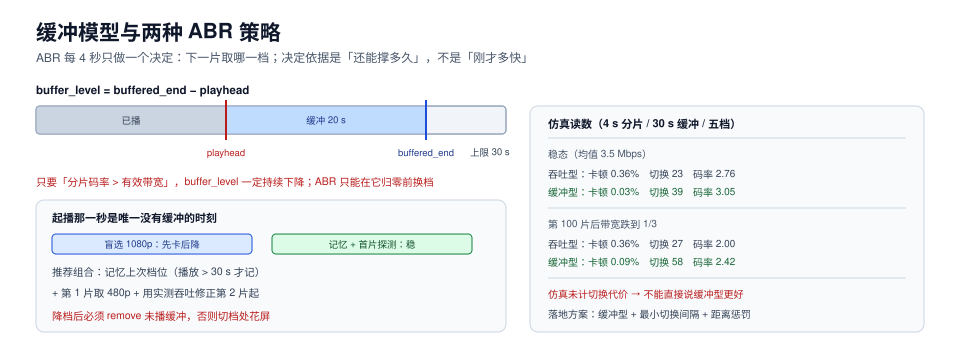

# 播放：缓冲模型与 ABR 策略

播放器是五段里唯一跑在**别人机器**上的一段。它要做的判断只有一个：**下一片取哪一档**。这个判断每 2~6 秒做一次，做错的代价是观众看到卡顿或模糊。

这一页讲四件事：MSE 的管线长什么样、缓冲模型怎么算、吞吐型与缓冲型 ABR 差在哪、以及起播那一秒为什么最贵。



本页判据族 `MDP-A` ~ `MDP-H`，共 8 条。定义表见文末「本页判据」一节。

## 一、MSE 管线：为什么浏览器「不原生支持」某些流

Safari 能直接 `src="xxx.m3u8"` 播 HLS；Chrome/Firefox 不行，因为它们只认「一整段 MP4」。补上这个能力的接口是 **MSE（Media Source Extensions）**：

```text
1. new MediaSource() → URL.createObjectURL(ms) → video.src = url
2. ms.addSourceBuffer('video/mp4; codecs="avc1.640028"')
3. fetch 分片 → sourceBuffer.appendBuffer(bytes)
4. 浏览器解码 → 播到缓冲末尾 → 继续第 3 步
```

四个必然踩到的点：

| 现象 | 原因 | 处理 |
| --- | --- | --- |
| `addSourceBuffer` 抛 `NotSupportedError` | `codecs` 字符串与实际编码不匹配（如写了 `avc1.640028` 但实际是 High@4.0） | 从分片的 `init` 段或清单的 `CODECS` 读，别硬编码 |
| `appendBuffer` 抛 `QuotaExceededError` | 缓冲里堆太多未播数据（常见于「一直 append 不 remove」） | 按播放位置 `remove(start, end)`，保持 30~60 s |
| 音画不同步 | 视频按视频时钟、音频按音频时钟各走各的 | MSE 会自行对齐，但 `timestampOffset` 设错会破坏对齐 |
| 切档后花屏 | 新档的 `init` 段没重新 append，或时间基不同 | 切档时 append 对应档的 init，且各档时间基一致 |

**加密流**还要 EME：`navigator.requestMediaKeySystemAccess('com.widevine.alpha', ...)` 拿 license，再把 `MediaKeys` 挂到 `video` 上。这一层失败的表现通常是「黑屏但有声音」或「直接 error code 3/4」。

## 二、缓冲模型：三个数决定观感

播放器的缓冲可以只用三个数描述：

```text
buffered_end   已下载到的时间点
playhead       当前播放位置
buffer_level = buffered_end - playhead      （秒）
```

- **buffer_level 高** → 抗抖动能力强，但起播慢、seek 迟钝（要先丢缓冲）。
- **buffer_level 低** → 响应快，但一次带宽抖动就卡。
- **下载速度 vs 播放消耗速度** → 决定 buffer_level 是在涨还是在掉。

一个必须知道的守恒关系：**只要「分片码率 > 有效带宽」，buffer_level 一定持续下降**，无论 ABR 策略多聪明。ABR 唯一能做的是在它掉到 0 之前换到更低的档。这也是为什么「起播时盲选高档」特别危险：它在最没有缓冲的时候选择了最贵的档。

## 三、吞吐型 vs 缓冲型：一组实测

用一条 4 Mbps 上下波动的带宽曲线做离散事件仿真（4 s 分片、30 s 缓冲上限、五档阶梯），两种策略的读数：

| 场景 | 策略 | 卡顿率 | 切换次数 | 平均码率 |
| --- | --- | --- | --- | --- |
| 稳态（均值 3.5 Mbps） | 吞吐型（EWMA × 0.85） | **0.36%** | **23** | 2.76 Mbps |
| 稳态 | 缓冲型（按 buffer_level 映射档位） | **0.03%** | 39 | **3.05 Mbps** |
| 第 100 片后带宽跌到 1/3 | 吞吐型 | 0.36% | 27 | 2.00 Mbps |
| 第 100 片后带宽跌到 1/3 | 缓冲型 | **0.09%** | 58 | **2.42 Mbps** |

四个读法：

1. **缓冲型在「卡顿」和「清晰度」两项上都更好**（0.03% vs 0.36%，3.05 vs 2.76 Mbps）。原因是它直接看「还能撑多久」，而吞吐型只能看「刚过去的带宽」——带宽是**滞后信号**。
2. **代价是切换次数翻倍**（39 vs 23；带宽骤降时 58 vs 27）。这就是为什么纯缓冲型不能直接上线：切换本身有代价（解码器重建、可能的短暂花屏、CPU 抖动）。
3. **带宽骤降时差距缩小**（0.09% vs 0.36%，2.42 vs 2.00）：缓冲型仍有优势，但切换频率变得不可接受。
4. **本仿真没有计入切换代价**。真实工程里正确做法是「缓冲为主 + 切换惩罚项」：在缓冲型的档位选择上加一个「与当前档位距离」的惩罚，或者加最小切换间隔（如 10 s 内不连续切换）。

::: warning 别把 ABR 当纯算法问题
线上「ABR 效果不好」的多数原因是**测量本身失真**：分片下载时间包含 DNS、TLS、排队、CDN 回源首包，用「分片字节数 / 总耗时」算带宽，在 CDN 冷启动时会严重低估。要么用 `PerformanceResourceTiming` 剔掉建连时间，要么用「同一连接上连续两片的吞吐」做估计。
:::

## 四、起播那一秒最贵

起播是整场播放中**唯一没有缓冲**的时刻，所以初始档位的选择决定了前 10 秒的体验：

| 初始策略 | 起播时间 | 前 10 秒风险 |
| --- | --- | --- |
| 盲选最高档（1080p 4 Mbps） | 长（2 Mbps 带宽下要下 2 s 才能出第 1 片） | 高概率立刻卡一次再掉档 |
| 盲选中间档（480p 1 Mbps） | 短 | 低，画质一般 |
| 记忆上次档位 | 短 | 中（换网络后记忆失效） |
| 首片探测（先下最低档 1 片测速） | 略长（多一次小请求） | **低，且选档有依据** |

推荐组合：**记忆上次档位（若上次成功播放超过 30 s）+ 首片用记忆档位或 480p + 用第 1 片的实测吞吐修正第 2 片起的档位**。这三条加起来，能把「一进来模糊一下」压到几乎不出现。

## 五、seek：为什么拖动会「顿一下」

seek 不是「跳到那个时间点」，而是：

```text
1. 丢弃当前缓冲（sourceBuffer.remove）
2. 计算目标时间点所属分片
3. 从该分片（或更早一个）开始取
4. 找到分片内的关键帧 → append → 解码 → 上屏
```

所以 seek 的耗时 ≈ **1 个分片下载 + 1 个关键帧解码**。分片 6 s 时，目标点可能落在分片中间，播放器会从「分片起点」开始解，最多白解 6 秒的内容——这就是「拖完要等半秒」的来源。缩短分片能改善 seek 精度，但会放大请求数（见[封装](../Packaging/index.md)第二节）。

## 六、错误恢复：三类错误，三种处理

| 错误类型 | 例子 | 处理 |
| --- | --- | --- |
| 网络类（可重试） | 分片请求超时、5xx | 重试 1~2 次（换 CDN 节点），仍失败则降档 |
| 内容类（不可重试） | 404、分片解码失败 | 立即降档；连续两档失败则报错并上报 |
| 会话类（需重建） | `MEDIA_ERR_DECODE`、EME 失败 | 重建 `MediaSource`，从当前时间点续播 |

一个必失点：**降档后不要复用原缓冲**。低档分片与高档分片的时间基相同但内容不同，混在缓冲里会花屏。正确做法是 `remove` 掉未播部分再 append。

## 七、验证方式

```js
// 1) 埋点：起播、卡顿、切换、错误四类事件（每个会话一次）
const t0 = performance.now();
video.addEventListener('playing', () => {
  if (!window.__firstFrame) {
    window.__firstFrame = true;
    report('startup_ms', performance.now() - t0);
  }
}, { once: true });

video.addEventListener('waiting', () => report('rebuffer_start'));
video.addEventListener('playing', () => report('rebuffer_end'));
video.addEventListener('error', () => report('error', video.error && video.error.code));

// 2) 档位切换来自 ABR 模块，不要从 videoWidth 反推（会滞后一片）
abr.on('switch', ({ from, to, bufferLevel }) => report('abr_switch', { from, to, bufferLevel }));

// 3) 缓冲水位采样：每 2 秒一次，用来复现「卡之前水位是多少」
setInterval(() => {
  const b = video.buffered;
  if (b.length) report('buffer_level', b.end(b.length - 1) - video.currentTime);
}, 2000);
```

```shell
# 4) 用真实清单做一次「弱网」验证（Chrome 开发者工具 → Network → 自定义 1.5 Mbps）
# 预期：起播 < 4 s，10 分钟内切换 ≤ 3 次，无 error 事件
```

## 本页判据

| 编号 | 判据 | 看什么现象 | 不满足时改哪里 |
| --- | --- | --- | --- |
| `MDP-A` | `codecs` 从清单/init 读，不硬编码 | 换编码不需要改播放器代码 | 解析 `CODECS` 与 `init` 段 |
| `MDP-B` | 缓冲上限有界且会 `remove` | `buffer_level` 稳定在 20~40 s | 播过部分及时 remove |
| `MDP-C` | 初始档位有依据（记忆或首片探测） | 起播 p75 < 2 s 且无「先卡后降」 | 改初始选档策略 |
| `MDP-D` | ABR 以缓冲为主、带切换惩罚 | 切换次数与卡顿率同时达标 | 加最小切换间隔与距离惩罚 |
| `MDP-E` | 带宽估计剔除建连时间 | 估计值与实际吞吐偏差 < 30% | 用 Resource Timing 或连续片吞吐 |
| `MDP-F` | 降档后清理未播缓冲 | 切档处无花屏 | 切档前 `remove` 未播区间 |
| `MDP-G` | 三类错误分别处理 | 错误事件能区分网络/内容/会话 | 按第六节三类分流 |
| `MDP-H` | 四类埋点齐备 | 能复原「卡之前的水位与档位」 | 加 `buffer_level` 与 `abr_switch` 上报 |

## 参考资料

- W3C, *Media Source Extensions*：<https://www.w3.org/TR/media-source/>
- W3C, *Encrypted Media Extensions*：<https://www.w3.org/TR/encrypted-media/>
- dash.js, *ABR 策略文档*（吞吐型/缓冲型/BOLA 的实现对照）：<https://github.com/Dash-Industry-Forum/dash.js/wiki>
- hls.js, *API 与配置*（`maxBufferLength`、`abrEwmaDefaultEstimate`）：<https://github.com/video-dev/hls.js/blob/master/docs/API.md>
