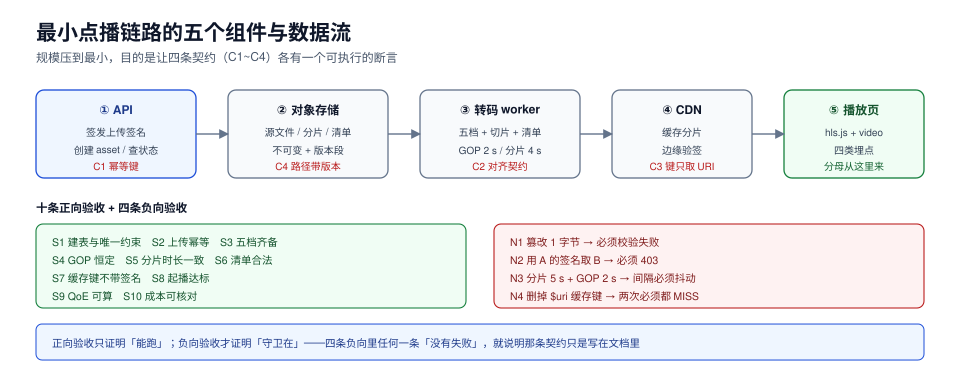

# 实战：一条能跑起来的最小点播链路

前面八页各讲一段。这一页把它们接起来，给一条**从零能跑通、每一步都有可执行判据**的最小链路：一个视频传进来 → 转五档 → 切片出清单 → 从 CDN 播放 → 埋点能算出起播与卡顿。

规模刻意压到最小：不接 DRM、不做多租户、不做直播。目标不是「功能完整」，而是**让四条交接契约（C1~C4）在一条真实链路上各有一个可执行的断言**。



本页判据族 `MDX-A` ~ `MDX-H`，共 8 条。定义表见文末「本页判据」一节。

## 一、五个组件

| 组件 | 职责 | 最小实现 | 不做什么 |
| --- | --- | --- | --- |
| API | 签发上传签名、创建 asset、查询状态 | 一个 HTTP 服务 + 一张表 | 不做用户体系 |
| 对象存储 | 存源文件、分片、清单 | S3 兼容（MinIO 本地） | 不做跨区复制 |
| 转码 worker | 拉任务、编五档、切片、写清单 | FFmpeg 命令行 + 一个队列表 | 不做分布式调度（单机串行够用） |
| CDN | 缓存分片、边缘鉴权 | 本地可用 Nginx 模拟（`proxy_cache`） | 不做多级缓存 |
| 播放页 | 播 HLS、上报事件 | hls.js + 一个 `<video>` | 不做推荐/评论 |

## 二、五张表

```sql
-- 1) 资产：身份 = 内容哈希 + profile
CREATE TABLE media_asset (
  id            text PRIMARY KEY,                 -- sha256(src)[0:16] || '-' || profile_id
  tenant_id     text NOT NULL,
  source_key    text NOT NULL,                    -- t/<tenant>/src/<ab>/<sha256>
  source_sha256 char(64) NOT NULL,
  profile_id    text NOT NULL,
  duration_ms   integer NOT NULL,
  width         integer NOT NULL,
  height        integer NOT NULL,
  fps_num       integer NOT NULL,                 -- 30000
  fps_den       integer NOT NULL,                 -- 1001
  rotation      integer NOT NULL DEFAULT 0,
  status        text NOT NULL DEFAULT 'ingested', -- ingested|transcoding|packaged|failed
  created_at    timestamptz NOT NULL DEFAULT now(),
  UNIQUE (source_sha256, profile_id)
);

-- 2) 档位：一档一行，记录实际码率与 bpp 自检结果
CREATE TABLE media_rendition (
  asset_id   text NOT NULL REFERENCES media_asset(id),
  name       text NOT NULL,                       -- 1080p / 720p ...
  width      integer NOT NULL,
  height     integer NOT NULL,
  bitrate    integer NOT NULL,                    -- bps，实测值
  bpp        numeric(6,4) NOT NULL,               -- bitrate/(w*h*fps)
  gop_ms     integer NOT NULL,
  seg_ms     integer NOT NULL,
  playlist_key text NOT NULL,
  PRIMARY KEY (asset_id, name)
);

-- 3) 任务：一个 asset × 一个阶段＝一行，幂等靠唯一键
CREATE TABLE media_job (
  id         bigserial PRIMARY KEY,
  asset_id   text NOT NULL REFERENCES media_asset(id),
  stage      text NOT NULL,                       -- transcode|package
  state      text NOT NULL DEFAULT 'queued',      -- queued|running|done|failed|dead
  attempts   integer NOT NULL DEFAULT 0,
  next_run_at timestamptz NOT NULL DEFAULT now(),
  last_error text,
  UNIQUE (asset_id, stage)
);
CREATE INDEX media_job_due ON media_job (state, next_run_at);

-- 4) 会话与播放：QoE 的分母
CREATE TABLE media_session (
  id         text PRIMARY KEY,                    -- s_xxx
  asset_id   text NOT NULL,
  viewer_id  text,
  started_at timestamptz NOT NULL DEFAULT now()
);
CREATE TABLE media_play (
  id         text PRIMARY KEY,                    -- p_xxx
  session_id text NOT NULL REFERENCES media_session(id),
  started_at timestamptz NOT NULL DEFAULT now(),
  startup_ms integer,
  ended_at   timestamptz
);

-- 5) 事件：只 append，不更新
CREATE TABLE media_qoe_event (
  id         bigserial PRIMARY KEY,
  session_id text NOT NULL,
  play_id    text,
  event      text NOT NULL,                       -- click|startup|rebuffer|heartbeat|switch|error
  ts         bigint NOT NULL,                     -- 客户端毫秒
  position_s numeric(10,3),
  bitrate    integer,
  buffer_s   numeric(8,3),
  extra      jsonb
);
CREATE INDEX media_qoe_session ON media_qoe_event (session_id, ts);
```

三个约束值得单独说：`media_asset` 的 `UNIQUE (source_sha256, profile_id)` 是 C1 契约的物理实现；`media_job` 的 `UNIQUE (asset_id, stage)` 让「同一任务被投递两次」变成无害；`media_qoe_event` 只 append 不 update，保证指标可以离线重算。

## 三、对象键规范

```text
t/<tenant>/src/<sha[0:2]>/<sha256>                         源文件（不可变）
v/<asset_id>/<encode_version>/<rendition>/index.m3u8       媒体清单
v/<asset_id>/<encode_version>/<rendition>/init.mp4         fMP4 初始化段
v/<asset_id>/<encode_version>/<rendition>/seg-00000.m4s    分片
v/<asset_id>/<encode_version>/master.m3u8                  主清单
```

四条规则：**不可变**（同键不覆盖）、**带版本段**（`encode_version` 可回滚）、**带租户前缀**（隔离）、**按哈希打散**（避免热点前缀）。

## 四、转码与切片（关键参数）

```shell
# 五档，GOP 2 s，分片 4 s（4 = 2 × 2，满足 C2）
for r in "1080p:1920:1080:4000" "720p:1280:720:2000" "480p:854:480:1000" "360p:640:360:600" "240p:426:240:300"; do
  IFS=: read name w h br <<< "$r"
  ffmpeg -y -i src.mp4 \
    -vf "scale=${w}:${h}:force_original_aspect_ratio=decrease,pad=${w}:${h}:(ow-iw)/2:(oh-ih)/2" \
    -c:v libx264 -preset veryfast -profile:v high \
    -b:v ${br}k -maxrate $((br*11/10))k -bufsize $((br*2))k \
    -g 60 -keyint_min 60 -sc_threshold 0 \
    -force_key_frames "expr:gte(t,n_forced*2)" \
    -c:a aac -b:a 96k -ac 2 \
    -f hls -hls_time 4 -hls_playlist_type vod \
    -hls_segment_type fmp4 -hls_flags independent_segments \
    -hls_segment_filename "${name}/seg-%05d.m4s" \
    "${name}/index.m3u8"
done
```

参数与契约的对应关系：

| 参数 | 管什么 | 对应契约/判据 |
| --- | --- | --- |
| `-g 60 -keyint_min 60`（30 fps 下 = 2 s） | GOP 恒定 | `MDG-C` |
| `-sc_threshold 0` | 场景切换不插 IDR | `MDTC-D` |
| `-hls_time 4` 且 4 是 2 的整数倍 | 分片 = GOP × 2 | `MDG-B` |
| `-hls_segment_type fmp4` | CMAF 分片，双清单可用 | `MDG-D` |
| `-hls_flags independent_segments` | 每片可独立解码 | `MDG-A` |

## 五、CDN 配置（Nginx 模拟，三行关键）

```nginx
proxy_cache_path /var/cache/media levels=1:2 keys_zone=media:100m inactive=7d;

location /v/ {
  # 关键：缓存键只取 URI（不含 $args），签名参数不进键
  proxy_cache_key "$uri";
  proxy_cache media;
  proxy_cache_valid 200 7d;
  proxy_cache_lock on;                    # 合并回源（六道闸之二）
  add_header X-Cache $upstream_cache_status;
  # 边缘鉴权：签名校验脚本自己算 HMAC，参数不参与缓存
  access_by_lua_block { require("media_auth").verify() }
}
```

`proxy_cache_key "$uri"` 这一行是 C3 契约的实现。删掉它（默认会带 `$args`），命中率立刻归零。

## 六、S1~S10 十条验收

| # | 验收 | 命令 | 预期 |
| --- | --- | --- | --- |
| S1 | 建表与约束生效 | `psql -c "\d media_asset"` | 能看到 `UNIQUE (source_sha256, profile_id)` |
| S2 | 上传幂等（C1） | 同一文件提交两次 | 两次返回同一 `asset_id`，`media_job` 只有 1 行 |
| S3 | 五档齐备 | `ls */index.m3u8` | 5 个文件 |
| S4 | GOP 恒定 | 见第六节命令 4 | 只有一个间隔值 ≈ 2.00 |
| S5 | 分片时长一致 | 见第六节命令 5 | 除最后一片外都等于 4.0 |
| S6 | 清单合法 | `mediastreamvalidator master.m3u8` | 无 error |
| S7 | 缓存键不带签名（C3） | 两个不同签名请求 | 第二次 `X-Cache: HIT` |
| S8 | 起播达标 | 弱网 1.5 Mbps 下播放 | 起播 < 4 s，无「先卡后降」 |
| S9 | QoE 可算 | 见 QoE 章的 SQL | p75/p95 与卡顿三口径都能出数 |
| S10 | 成本可核对 | 流量 × 单价 | 与埋点算出的平均码率偏差 < 10% |

```bash
1) 建表
psql "$DSN" -f schema.sql && psql "$DSN" -c "\d media_asset"

2) 幂等
curl -s -X POST localhost:8080/assets -F file=@sample.mp4 -F profile=web-hd | jq -r .asset_id
curl -s -X POST localhost:8080/assets -F file=@sample.mp4 -F profile=web-hd | jq -r .asset_id
# 预期：两行相同

3) 档位
ls 1080p/index.m3u8 720p/index.m3u8 480p/index.m3u8 360p/index.m3u8 240p/index.m3u8 | wc -l
# 预期：5

4) GOP 恒定
ffprobe -v error -select_streams v:0 -skip_frame nokey -show_entries frame=pts_time \
  -of csv=p=0 1080p/seg-0000{0,1,2}.m4s 2>/dev/null \
  | awk -F, 'NR>1{printf "%.2f\n",$1-prev}{prev=$1}' | sort -u
# 预期：2.00（单个值）

5) 分片时长
for f in 1080p/seg-*.m4s; do ffprobe -v error -show_entries format=duration -of csv=p=0 "$f"; done | sort -u
# 预期：4.000 与最后一片的较短值
```

## 七、四条必须失败的负向验收

正向验收只能证明「能跑」，负向验收才能证明「守卫在」。四条都必须失败：

| # | 造法 | 期望失败 | 对应的守卫 |
| --- | --- | --- | --- |
| N1 | 上传时篡改 1 个字节 | 校验失败 4xx | `MDI-E` 内容哈希 |
| N2 | 用 A 分片的签名请求 B 分片 | 403 | `MDS-A` 路径参与签名 |
| N3 | 把 `-hls_time` 改成 5（GOP 2 s） | GOP 间隔出现 1/2/3 抖动 | `MDG-B` 整数倍 |
| N4 | 删掉 `proxy_cache_key "$uri"` | 两次请求都 MISS | `MDL-A` 缓存键 |

```shell
# N2 的最小复现
sig_a=$(curl -s "localhost:8080/sign?path=/v/a1/v7/1080p/seg-00000.m4s" | jq -r .sig)
curl -s -o /dev/null -w '%{http_code}\n' "http://localhost:8081/v/a1/v7/1080p/seg-00001.m4s?sig=$sig_a"
# 预期：403
```

## 八、交付物清单

一条最小链路做完，应该留下这七样东西（缺一样就意味着某条契约没有落点）：

1. 五张表的 DDL（含三个唯一约束）。
2. 对象键规范一份（含版本段与租户前缀）。
3. 转码参数一组（含 GOP/分片/`sc_threshold`）。
4. CDN 缓存键配置一行（`proxy_cache_key "$uri"`）与签名校验脚本。
5. 十条正向验收 + 四条负向验收的可执行命令。
6. QoE 三条 SQL（起播分位、卡顿三口径、平均码率）。
7. 成本核对表（流量 × 单价 ↔ 埋点反算）。

## 本页判据

| 编号 | 判据 | 看什么现象 | 不满足时改哪里 |
| --- | --- | --- | --- |
| `MDX-A` | 五张表齐备且三处唯一约束在位 | `\d` 能看到唯一约束 | 按第二节 DDL 建 |
| `MDX-B` | 对象键不可变且带版本段 | 路径里有 `encode_version` | 改键规范，禁止覆盖写 |
| `MDX-C` | 转码参数与契约一一对应 | 参数表能指到判据编号 | 按第四节对照表补参数 |
| `MDX-D` | 缓存键只取 URI | 配置里是 `proxy_cache_key "$uri"` | 删掉 `$args` |
| `MDX-E` | 十条正向验收全绿 | 每条都有命令与预期 | 按第六节表执行 |
| `MDX-F` | 四条负向验收全红 | 四条都按预期失败 | 按第七节表造 |
| `MDX-G` | QoE 三条 SQL 可跑 | 出数且分母正确 | 按 QoE 章补齐事件 |
| `MDX-H` | 成本可双向核对 | 流量反算与埋点偏差 < 10% | 补未埋点流量（预加载/盗链） |

## 参考资料

- FFmpeg, *HLS 分段参数*（`-hls_time`/`-hls_segment_type`）：<https://ffmpeg.org/ffmpeg-formats.html#hls-2>
- Apple, *HLS Authoring Specification*：<https://developer.apple.com/documentation/http_live_streaming/hls_authoring_specification_for_apple_devices>
- nginx, *ngx_http_proxy_module*（`proxy_cache_key`/`proxy_cache_lock`）：<https://nginx.org/en/docs/http/ngx_http_proxy_module.html>
- PostgreSQL 18, *Constraints*（唯一约束与 `ON CONFLICT`）：<https://www.postgresql.org/docs/18/ddl-constraints.html>
