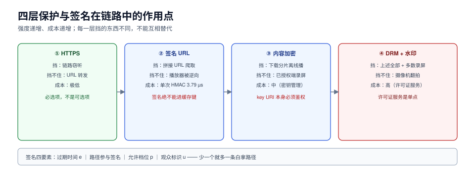

# 保护：签名 URL、密钥与 DRM

保护这一段要回答一个问题：**谁可以看这一片**。手段有四种，强度递增、成本也递增：

| 手段 | 挡住什么 | 挡不住什么 | 成本 |
| --- | --- | --- | --- |
| HTTPS | 链路窃听 | 拿到 URL 后的转发 | 极低 |
| 签名 URL（防盗链） | 直接拼接 URL 的爬取 | 真实播放器被逆向后的批量取流 | 极低（单次 HMAC 3.79 µs） |
| 内容加密（AES-128 / CENC） | 直接下载分片后离线播放 | 在已授权的播放器里录屏 | 中（密钥管理） |
| DRM（Widevine/FairPlay/PlayReady） | 上述全部 + 大部分录屏工具 | 摄像机翻拍 | 高（许可证服务、设备等级） |

这一页讲前三层的工程细节，以及它们与[分发](../Delivery/index.md)那条「签名不能进缓存键」的硬约束怎么共存。



本页判据族 `MDS-A` ~ `MDS-H`，共 8 条。定义表见文末「本页判据」一节。

## 一、签名 URL：五个字段，一个都不能少

```text
https://cdn.example.com/v/a1b2/v7/1080p/seg-00012.m4s
  ?e=1793003600              # 过期时间（Unix 秒）
  &p=1920x1080               # 允许的档位（可选，防「拿低档签名换高档」）
  &u=u_8f21                  # 观众标识（可选，用于追溯）
  &sig=9f8e7d6c...           # HMAC-SHA256(path + e + p + u, secret)[:32]
```

五个字段各自的作用：

| 字段 | 少了它会怎样 |
| --- | --- |
| `e`（过期） | URL 永久有效，等于没保护 |
| 路径参与签名 | 改路径就能拿别的分片（签名与对象解绑） |
| `p`（档位） | 用 480p 的签名去请求 1080p，白拿高清 |
| `u`（观众） | 出事时无法追溯是谁泄露的 |
| `sig` 算法与密钥分离 | 密钥轮换必须能让旧签名在窗口内继续有效 |

**成本可以忽略**：单次 HMAC-SHA256 约 **3.79 µs**，1 万次/秒只占单核 **3.8%**。所以「签名会不会拖慢」不是问题；真正要处理的是**签名与缓存键的冲突**。

::: danger 签名与缓存的唯一正确解法
签名参数**必须从缓存键里剔除**，只保留路径。看起来矛盾（「剔除后不同签名的请求会命中同一个缓存对象，那鉴权不就没了吗」），实际不矛盾：**鉴权在边缘做（或回源时做一次），命中缓存不影响鉴权结果**。

如果为了「安全」把签名留在键里，命中率 0%，回源 100%——这是用成本买了一个**并不更高**的安全等级（因为签名本来就可以被重放）。
:::

## 二、签名作用域：三种粒度

| 粒度 | 签名对象 | 优点 | 缺点 | 适用 |
| --- | --- | --- | --- | --- |
| 单分片 | 每个 `.m4s` 一个签名 | 最小权限，泄露影响 1 片 | 1350 个分片 = 1350 次签名（约 5 ms，可忽略） | 高价值内容 |
| 单清单 | 签 `index.m3u8`，分片由清单派生（相对路径带同一 token） | 签名次数 = 档数 | token 泄露可播整片 | 常规点播 |
| 会话级 | 签一个短时 token，播放器每次请求带 `Authorization` | 可撤销、可限速 | 需要边缘支持自定义头校验 | 会员内容 |

实践推荐：**会话级 token（30 分钟）+ 清单级签名兜底**。两者叠加的成本仍然可以忽略，但换来「可以按观众撤销」。

## 三、内容加密：AES-128 与 CENC 的分界

| 方案 | 加密粒度 | 密钥分发 | 兼容性 | 适用 |
| --- | --- | --- | --- | --- |
| HLS AES-128（`EXT-X-KEY:METHOD=AES-128`） | 整个分片 | 一个 HTTPS 的 key URI | 极好（所有 HLS 播放器） | 基础防下载 |
| HLS SAMPLE-AES | 样本级（只加密部分 NAL） | key URI | 较好 | 需要「加密但保持兼容」 |
| CENC（`cenc`/`cbcs`）+ DRM | 样本级 | 许可证服务器 | 需要 EME/CDM | 版权内容 |

关键差别在于**密钥 URI 本身也要鉴权**。如果 `EXT-X-KEY:URI="key.bin"` 是公开可取的，那加密等于没加——拿到 key 就能解所有分片。

::: warning 密钥轮换的三个坑
1. **轮换必须换 `EXT-X-KEY` 行，不能覆盖同一个 key URI 的内容**——覆盖会让已缓存的播放器拿到新 key 去解旧分片，直接黑屏。
2. **轮换周期与分片时长要对齐**（如每 10 分钟一个 key），否则一个分片跨两个 key，播放器要处理边界。
3. **旧 key 至少保留一个「最长播放时长 + 缓存 TTL」的窗口**，否则长片播到一半 key 被删。
:::

## 四、DRM：三个体系、一个打包

| 体系 | 平台 | 安全等级 | 备注 |
| --- | --- | --- | --- |
| Widevine | Android / Chrome | L1（硬件） / L3（软件） | L1 才能放 4K；L3 可被录屏 |
| FairPlay | Safari / iOS / tvOS | 硬件级 | 需要 Apple 开发者证书链 |
| PlayReady | Windows / 部分电视 | SL2000/SL3000 | 企业/机顶盒场景多 |

「多 DRM」的做法是**一次加密、多个 PSSH**：用 CENC 加密一次，在 `init` 段里放三个 DRM 的 `pssh` box，各平台各取所需。这样一份分片能服务三个生态，代价是 `init` 段变大（KB 级，可忽略）。

三个运营事实：

1. **许可证服务是单点**。它挂了，所有 DRM 内容都放不了。必须有降级预案（提前签发长时效 license，或临时切到「仅签名」模式）。
2. **L1 与 L3 要分开算成本**。L1 设备能播 4K，L3 只能 1080p 及以下；内容分级要按设备等级给不同清单。
3. **DRM 不防录屏**（L3 尤其）。要防泄露只能靠**取证水印**。

## 五、水印：明水印与暗水印

| 类型 | 做法 | 能做什么 | 代价 |
| --- | --- | --- | --- |
| 明水印 | 画面角上叠加观众 ID | 震慑、快速定位泄露源 | 影响观感，可被裁剪 |
| 暗水印（forensic） | 在编码参数/DCT 系数里嵌入不可见信号 | 泄露后能提取出观众 ID | 需要预处理，抗压缩能力有限 |
| 会话指纹 | 每个会话的切片顺序/时长做微扰 | 抗合谋（多人拼接） | 实现复杂，播放器要配合 |

暗水印的关键指标是**抗压缩率**：经过二次转码（常见泄露路径）后仍能提取。这一点必须在合同/方案阶段写清，否则「上了水印」但「提取不出来」等于没上。

## 六、盗链的判定与处置

判定不能只看「请求有没有签名」（盗链者也会带签名，只是签名是别人的）。三个信号源：

| 信号 | 说明 | 误报风险 |
| --- | --- | --- |
| 同一 token 的并发 IP 数 | 正常 1~2 个，异常 > 10 | 中（移动网络切换、公司出口 NAT） |
| 请求速率 | 单 token 每分钟分片数远超正常播放 | 低（正常播放速率由分片时长决定） |
| UA / 设备指纹一致性 | 同一 token 出现在多个设备 | 中（家庭多设备） |

处置顺序（从轻到重）：

1. **降速**：对该 token 加限速，让盗链方体验变差但不断流（减少误伤）。
2. **缩短 token 有效期**：新签发的 token 从 30 分钟降到 5 分钟。
3. **拉黑 token / IP 段**：仅在高置信度时执行。
4. **换密钥 + 重新打包**：极端情况下的最后手段（成本高，影响所有在播会话）。

## 七、验证方式

```shell
# 1) 签名必须绑定路径：换一个分片路径，签名应失效
curl -s -o /dev/null -w '%{http_code}\n' \
  "https://cdn.example.com/v/a1b2/v7/1080p/seg-00013.m4s?e=1793003600&sig=<seg-00012的sig>"
# 预期：403

# 2) 过期必须生效
curl -s -o /dev/null -w '%{http_code}\n' \
  "https://cdn.example.com/v/a1b2/v7/1080p/seg-00012.m4s?e=1700000000&sig=<按旧e计算>"
# 预期：403（expired）

# 3) 签名不进缓存键：两个不同签名应命中同一对象
curl -sI "...seg-00012.m4s?e=1793003600&sig=aaa" | grep -i x-cache
curl -sI "...seg-00012.m4s?e=1793003700&sig=bbb" | grep -i x-cache
# 预期：第二次 HIT

# 4) 密钥 URI 必须鉴权
curl -s -o /dev/null -w '%{http_code}\n' "https://cdn.example.com/v/a1b2/v7/key.bin"
# 预期：403（不带签名时）

# 5) 加密分片应无法直接播放
ffprobe -v error "1080p/seg-00000.m4s"
# 预期：报错或只有加密的样本，无法解出画面
```

## 本页判据

| 编号 | 判据 | 看什么现象 | 不满足时改哪里 |
| --- | --- | --- | --- |
| `MDS-A` | 签名含过期、路径、档位、观众四要素 | 篡改任一要素都被拒 | 补齐签名串字段 |
| `MDS-B` | 签名参数不进缓存键 | 换签名第二次请求 HIT | 配置忽略签名参数 |
| `MDS-C` | 签名作用域明确（分片/清单/会话） | 三种粒度选其一并写清 | 按第二节选型 |
| `MDS-D` | 密钥 URI 需鉴权 | 裸请求 key 返回 403 | 给 key URI 加签名或走许可证 |
| `MDS-E` | 密钥轮换不覆盖同名对象 | 轮换后老片仍可播 | 换 URI，不换内容 |
| `MDS-F` | DRM 多 PSSH 单次加密 | 一份分片三平台可播 | CENC + 多 pssh |
| `MDS-G` | 水印有抗压缩指标 | 二次转码后仍能提取 | 评估 forensic 方案 |
| `MDS-H` | 盗链处置有分级 | 有降速→短 token→拉黑→换钥的顺序 | 按第六节写 runbook |

## 参考资料

- RFC 8216 §4.3.2.4, *EXT-X-KEY*（HLS 加密与 `KEYFORMAT`）：<https://www.rfc-editor.org/rfc/rfc8216>
- W3C, *Encrypted Media Extensions*：<https://www.w3.org/TR/encrypted-media/>
- ISO/IEC 23001-7, *Common encryption in ISO base media file format files (CENC)*：<https://www.iso.org/standard/84637.html>
- Apple, *FairPlay Streaming Overview*：<https://developer.apple.com/streaming/fps/>
