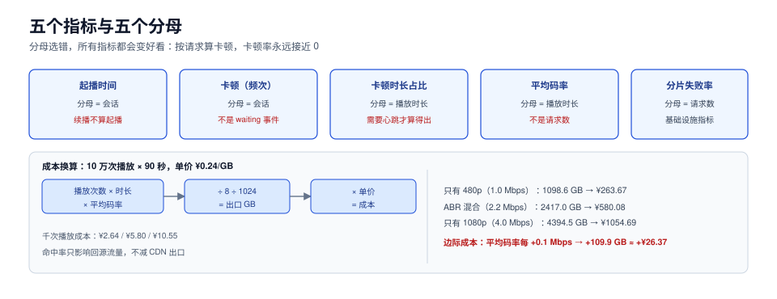

# 体验与成本：指标分母与换算

前四段决定「能不能播、快不快」，这一页回答两个管理问题：**怎么证明体验没变差，怎么把体验换算成钱**。两件事共用一套东西——**分母**。

分母选错，所有指标都会变得很好看：按「请求数」算卡顿，卡顿率永远接近 0（因为一个卡顿只影响一次播放，但一次播放有几百个请求）；按「播放数」算起播慢，起播慢又被均摊掉。这一页把每个指标的分母钉死。



本页判据族 `MDQ-A` ~ `MDQ-H`，共 8 条。定义表见文末「本页判据」一节。

## 一、五个指标、五个分母

| 指标 | 定义 | 分母 | 为什么必须是这个分母 |
| --- | --- | --- | --- |
| 起播时间 | 从点击播放到首帧上屏 | **会话**（一次进入播放页） | 一个会话可能续播多次，续播不算起播 |
| 卡顿率（频次） | 发生卡顿的会话数 / 总会话数 | **会话** | 「有卡顿的观众占比」才是体感 |
| 卡顿时长占比 | 卡顿总时长 / 播放总时长 | **播放时长** | 用来防止「少数人卡很久」被掩盖 |
| 平均码率 | 播放码率按播放时长加权 | **播放时长** | 按请求数加权会被短分片刷高 |
| 分片失败率 | 5xx + 超时 / 分片请求数 | **请求数** | 这是基础设施指标，分母就是请求 |

三个口径混用的典型后果：

- 用「播放」做卡顿分母：一次长播放卡 3 次，分母只算 1，卡顿率被夸大 3 倍（看起来比实际差）。
- 用「请求」做卡顿分母：1350 个请求里 3 次卡顿 → 0.2%，看起来很好，实际是「3 次卡顿集中在 1 个观众身上」。
- 用「请求」做平均码率分母：4 s 分片与 2 s 分片数量不同，同一个观众的平均码率会算出两个值。

::: danger 两个最容易搞错的定义
1. **「会话」不是「播放」**。用户暂停 10 分钟再继续，是同一个会话、两次播放。起播时间只在会话的第一个 `playing` 事件上报。
2. **「卡顿」不是「`waiting` 事件」**。`waiting` 在 seek、切档、广告切换时也会触发。只有「`waiting` 且 `buffer_level` 已为 0 且持续 > 200 ms」才算卡顿。
:::

## 二、为什么必须报分位与「受影响占比」

卡顿是**长尾事件**：大部分会话一次都不卡，少数会话卡很多次。这种分布的均值毫无意义。

假设 10,000 个会话：9,700 个不卡，280 个各卡 1 次，20 个各卡 10 次。总卡顿 480 次：

| 口径 | 值 | 读起来 |
| --- | --- | --- |
| 均值（次/会话） | 0.048 | 「几乎不卡」 |
| 有卡顿的会话占比 | **3.0%** | 「30 个里有 1 个卡过」 |
| 卡顿时长 / 播放时长 | 取决于时长 | 需要和上一条一起看 |

**只看第一行会得出完全错误的结论**：0.048 次/会话听起来可以忽略，但那 20 个各卡 10 次的会话，体感是「这个视频根本没法看」。所以卡顿必须同时报三个数：**有卡顿的会话占比、卡顿时长占比、受影响会话的卡顿次数 p95**。

同理，起播时间要报 **p75 与 p95**，不能只报均值——起播 1.2 s 的均值和「10% 的人等 8 秒」可以是同一批数据。

## 三、起播时间的分解

起播可以拆成五段，每一段对应不同的责任方：

```text
t0  点击
t1  DNS + TCP + TLS（复用连接时 ≈ 0）
t2  主清单返回
t3  媒体清单返回
t4  起播缓冲（3 个分片下载完成）
t5  解码首帧上屏
```

| 段 | 典型值 | 变大时先看 |
| --- | --- | --- |
| t0→t1 | 0~200 ms（新建连接） | 域名解析、证书链、边缘节点选择 |
| t1→t2 | 50~150 ms | 清单是否被缓存、回源是否慢 |
| t2→t3 | 50~150 ms | 同上 |
| t3→t4 | 0.4~1.2 s | 起播档位是否过高、分片是否过大、带宽估计 |
| t4→t5 | 50~200 ms | 解码器初始化、`init` 段是否缺失 |

**大多数「起播 5 秒」都落在 t3→t4**，而不是网络本身慢——是起播档位选高了，或者起播缓冲片数设多了。

## 四、成本换算：从码率到钱

成本算式只有一行：

```text
出口流量(GB) = 播放次数 × 平均时长(s) × 平均码率(Mbps) / 8 / 1024
出口成本(元) = 出口流量(GB) × 单价(元/GB)
```

代入一组真实量级（10 万次播放、每次 90 秒、单价 ¥0.24/GB）：

| 平均码率 | 出口流量 | 成本 | 千次播放成本 |
| --- | --- | --- | --- |
| 1.0 Mbps（只有 480p） | 1098.6 GB | ¥263.67 | **¥2.64** |
| 2.2 Mbps（ABR 混合） | 2417.0 GB | ¥580.08 | **¥5.80** |
| 4.0 Mbps（只有 1080p） | 4394.5 GB | ¥1054.69 | **¥10.55** |

由此得到一个可以直接用的**边际成本**：平均码率每提高 0.1 Mbps，10 万次播放的成本增加约 **109.9 GB ≈ ¥26.37**。这个数在评审「要不要把阶梯整体上调一档」时最有用——上调一档通常意味着平均码率 +0.4~0.6 Mbps，也就是成本 +¥105~158 / 10 万次播放。

再叠加缓存：CDN 侧出口不会因为命中率变化而减少（观众该拿多少字节还是多少字节），**命中率只影响回源流量**。所以「优化缓存」优化的是源站带宽与回源费，不是 CDN 出口费——这两笔钱在账单上是分开的。

## 五、埋点模型：一张表存四类事件

QoE 埋点不要设计成「每个指标一个字段」，而是**事件流**：

| 字段 | 说明 | 例 |
| --- | --- | --- |
| `session_id` | 一次进入播放页 | `s_9f2c` |
| `play_id` | 会话内的一次播放（暂停再播算新 play） | `p_1` |
| `event` | 事件类型 | `startup` / `rebuffer` / `switch` / `error` / `heartbeat` |
| `ts` | 客户端时间戳（ms） | `1793000123456` |
| `position` | 播放位置（s） | `42.5` |
| `bitrate` | 当前档位码率 | `2000000` |
| `buffer_level` | 缓冲水位（s） | `18.2` |
| `extra` | 事件特有字段 | `{from: 720, to: 480}` |

四条纪律：

1. **`heartbeat` 必须有**（每 15~30 s 一次）。没有心跳就无法算「播放时长」这个分母，卡顿时长占比与平均码率都算不出来。
2. **事件要能离线重算**。不要在上报端就聚合，原始事件落库，指标在查询时算——口径调整时才不用重发版。
3. **采样要分层**。全量上报心跳的存储成本很高；可以「全量报 startup/error，心跳按 10% 采样」，但采样率必须写进指标口径（否则分母错）。
4. **`position` 用播放位置，不用墙钟**。墙钟会被暂停、切后台污染。

## 六、SLO 怎么定：从体感反推，不从技术反推

定 SLO 的常见错误是「我们能做到 99.9%，就定 99.9%」。正确顺序是反的：

1. **先定体感红线**：起播 > 5 s 或一次播放卡 3 次以上，用户大概率退出。
2. **再看现状分布**：p75/p95 是多少，超红线的人占多少。
3. **再定目标**：把「超红线占比」从 x% 压到 y%，并给出对应动作（降起播档、改分片、加边缘节点）。
4. **最后才写数字**：SLO 写成「起播 p95 < 4 s，且超 5 s 的会话占比 < 1%」。

这样定出来的 SLO 才和成本挂钩：每一条都能反推到一个动作与一笔钱。

## 七、验证方式

```sql
-- 1) 起播 p75/p95（按会话取第一次 startup）
WITH first_start AS (
  SELECT session_id, MIN(ts) AS t0 FROM events WHERE event = 'click' GROUP BY session_id
), startup AS (
  SELECT e.session_id, MIN(e.ts) - f.t0 AS ms
  FROM events e JOIN first_start f USING (session_id)
  WHERE e.event = 'startup' GROUP BY e.session_id
)
SELECT
  percentile_cont(0.75) WITHIN GROUP (ORDER BY ms) AS p75,
  percentile_cont(0.95) WITHIN GROUP (ORDER BY ms) AS p95,
  COUNT(*) FILTER (WHERE ms > 5000)::numeric / COUNT(*) AS over_5s_ratio
FROM startup;
-- 预期：p75 < 2000、p95 < 4000、over_5s_ratio < 0.01

-- 2) 卡顿两个口径必须同时报
SELECT
  COUNT(DISTINCT session_id) FILTER (WHERE event = 'rebuffer')::numeric
    / COUNT(DISTINCT session_id) AS session_rebuffer_ratio,
  SUM(CASE WHEN event = 'rebuffer' THEN 1 ELSE 0 END)::numeric
    / NULLIF(SUM(CASE WHEN event = 'heartbeat' THEN 1 ELSE 0 END) * 15, 0) AS rebuffer_time_ratio
FROM events;
```

```shell
# 3) 成本核对：用实际出口流量反算平均码率，与埋点算出的平均码率对比
# 预期：两者偏差 < 10%（偏差大说明有未埋点的流量，如盗链或预加载）
```

## 本页判据

| 编号 | 判据 | 看什么现象 | 不满足时改哪里 |
| --- | --- | --- | --- |
| `MDQ-A` | 五个指标各有唯一分母 | 指标字典里每个指标写明分母 | 按第一节表格固定 |
| `MDQ-B` | 卡顿同时报三个数 | 会话占比 + 时长占比 + 次数 p95 | 补查询，不要只报均值 |
| `MDQ-C` | 起播报 p75 与 p95 | 两个数都在看板上 | 加分位查询 |
| `MDQ-D` | 起播有分段归因 | 能拆出 t0→t5 五段 | 加 `click`/`manifest`/`first-frame` 三个事件 |
| `MDQ-E` | 埋点有心跳 | 有 `heartbeat` 事件且间隔固定 | 补心跳（15~30 s） |
| `MDQ-F` | 埋点可离线重算 | 原始事件落库，指标可改口径重算 | 不做上报端聚合 |
| `MDQ-G` | 成本可反算 | 能用「流量 × 单价」核对埋点 | 每月对一次账 |
| `MDQ-H` | SLO 由体感反推 | 每条 SLO 能指到一个动作 | 按第六节四步重写 |

## 参考资料

- W3C, *Navigation Timing / Resource Timing*（分段耗时的标准来源）：<https://www.w3.org/TR/resource-timing/>
- Google, *Web Vitals*（分位与「受影响会话」的思路可直接借用）：<https://web.dev/articles/vitals>
- RFC 8216, *HTTP Live Streaming*（清单与分片对起播的影响）：<https://www.rfc-editor.org/rfc/rfc8216>
- Apple, *HLS Authoring Specification*：<https://developer.apple.com/documentation/http_live_streaming/hls_authoring_specification_for_apple_devices>
