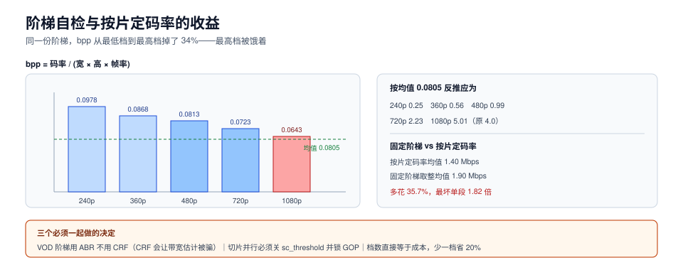

# 转码：码率阶梯与按片定码率

转码这一段的任务只有一句：**把一份源，变成若干份「在任何带宽下都能挑到合适一档」的流**。听起来是纯编码问题，实际是**预算分配问题**——总预算（码率、CPU、钱）固定，怎么在 5 档分辨率之间分。

这一页讲四件事：阶梯该按什么定、CRF 与目标码率怎么选、切片并行怎么不破坏对齐、以及转码成本怎么算成一个数。



本页判据族 `MDTC-A` ~ `MDTC-H`，共 8 条。定义表见文末「本页判据」一节。

## 一、阶梯的三种定法

| 定法 | 做法 | 优点 | 缺点 | 适用 |
| --- | --- | --- | --- | --- |
| 拍脑袋 | 抄一份业界常见阶梯 | 5 分钟搞定 | 简单内容被抬高码率、复杂内容不够 | 只用于原型 |
| 分辨率比例法 | 码率按像素数等比缩放 | 有依据、可解释 | 忽略了「同一分辨率下不同内容复杂度差 3 倍」 | 中等规模、内容同质 |
| 按片定码率（per-title） | 每个片源单独跑一次「码率-质量」曲线，取曲线的拐点 | 同等质量省 20%~40% | 需要额外一次分析编码，成本与复杂度上升 | 长片、版权内容、量大 |

「拍脑袋」的代价可以精确算。取一份常见阶梯（240p 0.3 / 360p 0.6 / 480p 1.0 / 720p 2.0 / 1080p 4.0 Mbps），对 12 段复杂度不同的内容分别求「达标所需码率」，再统一按阶梯向上取整：

- 按片定码率的平均需求 = **1.40 Mbps**
- 固定阶梯取整后的平均 = **1.90 Mbps**
- **多花 35.7%**，最坏的单段浪费 **1.82 倍**

这 35.7% 不是小数——它直接等于出口流量与存储。

## 二、阶梯自检：bpp 是否大致一致

判断一份阶梯「是不是合理」，最便宜的机械方法是算 **bpp（bits per pixel）**：

```text
bpp = 码率(bps) / (宽 × 高 × 帧率)
```

同一份内容在不同分辨率上，只要编码器与预设一致，**bpp 接近就代表视觉质量接近**。拿上面那份阶梯算：

| 档位 | 分辨率 | 像素数 | 码率 | bpp |
| --- | --- | --- | --- | --- |
| 240p | 426×240 | 102,240 | 0.3 Mbps | **0.0978** |
| 360p | 640×360 | 230,400 | 0.6 Mbps | 0.0868 |
| 480p | 854×480 | 409,920 | 1.0 Mbps | 0.0813 |
| 720p | 1280×720 | 921,600 | 2.0 Mbps | 0.0723 |
| 1080p | 1920×1080 | 2,073,600 | 4.0 Mbps | **0.0643** |

bpp 从 0.0978 一路滑到 0.0643（**降了 34%**），说明这份阶梯的**最高档被饿着**：观众切到 1080p 时看到的画面质量，反而不如 480p 时的相对水平。这就是「4K/1080p 看着不如预期清楚」的常见原因——不是屏幕问题，是最高档码率给低了。

把平均 bpp（0.0805）反推回去，视觉一致的阶梯应该是：240p **0.25**、360p **0.56**、480p **0.99**、720p **2.23**、1080p **5.01** Mbps。可以看到 1080p 差了 25%，而 240p 反而给多了 20%。

::: tip 一个 30 秒就能做完的检查
把阶梯的 bpp 算出来，如果**最低档与最高档相差超过 20%**，先怀疑最高档不足（最常见）或最低档浪费（次常见）。这个检查不需要编码，只需要乘法。
:::

## 三、CRF、ABR、CBR：选哪个

| 模式 | 控制什么 | 码率是否稳定 | 质量是否稳定 | 什么时候用 |
| --- | --- | --- | --- | --- |
| CRF（恒定质量） | 质量因子 | **不稳定**（简单内容码率骤降，复杂内容飙升） | 稳定 | 单档归档、源片、需要「质量优先」的场合 |
| ABR（目标平均码率） | 平均码率 | 大致稳定 | 波动 | 多档阶梯的主流选择（要可预测的带宽） |
| CBR（恒定码率） | 瞬时码率 | 稳定 | 波动 | 直播、硬件编码器、有严格带宽上限的链路 |

三个实践结论：

1. **VOD 阶梯用 ABR，不用 CRF**。CRF 在「黑场 + 字幕」的段落会把码率压到几百 kbps，播放器按 ABR 估算带宽时会被骗——切档逻辑会误判「网络很好」，下一片跳到高档，然后卡住。
2. **两遍编码值得**。第一遍统计复杂度、第二遍按统计分配比特，同码率下质量提升明显（尤其是运动复杂片段）；代价是编码时间翻倍。对「一次编码、长期分发」的长片，值得；对「一天几万条 UGC 短视频」，不值得。
3. **不要给低档用高档的 preset**。低分辨率档用 `veryfast` 就够，画质差异在 240p 上肉眼不可见，但编码时间能省一半以上。

## 四、切片并行：快，但会破坏对齐

长片转码的常规做法是「按时间切片并行编码，最后拼接」。它有三个坑，每一个都会让下游（封装/播放）出现难查的症状：

1. **每片必须强制在起点插关键帧**。`-force_key_frames "expr:gte(t,n_forced*4)"` 保证每 4 秒一个 IDR；如果不加，切片起点不是关键帧，拼接处会花屏。
2. **切片的 GOP 必须与最终分片时长成整数倍**。这里就是[总览](../Overview/index.md)里 C2 契约的落地位置：切 4 秒一片、GOP 也是 4 秒，那么每片正好 1 个 IDR，拼接后 IDR 间隔恒定；如果 GOP 3 秒、片 4 秒，每片内部会插 1 个额外 IDR，拼接后间隔变成 **1/2/3 秒抖动**。
3. **时间基必须统一**。不同切片如果 FFmpeg 自动推断出不同的 `time_base`，拼接后时长会累加误差，长片末尾出现音画不同步。做法是在每片都显式指定 `-video_track_timescale`（MP4）或 `-muxdelay 0`，并在拼接后用 `ffprobe` 校验总时长。

::: danger 三个必失点
1. **关掉场景切换自动插帧**。x264/x265 默认会在场景切换处插入 IDR（`-sc_threshold`），这会让「GOP 恒定」失效。转码阶梯时必须显式设 `-sc_threshold 0`（或对应的 `-x264-params scenecut=0`），否则 C2 契约从第一分钟就不成立。
2. **`-ss` 放在 `-i` 前面是快速定位，放后面是精确定位**。切片转码要用**精确**定位（`-ss` 在 `-i` 之后，或先 `-ss` 再 `-copyts` 校正），否则每片的实际起点会偏移几十毫秒，拼接后累计成秒级不同步。
3. **音频不要跟着切片切**。音频帧边界与视频不同，按视频切点切音频会产生爆音。做法是音频整体编一遍，或按「对齐到音频帧」的切点切。
:::

## 五、编码选型：省下的码率要能兑现

| 编码 | 相对 H.264 的码率 | 编码成本 | 解码覆盖（2026） | 主要风险 |
| --- | --- | --- | --- | --- |
| H.264/AVC | 1.0（基准） | 低 | 几乎全部 | 无 |
| H.265/HEVC | 0.5~0.6 | 中高 | 较新设备与 Safari 支持好，部分安卓/浏览器需硬件 | 专利池，商用授权复杂 |
| AV1 | 0.5~0.6 | 高（软件编码慢） | 新浏览器与部分硬件 | 老设备无解码，必须准备回退档 |
| VVC/H.266 | 0.4~0.5 | 很高 | 很窄 | 生态不成熟 |

关键不是「哪个压得狠」，而是**省下的码率能不能兑现**：如果 30% 的观众设备解不了 AV1，他们回退到 H.264 档，实际平均只省了「70% × 30%」≈ 21%，而编码成本翻了几倍。选型前必须先有**设备解码能力分布**这个数。

## 六、成本：把一个视频的转码换算成分钟

转码成本 ≈ `单核编码速度 × 档数 × 素材时长 × 单价`。用显式假设算一遍（假设单核 1080p `veryfast` 编码 60 fps、素材 30 fps）：

| 素材时长 | 单档单核耗时 | 5 档合计 | 1000 条素材的总核时 |
| --- | --- | --- | --- |
| 60 s | 30 s | **2.5 分钟** | 41.7 核时 |
| 600 s | 300 s | **25 分钟** | 416.7 核时 |

两个可以直接改的杠杆：

- **档数**。从 5 档降到 4 档（去掉 240p），成本降 20%，代价是老设备/弱网体验变差。这个取舍必须显式做。
- **只编一次**。内容寻址（见[入库](../Ingest/index.md)）让同一文件只编一次；重复提交导致的重复转码，是这项成本里最容易消掉的部分。

## 七、验证方式

```shell
# 1) GOP 是否恒定（关键帧间隔）
ffprobe -v error -select_streams v:0 -skip_frame nokey -show_entries frame=pts_time \
  -of csv=p=0 out_1080p.mp4 | awk -F, 'NR>1{printf "%.2f\n", $1-prev} {prev=$1}' | sort -u
# 预期：只输出一个值（约等于设定 GOP），出现多个值即 C2 契约不成立

# 2) 每档的实际 bpp（把输出填进第二节的表）
ffprobe -v error -select_streams v:0 -show_entries stream=width,height,avg_frame_rate,bit_rate \
  -of default=nw=1 out_1080p.mp4
# 预期：bpp = bit_rate / (width*height*fps)，五档之间相差不超过 20%

# 3) 切片拼接后总时长是否漂移
ffprobe -v error -show_entries format=duration -of csv=p=0 out_1080p.mp4
ffprobe -v error -show_entries format=duration -of csv=p=0 source.mp4
# 预期：两者差值 < 0.1 s

# 4) 音画同步：取第 300 秒一帧与音频波形对齐
ffmpeg -v error -ss 300 -i out_1080p.mp4 -frames:v 1 -y /tmp/f300.png
# 预期：画面中的时间码/拍板与 300 s 一致（用带时间码的测试片源验证）
```

## 本页判据

| 编号 | 判据 | 看什么现象 | 不满足时改哪里 |
| --- | --- | --- | --- |
| `MDTC-A` | 阶梯有来源，不是抄的 | 每档码率能指到一次实测或一个公式 | 用按片定码率或至少按内容类型分套 |
| `MDTC-B` | 阶梯 bpp 首尾差 ≤ 20% | 五档 bpp 算出来相近 | 调整最高/最低档码率（见第二节反推表） |
| `MDTC-C` | VOD 阶梯用 ABR 不用 CRF | 编码参数里是目标码率 | 改 `-b:v` + `-maxrate`/`-bufsize` |
| `MDTC-D` | 场景切换不插 IDR | `ffprobe` 关键帧间隔只有一个值 | 设 `-sc_threshold 0` |
| `MDTC-E` | 切片转码强制关键帧对齐 | `-force_key_frames` 表达式存在且与分片时长一致 | 按分片时长设表达式 |
| `MDTC-F` | 时间基统一、总时长不漂移 | 拼接后与源时长差 < 0.1 s | 显式设 timescale，`-ss` 用精确模式 |
| `MDTC-G` | 编码选型有设备分布依据 | 有「能解该编码的设备占比」这个数 | 先测设备分布，再决定是否上 AV1/HEVC |
| `MDTC-H` | 转码成本可算成一个数 | 能算出「每条素材的核时」 | 按第六节公式算，并记录实际值 |

## 参考资料

- FFmpeg, *Encode/H.264*（CRF 与 preset 的取值建议）：<https://trac.ffmpeg.org/wiki/Encode/H.264>
- FFmpeg, *Seeking*（`-ss` 前置与后置的差异）：<https://trac.ffmpeg.org/wiki/Seeking>
- Apple, *HLS Authoring Specification*（bitrate ladder 建议）：<https://developer.apple.com/documentation/http_live_streaming/hls_authoring_specification_for_apple_devices>
- Netflix TechBlog, *Per-Title Encode Optimization*（按片定码率的原始动机）：<https://netflixtechblog.com/per-title-encode-optimization-7e99442b62a2>
