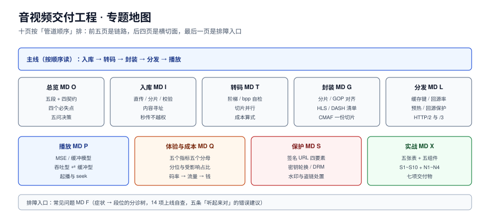

# 音视频交付工程

一个视频从上传到能看，中间要过五道手：**入库 → 转码 → 封装 → 分发 → 播放**。这五段每一段都能单独跑通，但拼起来最常见的结局是「能播，但是起播 8 秒、拖到中间卡一下、切清晰度花屏、账单比预算高 3 倍」。

原因不是某一段有 bug，而是**五段之间的契约没人写**：分片边界要不要对齐 GOP、缓存键里能不能带签名、阶梯按什么定、QoE 用什么分母——每一条都是跨段的，任何一段自己测都测不出来。

本专题讲这条交付链路的工程层：每一段的输入输出是什么、失效长什么样、用什么读数判定「这段做对了」。编解码算法本身（DCT、熵编码、率失真优化）只讲到能解释失效的程度，不展开推导。

::: tip 一句话理解
视频交付不是「把文件放到 CDN 上」，而是**把一条连续的流切成几千个能被独立解码的小块，并保证每一块在任何网络条件下都能被及时取到、正确接上**。切法（封装）、放法（分发）、取法（播放）三件事必须用同一套时间轴对齐。
:::

::: info 本专题与相邻专题的分工
- **视频内容本身怎么被理解（抽帧、时间戳、字幕、视频生成）** → [视频处理](../../AI/Multimodal/VideoProcessing/index.md)：那边把视频当**输入数据**，本专题把视频当**要交付给观众的产物**。
- **`<video>` 标签的属性与事件** → [HTML 视频](../../Frontend/Basic/HTML/Video/index.md)：那是标签语法，本专题讲标签背后那几千个分片从哪来。
- **CDN 的边缘节点、回源与缓存策略** → [边缘与 CDN](../../Ops/EdgeCDN/index.md)：那边讲 CDN 产品怎么选与怎么配，本专题只讲**视频特有的缓存键与回源率问题**。
- **对象存储的键设计与一致性** → [对象存储](../ObjectStorage/index.md)：分片落盘走的那套语义在那边，本专题只讲**分片该怎么命名、怎么校验**。
- **推流与实时音视频（RTC）** → [语音与音频 AI](../../AI/SpeechAudioAI/RTC/index.md)：那边是「毫秒级双向」，本专题是「秒级单向」，两者的缓冲模型相反。
- **任务队列与重试** → [分布式调度](../DistributedScheduling/index.md)：转码任务是长任务，调度与补跑在那边，本专题只讲**转码任务自身的输入输出契约**。
- **鉴权与会话** → [认证与授权](../Auth/index.md)：本专题只讲**媒体链路上的签名 URL 与密钥体系**，账号体系不在这里。
- **出口成本的核算方法** → [容量与成本](../../Ops/CapacityCost/index.md)：分摊口径在那边，本专题给的是**码率 ⇄ 流量 ⇄ 钱**的换算算式。
:::

## 目录

- [总览：五段链路与四条交接契约](Overview/index.md)
- [入库：上传、校验与内容寻址](Ingest/index.md)
- [转码：码率阶梯与按片定码率](Transcoding/index.md)
- [封装：分片、GOP 对齐与清单](Packaging/index.md)
- [分发：缓存键、回源率与预热](Delivery/index.md)
- [播放：缓冲模型与 ABR 策略](Playback/index.md)
- [体验与成本：指标分母与换算](QoE/index.md)
- [保护：签名 URL、密钥与 DRM](Protection/index.md)
- [实战：一条能跑起来的最小点播链路](Practice/index.md)
- [常见问题与分诊](FAQ/index.md)

## 专题地图

## 判据纪律

沿用全库写法：**每页 8 条，编号形如 `MDO-A`**，逐页前缀唯一，可被 `utils/audit` 下的判据类巡检机械核对。每条判据回答三件事：**看什么现象、判成什么、不满足时改哪里**。判据不是口号——「转码要快」不是判据，「转码任务必须带 `source_sha256` 与 `profile_id`，且同一对值重复提交返回同一个 `asset_id`」才是。

| 页 | 判据族 | 这一族管什么 | 条数 |
| --- | --- | --- | --- |
| 总览 | `MDO-A` ~ `MDO-H` | 五段边界、四条交接契约、必失点定位 | 8 |
| 入库 | `MDI-A` ~ `MDI-H` | 直传签名、分片粒度、校验、内容寻址与幂等 | 8 |
| 转码 | `MDTC-A` ~ `MDTC-H` | 阶梯来源、按片定码率、切片并行、成本口径 | 8 |
| 封装 | `MDG-A` ~ `MDG-H` | 分片时长、GOP 对齐、清单结构、协议版本 | 8 |
| 分发 | `MDL-A` ~ `MDL-H` | 缓存键、回源率、预热、Range 与多级缓存 | 8 |
| 播放 | `MDP-A` ~ `MDP-H` | 缓冲模型、ABR 策略、起播、错误恢复 | 8 |
| 体验与成本 | `MDQ-A` ~ `MDQ-H` | 指标分母、分位、埋点模型、成本换算 | 8 |
| 保护 | `MDS-A` ~ `MDS-H` | 签名作用域、密钥层级、DRM 等级、水印 | 8 |
| 实战 | `MDX-A` ~ `MDX-H` | 端到端验收、可观测、交付物 | 8 |
| 常见问题 | `MDF-A` ~ `MDF-H` | 症状分诊、误判、止血顺序 | 8 |

合计 **10 族 80 条**。

## 事实与版本速览（2026-10 核对）

| 项 | 口径 | 与交付的关系 |
| --- | --- | --- |
| HLS | RFC 8216（2017-08）发布；此后有增量修订（rfc8216bis），清单标签只增不改老语义 | 分片容器可用 MPEG-TS 或 fMP4；`EXT-X-VERSION` 决定哪些标签可用 |
| DASH | ISO/IEC 23009-1（第 5 版，2022） | 清单是 XML，分片寻址靠 `SegmentTemplate` 模板；与 HLS 共用 fMP4 分片 |
| CMAF | ISO/IEC 23000-19 | 让 HLS 与 DASH **共用同一份 fMP4 分片**，一份存储两种清单 |
| 视频编码 | H.264/AVC（2003）仍是最广兼容；H.265/HEVC（2013）省 40%~50% 码率但有专利池；AV1（2018）免专利费但编码慢；VVC/H.266（2020）压缩率更高、生态更窄 | 编码选型直接决定阶梯每一档的码率，进而决定出口账单 |
| 播放接口 | MSE（W3C 推荐 2016-11-17）、EME（W3C 推荐 2017-09-18） | 非 Safari 浏览器的 HLS/DASH 播放都走 MSE，是「为什么不原生能播」的根因 |
| 低延迟 | LL-HLS（`EXT-X-PART` 部分分片 + 阻塞式清单刷新） | 把分片再切成 200~500 ms 的 part，代价是请求数与边缘缓存碎片化 |
| 分片时长惯例 | 点播 4~6 s，直播 2 s，低延迟 0.2~0.5 s（part） | 这个数一处改，起播、请求数、切档粒度、缓存命中四处跟着变 |

::: warning 版本差异怎么处理
本专题涉及的多是**规范与编码代际**，不是「同一个产品的两代 API」。差异按三种方式处理：① 会改分片格式的（TS ⇄ fMP4、HLS 各 `EXT-X-VERSION` 档位）写成**页内对照表并标注可用/废弃状态**；② 只影响选型的（H.264 ⇄ HEVC ⇄ AV1）写成**同一张表里的并列行**；③ 谁都不影响判据的（播放器内部实现）不写。故**不建版本目录**，理由见下一节。
:::

## 为什么这里没有版本目录

本专题**不建 `HLS7/` `DASH5/` 这类版本目录**，理由三条，写在这里以免下次又被当成「漏了大版本规范」：

1. **换代的是编码与容器，判据跟着问题走**。从 TS 到 fMP4、从 H.264 到 AV1，换掉的是「一个分片里装什么」，而「分片边界有没有对齐 GOP」「缓存键里有没有带一次性参数」「QoE 的分母是会话还是播放」这三类问题一字未变。按版本建目录会把同一套判据抄两遍。
2. **并存差异是选型，不是代际**。同一时刻线上一定同时跑着 H.264（老设备）与 AV1（新设备）、TS（存量）与 fMP4（新建）。它们是**并存的两条路**，不是「新版替代旧版」。
3. **真正有状态差异的地方已用表格钉住**。HLS 的 `EXT-X-VERSION` 是逐版本累加的**能力开关**，所以做成一张「版本 ⇄ 可用标签 ⇄ 已废弃标签」的表（见[封装](../MediaDelivery/Packaging/index.md)），旧版本行**保留并标注状态**，而不是给旧版本单开一页。

作为对照，本库确实存在需要版本目录的主题：[Spring 5 / Spring 6](../Java/Frame/Spring/index.md)、[MySQL 5.7 / 8.4](../../DB/SchemaEvolution/index.md)、[MCP 2025 / 2026](../../AI/AgentToolProtocol/index.md)——它们的共同点是**同一个产品的两代 API 不兼容，且旧版仍必须能查**。

## 三条底线

::: danger 三条不可让步的底线
1. **分片边界必须落在关键帧上，而且分片时长要是 GOP 的整数倍**。GOP 2 s、分片 4 s 时 60 秒里 30 个 IDR、码率相对开销 **+11.7%**；GOP 4 s、分片 4 s 时只 15 个 IDR、开销 **+5.8%**。GOP 3 s 配分片 4 s 更糟：IDR 间隔在 **1/2/3 s 之间抖动**，播放器的缓冲估算从此不可信。
2. **签名与一次性参数绝不能进 CDN 缓存键**。一旦每个观众的 URL 都不同，命中率从「按热度曲线该有的 56%~88%」直接掉到 **0**，回源流量等于全部流量——这一条每年都在不同团队重犯一次。
3. **QoE 只看均值等于没看**。同一批播放里卡顿率 0.3% 与 3% 的均值可能只差 0.1 个百分点，而**受影响的会话比例**差 10 倍。指标必须报「有卡顿的会话占比」与 p75/p95，且分母写清楚是**会话**还是**播放**。
:::

## 阅读顺序

先读[总览](Overview/index.md)拿到五段链路和四条交接契约，然后按手上的症状选主线：

- **起播慢、拖动卡** → [播放](Playback/index.md) → [分发](Delivery/index.md) → [封装](Packaging/index.md)
- **账单超预算** → [体验与成本](QoE/index.md) → [转码](Transcoding/index.md) → [分发](Delivery/index.md)
- **上传老失败、重复转码** → [入库](Ingest/index.md) → [转码](Transcoding/index.md)
- **能播但被白嫖 / 要求 DRM** → [保护](Protection/index.md)
- **要在一周内搭出第一条能跑的链路** → [实战](Practice/index.md)
