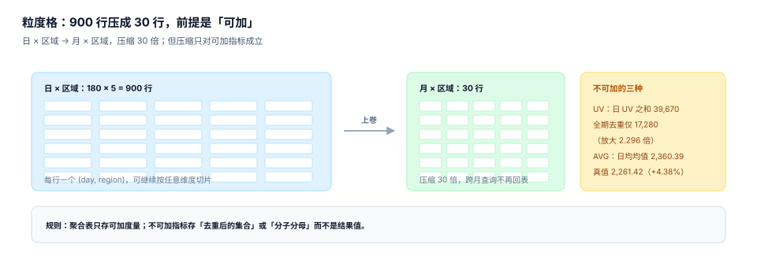

# 预聚合、物化与可加性

语义层编译出来的 SQL 如果每次都扫明细，一个看板的八个图能跑十分钟。预聚合是为了解决这个问题：把「常用粒度」的结果提前算好，查询时直接上卷。但它带来一个比性能更严重的问题——**如果指标不可加，预聚合出来的结果本身就是错的，而且错得很安静**。

本页只讲一件事：什么时候可以把「按天」的结果加总成「按月」，什么时候绝对不能。



## 一、粒度格：一份数据，多个分辨率

预聚合的本质是**用空间换时间**：把日 × 区域（180 × 5 = 900 行）压成月 × 区域（6 × 5 = 30 行），压缩 **30 倍**，跨月查询不用回表。

| 粒度 | 行数（本机） | 压缩比 | 能回答的查询 |
| --- | --- | --- | --- |
| 日 × 区域 | 900 | 1× | 任意维度切片 |
| 月 × 区域 | 30 | **30×** | 月度同比、环比、区域排名 |
| 月（全域） | 6 | 150× | 全局趋势 |

粒度格不是越多越好。每多一个粒度组合，就多一份存储、一份刷新任务、一份一致性风险。经验规则是：**只物化「有过真实查询」的粒度组合**，并且按周清理连续 30 天零命中的组合。

## 二、可加性是上卷的唯一前提

| 类型 | 能否从日上卷到月 | 正确做法 |
| --- | --- | --- |
| 可加（金额、件数、单数） | 可以，直接 `sum` | 存结果值即可 |
| 半可加（余额、库存） | 时间维度**不能** sum | 存期末快照，或存「每日快照」按时点取 |
| 不可加（UV、去重数、比值） | **不能** | 存分子分母，或存去重集合（HLL / bitmap） |

本机两个实测：

| 指标 | 正确值 | 直接上卷 | 偏差 |
| --- | --- | --- | --- |
| 访问用户数 UV | 17,280（全期去重） | 39,670（180 天日 UV 之和） | **+129.6%** |
| 客单价 | 2,261.42（总额 / 总单数） | 2,360.39（日均值再平均） | **+4.38%** |

UV 的偏差方向永远是**高估**，因为同一个人跨天会被重复计数；周期越长、用户回访越频繁，高估越严重。客单价的偏差方向不固定，取决于「高客单价的日期」是否恰好也是「单量大的日期」。

::: danger 三个必须拦住的上卷
1. **把 `avg` 直接上卷**：`avg(avg)` 是等权平均。必须存 `sum` 与 `count`，上卷后再除。
2. **把 UV 存成整数**：一旦落成 `long`，任何聚合都是错的。要么存 HLL、要么存去重明细、要么声明「不可上卷」并在查询时回退到明细。
3. **把比率当可加量**：转化率、退款率、毛利率都是比值，上卷必须重新对齐分子分母，不能对百分比求平均。
:::

## 三、物化的三种形态与取舍

| 形态 | 做法 | 刷新成本 | 查询灵活性 | 适用 |
| --- | --- | --- | --- | --- |
| 宽表（一张大表） | 把所有维度拍平进一张表 | 高（全量重写） | 低（加维度要改表） | 维度稳定的固定报表 |
| 粒度格（cube） | 每个粒度组合一张表 | 中（按组合增量） | 高（按需选表） | 自助分析、多粒度看板 |
| 物化视图 | 数据库原生 MV | 低（依赖刷新策略） | 中（受 SQL 限制） | 单一数据库、查询稳定 |

三种形态的分界不在技术，而在**维度变化的频率**。业务每周加一个新维度（比如「渠道二级分类」），宽表就要每周改一次表结构；粒度格只需要多刷一个组合。

### 物化表的最小结构

```sql
create table agg_metric (
  metric_key   text not null,
  version      int  not null,
  grain_key    text not null,       -- 'month|region=east' 这类可解析的键
  period_start text not null,
  period_end   text not null,
  value        real not null,       -- 可加指标存值；不可加指标存分子
  denom        real,                -- 不可加指标的分母（如单数）
  rows_n       int  not null,       -- 参与计算的行数，用于对账
  computed_at  text not null,
  primary key (metric_key, version, grain_key, period_start)
);

create index idx_agg_lookup on agg_metric (metric_key, version, period_start, grain_key);
```

四个设计点：

1. **`version` 进主键**：口径切换后旧缓存不能被当成新口径。
2. **`denom` 可空**：比值型指标存分子分母，上卷时重新相除，而不是对结果值求平均。
3. **`rows_n` 必存**：对账时它就是「平台认为有多少行」，没有它无法归因「差 78 单」这种事。
4. **`computed_at` 必存**：判断数据新鲜度，也用于「这条结果是什么时候算的」的审计。

## 四、命中率：预聚合到底省了多少

命中率 = 能被预聚合回答的查询数 / 总查询数。本机对一个典型看板的 20 条查询做了归类：**12 条能被已有粒度回答（60%）**，8 条必须回明细。

| 查询类型 | 数量 | 是否命中 | 原因 |
| --- | --- | --- | --- |
| 月度趋势 | 5 | 命中 | 月粒度直接可用 |
| 区域排名 | 4 | 命中 | 月 × 区域可用 |
| 日粒度明细 | 3 | 命中 | 日 × 区域可用 |
| 新客占比 | 3 | 未命中 | 需要用户维度，粒度格里没有 |
| 品类拆分 | 3 | 未命中 | 需要商品维度 |
| 任意日期区间 | 2 | 未命中 | 跨粒度边界，需回明细 |

**60% 是一个很有代表性的数**：想再往上提，必须加「用户 × 月」「品类 × 月」两个组合，存储翻三倍，而剩下 40% 里有一半是低频查询，加了也不划算。

::: tip 命中率不是越高越好
命中率从 60% 提到 85%，通常要多付 3 倍存储与 2 倍刷新时间。判断标准是**回明细查询的 P95 延迟**：如果它已经低于 2 秒，再提命中率就是浪费；如果它超过 10 秒，那 25 个百分点值得买。
:::

## 五、回退路径：预聚合是加速，不是唯一入口

任何预聚合系统都必须有回退路径，否则一个未预见的查询就会变成故障：

```text
请求 → 找匹配粒度（从最细到最粗）
        ├── 命中 → 读 agg_metric → 上卷到请求粒度
        ├── 部分命中 → 读最细可用粒度 + 明细补齐缺口
        └── 全不命中 → 回明细执行编译后的 SQL（限流 + 埋点）
```

三条纪律：

1. **回退必须限流**：否则一次大查询会把明细库拖垮，连带所有走预聚合的查询一起变慢。
2. **回退必须埋点**：记录「哪些查询回退了」，这是下一轮该加哪个粒度组合的唯一依据。
3. **回退结果不回写**：临时查询的结果不写进聚合表——它可能带着奇怪的过滤条件，写进去会污染后续所有人的结果。

## 六、TTL、刷新与幂等重算

| 概念 | 含义 | 常见错误 |
| --- | --- | --- |
| TTL | 结果多久后过期 | TTL 短于上游数据到达延迟 → 每次刷新都算到「不完整的一天」 |
| 刷新窗口 | 什么时候重算哪个区间 | 只刷「今天」，忘了刷「昨天」（迟到数据） |
| 幂等重算 | 同一区间重复跑结果不变 | 用 `insert` 而非 `replace/upsert` → 行数翻倍 |

幂等重算是预聚合的生命线。典型写法：

```sql
-- 先删后插，同一个事务里完成；按 (metric, version, grain, period) 精确删除
begin;
delete from agg_metric
where metric_key = ? and version = ? and grain_key = ? and period_start = ?;
insert into agg_metric (metric_key, version, grain_key, period_start, period_end, value, denom, rows_n, computed_at)
values (?, ?, ?, ?, ?, ?, ?, ?, ?);
commit;
```

漏掉 `version` 的删除条件，会让「重算 v1」把「v2 的结果」一起删掉——然后 v2 的报表静默变成空。

## 七、本专题的判据族

本页判据族 `MSM-A` ~ `MSM-H`，共 8 条。

| 判据 | 要求 | 判定方式 |
| --- | --- | --- |
| `MSM-A` | 粒度组合有清单，且只物化有真实查询的组合 | 清单可查，30 天零命中的组合被标记 |
| `MSM-B` | 可加性三分类落到契约，且与上卷代码一致 | 不可加指标的上卷被拒 |
| `MSM-C` | 比值型指标存分子分母，不存结果值 | 表里有 `denom` 且非空行符合预期 |
| `MSM-D` | 聚合表主键含版本与粒度键 | 主键或唯一索引满足 |
| `MSM-E` | 有命中率统计与回退埋点 | `query_log` 能算出命中率 |
| `MSM-F` | 回退路径有限流与阈值 | 回退查询被限流器记录 |
| `MSM-G` | TTL 不短于上游到达延迟 | 配置项可对照上游 SLA |
| `MSM-H` | 重算幂等（删插同事务，键完整） | 同一区间连跑三次行数不变 |

## 八、验证方式

```shell
# 1. 亲眼看到「日 UV 相加 ≠ 全期 UV」
sqlite3 :memory: "
create table e(d text, uid int);
insert into e values ('d1',1),('d1',2),('d1',3),('d2',2),('d2',3),('d2',4),('d3',1),('d3',4);
select count(distinct uid) as 全期 from e;
select sum(c) as 日之和 from (select d, count(distinct uid) c from e group by d);"
# 期望：4 | 8
```

```shell
# 2. 确认 avg 不能上卷，必须用 sum/count 重算
sqlite3 :memory: "
create table s(d text, amt real);
insert into s values ('d1',100),('d1',200),('d1',300),('d2',1000);
select round(avg(amt),2) as 正确 from s;
select round(avg(a),2) as 日均再平均 from (select d, avg(amt) a from s group by d);"
# 期望：400.0 | 600.0 —— 差 50%
```

```shell
# 3. 确认重算幂等：同一区间跑三次，行数不变
sqlite3 agg.db "
delete from agg_metric where metric_key='gmv' and version=2 and grain_key='month|all' and period_start='2026-06-01';
insert into agg_metric(metric_key,version,grain_key,period_start,period_end,value,denom,rows_n,computed_at)
select 'gmv',2,'month|all','2026-06-01','2026-06-30',sum(amount-refund_amount),null,count(*),'2026-11-03'
from fact_order where status='paid' and paid_at>='2026-06-01' and paid_at<'2026-07-01';
select count(*) from agg_metric where metric_key='gmv' and version=2 and grain_key='month|all' and period_start='2026-06-01';"
# 期望：1（重复执行仍是 1，不是 2 或 3）
```

第 2 条命令的 `400.0` 与 `600.0` 差了 50%：日 1 三单均价 200、日 2 一单 1,000，等权平均把「一单的那天」和「三单的那天」看得一样重。**任何对 `avg` 做 `avg` 的实现，都会稳定地产生这类偏差**。

## 与「报表与自助分析工程」专题的分工（第 262 天补充）

本页回答「粒度格怎么建、哪些指标可加、物化怎么刷新」；[报表与自助分析工程](../../ReportAnalytics/index.md)回答「查询来了选哪张表、选不中怎么退、退了多少次」。前者是设计，后者是运行。

::: danger 一页一坑：把命中率当成报表性能的验收指标
命中率的分母是「请求」，而慢的请求几乎全在「回退」里。同一套覆盖 12 个维度组合的预聚合，在本机两种流量分布下：

- 均匀分布 → 命中率 **18.8%**
- 齐夫分布 → 命中率 **70.6%**

系统一个字都没改，命中率差 3.8 倍——说明它测的是「用户最近爱查什么」，不是「报表快不快」。更糟的是它可以被「只统计热门查询」轻易做到 99%，于是验收表上一切正常。

验收必须是三个数一起看：`fallback_rate`（回退占比）、回退路径的 p95、命中路径的 p95。任何一个单独看，都能被另一种解释圆过去。

:::

## 参考资料

- Cube《Pre-aggregations》：粒度格、rollup 与刷新策略的官方说明，<https://cube.dev/docs/product/caching/using-pre-aggregations>
- dbt Labs《Metric types 与 measure 的聚合方式》：`sum` / `count_distinct` / `average` 在语义层的表达，<https://docs.getdbt.com/docs/build/measures>
- ClickHouse《Aggregate function combinators》：`-State` / `-Merge` 组合子如何支持「先存中间态再合并」，<https://clickhouse.com/docs/en/sql-reference/aggregate-functions/combinators>
- 与本页相邻的册子：[查询编译](../Compile/index.md)、[版本与回溯](../Version/index.md)、[双口径对账](../Reconcile/index.md)。
