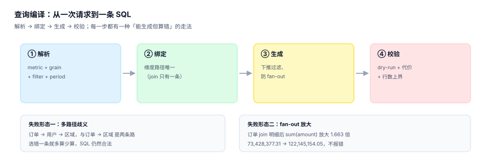
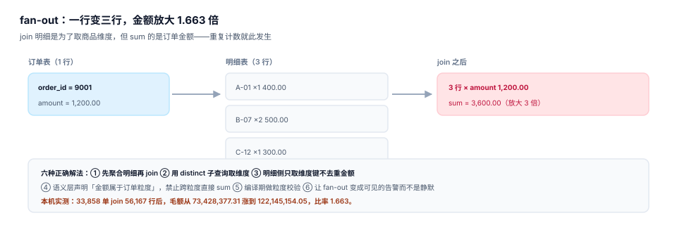

# 语义层与查询编译

业务方说「看下华东区上个月的成交额，按天」，这句话里其实藏着四个参数：指标（成交额）、粒度（按天）、过滤（华东区）、期间（上个月）。语义层要做的不是「拼一句 SQL」，而是**把这四个参数翻译成一条口径正确、粒度正确、代价可控的查询，并留下一个能复算的指纹**。

手工写 SQL 也能出数，问题在于同一个人下个月写的和上个月不一样。编译器的价值在于**同一组参数永远产出同一条 SQL**——这才有缓存、有对账、有「为什么昨天和今天不一样」的可解释性。



## 一、请求模型：五个必须有值的参数

```json
{
  "metric": "trade.gmv.net",
  "grain": ["day"],
  "filter": { "region": ["east"] },
  "period": { "start": "2026-05-01", "end": "2026-06-01" },
  "having": null
}
```

| 参数 | 缺省后果 | 是否允许默认 |
| --- | --- | --- |
| `metric` | 无法确定表达式 | 否 |
| `grain` | 只能返回总计，无法满足「按天」 | 否 |
| `filter` | 全量返回，慢且可能越权 | 是（等于无过滤，但权限仍生效） |
| `period` | 全历史扫描 | **否**（必须显式给期间） |
| `having` | 无 | 是 |

`period` 必须显式给，是编译层最重要的一条纪律。允许「不传期间」的接口，最终一定会有人拿它扫全表，然后所有人一起等。

## 二、四段编译

| 段 | 输入 | 输出 | 失败形态 |
| --- | --- | --- | --- |
| ① 解析 | 请求 JSON + 指标契约 | 逻辑计划（度量、聚合、粒度、过滤） | 指标不存在 / 粒度与指标不兼容（显性） |
| ② 绑定 | 逻辑计划 + 维度图 | 物理计划（表、join 路径、分区） | **多路径歧义**（能生成，但可能算错） |
| ③ 生成 | 物理计划 | SQL 文本 + 参数列表 | **fan-out 放大**（能跑，但重复计数） |
| ④ 校验 | SQL + 预算 | 指纹 + 计划摘要 + 放行/拒绝 | 代价超限（显性拒绝） |

### ① 解析：粒度兼容性

不是所有指标都能按任意粒度看。「成交额」是订单粒度，可以按天、按区域、按渠道看；「客单价」是比值，按天看没问题，**按「商品」看就没有意义**（一笔单里有多个商品，客单价怎么分？）。

编译器需要在解析阶段就拒绝这类组合，而不是生成一条「能跑但没人看得懂」的 SQL。判定方式写进契约：比值型指标声明 `grain_compatible: [order, user, region]`，请求的 `grain` 不在列表里直接返回 `422 grain.incompatible`。

### ② 绑定：多路径歧义是编译层最隐蔽的错

同一张订单表到「区域」通常有两条路：

```text
fact_order.region            -- 下单时的收货区域（订单属性）
fact_order.user_id → dim_user.region  -- 用户注册区域（用户属性）
```

两条路都合法、都能 join、都能出数，但结果不同。本机读数：33,858 单里两条路径的结果差异来自「用户换过区域」的那部分订单——量不大，但足以让两个团队的数字差 1%~3%，且**谁都无法证明对方错**。

处理方式有三种，必须选一种并写进契约：

| 方式 | 做法 | 适用 |
| --- | --- | --- |
| 白名单 | 每个指标声明允许的 join 路径，不在白名单直接拒 | 推荐默认 |
| 优先级 | 多条路径按 `priority` 取第一条，并在结果里标注 | 兼容历史 |
| 显式指定 | 请求里必须带 `join_path` 参数 | 分析型场景 |

::: danger 不要「按最短路径自动选」
自动选路径看起来聪明，实际是把业务语义交给图算法决定。用户改过一次收货地址，自动选路就会在某天悄悄换一条路，报表数字跟着跳——而日志里只有一条「路径变更」的 debug。
:::

### ③ 生成：fan-out 防护

这是编译器最容易出错、也最值得投人力的地方。订单粒度 join 明细后再 `sum(订单金额)`，会把一笔单算成 N 笔：



本机实测：33,858 单 join 56,167 条明细后，毛额从 **73,428,377.31** 涨到 **122,145,154.05**，放大 **1.663 倍**。SQL 完全合法，没有任何报错。

编译器的三种防护：

```sql
-- 防护一：先在明细侧聚合，再 join（"先聚合后连接"）
select o.region, sum(o.amount) as gmv
from fact_order o
where o.status = 'paid' and o.paid_at >= ? and o.paid_at < ?
group by o.region;

-- 需要商品维度时：先把订单金额按明细摊好，再聚合
with item_agg as (
  select order_id, sum(item_amount) as item_amount from fact_item group by order_id
)
select i.sku_id, sum(i.item_amount)
from fact_item i
join fact_order o on o.id = i.order_id
where o.status = 'paid'
group by i.sku_id;
```

```text
防护二：粒度校验（编译期静态检查）
  请求 grain = order，但物理计划里出现 fact_item 且 SELECT 里有 sum(订单级度量)
  → 直接拒绝，返回 422 grain.fanout_risk

防护三：执行期行数上界
  预估行数 > 期间内订单数 × 1.2 → 拒绝或降级为采样
```

三条防护里，**第二条最有效**，因为它把「算错」变成了「跑不了」。第三条是兜底：静态检查漏掉的写法（比如动态拼接的条件），还能被行数上界拦一次。

### ④ 校验：代价与指纹

编译产物必须包含一个**指纹**：SQL 文本归一化后的哈希（去掉空白、统一别名、参数占位符化）。指纹的用途有三个：

| 用途 | 说明 |
| --- | --- |
| 缓存键 | 同指纹 → 同结果，可安全复用 |
| 变更检测 | 指纹变了，说明口径或编译逻辑变了 |
| 审计 | 任何一个数字都能反查到生成它的那条 SQL |

## 三、参数化：缓存命中率的真正来源

把日期直接拼进 SQL，168 条日查询就是 168 条不同的 SQL，缓存命中率 **0%**；参数化之后是 1 条模板，命中率 **99.4%**：

| 写法 | 不同 SQL 条数（168 次日查询） | 可复用比例 |
| --- | --- | --- |
| 字面量拼接 | 168 | 0% |
| 参数化模板 | 1 | **99.4%** |

这不只是性能问题。字面量拼接还会让「同样的查询」在审计系统里看起来像 168 个不同的查询，血缘与影响面分析全部失效。

```sql
-- 反例：日期拼进文本
select sum(amount - refund_amount) from fact_order
where status='paid' and paid_at >= '2026-06-01' and paid_at < '2026-06-02';

-- 正例：参数化（同一个模板，只换参数）
select sum(amount - refund_amount) from fact_order
where status='paid' and paid_at >= ? and paid_at < ?;
```

::: warning 参数化 ≠ 一定安全
参数化能防注入、能提命中率，但**不能防「口径错」**。参数只影响「查哪段数据」，不影响「怎么算」。口径错要靠契约与编译期校验，不能指望参数化。
:::

## 四、编译产物：四件套

一次成功的编译应该产出四样东西，缺一样就不算「可运维」：

| 产物 | 内容 | 用途 |
| --- | --- | --- |
| SQL 文本 | 归一化后的语句 | 人工复核、DBA 审计 |
| 参数列表 | 有序的参数值 | 复跑、重放 |
| 指纹 | SQL 归一化后的哈希 | 缓存键、变更检测 |
| 计划摘要 | 扫描分区、预估行数、join 数 | 代价控制、慢查询归因 |

计划摘要里最重要的一个数是**预估扫描行数**。它决定了这条查询是「毫秒级」还是「把库拖死」——而后者通常不会报错，只会让所有人的查询一起变慢。

## 五、编译错误码：拒绝要给出可执行的下一步

| 错误码 | 触发条件 | 给用户的下一步 |
| --- | --- | --- |
| `422 metric.not_found` | 指标键不存在或已下线 | 返回最接近的三个候选键 |
| `422 grain.incompatible` | 粒度不在契约允许列表 | 列出该指标支持的粒度 |
| `422 grain.fanout_risk` | 物理计划跨粒度聚合 | 提示改用明细指标或先聚合 |
| `422 path.ambiguous` | 多条 join 路径且未指定 | 列出候选路径与差异说明 |
| `422 period.missing` | 未传期间 | 给出默认建议（最近 7 天） |
| `429 cost.exceeded` | 预估代价超预算 | 建议缩小期间或换粒度 |

错误码的价值在于**把「算错了」前置成「算不了」**。一条 `422 grain.fanout_risk` 拦下来的错误，事后要花三个人天去核对。

## 六、本专题的判据族

本页判据族 `MSC-A` ~ `MSC-H`，共 8 条。

| 判据 | 要求 | 判定方式 |
| --- | --- | --- |
| `MSC-A` | 请求五参数齐全，`period` 不得缺省 | 缺 `period` 的请求返回 422 |
| `MSC-B` | 四段编译职责分离，每段有明确产物 | 日志里能看到四段各自的输出 |
| `MSC-C` | 粒度兼容性在解析期拒绝 | 比值指标按商品查返回 422 |
| `MSC-D` | join 路径白名单或显式指定 | 多路径请求必须带 `join_path` 或命中白名单 |
| `MSC-E` | fan-out 有静态检查 + 行数上界双保险 | 构造订单 join 明细的查询被拒 |
| `MSC-F` | 编译产物四件套齐全，指纹可复算 | 同参数两次编译指纹一致 |
| `MSC-G` | 全链路参数化，无字面量拼接 | 168 次查询只产生 1 条模板 |
| `MSC-H` | 错误码可执行（每个码给出下一步） | 六个错误码各有一条示例响应 |

## 七、验证方式

```shell
# 1. 亲眼看到 fan-out：一笔单变成三行
sqlite3 :memory: "
create table o(id int, amount real);
create table i(oid int, sku text, amt real);
insert into o values (9001, 1200.0);
insert into i values (9001,'A',400),(9001,'B',500),(9001,'C',300);
select sum(o.amount) as 直接 from o;
select sum(o.amount) as join后 from o join i on i.oid=o.id;"
# 期望：1200.0 | 3600.0
```

```shell
# 2. 确认参数化只产生一条模板（对比拼接）
python3 - <<'PY'
tpl = "select sum(amount) from o where paid_at >= ? and paid_at < ?"
lit = {f"select sum(amount) from o where paid_at >= '2026-06-{d:02d}' and paid_at < '2026-06-{d+1:02d}'" for d in range(1, 29)}
print("参数化模板数:", 1, "字面量条数:", len(lit))
print("命中率 参数化:", round((len(lit)-1)/len(lit)*100, 1), "% 字面量: 0.0 %")
PY
# 期望：参数化模板数: 1 字面量条数: 28 / 命中率 参数化: 96.4 % 字面量: 0.0 %
```

```shell
# 3. 检查你的编译产物里有没有指纹
sqlite3 metrics.db "select count(*) from query_log where fingerprint is null;"
# 期望：0
```

第 1 条命令的 `3600.0` 就是 fan-out 的全部——**金额放大 3 倍，SQL 没有报错，报表看起来很正常**。

## 参考资料

- Cube《Query orchestration》：语义层如何把「指标 + 粒度 + 过滤」编排成一条查询，<https://cube.dev/docs/product/basics/concepts>
- dbt Labs《Semantic layer queries》：`metrics` + `group by` + `where` 的编译模型，<https://docs.getdbt.com/docs/build/semantic-models>
- Apache Calcite《Algebra》（关系代数与计划优化）：逻辑计划到物理计划的转换与代价模型，<https://calcite.apache.org/docs/algebra.html>
- 与本页相邻的册子：[口径契约](../Definition/index.md)、[预聚合与物化](../Aggregate/index.md)、[权限与行级过滤](../Access/index.md)。
