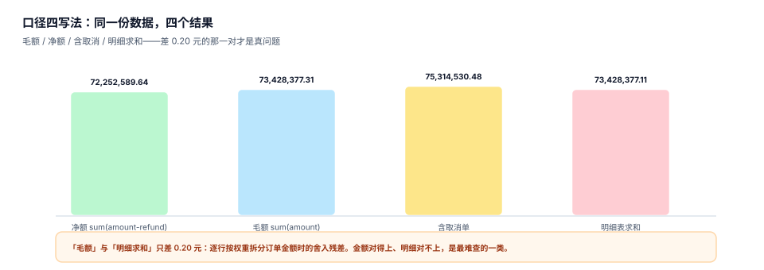

# 指标定义与口径契约

「成交额」这三个字，在一家公司里通常有四种写法：扣退款、不扣退款、含取消单、按下单时间还是支付时间。四种写法各自都能找到使用者，也各自都能找到「当初为什么这么定」的理由。问题不在于哪个对，而在于**这四个口径共用了同一个名字**。

口径契约要做的事只有一件：把「一句话」变成**一台机器能照着生成 SQL、一个人能照着复核、两个人吵起来时能据此判定谁跑偏了**的结构化定义。



## 一、指标的五要素

| 要素 | 回答的问题 | 缺失后果 | 例子 |
| --- | --- | --- | --- |
| 名称与语义 | 这个指标叫什么、一句话是什么 | 同名不同义，沟通成本归零 | 「成交额：已支付订单的商品金额合计」 |
| 表达式 | 用哪些字段、怎么聚合 | 无法编译，只能人工写 SQL | `sum(amount - refund_amount)` |
| 粒度 | 一行代表什么 | fan-out、重复计数 | 「一行一个订单」 |
| 时间语义 | 用哪个时间字段、哪个时区、边界开闭 | 跨日单归属错，日/月对不上 | 「按 `paid_at`，Asia/Shanghai，左闭右开」 |
| 排除项 | 哪些行不算 | 测试单、内部单混入 | 「排除 `is_test=true`、`channel='internal'`」 |

五要素里，**粒度与时间语义最容易缺**，因为它们「不写也能跑」：不写粒度，SQL 照样出数；不写时区，数据库默认时区照样能切日。而这两项恰恰是「同一天两个部门报出两个数」的第一大来源。

::: tip 一句话理解
口径契约不是文档，是**编译器的输入**。写不进契约的东西，编译器就不会执行；编译器不执行的东西，就一定会在某个人的手工 SQL 里被忘掉。
:::

## 二、可加性：决定「能不能上卷」的唯一属性

| 类型 | 定义 | 例子 | 上卷规则 |
| --- | --- | --- | --- |
| 可加（additive） | 沿所有维度相加都保持语义 | 金额、件数、订单数 | 任意粒度可 sum |
| 半可加（semi-additive） | 沿部分维度可加，沿时间不可加 | 库存余额、账户余额 | 时间维度取**期末值**，不能 sum |
| 不可加（non-additive） | 任何维度相加都失去语义 | UV、去重客户数、转化率、客单价 | 只能存**分子分母**或**去重集合**，不能存结果值 |

本机实测两个「不可加」的翻车现场：

| 指标 | 正确算法 | 错误算法 | 偏差 |
| --- | --- | --- | --- |
| 访问用户数 UV | 全期 `count(distinct user_id)` = 17,280 | 180 天日 UV 之和 = 39,670 | **+129.6%（2.296 倍）** |
| 客单价 | `sum(amount)/count(distinct order)` = 2,261.42 | 每日客单价再取平均 = 2,360.39 | **+4.38%** |

客单价这一类最容易被忽略：它不是「完全不可加」，而是**比值的平均不等于平均的比值**。差额来自权重——周末订单金额高 60%，但周末天数只占 2/7，日均值再平均就给周末过高的权重。

::: danger 三个常见错法
1. **把 `avg` 存进聚合表**：上卷时 `avg(avg)` 得到的是「等权平均」，不是加权平均。正确做法是同时存 `sum` 与 `count`，用的时候再除。
2. **把 UV 存成整数**：一旦存成整数，任何上卷都是错的；只能存 `HLL` / `bitmap` / 去重明细，或者干脆标记「不可上卷」。
3. **用「转化率」做加权**：转化率 = 转化数 / 曝光数，两个分子分母混在不同粒度里，加权必须先对齐粒度。
:::

## 三、十二字段契约

一份能编译、能评审、能追责的契约，最少要这十二个字段：

| 字段 | 类型 | 必填 | 说明 |
| --- | --- | --- | --- |
| `metric_key` | string | 是 | 全局唯一键，下划线小写，不含中文 |
| `name` | string | 是 | 展示名，允许中文，但同域内不得重名 |
| `domain` | string | 是 | 归属域（trade / growth / finance），决定评审人 |
| `definition` | text | 是 | 一句话定义，必须包含「算不算」三类边界 |
| `expr` | text | 是 | 聚合表达式，只能引用已登记的字段 |
| `grain` | enum | 是 | `order` / `order_item` / `user_day` / `sku_day` |
| `time_field` | string | 是 | 时间字段名，如 `paid_at` |
| `timezone` | string | 是 | 切日时区，如 `Asia/Shanghai` |
| `boundary` | enum | 是 | `[start,end)` 或 `(start,end]`，默认左闭右开 |
| `exclusions` | list | 是 | 排除项，空数组也要写（表示「确实没有」） |
| `additivity` | enum | 是 | `additive` / `semi` / `non` |
| `owner` | string | 是 | 口径负责人（人，不是团队） |

后四个字段（`time_field` / `timezone` / `boundary` / `exclusions`）是「不写也能跑」的那四个，也是评审时最容易被跳过的那四个。契约的严格性体现在这里：**空数组必须显式写**，因为「没想到要排除」和「确认不需要排除」在事后无法区分。

### 一份最小可编译的契约

```yaml [metrics/trade/gmv.yaml]
metric_key: trade.gmv.net
name: 成交额（净额）
domain: trade
definition: 已支付订单的商品金额扣除退款后的合计；不含取消、测试与内部渠道订单。
expr: sum(amount - refund_amount)
grain: order
time_field: paid_at
timezone: Asia/Shanghai
boundary: "[start,end)"
exclusions:
  - "status = 'cancelled'"
  - "is_test = true"
  - "channel = 'internal'"
additivity: additive
owner: zhang.lei
```

这份 YAML 的价值不在于「好看」，而在于它**可以被机械校验**：`expr` 只引用了 `grain` 声明的表里的字段，`exclusions` 引用的列都存在，`time_field` 在表里且类型是时间戳，`additivity=additive` 与表达式里只出现 `sum` 一致。

## 四、命名：让同名不同义在命名层就暴露

推荐 `域.对象.度量.口径` 四段式：

| 段 | 取值示例 | 作用 |
| --- | --- | --- |
| 域 | `trade` / `growth` / `finance` / `supply` | 决定评审人与权限边界 |
| 对象 | `gmv` / `order` / `user` / `sku` | 决定粒度 |
| 度量 | `amount` / `cnt` / `rate` / `avg` | 决定聚合方式 |
| 口径 | `net` / `gross` / `refund_excluded` | 决定「算不算」 |

四段里**口径段不许省**。省掉之后，`trade.gmv` 会被四个团队各自解释一遍，而键名完全相同——这是同名不同义最隐蔽的形态：键一样、值不一样，任何按 key join 的系统都会静默错配。

反例与正例：

| 写法 | 问题 |
| --- | --- |
| `gmv` | 无域、无口径，四处各写一份 |
| `成交额` | 中文键，跨系统编码不一致 |
| `gmv_net_v2` | 版本进键名，历史数据无法按版本查询 |
| `trade.gmv.amount.net` | 四段齐全，版本交给 `metric_version` 表 |
| `growth.uv.cnt.dedup` | 明确「去重」，读者不会误加 |

## 五、评审六问

评审不是「看一眼签个字」，是六个必须逐条回答的问题：

1. **算不算**：取消单、退款、测试单、内部单、跨境单——四类边界逐条回答，答不上来就是没定义完。
2. **一行是什么**：粒度说不清，后面所有 join 都是猜的。
3. **按哪个时间**：下单、支付、发货、完成，四个时间点在同一天可能落在四个月。
4. **能不能加**：可加性决定能不能进聚合表，不能加却进了聚合表，等于给未来埋一颗雷。
5. **谁负责**：`owner` 必须是具体的人。写团队名的后果是出事时「团队里每个人都以为别人在管」。
6. **和谁重名**：同域内做一次全量名称与语义比对，重名必须先解决再上线。

六问里第五问最容易被敷衍。判断标准很简单：**能不能在半夜两点把这个人叫起来解释这个数**。叫不起来的，就不是 owner。

## 六、时间语义：三个必须写死的选择

| 选择 | 选项 | 后果 |
| --- | --- | --- |
| 时间字段 | 下单 / 支付 / 发货 / 完成 | 同一笔单在四个字段上可能跨四个月 |
| 时区 | UTC / 固定偏移 / IANA 时区 | UTC 切日与本地区切日，边界单归属不同；本机跨日单 **32.03%** |
| 开闭 | `[start,end)` / `(start,end]` | 闭区间会让边界那一秒被算两次，月与月相加比全年多 |

本机读数最能说明时区问题：33,858 单里有 **10,846 单（32.03%）** 的 UTC 日期与东八区日期不是同一天。也就是说，按 UTC 切日的日报，有三分之一的单在「昨天/今天」的归属上和业务的理解不同。

::: warning 为什么推荐 IANA 时区而不是固定偏移
`+08:00` 看起来够用，但一旦有跨境业务或多地团队，固定偏移会把「夏令时」这件事藏起来——某天少一小时、某天多一小时，边界单归属随之变化，而报表只会显示「今天比昨天少 4%」。用 `Asia/Shanghai` 这类 IANA 名称，夏令时规则由时区库维护。
:::

## 七、排除项：写「不排除什么」比写「排除什么」更重要

排除项通常有四类，缺任何一类都会让数字系统性偏大：

| 类别 | 典型条件 | 偏大量级（经验） | 本机读数 |
| --- | --- | --- | --- |
| 状态类 | 取消、关闭、风控拦截 | 3%~8% | 取消单占 **4.10%** |
| 测试类 | `is_test`、内部员工、压测账号 | 0.5%~3% | 未注入，故为 0 |
| 渠道类 | 内部调拨、线下补录、代客下单 | 1%~5% | 未注入，故为 0 |
| 重复类 | 重复支付、冲正、拆单重下 | 0.1%~1% | 有退款的单占 **3.62%** |

注意第四类：**退款不是排除项，是减项**。把退款写成「排除退款单」会让分母也变小，客单价随之虚高。正确写法是 `sum(amount - refund_amount)`，退款作为减项参与聚合。

## 八、本专题的判据族

本页判据族 `MSD-A` ~ `MSD-H`，共 8 条。

| 判据 | 要求 | 判定方式 |
| --- | --- | --- |
| `MSD-A` | 五要素齐全，粒度与时间语义不得为空 | 契约里五个字段都有值 |
| `MSD-B` | 可加性三选一，且与表达式一致 | `additive` 却出现 `count(distinct)` 即不成立 |
| `MSD-C` | 十二字段齐全，`exclusions` 允许空数组但必须存在 | 缺字段即不成立 |
| `MSD-D` | 命名四段式，口径段不得省 | 正则校验键名 |
| `MSD-E` | 评审六问逐条有答案，`owner` 是具体的人 | 六问有记录，owner 非团队名 |
| `MSD-F` | 时间字段、时区、开闭三项写死 | 三项均有值，不允许「跟随数据库默认」 |
| `MSD-G` | 四类排除项逐类回答，退款按减项处理 | 退款出现在 `exclusions` 而非 `expr` 即不成立 |
| `MSD-H` | 契约能被机械校验（字段存在、类型匹配） | 校验脚本对契约返回 0 个错误 |

## 九、验证方式

用三条命令确认「契约能编译、口径确实不同、不可加确实不能加」：

```shell
# 1. 契约里的排除项是否真的改变了结果（本机 33,858 单）
sqlite3 :memory: "
create table o(id int, status text, amount real, refund real, is_test int);
insert into o values (1,'paid',1000,0,0),(2,'paid',500,100,0),(3,'cancelled',800,0,0),(4,'paid',999,0,1);
select sum(amount) as 不排除 from o;
select sum(amount) from o where status<>'cancelled' and is_test=0;"
# 期望：3299.0 | 1400.0 —— 一条 SQL 之差，结论差一倍多
```

```shell
# 2. 确认「退款是减项，不是排除项」
sqlite3 :memory: "
create table o(id int, status text, amount real, refund real);
insert into o values (1,'paid',1000,100),(2,'paid',500,0);
select sum(amount-refund) as 减项 from o where status='paid';
select sum(amount) as 误当排除 from o where status='paid' and refund=0;"
# 期望：1400.0 | 500.0
```

```shell
# 3. 检查你的契约表：exclusions 为空的行有多少
sqlite3 metrics.db "select count(*) from metric_version where exclusions is null or exclusions = '[]';"
# 期望：0。非 0 说明「排除项没写」，不是「不需要排除」
```

第 2 条命令的 `1400.0` 与 `500.0` 是同一份数据：把退款当排除项，收入少了 900（整单的 1,000 连同它的 100 退款一起消失），分母从 2 单掉到 1 单，客单价从 700 掉到 500（**低估 28.6%**）。退款是「这笔钱退回去了」，不是「这笔生意没发生」——两者的分母不同。

## 参考资料

- dbt Labs《Semantic models》与《Metrics》：`measure` / `dimension` / `entity` 的组织方式与本文的五要素基本同构，<https://docs.getdbt.com/docs/build/semantic-models>
- Cube《Data modeling》：度量类型（`sum` / `count` / `countDistinct` / `avg`）与上卷行为的官方说明，<https://cube.dev/docs/product/data-modeling/concepts>
- Kimball Group《Additive, Semi-Additive, Non-Additive Facts》：三类事实的经典定义，<https://www.kimballgroup.com/data-warehouse-business-intelligence-resources/kimball-techniques/dimensional-modeling-techniques/additive-semi-additive-non-additive-facts/>
- IANA Time Zone Database：时区名称与夏令时规则的权威来源，<https://www.iana.org/time-zones>
