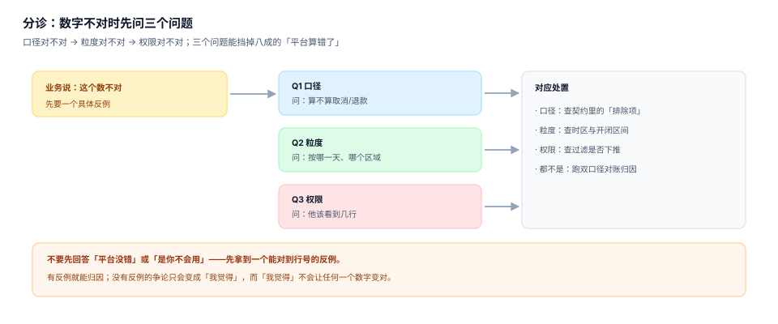

# 常见问题与分诊

指标平台的工单有一个共同特征：**提问方给的是一个数字和一句「不对」，而不是一个可复现的反例**。没有反例，讨论就只能停在「我觉得」——而「我觉得」不会让任何一个数字变对。

这一页把十二个高频问题按「口径 / 粒度 / 性能 / 权限」四类归档，每一类给出**判定方法**与**处置动作**。目的是让第一次接到工单的人能在十分钟内定位到页，而不是从头读一遍全册。



## 一、三步分诊

| 步 | 问什么 | 拿到什么 | 去哪一页 |
| --- | --- | --- | --- |
| ① 口径 | 「你算不算取消单 / 退款 / 测试单」 | 两边的排除项清单 | [口径契约](../Definition/index.md) |
| ② 粒度 | 「按哪一天、哪个时区、哪个区域」 | 时间字段与时区 | [查询编译](../Compile/index.md) |
| ③ 权限 | 「他应该看到几行」 | 行级过滤条件 | [权限](../Access/index.md) |

三步都问完还不一致，才需要跑[双口径对账](../Reconcile/index.md)做归因。跳过前两步直接对账，会把「口径不同」当成「系统错误」查上一整天。

## 二、口径类（四个）

| # | 现象 | 可能原因 | 判定方法 | 处置 |
| --- | --- | --- | --- | --- |
| 1 | 报表比手工 SQL 多 4% | 一边含取消单、一边不含 | 各自 `where` 里有没有 `status='cancelled'` | 统一口径或标注口径版本 |
| 2 | 退款没扣 | 退款写成排除项而非减项 | 检查 `expr` 是 `sum(amount-refund)` 还是 `where refund=0` | 改表达式，退款参与计算 |
| 3 | 数字每月都涨一点 | 测试单/内部单未排除 | 拉 `is_test` / `channel` 分布 | 补 `exclusions` 并重算 |
| 4 | 同比失真 | 口径改了但历史没重述 | 对比同一历史区间的新旧两版结果 | 走重述流程（见版本页） |

第一类最典型。本机读数：净额 72,252,589.64 vs 含取消单 75,314,530.48，差 **3,061,940.84（4.07%）**——这个量级足以让「同比增长 2%」变成「同比下降 2%」。

## 三、粒度类（四个）

| # | 现象 | 可能原因 | 判定方法 | 处置 |
| --- | --- | --- | --- | --- |
| 5 | 日加起来 ≠ 月 | 不可加指标被上卷 | 看指标 `additivity` 是否为 `non` | 存分子分母或去重集合 |
| 6 | 明细比订单多 | fan-out（订单 join 明细） | 比对 join 前后行数比 | 先聚合明细再 join |
| 7 | 月度边界差几十单 | 时区不同（UTC vs 东八区） | 只查边界日的归属 | 统一 `timezone` 与开闭 |
| 8 | 客单价偏高 | 日均值再平均 | 对比 `sum/count` 与 `avg(avg)` | 存 `sum` 与 `count` |

第六类的本机读数是 **1.663 倍**（73,428,377.31 → 122,145,154.05）。它最危险的地方在于：明细行数是「多」的，而金额也是「多」的，两个错误互相印证，看起来像一个自洽的结果。

## 四、性能类（两个）

| # | 现象 | 可能原因 | 判定方法 | 处置 |
| --- | --- | --- | --- | --- |
| 9 | 看板打开要 40 秒 | 未命中预聚合，回明细 | `query_log` 里 `cache_hit=0` 的占比 | 加粒度组合或限流回退 |
| 10 | 昨天快今天慢 | 字面量 SQL 导致缓存穿透 | 同参数 SQL 的不同文本条数 | 全链路参数化 |

第十类的本机读数：168 次日查询，字面量拼接产生 **168 条不同 SQL（命中率 0%）**，参数化后 **1 条模板（99.4%）**。这类问题不会报错，只会让人以为「数据库今天有点慢」。

## 五、权限类（两个）

| # | 现象 | 可能原因 | 判定方法 | 处置 |
| --- | --- | --- | --- | --- |
| 11 | 华东经理看到全域数 | 行级过滤后置或缺失 | 用该角色跑一次，数返回行数 | 过滤下推到 SQL |
| 12 | 换个人登录看到同一个数 | 缓存键没含权限上下文 | 检查缓存键结构 | 键里加 `scope` |

第十一类的本机读数：应见 6,811 行，实见 33,858 行，**越权 79.88%**。这个错误永远不会自己暴露——看到数的人不知道自己不该看到，做数的人不知道有人看到了全部。

## 六、五个「不是问题」的问题

有些工单的正确答复是「这是对的」，但必须给依据，否则等于敷衍：

| 现象 | 为什么是对的 | 怎么解释 |
| --- | --- | --- |
| 分区域之和 ≠ 总计 | 有小样本抑制（`count < k` 置空） | 说明抑制阈值与被抑制的格子数 |
| 明细行对不上报表 | 报表是聚合口径，明细是事务口径 | 给出聚合前后的行数比 |
| 昨天数字今天变了 | 迟到数据触发 T+2 重算 | 给出重算记录与触发原因 |
| 两个人看到的数不同 | 合法：行级过滤不同 | 给出各自 `scope` |
| UV 月度不等于日之和 | 去重指标不可加 | 给出跨天回访人数 |

::: tip 解释的格式
一句结论 + 一个可复算的命令 + 一个数量级。例如：「这是小样本抑制，`count<5` 的格子被置空，本次共 3 个格子；命令 `select ...` 可复现。」三段缺一段，工单会被重新打开。
:::

## 七、升级路径

| 情况 | 找谁 | 需要带什么 |
| --- | --- | --- |
| 口径说不清 | 业务定义人（`owner`） | 两边公式与排除项 |
| 数算错 | 数据工程 | 指标键、期间、期望值、实际值 |
| 查询慢 | 平台 | 请求 JSON、耗时、是否命中缓存 |
| 权限不对 | 平台 + 安全 | 角色、`scope`、返回行数 |
| 对账不平 | 财务 + 平台 | 三方结果与差异清单 |

升级的门槛是**带反例**。没有反例的升级会被退回，退回一次之后，提问方就会开始自己造反例——这其实是好事。

## 八、本专题的判据族

本页判据族 `MSQ-A` ~ `MSQ-H`，共 8 条。

| 判据 | 要求 | 判定方式 |
| --- | --- | --- |
| `MSQ-A` | 十二个问题按四类归档，每类有判定方法 | 表格里每行都有「判定方法」列 |
| `MSQ-B` | 三步分诊有顺序，不得跳步 | 分诊表按 ① ② ③ 排列 |
| `MSQ-C` | 每个问题都给可执行处置 | 「处置」列不允许写「排查一下」 |
| `MSQ-D` | 至少五个「不是问题」的场景有解释模板 | 五个场景各有一句结论 + 一个命令 |
| `MSQ-E` | 升级路径按问题类型分流 | 五个类型各有对接方与材料清单 |
| `MSQ-F` | 关键问题配本机读数 | 至少四条问题带具体数字 |
| `MSQ-G` | 有跨页链接，能跳到对应章节 | 四类各至少一条链接 |
| `MSQ-H` | 有一条可复跑的验证命令 | 本页第九节命令返回预期值 |

## 九、验证方式

```shell
# 1. 复现「日加起来 ≠ 月」：不可加指标的典型症状
sqlite3 :memory: "
create table e(d text, uid int);
insert into e values ('d1',1),('d1',2),('d2',2),('d2',3);
select count(distinct uid) from e;
select sum(c) from (select d, count(distinct uid) c from e group by d);"
# 期望：3 | 4
```

```shell
# 2. 复现「边界差几十单」：时区导致
sqlite3 :memory: "
create table o(id int, t text);
insert into o values (1,'2026-06-30 20:00'),(2,'2026-06-30 10:00');
select count(*) from o where t>='2026-06-01' and t<'2026-07-01';
select count(*) from o where datetime(t,'+8 hours')>='2026-06-01' and datetime(t,'+8 hours')<'2026-07-01';"
# 期望：2 | 1
```

```shell
# 3. 检查你的系统里有多少「口径不明」的指标
sqlite3 metrics.db "select count(*) from metric where key not in (select metric_key from metric_version);"
# 期望：0。非 0 说明有指标没有契约，只能靠人记
```

第 3 条命令返回非 0 时，那些指标就是下一批工单的来源——**没有契约的指标，每个使用者都在心里存了一份自己的口径**。

## 参考资料

- dbt Labs《Troubleshooting the semantic layer》：官方给出的常见差异排查顺序，<https://docs.getdbt.com/docs/build/semantic-models>
- Cube《Caching and pre-aggregations》：命中率与回退行为的官方说明，<https://cube.dev/docs/product/caching>
- PostgreSQL《Row Security Policies》：行级过滤不生效的常见原因（会话变量未设置），<https://www.postgresql.org/docs/current/ddl-rowsecurity.html>
- 与本页相邻的册子：[总览](../Overview/index.md)、[口径契约](../Definition/index.md)、[双口径对账](../Reconcile/index.md)。
