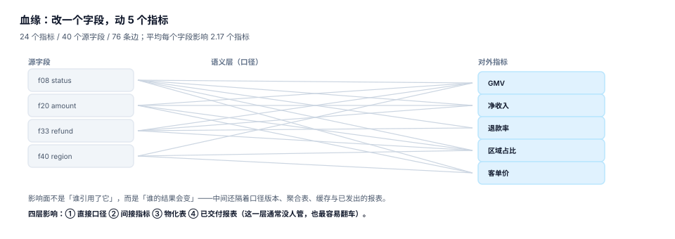

# 血缘与影响面

数据治理册里的血缘回答「这张表的数据从哪来」，本页要回答的是另一个问题：**改这一个字段，谁的数会变**。前者是溯源，后者是影响面；前者用于排查，后者用于**变更前**的决策。

这两个问题的技术实现很像（都是图遍历），但产物完全不同：溯源给出「一条链路」，影响面必须给出「一份可执行的清单」——改哪个指标、刷哪张聚合表、通知哪些报表的负责人、哪些数字需要在发布说明里标注。



## 一、三层血缘，缺一层就断

| 层 | 边 | 例子 | 谁维护 |
| --- | --- | --- | --- |
| 表级 | `表A.字段 → 表B.字段` | `ods.order → dwd.fact_order.amount` | 调度系统自动解析 |
| 列级 | `f20 amount → 指标 GMV` | 一行字段被哪个指标的表达式引用 | 语义层解析（自动 + 人工确认） |
| 指标级 | `GMV → 看板「交易总览」` | 指标被哪些报表、接口、告警使用 | 需要登记（最难自动） |

三层里前两层可以自动抽取，第三层几乎只能靠登记。而恰恰是第三层决定了「改完之后要通知谁」——没有它，影响面分析只能给出「有 5 个指标会变」，给不出「这 5 个指标在 12 张报表上，负责人是 3 个人」。

## 二、边表：血缘的最小存储

```sql
create table metric_lineage (
  metric_key   text not null,     -- 下游：指标
  source_table text not null,     -- 上游：表
  source_col   text not null,     -- 上游：字段
  transform    text not null,     -- sum / count_distinct / filter / join_key
  recorded_at  text not null,
  primary key (metric_key, source_table, source_col, transform)
);
```

四个设计点：

1. **`transform` 必存**：同一个字段既可能是 `sum` 的对象，也可能是 `filter` 的条件。只记「引用」不记「怎么用」，影响面会高估（把过滤条件的变更也当成数值变更）。
2. **主键四元组**：同一字段对同一指标可能有多种用法（`amount` 既是 `sum` 对象又在 `where amount > 0` 里），四元组才能表达。
3. **`recorded_at`**：血缘本身也会变，需要知道「这条边是什么时候登记的」。
4. **不存「传递闭包」**：闭包会随每次变更重算，存下来只会过期。用递归查询实时算。

## 三、正向与反向

| 方向 | 问题 | 用途 | 典型耗时 |
| --- | --- | --- | --- |
| 反向（溯源） | 「这个数是怎么来的」 | 排查异常、解释口径 | 毫秒级（边少） |
| 正向（影响） | 「改这个字段会动谁」 | 变更评审、下线决策 | 与深度成正比 |

本机对一张 24 个指标 / 40 个源字段 / 76 条边的登记图做遍历：

| 指标 | 读数 |
| --- | --- |
| 指标数 | 24 |
| 源字段数 | 40 |
| 边数 | 76 |
| 平均每个字段影响的指标数 | **2.17** |
| 影响最多的单字段 | **5 个指标** |
| 深度 | 最多 2 跳（字段 → 指标 → 派生指标） |

2.17 这个数说明：「**只改一个字段**」在指标层几乎不存在。一个字段平均牵动两个指标，而这两个指标又各自被若干报表引用——所以「小改动」的影响面通常比直觉大 3~5 倍。

## 四、影响面必须算到第四层

| 层 | 内容 | 是否常被漏 | 后果 |
| --- | --- | --- | --- |
| ① 直接口径 | 表达式里直接引用该字段的指标 | 否 | 数字变 |
| ② 间接指标 | 由①派生的比值、同比、环比 | **是** | 报表结构不变但数变 |
| ③ 物化表 | 需要重算的聚合组合 | **是** | 数字「一半新一半旧」 |
| ④ 已交付报表 | 发给客户 / 管理层的固定报表、对外披露 | **最常见** | 对外数字与自己说的不一致 |

第四层是最容易被忽略的一层，因为它**不在任何系统里**。做法是把「已交付报表」做成一张登记表：报表名、指标清单、负责人、交付周期、最近一次交付时间。没有这张表，影响面分析只能做到第三层。

```sql
-- 正向影响：从一个字段出发，找出所有受影响的指标（含派生）
with recursive impact(metric_key, depth, path) as (
  select metric_key, 1, metric_key
  from metric_lineage
  where source_table = 'fact_order' and source_col = 'amount'
  union all
  select l.metric_key, i.depth + 1, i.path || '>' || l.metric_key
  from metric_lineage l
  join impact i on l.source_table = i.metric_key   -- 派生指标以指标为上游
  where i.depth < 5
)
select distinct metric_key, min(depth) as depth from impact group by metric_key order by depth, metric_key;
```

这段查询有两个细节值得注意：`union all` 而不是 `union`（去重会吞掉不同路径），以及 `depth < 5` 的硬上限（防止环导致无限递归）。

::: danger 血缘图里的三种「假边」
1. **同名字段假边**：`amount` 在订单表与退款表里都叫 `amount`，按名字自动抽取会连出一条不存在的边。
2. **注释里的假边**：SQL 注释里提到表名，解析器会当成引用。
3. **临时表断链**：中间用了 `create temporary table` 或 CTE，链在临时对象处断掉，下游看起来「没有上游」。
:::

## 五、变更流程：四步，少一步就出事

| 步 | 动作 | 产物 | 谁做 |
| --- | --- | --- | --- |
| ① 冻结 | 变更期间禁止新增对该字段的引用 | 冻结标记 + 生效时间 | 平台 |
| ② 影响面 | 跑正向遍历，输出四层清单 | 影响面报告 | 数据工程 |
| ③ 通知 | 按清单逐个通知负责人，附「变化幅度预估」 | 通知记录 | 变更发起人 |
| ④ 回填 | 重算聚合表、刷新报表、更新对外说明 | 重算记录 + 发布说明 | 平台 + 业务 |

「变化幅度预估」是第 ③ 步的关键。只说「会影响你」没有用，负责人需要知道「会影响多少」才能决定要不要提前准备口径说明。预估不需要精确，给出量级即可（如「约 4%」），但必须给出依据（参照历史同期变动或抽样计算）。

## 六、血缘的维护成本

| 方式 | 覆盖率 | 维护成本 | 失真风险 |
| --- | --- | --- | --- |
| 纯自动解析 SQL | 表级 ~90%，列级 ~60% | 低 | 中（动态 SQL、临时表断链） |
| 自动 + 人工确认 | 列级 ~95% | 中 | 低 |
| 纯人工登记 | 取决于纪律 | 高 | 高（三个月后没人更新） |

推荐「自动抽取 + 人工确认关键边 + 指标级强制登记」。关键是**指标级必须强制**：新增指标时不填「被哪些报表使用」，就不允许上线。这条规则看起来麻烦，但它把「三个月后没人说得清」变成了「上线时就必须说清」。

## 七、本专题的判据族

本页判据族 `MSL-A` ~ `MSL-H`，共 8 条。

| 判据 | 要求 | 判定方式 |
| --- | --- | --- |
| `MSL-A` | 三层血缘齐全，指标级不得为空 | 每个指标至少一条「被谁使用」的边 |
| `MSL-B` | 边表存 `transform`，区分取值与过滤 | 边表四元组主键存在 |
| `MSL-C` | 正向遍历可跑，含深度上限 | 递归查询 1 秒内返回 |
| `MSL-D` | 反向溯源可回答「这个数怎么来的」 | 给定指标能列出全部上游字段 |
| `MSL-E` | 影响面覆盖四层（含已交付报表） | 报告里有第四层清单 |
| `MSL-F` | 变更前冻结，冻结期有生效时间 | 冻结标记可查 |
| `MSL-G` | 通知带「变化幅度预估」与依据 | 通知记录里有量级与依据 |
| `MSL-H` | 新指标上线必须登记使用方 | 未登记的不允许发布 |

## 八、验证方式

```shell
# 1. 用递归 CTE 跑一次正向影响（含派生指标）
sqlite3 :memory: "
create table l(m text, t text, c text, x text);
insert into l values
 ('gmv','fact_order','amount','sum'),
 ('gmv','fact_order','refund','sum'),
 ('net_rev','gmv','value','derive'),
 ('gmv_region','gmv','value','derive'),
 ('refund_rate','fact_order','refund','sum');
with recursive imp(m,d) as (
  select m,1 from l where t='fact_order' and c='amount'
  union
  select l.m, imp.d+1 from l join imp on l.t=imp.m where imp.d<5)
select m, min(d) from imp group by m order by 2,1;"
# 期望：gmv|1, gmv_region|2, net_rev|2
```

```shell
# 2. 确认「一个字段平均牵动几个指标」
sqlite3 metrics.db "
select round(avg(n),2) as 平均影响数, max(n) as 最大 from (
  select source_table||'.'||source_col as f, count(distinct metric_key) n
  from metric_lineage group by 1);"
# 期望：2.17 | 5（本机 24 指标 / 40 字段 / 76 边的登记图）
```

```shell
# 3. 检查有没有「不知道被谁用」的指标
sqlite3 metrics.db "
select count(*) from metric m
where not exists (select 1 from metric_usage u where u.metric_key = m.key);"
# 期望：0
```

第 1 条命令的输出里，`net_rev` 与 `gmv_region` 是**第二层**——它们不直接引用 `amount`，但会跟着变。只查第一层的影响面，会漏掉这两个指标以及它们背后的所有报表。

## 参考资料

- dbt Labs《About dbt lineage》：列级血缘的自动抽取方式与 `ref` 图，<https://docs.getdbt.com/docs/collaborate/explore-projects>
- OpenLineage 规范：作业、数据集、字段级血缘的事件模型，<https://openlineage.io/docs/spec/object-model>
- Marquez 项目文档：血缘图的存储与查询实现，<https://marquezproject.ai/docs>
- 与本页相邻的册子：[数据治理的血缘页](../../../DB/DataGovernance/Lineage/index.md)（表级溯源）、[口径契约](../Definition/index.md)、[版本与回溯](../Version/index.md)。
