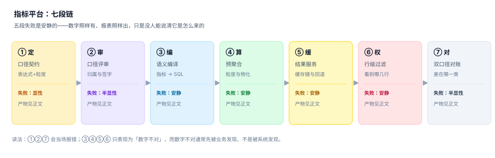

# 总览：七段链与三个「同一个数」

一个指标从「业务嘴里的一个词」变成「报表上的一个数」，中间要过七道手：定义、评审、编译、计算、缓存、授权、对账。每一道手都会产出一个「这个东西应该是什么」的判断，而这些判断之间并不天然一致——定义说「不含退款」，编译生成了 `sum(amount)`，缓存里躺着上一版的结果，对账时财务拿的是含取消单的总量。

这一页做三件事：把七段链讲清楚、把三个「同一个数」分开、把四个必失接缝标出来。后面九页都在补这三件事的细节。

## 一、七段链：每段都在产生一个「结论」

| 段 | 输入 | 动作 | 产物 | 结论形态 | 失败是否安静 |
| --- | --- | --- | --- | --- | --- |
| ① 定 | 业务的一句话 | 写表达式、定粒度、列排除项 | `metric` + `metric_version` | 「这个指标是什么意思」 | 显性（写不出表达式就提不了） |
| ② 审 | 草稿口径 | 归属、命名、边界、签字 | `owner` + 评审记录 | 「这个口径公司认了」 | 半显性（没人签字会卡住） |
| ③ 编 | 指标 + 粒度 + 过滤 | 语义层编译成 SQL | 编译产物 + 指纹 | 「这次查询具体查什么」 | **安静**（SQL 合法但算错） |
| ④ 算 | 编译产物 | 扫描、聚合、上卷、物化 | `agg_cache` / 物化视图 | 「这个数已经算出来了」 | **安静**（不可加的被加了） |
| ⑤ 缓 | 计算结果 | 缓存键、TTL、回退 | 查询结果 + `query_log` | 「这个数可以直接给人看」 | **安静**（缓存穿了权限） |
| ⑥ 权 | 结果 + 身份 | 指标权限、行级过滤、脱敏 | 过滤后的结果集 | 「这个人只能看到这些」 | **安静**（多给了几行没人知道） |
| ⑦ 对 | 平台值 + 手工值 | 对账、归因、闭环 | `recon_result` | 「这个数能被复核」 | 半显性（阈值报警才浮出来） |



**为什么只有第 ① 段是显性的**：定义是唯一「从人的语言进入系统」的环节，表达式写不出来、粒度说不清、排除项漏了业务规则，评审当场就能拦。从第 ③ 段开始，每一段的输入都是**上一段认为对的东西**——上一段错了，这一段没有能力发现。

最典型的例子：定义里写「排除测试账号」，但排除项写在文档里、没写进 `where`。编译照样生成 SQL，聚合照样出数，缓存照样命中，对账时财务拿到的总量比平台多 0.8%。全过程没有一处报错，只有一张对外披露的报表错了 0.8%。

::: danger 安静失败的三条共同特征
1. **SQL 能跑**：语法、权限、超时全都正常，日志里连一条 warning 都没有。
2. **数字有量级**：结果不是 0、不是 NULL，看起来「像那么回事」，肉眼无法判断对错。
3. **上下游都认**：编译认为定义是对的，缓存认为计算是对的，前端认为接口是对的——**没有任何一方有动机去验**。
:::

## 二、三个「同一个数」

| 口径 | 公式 | 谁在关心 | 常见错法 |
| --- | --- | --- | --- |
| 报表口径 | `sum(amount - refund_amount) where status='paid'` | 业务 / 运营 | 口径改了不重述历史，同比与环比同时失真 |
| 接口口径 | `sum(amount) where status='paid'` | 下游系统 / 客户 | 接口自己拼 SQL，绕过语义层，口径分裂 |
| 对账口径 | `sum(amount - refund_amount)`（不过滤状态） | 财务 / 审计 | 拿含取消单的总量去对净额的明细，永远对不上 |


本机读数（33,858 单 / 180 天 / 种子 20261103）：三个数分别是 **72,252,589.64 / 73,428,377.31 / 75,314,530.48**，极差 **3,061,940.84 元（4.07%）**。

三个数都能对到同一张 `fact_order`，都没有算错。「**哪个对**」这个问题本身是错的——正确的问题是「这三个数各自服务谁，两两之间能不能互相解释」。

### 三个数之间必须有桥

| 桥 | 表达式 | 本机读数 |
| --- | --- | --- |
| 报表 → 接口 | `+ sum(refund_amount)` | +1,175,787.67（退款） |
| 接口 → 对账 | `+ sum(amount) where status='cancelled'` | +1,886,153.17（取消单） |
| 报表 → 对账 | 上面两段之和 | +3,061,940.84 |

桥的意义在于：任何两个数之间的差，都能被拆成**有限个、有名字的**加项。拆不出来，说明中间有一段的语义没人说得清。

## 三、四个必失接缝

接缝是两段之间的交界，也是「两边都以为对方会管」的地方。

| 接缝 | 左边认为 | 右边认为 | 实际丢失的东西 | 本机读数 |
| --- | --- | --- | --- | --- |
| ③→④ | 「SQL 里的粒度就是指标粒度」 | 「聚合表按天存，随时能上卷」 | 订单粒度 join 明细后 fan-out | 73,428,377.31 → 122,145,154.05（**1.663×**） |
| ④→⑤ | 「缓存键 = 指标 + 期间 + 粒度」 | 「同一个人看到的数一样」 | 权限上下文没进缓存键 | east 应见 6,811 行，实见 33,858 行（**79.88% 越权**） |
| ⑤→⑥ | 「过滤在应用层做也一样」 | 「SQL 里已经带过滤了」 | 先聚合后过滤，总数已泄露 | join 后明细行 56,167 全部可见 |
| ⑥→⑦ | 「平台算的就是准的」 | 「财务的对账单才是准的」 | 切日时区不同，边界单归属不同 | UTC 16,325 vs 东八区 16,247（**78 单 / 0.478%**） |

四条接缝里，只有第三条会在某些实现里「碰巧正确」——如果过滤谓词恰好写在 SQL 里。其余三条**无论实现怎么写都会错**，区别只是错多错少。

## 四、五个角色与三份签字

| 角色 | 关心什么 | 会漏什么 | 在哪一步签字 |
| --- | --- | --- | --- |
| 业务定义人 | 「这个数是否符合业务直觉」 | 排除项、边界条件 | ② 评审 |
| 数据工程 | 「能不能算出来、跑得多快」 | 口径的业务含义 | ③ 编译 |
| 平台 | 「查询稳不稳、贵不贵」 | 口径是否被绕过 | ④⑤ 计算与服务 |
| 分析师 | 「能不能自助取数」 | 自己复制了一份口径 | ⑥ 使用 |
| 财务 / 审计 | 「能不能逐笔核到凭证」 | 平台的切日与口径 | ⑦ 对账 |

**三份签字**：口径签字（业务 + 数据）、上线签字（平台 + 分析师）、对账签字（财务 + 平台）。三份签字的共同点是**签字人不是实现人**——自己验自己，等于没验。

## 五、六个必失点与本机读数

| 必失点 | 为什么会失 | 本机读数 |
| --- | --- | --- |
| 口径漂移 | 同名不同式，四处各写一份 | 四写法极差 3,061,940.84（4.07%） |
| 粒度混算 | 订单粒度 join 明细再 sum | 放大 **1.663 倍** |
| 不可加上卷 | 日 UV 直接相加做月 | 17,280 → 39,670（**2.296 倍**） |
| 均值平均 | 日均值再平均 | 真值 2,261.42，日均均值 2,360.39（**+4.38%**） |
| 时区切日 | UTC 存、本地看 | 跨日单 10,846（**32.03%**） |
| 权限后置 | 先算后过滤 | 越权 **79.88%** 的行 |

六个数有一个共同点：**都在 1% 以上**。这意味着它们都能被业务肉眼发现，但都要等到「有人真的去核」才会被发现——而这个人通常是三个月后的审计。

## 六、本专题的判据族

本页判据族 `MSO-A` ~ `MSO-H`，共 8 条。八条都能被单独判定，任何一条不成立就不算这篇文档写完。

| 判据 | 要求 | 判定方式 |
| --- | --- | --- |
| `MSO-A` | 七段链每段都有输入、产物、结论形态与失败形态 | 对照本页第一张表，缺一列即不成立 |
| `MSO-B` | 三个口径各有公式、读者与常见错法 | 三个公式都能在 `fact_order` 上跑出不同结果 |
| `MSO-C` | 四个接缝各自指定了归属方 | 每个接缝能回答「谁负责补这一刀」 |
| `MSO-D` | 五个角色与三份签字分离 | 签字人 ≠ 实现人 |
| `MSO-E` | 六个必失点各配一个可复算读数 | 读数能在本机用种子 20261103 复现 |
| `MSO-F` | 与八个相邻册子的边界写成表 | 八行里没有一行是「顺便提一句」 |
| `MSO-G` | 版本组织结论明确且给理由 | 不建版本目录，三条理由可被反驳 |
| `MSO-H` | 有可执行的验收入口 | 本页第七节两条命令返回预期值 |

## 七、验证方式

读完本页，用两条命令确认「三个数可以同时正确，且不可加指标不能相加」：

```shell
# 1. 三个口径同时成立
sqlite3 :memory: "
create table o(id int, status text, amount real, refund real);
insert into o values (1,'paid',1000,100),(2,'paid',500,0),(3,'cancelled',800,0);
select sum(amount-refund) from o where status='paid';
select sum(amount) from o where status='paid';
select sum(amount-refund) from o;"
# 期望：900.0 | 1500.0 | 2200.0
```

```shell
# 2. 确认「日 UV 之和 ≥ 全期 UV」，差值是跨天回访
sqlite3 :memory: "
create table e(d text, uid int);
insert into e values ('d1',1),('d1',2),('d2',2),('d2',3);
select count(distinct uid) from e;
select sum(c) from (select d, count(distinct uid) c from e group by d);"
# 期望：3 | 4
```

第 2 条返回的 `3 | 4` 说明：全期 3 个人，按天相加得 4 人次。**任何把日 UV 相加当周 UV 的报表，都在系统性高估**，且高估幅度随周期变长而增大（180 天时实测 2.296 倍）。

## 参考资料

- dbt Labs《About the dbt Semantic Layer》：语义层解决的正是「指标定义与查询分离」，<https://docs.getdbt.com/docs/build/semantic-models>
- Cube《Semantic Layer concepts》：指标、度量、维度、分段与预聚合的关系，<https://cube.dev/docs/product/basics/concepts>
- Ralph Kimball《The Data Warehouse Toolkit》：可加 / 半可加 / 不可加事实的划分方式。
- 与本页相邻的册子：[数据仓库](../../../DB/DataWarehouse/Overview/index.md)、[数据治理](../../../DB/DataGovernance/Overview/index.md)、[接口契约演进](../../ContractEvolution/index.md)。
