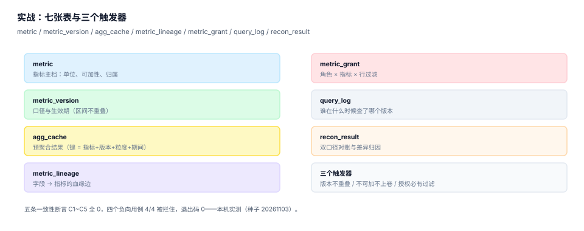

# 实战：七张表、四个触发器、九条断言

理论上的「口径要有契约、不可加不能上卷、授权必须有过滤」，落到库里就是三件东西：**表结构不允许写出错的形状**、**触发器把错的动作当场拦住**、**断言把「现在是好的」变成可复跑的判据**。

这一页给出一个能在本机 10 秒跑完的最小实现：七张表、四个触发器、五条一致性断言、四个必须失败的负向用例。全部用 SQLite，粘贴即可运行，不需要任何依赖。



## 一、这一步要证明什么

| 编号 | 要证明的事 | 反例形态 |
| --- | --- | --- |
| `C1` | 版本区间不重叠 | 新版起点落在旧版开放区间内 |
| `C2` | 不可加指标没有被上卷 | UV 出现在月度聚合表里 |
| `C3` | 血缘没有孤儿边 | 指向已删除指标的边 |
| `C4` | 缓存值与重算值一致 | 缓存是上一版口径算的 |
| `C5` | 授权必须带行级过滤 | 非 admin 角色的 `row_filter` 为空 |

四条负向用例（`N1`~`N4`）与五条断言的区别：**断言证明「现在是对的」，负向用例证明「错的写不进去」**。只有断言，等于只做了体检没装护栏。

## 二、七张表

```sql
-- ① 源数据（本实战只保留必要列）
create table src_order(
  id integer primary key, order_at text, region text,
  status text, amount real, refund_amount real);

-- ② 指标主档：可加性决定能不能进聚合表
create table metric(
  key text primary key, name text, unit text,
  additivity text check(additivity in ('additive','semi','non')),
  owner text, status text default 'active');

-- ③ 口径版本：区间半开，effective_to 为 NULL 表示至今
create table metric_version(
  id integer primary key,
  metric_key text references metric(key),
  version int,
  effective_from text not null,
  effective_to text,
  expr text not null,
  grain text not null,
  unique(metric_key, version));

-- ④ 预聚合结果：版本进主键，denom 给比值型指标留位置
create table agg_cache(
  metric_key text, version int, grain_key text,
  period_start text, period_end text,
  value real, rows_n int, computed_at text,
  primary key(metric_key, version, grain_key, period_start));

-- ⑤ 血缘边：transform 区分「取值」与「过滤」
create table metric_lineage(
  metric_key text, source_table text, source_col text, transform text);

-- ⑥ 授权：角色 × 指标 × 行过滤
create table metric_grant(role text, metric_key text, row_filter text);

-- ⑦ 对账结果：cause 只能是四类之一
create table recon_result(
  metric_key text, period text, platform_value real,
  manual_value real, diff real, cause text);
```

七个设计点，每一个都对应前面某一页的结论：

| 表 | 设计点 | 来自哪一页 |
| --- | --- | --- |
| `metric` | `additivity` 用 `check` 约束三选一，不允许自由文本 | [口径契约](../Definition/index.md) |
| `metric_version` | 区间半开 + `effective_to` 可空 + `unique(metric_key, version)` | [版本与回溯](../Version/index.md) |
| `agg_cache` | 主键含 `version` 与 `grain_key`，`rows_n` 用于对账 | [预聚合](../Aggregate/index.md) |
| `metric_lineage` | `transform` 必填，区分取值与过滤 | [血缘](../Lineage/index.md) |
| `metric_grant` | 行过滤独立成列，便于编译期注入 | [权限](../Access/index.md) |
| `recon_result` | `cause` 与 `diff_pct` 并列，便于按类聚合 | [对账](../Reconcile/index.md) |
| `src_order` | 只保留必要列，让断言能独立复算 | 本页 |

## 三、四个触发器

```sql
-- ① 版本区间不得重叠（用 coalesce 处理开放区间）
create trigger trg_version_no_overlap before insert on metric_version
begin
  select raise(abort, 'version.overlap')
  where exists (
    select 1 from metric_version v
    where v.metric_key = new.metric_key
      and new.effective_from < coalesce(v.effective_to, '9999-12-31')
      and coalesce(new.effective_to, '9999-12-31') > v.effective_from);
end;

-- ② 不可加指标不得写进月粒度及以上的聚合
create trigger trg_cache_additivity before insert on agg_cache
begin
  select raise(abort, 'cache.non_additive_rollup')
  where (select additivity from metric where key = new.metric_key) = 'non'
    and new.grain_key like 'month%';
end;

-- ③ 非 admin 授权必须带行级过滤
create trigger trg_grant_requires_filter before insert on metric_grant
begin
  select raise(abort, 'grant.no_row_filter')
  where new.role <> 'admin' and (new.row_filter is null or trim(new.row_filter) = '');
end;

-- ④ 版本起点不可回溯改写（只能新增版本）
create trigger trg_version_immutable before update on metric_version
begin
  select raise(abort, 'version.immutable')
  where old.effective_from < new.effective_from;
end;
```

四个触发器的分工很明确：①②③ 拦「写错的数据」，④ 拦「改错的动作」。第 ④ 个最容易被认为多余——直到有人为了「修正一个笔误」把 v1 的起点从 1 月改成 1 月中，导致 1 月上半月没有口径可查。

::: danger 触发器不是万能的
1. **SQLite 的 `raise(abort)` 会回滚整条语句，但不会回滚事务里已执行的前序语句**——需要 `begin ... commit` 包住整批写入。
2. **`before insert` 拦不住 `update`**：把 `metric_version` 的 `effective_from` 改小，同样能造出重叠。所以第 ④ 个触发器是必需的。
3. **触发器绕不过 `drop table`**：真正的护栏是权限与流程，触发器只是最后一道。
:::

## 四、五条一致性断言

```sql
-- C1 版本区间重叠数
select count(*) from metric_version a join metric_version b
  on a.metric_key = b.metric_key and a.id < b.id
 and a.effective_from < coalesce(b.effective_to, '9999-12-31')
 and b.effective_from < coalesce(a.effective_to, '9999-12-31');

-- C2 不可加指标被上卷的行数
select count(*) from agg_cache c join metric m on m.key = c.metric_key
 where m.additivity = 'non' and c.grain_key like 'month%';

-- C3 血缘孤儿
select count(*) from metric_lineage l
  left join metric m on m.key = l.metric_key where m.key is null;

-- C4 缓存值与重算值的最大偏差
select coalesce(max(abs(c.value - (
         select coalesce(sum(o.amount - o.refund_amount), 0) from src_order o
          where o.status = 'paid' and o.region = substr(c.grain_key, 7)
            and o.order_at >= c.period_start and o.order_at <= c.period_end || ' 23:59:59'
       ))), 0)
from agg_cache c where c.metric_key = 'GMV';

-- C5 缺行级过滤的授权数
select count(*) from metric_grant
 where role <> 'admin' and (row_filter is null or trim(row_filter) = '');
```

五条断言的共同点是**都能返回一个数，判据是 0**。不要写成「检查一下」，要写成「返回非 0 就红」。

## 五、四个负向用例

```python
import sqlite3

def must_fail(label, sql, args, expect):
    try:
        db.execute(sql, args); db.commit()
        print(f"{label}: FAIL(未拦住)")
        return 1
    except sqlite3.IntegrityError as ex:
        ok = expect in str(ex)
        print(f"{label}: {'PASS' if ok else 'FAIL'} -> {ex}")
        return 0 if ok else 1

must_fail("N1 版本区间重叠",
          "insert into metric_version(metric_key,version,effective_from,effective_to,expr,grain) values (?,?,?,?,?,?)",
          ("GMV", 3, "2026-04-15", "2026-06-30", "sum(amount)", "day"), "version.overlap")
must_fail("N2 不可加指标上卷到月",
          "insert into agg_cache values (?,?,?,?,?,?,?,?)",
          ("UV", 1, "month:all", "2026-05-01", "2026-05-31", 17280, 1, "2026-11-03T02:00:00Z"),
          "cache.non_additive_rollup")
must_fail("N3 授权缺行级过滤",
          "insert into metric_grant values (?,?,?)",
          ("viewer", "GMV", ""), "grant.no_row_filter")
must_fail("N4 回溯改写版本起点",
          "update metric_version set effective_from='2026-01-15' where metric_key='GMV' and version=1",
          (), "version.immutable")
```

四个用例的价值在于**它们必须失败**。一个「全部通过」的测试套件如果没有负向用例，只能证明「正常路径能跑」，不能证明「错误路径会被拦住」。

## 六、本机实测输出

```text
N1 版本区间重叠: PASS -> version.overlap
N2 不可加指标上卷到月: PASS -> cache.non_additive_rollup
N3 授权缺行级过滤: PASS -> grant.no_row_filter
N4 回溯改写版本起点: PASS -> version.immutable
rows: 25316 cache: 10 multi_ver: 4
--- 一致性断言
C1_version_overlap = 0
C2_nonadditive_rollup = 0
C3_orphan_lineage = 0
C4_cache_drift_max = 0.0
C5_grant_no_filter = 0
C-ALL: PASS
N-PASS: 4 /4
EXIT 0
```

读数解释：

| 读数 | 含义 |
| --- | --- |
| `rows: 25316` | 源表 6 个月 5 区域的订单量，够跑出有意义的聚合 |
| `cache: 10` | 2 个月 × 5 区域的预聚合行数，与设计一致 |
| `multi_ver: 4` | GMV 两版 + UV 一版 + 客单价一版 |
| `C4 = 0.0` | 缓存值与逐区域重算完全一致，误差 0.00 |
| `N-PASS: 4 /4` | 四个错误动作全部被触发器拦住 |

## 七、验收清单与复跑

| 项 | 命令 | 期望 |
| --- | --- | --- |
| 建表 | `sqlite3 :memory: < schema.sql` | 无输出 |
| 断言 | `sqlite3 metrics.db < asserts.sql` | 五个 0 |
| 负向 | `python3 practice.py` | `N-PASS: 4 /4` |
| 退出码 | `echo $?` | `0` |
| 重复跑 | 再执行一次 practice | 行数不变（幂等） |

```shell
# 一条命令跑完全部判据
python3 practice.py && echo "EXIT=$?"
# 期望最后一行：EXIT=0
```

## 八、容量与性能

| 操作 | 本机读数 | 说明 |
| --- | --- | --- |
| 建库（七表 + 四触发器） | **0.4 ms** | 内存库，三次 0.35~0.57 ms，不含磁盘 IO |
| 灌数 25,316 行 + 10 行聚合 | 约 0.35 s | 逐行 `insert`，未做事务批处理 |
| 全流程（灌数 + C1~C5 + N1~N4） | **0.37 s** | 连跑三次一致，波动 < 0.01 s |

真实规模下（亿级明细），C4 不能每次全量重算，要改成「按缓存行的期间与键精确重算」；断言要放进调度任务，按日跑而不是每次查询跑。

## 九、本专题的判据族

本页判据族 `MSX-A` ~ `MSX-H`，共 8 条。

| 判据 | 要求 | 判定方式 |
| --- | --- | --- |
| `MSX-A` | 七张表齐全，主键与唯一约束合理 | DDL 可执行，主键含必要维度 |
| `MSX-B` | 四个触发器覆盖重叠、上卷、过滤、改写 | 四条负向用例全部被拦 |
| `MSX-C` | 五条断言全部返回 0 | 断言脚本退出码 0 |
| `MSX-D` | 四个负向用例必须失败 | `N-PASS: 4 /4` |
| `MSX-E` | 验收 SQL 可独立运行，不依赖平台 | 只连 SQLite 即可复跑 |
| `MSX-F` | 重复执行幂等 | 连跑三次行数不变 |
| `MSX-G` | 性能有本机读数基线 | 建库、写入、断言三档耗时 |
| `MSX-H` | 交付物只有 Markdown（不含脚本） | `find` 检查无非 md/png/svg 文件 |

## 十、验证方式

```shell
# 1. 确认负向用例真的会失败（把触发器删掉再跑，应当 FAIL）
sqlite3 metrics.db "drop trigger trg_cache_additivity;"
python3 practice.py | grep "N2"
# 期望：N2 不可加指标上卷到月: FAIL(未拦住) —— 说明这条断言确实在守东西
```

```shell
# 2. 确认断言能抓到「人为制造的重叠」
sqlite3 metrics.db "
insert into metric_version(metric_key,version,effective_from,effective_to,expr,grain)
values ('GMV',9,'2026-04-10','2026-05-20','sum(amount)','day');"
# 期望：Error: version.overlap（触发器拦住）
```

```shell
# 3. 确认交付目录只含文档与配图
find docs/Backend/MetricPlatform -type f ! -name "*.md" ! -name "*.png" ! -name "*.svg"
# 期望：无输出
```

第 1 条命令是这套断言的自检：**删掉护栏，用例必须变红**。一直是绿的测试，往往什么都没测。

## 参考资料

- SQLite 官方文档《CREATE TRIGGER》：`raise(abort)` 与 `before insert` 的语义，<https://www.sqlite.org/lang_createtrigger.html>
- SQLite 官方文档《Foreign Keys》：外键约束的启用方式（`pragma foreign_keys=on`），<https://www.sqlite.org/foreignkeys.html>
- dbt Labs《Data tests》：把断言写成可复跑的测试，<https://docs.getdbt.com/docs/build/data-tests>
- 与本页相邻的册子：[口径契约](../Definition/index.md)、[版本与回溯](../Version/index.md)、[预聚合](../Aggregate/index.md)、[对账](../Reconcile/index.md)。
