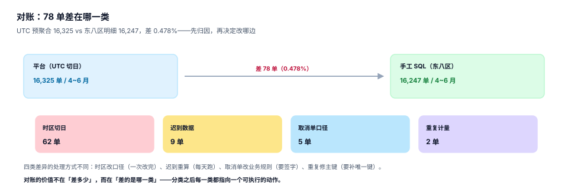

# 双口径对账与差异归因

指标平台的信任危机通常从一个具体问题开始：「昨天日报说 1,632 万，我今天自己拉 SQL 是 1,625 万，哪个对？」这个问题的可怕之处在于——**两个都对**。平台按 UTC 切日，手工 SQL 按东八区截取，边界那 8 小时的单归到了不同的日子。

对账要做的不是「让两个数一样」，而是**把差异拆成有限个有名字的类别**，每一类指向一个可执行的动作。拆不开的差异，会周而复始地出现在每个月的工单里。



## 一、三个层次，逐层收窄

| 层次 | 比什么 | 能发现 | 成本 |
| --- | --- | --- | --- |
| 行数 | `count(*)` | 漏算、重复、期间边界 | 最低 |
| 金额 | `sum(...)` | 口径差、精度差 | 低 |
| 明细指纹 | 逐行哈希 / 有序比对 | 行对行错位、同额不同行 | 高 |

三层的关系是**漏斗**：行数不对，先别比金额；金额不对，先别看明细。本机实测一个典型场景：UTC 预聚合 **16,325** 单 vs 东八区明细 **16,247** 单，差 **78 单（0.478%）**。

这 78 单不是「算错」，而是**边界归属不同**：UTC 时间 6 月 30 日 16:00~24:00 的单，在东八区已经是 7 月 1 日。两边各自都对，只是回答的「6 月」不是同一个 6 月。

## 二、四类差异，必须分类

| 类别 | 判定方法 | 典型比例（本机/经验） | 处理动作 |
| --- | --- | --- | --- |
| 口径差 | 两边的 `where` 与表达式逐条比对 | 4.07%（净额 vs 含取消） | 改契约或改手工 SQL，二选一并写进文档 |
| 时点差 | 只差边界日，中间日完全一致 | **0.478%**（78 单） | 统一时区与开闭区间 |
| 重复 | 同一主键出现多次，或 join 放大 | 1.663×（fan-out） | 修主键 / 改 join 方式 |
| 缺失 | 上游迟到、任务失败、过滤过严 | 视 T+N 而定 | 补数 + 重算窗口 |

**分类的动作是「先看差在哪些日期」**：如果只有首尾两天有差异，几乎一定是时点差；如果每天都有差异且比例稳定，几乎一定是口径差；如果差异集中在某几天且量级突变，先查任务失败与迟到数据。

```sql
-- 按天对比，一步定位差异形状
select d, platform_n, manual_n, platform_n - manual_n as diff
from (
  select substr(period_start,1,10) d, rows_n as platform_n,
         (select count(*) from fact_order o
           where o.status='paid' and substr(o.paid_at,1,10) = substr(a.period_start,1,10)) as manual_n
  from agg_metric a
  where a.metric_key='trade.order.cnt' and a.version=2 and a.grain_key='day|all'
) t
where platform_n <> manual_n
order by abs(diff) desc;
```

差异形状是最强的诊断信号，比任何日志都直接。

## 三、为什么「差 0.478%」比「差 78 单」更有用

同一个差异，两种表达：

| 表达 | 读者反应 | 后续动作 |
| --- | --- | --- |
| 差 78 单 | 「才 78 单，忽略吧」 | 无人处理，下个月继续出现 |
| 差 0.478%，全部落在边界日 | 「这是系统性的切日问题」 | 改时区配置，一次解决 |

**相对值决定要不要管，绝对值的分布决定怎么管**。只报绝对值，差异会被当成噪声；只报相对值，又无法定位。

阈值建议双条件：`abs(diff) > 100 且 diff_pct > 0.1%` 才报警。单条件会两头失效——小平台永远触发不了绝对值阈值，大平台永远触发相对值阈值。

## 四、三方对账：平台、手工、源系统

| 参与方 | 数从哪来 | 强项 | 弱项 |
| --- | --- | --- | --- |
| 平台 | 预聚合表 | 快、稳定、可复算 | 可能口径错、可能缓存旧值 |
| 手工 SQL | 直接查明细 | 独立于平台逻辑 | 人写的，口径每次可能不同 |
| 源系统 | 业务库/财务系统导出 | 最接近「事实」 | 时区、状态定义可能不同 |

两方对账只能判断「不一致」，三方对账才能判断「谁偏离」。做法是：**平台 vs 手工**定差异，**手工 vs 源系统**定基准。如果手工与源系统一致，说明平台错；如果手工与源系统也不一致，先修手工。

::: warning 手工 SQL 不是「真相」
手工 SQL 的价值在于「独立实现」，不在于「正确」。很多团队把手工 SQL 当基准，结果把手工的口径错误固化成了标准。基准应该是**能逐笔核到凭证的源系统**，手工 SQL 只是另一条独立路径。
:::

## 五、日报：三行数、两个阈值、一个链接

对账日报不需要长，只需要让人一眼看出「今天要不要管」：

```text
2026-11-03 指标对账日报
① 行数   平台 16,325 | 手工 16,247 | 差 78 (0.478%)  [时点差]  ← 超阈值
② 金额   平台 72,252,589.64 | 手工 72,252,589.64 | 差 0.00        [一致]
③ 明细   抽样 500 行，指纹不一致 0 行                              [一致]
明细：/recon/2026-11-03  （含 78 单清单与逐单归属日）
```

三个要点：

1. **每行都带类别标签**（时点差 / 口径差 / 重复 / 缺失），不带标签的差异等于没归因。
2. **抽样要写清样本量**，`抽样 500 行不一致 0 行` 与 `全量一致` 是两种结论。
3. **给链接而不是给结论**：链接指向可下钻的明细，让人自己能核。

## 六、闭环：归因之后必须有动作

| 归因 | 动作 | 责任人 | 验收 |
| --- | --- | --- | --- |
| 时点差 | 统一 `timezone` 与 `boundary` 配置 | 平台 | 次日差异归零 |
| 口径差 | 修改契约或修改手工 SQL，并写进文档 | 业务 + 数据 | 两边公式一致 |
| 重复 | 补唯一键、改 join 方式 | 数据工程 | 行数一致 |
| 缺失 | 补数 + 重算 + 调整窗口 | 平台 | 金额一致 |

没有责任人与验收标准的归因，只是「解释」，不是「闭环」。判断标准很朴素：**同类差异下个月还会不会出现**。

## 七、留痕：让三个月后的人能复现

每次对账要留下五样东西：期间、双方 SQL、双方结果、归因结论、处置动作。少一样，三个月后就要重新查一遍。

```sql
create table recon_result (
  id integer primary key,
  metric_key text not null,
  version int not null,
  period text not null,
  platform_value real not null,
  manual_value real not null,
  diff real not null,
  diff_pct real not null,
  cause text not null,          -- caliber / timezone / duplicate / missing
  action text,                  -- 处置动作
  owner text,
  checked_at text not null
);
```

`cause` 字段是这张表的核心。没有它，历史对账记录只是一堆「差多少」，无法回答「这个差异以前是怎么处理的」。

## 八、本专题的判据族

本页判据族 `MSR-A` ~ `MSR-H`，共 8 条。

| 判据 | 要求 | 判定方式 |
| --- | --- | --- |
| `MSR-A` | 三层次对账齐全（行数/金额/明细） | 日报三段都有数 |
| `MSR-B` | 差异按四类归因，不允许「未知」 | `cause` 只能是四个枚举值之一 |
| `MSR-C` | 阈值双条件（绝对值 + 相对值） | 配置里两个阈值都存在 |
| `MSR-D` | 日报每行带类别标签与明细链接 | 日报模板可对照 |
| `MSR-E` | 三方对账：平台、手工、源系统 | 三方各有结果记录 |
| `MSR-F` | 明细比对有抽样策略与样本量 | 抽样数与不一致数都记录 |
| `MSR-G` | 归因有责任人与验收标准 | `owner` 与 `action` 非空 |
| `MSR-H` | 对账留痕五要素齐全 | 表里五个字段都有值 |

## 九、验证方式

```shell
# 1. 亲眼看到「同一天、不同时区」差多少单
sqlite3 :memory: "
create table o(id int, paid_at text);
insert into o values (1,'2026-06-30 10:00'),(2,'2026-06-30 20:00'),
                     (3,'2026-07-01 02:00'),(4,'2026-07-01 09:00');
select count(*) as UTC六月 from o
 where paid_at >= '2026-06-01' and paid_at < '2026-07-01';
select count(*) as 东八区六月 from o
 where datetime(paid_at,'+8 hours') >= '2026-06-01' and datetime(paid_at,'+8 hours') < '2026-07-01';"
# 期望：2 | 1 —— 20:00 那单在东八区已经是 7 月 1 日 04:00
```

```shell
# 2. 确认「差异形状」能直接区分类别
sqlite3 :memory: "
create table r(d text, p int, m int);
insert into r values ('06-29',100,100),('06-30',120,98),('07-01',110,110);
select d, p-m as diff from r where p<>m;"
# 期望：只有 06-30 一行有差异 → 时点差；若每天都差 → 口径差
```

```shell
# 3. 检查历史对账里有没有「未知原因」
sqlite3 metrics.db "select cause, count(*) from recon_result group by cause order by 2 desc;"
# 期望：只有 caliber / timezone / duplicate / missing 四类，没有空值
```

第 1 条命令的 `2 | 1` 说明：**UTC 六月比东八区六月多一单**，因为 `2026-06-30 20:00` 在东八区是 7 月 1 日凌晨。这一单就是 78 单里的一个。

## 参考资料

- dbt Labs《Data tests》：`unique` / `not_null` / 自定义断言作为对账的第一道门，<https://docs.getdbt.com/docs/build/data-tests>
- Great Expectations 官方文档：期望式数据校验与差异报告，<https://greatexpectations.io/expectations/>
- ISO 8601-1:2019《Date and time — Representations for information interchange》：时区与边界表达的标准形式。
- 与本页相邻的册子：[口径契约](../Definition/index.md)、[版本与回溯](../Version/index.md)、[预聚合与物化](../Aggregate/index.md)、[账务对账](../../Ledger/Reconciliation/index.md)（金额侧对账）。
