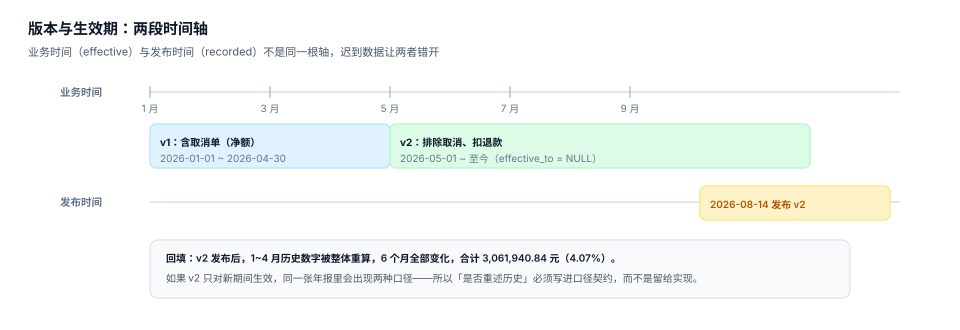

# 版本、生效期与回溯

口径一定会变。业务改规则、财务改确认方式、退款政策调整，都会让「成交额」这四个字的意思发生位移。真正的问题不是「该不该变」，而是**变了以后，历史数字怎么办**——是跟着一起变，还是保持不变，还是两套并存一段时间。

版本表要回答的就是这个问题。它的设计目标只有一句话：**任何一个历史时点的数字，都能按当时生效的口径重算出来，并且能说清那次重算用的是哪一版。**



## 一、双时态：两根时间轴不能混

| 时间轴 | 字段 | 回答什么 | 例子 |
| --- | --- | --- | --- |
| 业务时间 | `effective_from` / `effective_to` | 这个口径**适用于哪段业务数据** | v2 适用于 2026-05-01 起的订单 |
| 记录时间 | `recorded_at` | 这个口径**是什么时候被写进系统的** | v2 于 2026-08-14 发布 |

两根轴必须分开存。合成一个 `updated_at` 的后果是：你永远无法回答「8 月 1 号那天，系统认为 5 月的口径是什么」——而这恰恰是审计最常问的问题。

四种查询组合，各有各的用途：

| 查询 | 业务时间 | 记录时间 | 用途 |
| --- | --- | --- | --- |
| 当前口径 | 今天 | 现在 | 日常报表 |
| 当时口径 | 业务发生日 | 业务发生日 | 审计复算、纠纷举证 |
| 最新口径重述 | 历史区间 | 现在 | 口径统一后的历史重算 |
| 修正后口径 | 业务发生日 | 现在 | 「如果当时就是这个口径」的假设分析 |

第三种与第四种的区别常被混淆：**重述**是「用新口径重算历史」（业务时间取历史、记录时间取现在）；**假设**是「如果当时就知道」（两根轴都取历史，但口径换成新的）。前者用于对外披露，后者用于内部复盘。

## 二、区间怎么写：三种实现与一个必错项

| 实现 | 写法 | 优点 | 陷阱 |
| --- | --- | --- | --- |
| 闭区间 | `[from, to]` | 直观 | 相邻版本在边界那一天**双命中**；`to` 用 `NULL` 表示「至今」时无法比较 |
| 半开区间 | `[from, to)` | 相邻版本天然不重叠 | 需要约定「最后一天」如何表达（通常是 `次日`） |
| 有效标记 | `is_current` 布尔 | 查询简单 | 并发切换时会出现两条 `true` 或零条 `true` |

推荐半开区间，`effective_to` 允许 `NULL` 表示「至今」。判定重叠的条件是：

```sql
-- 两版重叠 <=> 新版起点 < 旧版终点 且 旧版起点 < 新版终点
select count(*)
from metric_version a
join metric_version b
  on a.metric_key = b.metric_key and a.id < b.id
 and a.effective_from < coalesce(b.effective_to, '9999-12-31')
 and b.effective_from < coalesce(a.effective_to, '9999-12-31');
-- 期望：0
```

`coalesce(..., '9999-12-31')` 是这段 SQL 的关键。漏掉它，`NULL` 参与比较的结果是 `UNKNOWN`，重叠检查会**静默放过**「新版起点落在旧版开放区间内」这一类错误——而这正是最常见的一类。

::: danger 三个必错项
1. **把 `NULL` 当「无终点」却用 `<=` 比较**：`NULL <= '2026-05-01'` 是 `UNKNOWN`，不是 `false`，重叠检查直接失效。
2. **用 `updated_at` 覆盖 `effective_from`**：改口径时顺手改了起点，历史区间被「回溯覆盖」，从此无法复算。
3. **版本号用时间戳**：`v20260814103000` 看起来唯一，但排序与「上一版是谁」的查询会变得极其别扭；用整数 `version` 自增，时间放 `recorded_at`。
:::

## 三、三种变更策略

| 策略 | 做法 | 历史数字 | 适用场景 | 代价 |
| --- | --- | --- | --- | --- |
| 仅新期生效 | v2 的 `effective_from` = 变更次日 | **不变** | 口径差异小、对外披露已定型 | 同一年报里出现两种口径，需在脚注说明 |
| 全历史重述 | v2 覆盖全部历史区间 | **全部重算** | 原口径确认为错（如漏扣退款） | 所有历史报表、对外披露、KPI 考核基数同时变 |
| 双轨并行 | v1 与 v2 同时存在，出两个数 | 各自独立 | 口径调整过渡期（通常 1~3 个月） | 两套缓存、两套权限、两套对账，成本翻倍 |

本机读数（种子 20261103）：把 v1（含取消单）换成 v2（排除取消、扣退款）后，**6 个月全部变化**，合计差 **3,061,940.84 元（4.07%）**。

这个读数说明一件事：**4.07% 不是一个小数**。如果这家公司按季度披露，重述会让上个季度的「同比增长」直接翻转方向。所以策略选择不能由数据团队单方面决定——它是一次**对外承诺的变更**。

### 选择策略的三个问题

1. **原口径是「错」还是「不同」**？错（漏扣退款）→ 必须重述；不同（含不含取消单各有道理）→ 仅新期生效。
2. **有没有对外披露过**？披露过的数字重述要走正式流程，且必须给出「新旧对照表」。
3. **下游有没有按旧口径做的考核**？有，就必须双轨并行一个考核周期，否则等于改了别人的成绩单。

## 四、迟到数据与重算窗口

版本管的是「口径」，重算管的是「数据」。两者都会让历史数字变化，但原因完全不同：

| 变化来源 | 表现 | 处理方式 |
| --- | --- | --- |
| 口径变更 | 所有期间同时变，方向一致 | 版本切换 + 重述决策 |
| 迟到数据 | 个别期间变，方向不定 | 滚动重算窗口（T+2 ~ T+7） |
| 上游修正 | 某个源表批量变更 | 影响面分析后定点重算 |
| 重复投递 | 某些行被算两次 | 主键/幂等键修复后全量重算 |

**重算窗口必须写死**。典型约定：T+2 内到达的数据自动重算当日与次日，T+7 内到达的走人工审批，超过 T+7 的进入「历史修正」流程，需要财务确认。没有窗口约定的后果是：三个月后一条迟到数据悄悄改了上季度报表，而没有任何人知道。

::: warning 重算不是「再跑一次」
重算必须满足三个条件：① 幂等（同样的输入得到同样的输出，重复跑不改变结果）；② 可追溯（每次重算留下 `recomputed_at` 与触发原因）；③ 有边界（明确重算哪个区间，不允许「全量重跑」当作日常手段）。
:::

## 五、缓存与物化表怎么跟着版本走

聚合表的键里**必须带版本**，否则口径一切换，旧缓存会被当成新口径的结果继续服务：

```sql
create table agg_cache (
  metric_key text not null,
  version    int  not null,   -- 关键：版本进主键
  grain_key  text not null,   -- 如 'month:2026-05:region:east'
  period_start text not null,
  period_end   text not null,
  value      real not null,
  computed_at  text not null,
  primary key (metric_key, version, grain_key, period_start)
);
```

版本切换时的失效动作有三步：**先停写**（禁止新结果写进旧版本键）→ **再切换**（把「当前版本」指针指向 v2）→ **后清理**（旧版本缓存按保留期删除，而不是立即删，因为还要支持「当时口径」查询）。

## 六、一次完整的时间旅行

给定「2026 年 6 月的成交额」，三个问题三种答案：

```sql
-- 问法一：现在按最新口径看 6 月（重述后的数）
select sum(amount - refund_amount) from fact_order
where status = 'paid' and paid_at >= '2026-06-01' and paid_at < '2026-07-01';

-- 问法二：8 月 1 日那天，系统认为 6 月是多少（当时口径）
select sum(amount) from fact_order
where status in ('paid','cancelled')
  and paid_at >= '2026-06-01' and paid_at < '2026-07-01';

-- 问法三：这条 6 月的数字，是被哪一版算出来的
select metric_key, version, effective_from, effective_to, recorded_at
from metric_version
where metric_key = 'trade.gmv.net'
  and effective_from <= '2026-06-01'
  and coalesce(effective_to, '9999-12-31') > '2026-06-01';
```

三条查询对应三个不同的业务问题：对外的数、当时的数、可解释的数。**只有第一条能直接给人看，后两条是给「有人质疑第一条」时用的**。

## 七、本专题的判据族

本页判据族 `MSV-A` ~ `MSV-H`，共 8 条。

| 判据 | 要求 | 判定方式 |
| --- | --- | --- |
| `MSV-A` | 业务时间与记录时间分列存储 | 表里同时有 `effective_*` 与 `recorded_at` |
| `MSV-B` | 区间用半开，`NULL` 表示至今，比较时 `coalesce` | 重叠检查 SQL 返回 0 |
| `MSV-C` | 变更策略三选一，并写明理由 | 策略字段有值，理由可查 |
| `MSV-D` | 重算窗口写死（T+N）并有审批阈值 | 窗口与阈值均为配置项，不是口口相传 |
| `MSV-E` | 聚合表主键含版本 | 主键或唯一索引里有 `version` |
| `MSV-F` | 版本切换三步（停写→切换→清理）可复跑 | 三步各有命令与预期 |
| `MSV-G` | 能回答「当时口径」与「最新口径」两种查询 | 两条 SQL 都能跑出不同结果 |
| `MSV-H` | 版本变更留签字（业务 + 财务） | 有 `signed_by` 与时间 |

## 八、验证方式

```shell
# 1. 造两版区间，确认重叠检查能抓到「新版起点落在旧版开放区间内」
sqlite3 :memory: "
create table v(k text, ver int, f text, t text);
insert into v values ('gmv',1,'2026-01-01','2026-04-30'),('gmv',2,'2026-05-01',null);
select count(*) from v a join v b on a.k=b.k and a.ver<b.ver
 where a.f < coalesce(b.t,'9999-12-31') and b.f < coalesce(a.t,'9999-12-31');
insert into v values ('gmv',3,'2026-04-15','2026-06-30');
select count(*) from v a join v b on a.k=b.k and a.ver<b.ver
 where a.f < coalesce(b.t,'9999-12-31') and b.f < coalesce(a.t,'9999-12-31');"
# 期望：0 然后 2（第 3 版与第 1、2 版都重叠）
```

```shell
# 2. 确认「当时口径」与「最新口径」确实不同
sqlite3 :memory: "
create table o(id int, status text, amount real, refund real, paid_at text);
insert into o values (1,'paid',1000,100,'2026-06-10'),(2,'cancelled',800,0,'2026-06-11');
select sum(amount) from o where status in ('paid','cancelled');
select sum(amount-refund) from o where status='paid';"
# 期望：1800.0 | 900.0 —— 差一倍，取决于你问的是哪个问题
```

第 2 条的两个结果都能「对」，因为它们对应两种口径。**任何只给一个数、不给口径标签的报表，都在制造未来的争论。**

## 参考资料

- Martin Fowler《Bitemporal History》：业务时间与记录时间双轴的经典论述，<https://martinfowler.com/articles/bitemporal-history.html>
- dbt Labs《Model versions》：语义层里版本与「latest」别名的组织方式，<https://docs.getdbt.com/docs/collaborate/govern/model-versions>
- SQL:2011 标准中的 `PERIOD FOR` 与系统时间版本表（`SYSTEM_TIME`）定义，见 ISO/IEC 9075-2:2011 第 4.6 节。
- 与本页相邻的册子：[口径契约](../Definition/index.md)、[预聚合与物化](../Aggregate/index.md)、[接口契约演进](../../ContractEvolution/index.md)。
