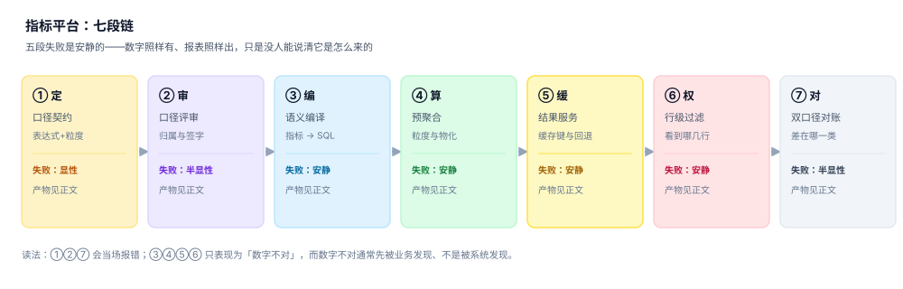

# 指标平台与语义层工程

<p style="text-align:center;"></p>

一家公司有 300 个指标、40 个源字段、6 套报表。业务问「上个月成交额多少」，报表说 7,225 万，接口说 7,343 万，财务说 7,531 万。三个数都能追溯到同一张订单表，都没有算错——它们只是分别在回答「扣不扣退款」「算不算取消单」「按谁的时区切日」。

指标平台要解决的从来不是「怎么算」，而是「**同一个名字，任何时候、任何人、任何入口，算出来的都必须是同一个数，而且能说清这个数是怎么来的**」。这句话拆开是四件事：口径要写成契约、契约要带生效期、查询要由语义层编译、结果要能和手工口径对上。

::: tip 一句话理解
指标不是「一个数」，而是**一段可复现的查询 + 一份带生效期的口径契约 + 一条可归因的差异记录**。三者缺一，这个数就只是一个「看起来对的数字」。
:::

## 一、这个专题讲什么

从一个业务问题到一个人人认账的数字，要走七段：

| 段 | 这一段在做什么 | 产物 | 失败是否安静 |
| --- | --- | --- | --- |
| ① 定 | 把口径写成契约：表达式、粒度、排除项 | `metric` + `metric_version` | 显性（写不出表达式就提不了） |
| ② 审 | 归属、命名、评审、签字 | 评审记录 + `owner` | 半显性（没人签字会卡住） |
| ③ 编 | 语义层把「指标 + 粒度 + 过滤」编译成 SQL | 编译产物 + 指纹 | **安静**（SQL 合法但算错） |
| ④ 算 | 按可加性决定是否上卷、是否物化 | `agg_cache` / 物化视图 | **安静**（不可加的被加了） |
| ⑤ 缓 | 结果服务、缓存键、回退路径 | 查询结果 + `query_log` | **安静**（缓存穿了权限） |
| ⑥ 权 | 指标权限、行级过滤、列级脱敏 | 过滤后的结果集 | **安静**（多给了几行没人知道） |
| ⑦ 对 | 双口径对账、差异归因 | `recon_result` | 半显性（阈值报警才会浮出来） |



七段里**四段的失败是安静的**。它们的共同形态是：SQL 能跑、报表能出、接口返回 200，只有「这个数是不是大家说的那个数」没人回答。而这件事通常由业务先发现，不是由系统发现。

本机实测最能说明问题的一组读数（33,858 单 / 56,167 条明细 / 20,000 用户 / 180 天，种子 20261103）：同一份订单数据，**净额 72,252,589.64、毛额 73,428,377.31、含取消单 75,314,530.48**，三者极差 **3,061,940.84 元（4.07%）**。没有任何一条 SQL 报错，因为三条 SQL 都对——错的是「它们共用了同一个指标名」。

## 二、三个「同一个数」

| 口径 | 定义 | 谁在关心 | 常见错法 |
| --- | --- | --- | --- |
| 报表口径 | 业务昨天在页面上看到的 | 业务 / 运营 | 口径改了但不重述历史，同比失真 |
| 接口口径 | 调用方通过 API 拿到的 | 下游系统 / 客户 | 接口自己拼 SQL，绕过语义层 |
| 对账口径 | 财务能逐笔核到凭证的 | 财务 / 审计 | 用「含取消单」的总量去对「净额」的明细 |


三者必须能互相解释，而不是「以某个为准」。工程上的做法不是统一成一个数（做不到，业务语义本来就不同），而是**让三个数各自带口径标签，并且两两之间有一条可复算的桥**。

### 一个必须自己算一遍的例子

同一天、同一批订单，四种写法：

| 写法 | SQL 片段 | 结果 |
| --- | --- | --- |
| 净额 | `sum(amount - refund_amount) where status='paid'` | 72,252,589.64 |
| 毛额 | `sum(amount) where status='paid'` | 73,428,377.31 |
| 含取消单 | `sum(amount - refund_amount)`（不过滤状态） | 75,314,530.48 |
| 明细表求和 | `sum(item.amount) join order` | 73,428,377.11 |

第四行和第一行差 1,176 万（退款），和第二行只差 **0.20 元**——这 0.20 元是逐行按权重拆分订单金额时的舍入残差。**金额对得上、明细对不上**，是排查成本最高的一类差异：它不像口径错那样能一眼看出方向。

::: danger 三件事必须分列存
1. **不要用一个 `metric_value` 表装所有口径**：没有 `version` 与 `caliber` 两个维度，事后无法判断某个历史数字是按哪版口径算的。
2. **不要让接口自己写 SQL**：接口一旦绕过语义层，口径就分裂成 N 份，且没有任何机制能在口径变更时找到它们。
3. **不要把「对账差异」当成 bug 修**：先归因到「口径 / 时点 / 重复 / 缺失」四类之一，再决定改哪边。直接改数只会把差异推到下个月。
:::

## 三、为什么单独成册

指标平台最容易写成一锅粥：数仓、治理、质量、可视化都能沾边。这一册的边界划在「**一个指标被定义出来到被对账**」这一段，其余各册各管一段：

| 相邻册子 | 它讲什么 | 本册讲什么（不重复的部分） |
| --- | --- | --- |
| [数据仓库](../../DB/DataWarehouse/Overview/index.md) | 仓怎么建：分层、维度建模、粒度选择 | 仓建好之后，指标怎么被**定义、编译、复用** |
| [数据治理](../../DB/DataGovernance/Overview/index.md) | 标准、主数据、元数据、组织流程 | 指标的**口径契约与生效期**（治理管「标准」，本册管「一个指标的一句话定义」） |
| [数据质量](../../DB/DataGovernance/DataQuality/index.md) | 完整性、唯一性、及时性等规则 | 指标**算出来之后**的双口径对账与差异归因 |
| [血缘（治理册）](../../DB/DataGovernance/Lineage/index.md) | 表级 / 任务级血缘，回答「数据从哪来」 | **指标级**血缘与影响面清单，回答「改这个字段，谁的数会变」 |
| [账务与分录](../../Backend/Ledger/DoubleEntry/index.md) | 借贷怎么平、凭证怎么记 | 只借用「净额 / 毛额」这两个词做例子，不涉分录 |
| [接口契约演进](../../Backend/ContractEvolution/index.md) | API 版本怎么并存、怎么弃用 | **口径**怎么并存与回溯（同一个「版本」概念，两种对象） |
| [多租户](../../Backend/MultiTenantSaaS/TenantContext/index.md) | 租户隔离的库 / schema / 行级三种做法 | 行级过滤在**指标查询**里的下推与缓存键污染 |
| [容量与成本](../../Ops/CapacityCost/Overview/index.md) | 单位成本、容量规划 | 预聚合带来的**扫描量下降**怎么折算成钱（只引用其口径） |

八行里没有一行是「顺便提一句」：每一行都对应本册某一页明确不写的内容，避免读者在两册之间看到两种说法。

## 四、本专题的页面

- [总览：七段链与三个「同一个数」](Overview/index.md)——七段各自产出什么结论、四个必失接缝、五个角色
- [指标定义与口径契约](Definition/index.md)——五要素、可加性三分、十二字段契约、命名与评审
- [版本、生效期与回溯](Version/index.md)——双时态、区间不重叠、三种变更策略、迟到数据重算
- [语义层与查询编译](Compile/index.md)——四段编译、join 路径唯一性、fan-out 防护、参数化与指纹
- [预聚合、物化与可加性](Aggregate/index.md)——粒度格、上卷条件、命中率与回退、TTL 与幂等重算
- [血缘与影响面](Lineage/index.md)——三层血缘、正向与反向遍历、改字段前的影响面清单
- [权限、行级过滤与脱敏](Access/index.md)——三轴模型、过滤下推、缓存键含权限、聚合泄露
- [双口径对账与差异归因](Reconcile/index.md)——三层次对账、四类归因、阈值与日报
- [实战：七张表、四个触发器、九条断言](Practice/index.md)——可复跑的 DDL、C1~C5、N1~N4
- [常见问题与分诊](FAQ/index.md)——十二个高频问题、三步分诊、反例优先

## 五、本专题的判据族

本专题共 **10 族 80 条判据**，每页 8 条，逐条可判定。

| 族 | 覆盖 | 页 |
| --- | --- | --- |
| `MSO-A ~ MSO-H` | 七段链、三个「同一个数」、四个接缝、五个角色、六个必失点、边界、版本组织、验收入口 | [总览](Overview/index.md) |
| `MSD-A ~ MSD-H` | 五要素、可加性、契约字段、命名、评审、时间语义、排除项、反例 | [定义与口径](Definition/index.md) |
| `MSV-A ~ MSV-H` | 双时态、区间、三策略、迟到数据、重算窗口、缓存失效、回溯口径、签字 | [版本与回溯](Version/index.md) |
| `MSC-A ~ MSC-H` | 请求模型、四段编译、路径唯一、fan-out、下推、指纹、代价边界、产物 | [查询编译](Compile/index.md) |
| `MSM-A ~ MSM-H` | 粒度格、可加性、上卷、物化形态、命中率、回退、TTL、幂等重算 | [预聚合](Aggregate/index.md) |
| `MSL-A ~ MSL-H` | 三层血缘、边表、正向、反向、影响面、冻结、通知、第四层 | [血缘](Lineage/index.md) |
| `MSP-A ~ MSP-H` | 三轴、RLS 四法、下推、缓存键、聚合泄露、脱敏、审计、越权验证 | [权限](Access/index.md) |
| `MSR-A ~ MSR-H` | 三层次、四归因、阈值、日报、三方对账、抽样、闭环、留痕 | [对账](Reconcile/index.md) |
| `MSX-A ~ MSX-H` | 七表、三触发器、五断言、四负向、验收 SQL、复跑、性能、交付 | [实战](Practice/index.md) |
| `MSQ-A ~ MSQ-H` | 十二问、三步分诊、反例、边界问、口径问、粒度问、权限问、升级路径 | [FAQ](FAQ/index.md) |

## 六、版本组织：本册不建版本目录

按仓库约定，出现大版本差异的主题要按版本目录组织（如 [Spring5](../Java/Frame/Spring/Spring5/index.md) / [Spring6](../Java/Frame/Spring/Spring6/index.md)、[Vue2](../../Frontend/Frame/Vue/Vue2/Overview/index.md) / [Vue3](../../Frontend/Frame/Vue/Vue3/Overview/index.md)）。本册**不建 `MetricPlatform/V1`、`V2` 这类目录**，三条理由：

1. **换代的是引擎，不是判据**。从手写 SQL 到 dbt Semantic Layer、Cube、MetricFlow，换的是「谁来编这段 SQL」；「口径必须有生效期」「不可加指标不能上卷」这些判据一字未变。
2. **并存差异是口径，不是代际**。同一家公司同时存在「净额 GMV」与「毛额 GMV」是业务事实，不是版本先后——把口径做成目录，会让读者以为「新版本取代旧版本」，而真实情况是**两个口径长期并存、各自服务不同读者**。口径的并存由 `metric_version` 表表达，不由目录表达。
3. **真正需要版本目录的是「同一份代码两套写法」**。本册讲的是概念与判据，不绑定某个引擎的 API；引擎差异用 `::: info` 在页内说明适用版本即可。

所以：**判据留在本册，引擎差异写进页内提示，旧口径靠 `effective_from / effective_to` 保留而不是靠目录保留**。这与「旧版本文档不删除、标注状态」的原则一致——本册的「旧版本」是数据行，永远可查，且带生效期。

## 七、验证方式

读完目录页，用两条命令确认「三个数确实可以同时正确」：

```shell
# 1. 造三行数据，看四种口径能不能算出四个数
sqlite3 :memory: "
create table o(id int, status text, amount real, refund real);
insert into o values (1,'paid',1000,100),(2,'paid',500,0),(3,'cancelled',800,0);
select sum(amount-refund) as 净额 from o where status='paid';
select sum(amount) as 毛额 from o where status='paid';
select sum(amount-refund) as 含取消 from o;
select count(*) as 行数 from o;"
# 期望：900.0 | 1500.0 | 2200.0 | 3
```

```shell
# 2. 确认不可加指标不能「按天相加」
sqlite3 :memory: "
create table e(d text, uid int);
insert into e values ('d1',1),('d1',2),('d2',2),('d2',3);
select count(distinct uid) as 全期 from e;
select sum(c) as 日之和 from (select d, count(distinct uid) c from e group by d);"
# 期望：3 | 4 —— 同一个人跨天被算了两次
```

第 2 条命令的 `3` 与 `4` 就是「UV 不可加」的全部证据：**日 UV 之和永远大于等于全期 UV**，两者之差是「跨天回访人数」。任何把日 UV 直接相加做月报的实现，都在系统性高估。

## 参考资料

- dbt Labs《Semantic models》官方文档：指标、度量、维度与语义层的组织方式，<https://docs.getdbt.com/docs/build/semantic-models>
- Cube《Semantic Layer》官方文档：预聚合、访问策略与查询编排，<https://cube.dev/docs/product/basics/concepts>
- OpenObservability《OpenMetrics 1.0.0》规范：指标命名与类型约定，<https://github.com/OpenObservability/OpenMetrics/blob/main/specification/OpenMetrics.md>
- Ralph Kimball《The Data Warehouse Toolkit》第 2 章「Retail Sales」：可加、半可加、不可加事实的经典划分。
- 与本册相邻的册子：[数据仓库](../../DB/DataWarehouse/Overview/index.md)、[数据治理](../../DB/DataGovernance/Overview/index.md)、[数据血缘（治理册）](../../DB/DataGovernance/Lineage/index.md)、[可视化](../../Frontend/DataVisualization/Overview/index.md)。
