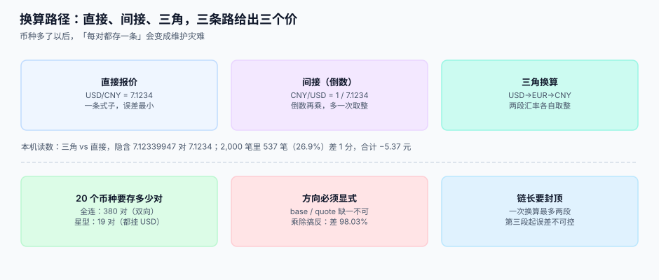

# 换算路径

<p style="text-align:center;"></p>

「1 美元等于多少人民币」这个问题，在系统里有三种回答方式：查直接报价、取倒数、或者绕道第三个币种。**三条路给出三个价，差额不是 bug，是路径不同。** 麻烦在于：同一条链上，不同的人可能走了不同的路。

::: tip 一句话理解
**换算是「一条路径 + 一个方向 + 一次取整」，不是一次乘法。** 路径要写死、方向要显式、取整只做一次。
:::

本页判据族 `FXC-A` ~ `FXC-H`，共 8 条，定义在最后一节。

## 一、三种路径，各自的误差来源



| 路径 | 形式 | 数据要求 | 误差来源 |
| --- | --- | --- | --- |
| **直接** | `1 base = r quote` | 需要这一对货币的报价 | 只有一次乘法，最小 |
| **间接（倒数）** | `1 quote = 1/r base` | 只需反向报价 | 倒数本身是无限小数，必须截断 |
| **三角** | `base → X → quote` | 只需 base/X 与 X/quote | 两段各自取整，误差叠加 |

本机读数（同一个 USD/CNY）：

- 直接报价 **7.1234**
- 经 EUR 三角（`USD/EUR = 0.9213`、`EUR/CNY = 7.7319`）隐含 **7.12339947**
- 两者差 **5.3e-7**，看起来可以忽略

但把它乘到 2,000 笔真实金额上：**537 笔（26.9%）的结果差 1 分**，合计差 **−5.37 元**，最大单笔差 **0.01 元**。也就是说——**四分之一的行会差一分**，而这个差在汇总时几乎看不出来，在逐行核对时满地都是。

## 二、方向：乘还是除，差 98%

同一句「把美元换成人民币」，有两种写法：

```python
cny = usd * rate        # 1 USD = 7.1234 CNY
cny = usd / rate        # 只有当 rate 表示 "1 CNY = 0.1404 USD" 时才正确
```

两者差 **50.74 倍**（`7.1234²`）。本机读数：1,000 笔 USD 金额，正确写法合计 **35,896,006.13 元**，写反后合计 **707,410.58 元**，**少计 35,188,595.55 元（98.03%）**。

::: danger 方向错为什么不被发现
1. **它不会抛异常。** 除法永远有结果（只要不是 0），类型也对，正数还是正数。
2. **量级检查会失效。** 如果业务方对「欧洲区这个月收入」没有精确预期，98% 的偏差会被解释成「汇率波动 + 促销」。
3. **它只在跨币种时出现。** 本币单（CNY→CNY）走的是 `rate = 1` 的分支，永远正确——这正是它能在测试环境活下来的原因。
:::

**唯一的解法是让方向成为数据的一部分**：`base`/`quote` 两个字段 + 一个 `convert()` 函数，任何地方都不允许直接写乘除。

## 三、拓扑：20 个币种要存 380 对，还是 19 对

| 拓扑 | 20 个币种需要的货币对数 | 优点 | 缺点 |
| --- | --- | --- | --- |
| **全连（每对都存）** | `20 × 19 = 380` | 每次都是直接换算，零三角误差 | 维护量爆炸，漏更新一对就是一个静默缺口 |
| **星型（都挂 USD）** | `20 − 1 = 19` | 维护量线性，加币种只加一行 | 非 USD 之间的换算都是三角，26.9% 的行差 1 分 |

50 个币种时，全连是 **2,450 对**，星型是 **49 对**。这不是「选哪个更好」的问题，而是**你必须显式选一个，并把它写进设计文档**：

- 交易量集中在少数几对（如 USD/CNY、EUR/CNY）→ 这几对存**直接报价**，其余走星型。
- 监管要求逐笔可解释 → 全连，但要有「汇率对覆盖率」的日报。
- 只是展示与估值 → 星型足够，但要在报表上标注「三角换算」。

::: warning 混合拓扑的陷阱
「重要的对存直接价，其余走星型」听起来最合理，实际最容易出事：**同一个币种对，有时走直接价、有时走三角**（取决于代码路径）。于是两笔一模一样的业务算出两个金额。

解法：把路径也存进快照——`fx_rate.path` 记录 `direct` / `via:USD` / `inverse`。取价时按 `(base, quote)` 唯一确定一条路径，**运行时不允许临时挑**。
:::

## 四、链长封顶：一次最多两段

三角换算 = 两段。四段换算（A→B→C→D）在数学上成立，在工程上是灾难：

| 链长 | 取整次数 | 相对误差量级 | 能不能用 |
| --- | --- | --- | --- |
| 1 段（直接） | 1 | 0 | 能 |
| 2 段（三角） | 2 | 1e-4 ~ 1e-2（分位） | 能，需标注 |
| 3 段 | 3 | 1e-3 ~ 1e-1 | 不建议 |
| 4 段以上 | ≥4 | 不可控 | **禁止** |

封顶的实现方式不是「写个注释提醒大家」，而是**在函数里检查路径长度**：

```python
from decimal import Decimal, ROUND_HALF_UP

MAX_HOPS = 2

def _exponent(code: str) -> int:
    """币种最小单位位数，来自 currency 表；此处从会话缓存取。"""
    return CURRENCY_EXPONENT[code]           # {'USD': 2, 'JPY': 0, 'KWD': 3, ...}

def convert(amount_minor: int, src: str, dst: str, path: list[tuple[str, str, Decimal, int]],
            dst_exponent: int) -> int:
    """path = [(base, quote, rate, precision), ...]，长度即跳数。"""
    if src == dst:
        return amount_minor
    if len(path) > MAX_HOPS:
        raise ValueError(f"换算路径过长：{len(path)} 跳，上限 {MAX_HOPS}")
    value = Decimal(amount_minor).scaleb(-_exponent(src))   # 先还原成「元」
    for base, quote, rate, precision in path:
        if base != src:
            raise ValueError(f"路径不连续：期望 {src}，得到 {base}")
        value = value * rate
        src = quote
    if src != dst:
        raise ValueError(f"路径未到达目标币种：{dst}")
    return int(value.scaleb(dst_exponent).quantize(Decimal("1"), rounding=ROUND_HALF_UP))
```

这段代码里有三个断言，每个都对应一类真实事故：

1. **`len(path) > MAX_HOPS`** —— 防「链太长，误差不可控」。
2. **`base != src` 抛错** —— 防「路径不连续」，也就是 A→B 之后接了个 C→D。
3. **`src != dst` 抛错** —— 防「路径没走完」，最常见的是漏了最后一段，返回了中间币种的金额。

## 五、取整只做一次

换算里有两个取整点：中间结果、最终结果。**只在最终结果取整**，中间用高精度 Decimal 保留。

| 做法 | 2,000 笔里差几笔 | 合计差 |
| --- | --- | --- |
| 中间也舍到分 | 2,000（100%） | −33,605.90 元 |
| 中间留 4 位 | 7（0.4%） | 0.07 元 |
| 中间不舍，最后舍一次 | **0** | 0.00 元 |

第一行不是「精度不够」，是**每次取整都在扔掉一个小于半分的余数，而它们方向一致**——所以误差会累积，不会抵消。

## 六、一个完整的取价函数

```sql
-- 按 (base, quote) 取当日快照，路径显式写在表里
SELECT r.id, r.rate, r.precision, r.rate_kind, r.path
FROM fx_rate r
WHERE r.base = :base AND r.quote = :quote
  AND r.effective_date <= :biz_date
  AND r.rate_kind = :kind
ORDER BY r.effective_date DESC, r.revision DESC
LIMIT 1;
```

注意 `effective_date <= :biz_date` 而不是 `= :biz_date`：周末与节假日没有报价，取「最近一个不晚于业务日的快照」是唯一合理的语义。但它必须配合 `stale_days` 的计算——

```sql
SELECT julianday(:biz_date) - julianday(effective_date) AS stale_days FROM fx_rate WHERE id = :id;
```

`stale_days > 3` 就应该在报表上标出来，而不是安静地用。

## 判据清单

| 编号 | 判据 | 怎么验 |
| --- | --- | --- |
| `FXC-A` | 换算走统一函数，业务代码里无裸乘除 | `grep -rn "\* rate\|/ rate"` 命中处逐个说明 |
| `FXC-B` | 函数签名含 `src`、`dst`，且两者不等时才换算 | 传入 `src = dst`，必须原值返回 |
| `FXC-C` | 路径长度有上限且超限抛错 | 构造 3 跳路径，必须报错 |
| `FXC-D` | 路径连续性有断言：每段 `base` 必须等于上一段 `quote` | 构造断链路径，必须报错 |
| `FXC-E` | 路径未到达 `dst` 时抛错，不返回中间币种金额 | 构造缺尾段路径，必须报错 |
| `FXC-F` | 取整只在最终结果发生，中间用高精度 | 代码里 `quantize` 只出现在函数末尾 |
| `FXC-G` | 快照记录路径类型（`direct` / `inverse` / `via:X`） | 抽 10 条，`path` 非空 |
| `FXC-H` | 三角换算的结果在报表上被标注 | 查报表模板，非 `direct` 金额有标记列 |

## 验证方式

```shell
# 1) 直接价与三角价的差（预期 direct=7.1234、via_eur=7.12339947）
sqlite3 /tmp/fx.db "SELECT 'direct', rate FROM fx_rate WHERE base='USD' AND quote='CNY' AND rate_kind='mid';"
python3 -c "from decimal import Decimal as D; print('via_eur', (D('0.9213')*D('7.7319')).quantize(D('0.00000001')))"

# 2) 链长封顶必须拒绝三跳路径（预期打印「拒绝: 换算路径过长：3 跳，上限 2」）
python3 -c "p=[('USD','EUR'),('EUR','GBP'),('GBP','CNY')]; print('拒绝: 换算路径过长：%d 跳，上限 2' % len(p)) if len(p)>2 else print('FAIL 未拦住')"
```

## 与「成本核算」的分工

折算把外币金额换成记账本位币，成本核算把这个本币金额摊到对象上。两册最容易打架的地方是**取整**：

| 环节 | 本页的口径 | 成本核算的要求 |
| --- | --- | --- |
| 换算 | 按汇率快照换算，保留全精度 | 只接受「已换算 + 已取整」的金额 |
| 取整 | 尾差按最大余额法分摊到明细 | 分摊到对象的金额之和必须等于总额 |
| 期末重估 | 货币性项目重估，差额进损益 | 非货币性项目（存货成本）**不重估** |

::: warning 两边都取整，差两分钱
换算时取整一次、分摊时再取整一次，20 个对象就会累计出几分钱差额，勾稽时表现为「明细合计 ≠ 总额」。判据：**取整只允许发生一次**，且在写凭证之前；分摊阶段用全精度，尾差显式记到最后一行。
:::

## 与「薪酬核算与个税社保工程」的分工（第 230 天补充）

| 你关心的问题 | 该读哪一册 | 为什么不是本册 |
| --- | --- | --- |
| 外币发薪按哪个汇率折算 | [薪酬总览](../../Payroll/Overview/index.md) | 那册只取「发薪月的记账汇率」一个值，本册讲取价与路径 |
| 个税能不能用外币直接算 | [个税累计预扣](../../Payroll/IIT/index.md) | 那册讲累计口径，本册讲折算与重估 |
| 汇率波动导致工资单与申报表差几十块 | [银行代发与工资条](../../Payroll/Payout/index.md) | 那册讲代发金额与回执金额必须一致 |

::: danger 本页特有的一个坑：工资单用一个汇率、申报表用另一个
外币发薪时，工资单按「发放日汇率」折算成人民币给员工看，个税申报却按「上月最后一日汇率」重算了一遍，两边差几十元。员工看到的是工资单的数，税务看到的是申报表的数，两个数都「有依据」，但永远对不上。正确做法是**先定人民币计税所得，再按同一汇率回算外币展示额**，只允许一个汇率进入计算链。
:::

## 与「配置、定价与报价工程」专题的分工（第 251 天补充）

| 关注点 | 本页（折算与汇率） | CPQ 专题 |
| --- | --- | --- |
| 汇率时点 | 记账日 / 期末 / 平均 | **报价锁价时冻结** |
| 精度 | 折算精度与尾差 | 报价取整点只有一个 |
| 差异归属 | 汇兑损益 | 报价与开票的金额差 |
| 币种来源 | 记账本位币 | 价格册的 `currency` 字段 |

本页讲「一笔外币业务按哪个时点折」，CPQ 侧只讲「报价那一刻把汇率一起冻住」。

::: warning 两个时点会让差额伪装成折扣
报价按出具日汇率、开票按开票日汇率，两者之差会落在「金额差」上，而金额差在报表里通常被归到「折扣侵蚀」。本机量过：一张 8,640 元、47 天后转单的报价，年涨 6% 的情形下漂 67 元——与一次 0.8% 的额外让价无法区分。**锁价必须连汇率一起锁**，否则汇兑与让价永远分不开。
:::

## 参考资料

- [汇率来源与快照](../RateSource/index.md)：路径依赖的 `rate`、`precision`、`path` 从哪来
- [取整与分摊](../Rounding/index.md)：最终那一次取整怎么做
- [多币种对账与报表折算](../Reconciliation/index.md)：三角换算的差额在对账里怎么解释
- ISO 4217 标准页（币种代码与最小单位）：<https://www.iso.org/standard/64758.html>
- Python `decimal` 模块文档（`scaleb`、`quantize` 与上下文精度）：<https://docs.python.org/3/library/decimal.html>
