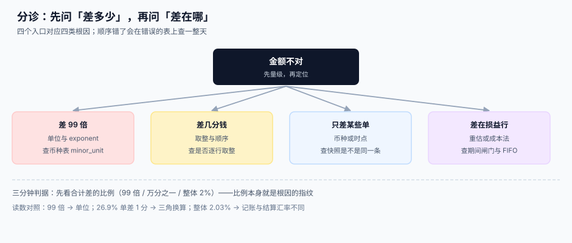

# 常见问题与分诊

<p style="text-align:center;"></p>

多币种的问题有一个共同特征：**现象都是「金额不对」，根因却在四个完全不同的地方**——单位、时点、顺序、差额归属。查错方向一错，就会在错误的表上翻一整天。

::: tip 一句话理解
**先看「差多少」，再看「差在哪」。** 差的**比例**本身就是根因的指纹：99 倍是单位，万分之一是取整，2% 是汇率时点。
:::

本页判据族 `FXQ-A` ~ `FXQ-H`，共 8 条，定义在最后一节。

## 一、四类现象的分诊入口



| 现象 | 比例特征 | 根因 | 第一件事 |
| --- | --- | --- | --- |
| 差 **99 倍 / 100 倍** | 整单同比例放大 | 单位与 `exponent` | 查币种表的 `minor_unit` |
| 差**几分钱** | 千分之一以内，逐行累积 | 取整顺序与层级 | 查是否逐行取整 |
| **只差某些单** | 整体 0.2%~5%，集中在少数币种 | 汇率时点或快照缺失 | 查 `fx_rate_id` 是不是同一条 |
| **差在损益行** | 损益科目异常，资产负债对得上 | 重估或成本法 | 查期间闸门与 FIFO/均价 |

四类的处置顺序不能颠倒：**先量级，再定位**。如果先怀疑「是不是汇率取错了」，而对 JPY 的 99 倍问题，你会查一整天的汇率表。

## 二、十二个高频问题

**Q1：能不能直接用 `float` 存金额？**

不能，但理由和你想的不一样。本机实测：100 万次累加 0.01 的误差只有 **1.7e-7 元**，远小于任何业务容差。float 的真正问题是**比较与序列化**：`0.1 + 0.2 == 0.3` 为假，`round(2.675, 2)` 得 `2.67`。所以答案不是「浮点不精确」，而是「**它不满足等值判断**」，而金额比对处处都要等值判断。

**Q2：金额到底存整数还是 `DECIMAL`？**

存整数（最小单位）。理由不是精度，是**可移植性**：同一份 `NUMERIC(18,2)` 在 PostgreSQL 精确、MySQL 舍入、SQLite **完全不截断**（实测存 `7.123456` 读回还是 `7.123456`，`typeof` 是 `real`）。整数在三种库里行为一致。

**Q3：`exponent` 能不能直接写 2？**

业务上「大部分情况对」，工程上「一定出事」。JPY/KRW/CLP/ISK 是 0，KWD/BHD/JOD/OMR/TND 是 3。写 2 的后果是 JPY 虚增 99 倍、KWD 少 0.003——**两个方向，都不会报错**。

**Q4：汇率保留几位小数？**

记账与结算 **6 位**，展示 4 位（与央行一致），中间计算 **28 位以上**。本机读数：2 位 → 100 万美元差 3,456 元；4 位 → 44 元；6 位 → 0 元。

**Q5：中间价能不能直接用来结算？**

不能。欧洲央行在参考汇率页上明确写「**不建议用于交易**」。中间价是买入价与卖出价的平均，用它结算等于把点差让给了客户。30 个点的点差，100 万美元就是 3,000 元。

**Q6：锁汇应该在哪一步？**

在**下单**这一步，并把 `fx_rate_id` 写到单据头上。之后入账、开票、收款都只认这一条。反过来（记账时重取）会让 1,000 张单**全部**与客户确认的金额不一致（实测差 317,096.06 元）。

**Q7：三角换算什么时候可以用？**

只有在**没有直接报价**且**链路 ≤ 2 段**时。实测三角与直接报价在 26.9% 的单上差 1 分；链长到 3 段以上，误差不可控，应当在函数里直接抛错。

**Q8：重估为什么总是翻倍？**

因为缺少「期间闸门」。没有 `UNIQUE(period, account, currency)` 时，重跑一次就多一笔：47,718.39 → 95,436.78 → 143,155.17。加上约束后，第二次写入 0 行。

**Q9：结算差额记什么科目？**

按性质拆：汇兑损益、手续费、折扣、尾差、多收。塞进「财务费用-其他」的后果是——月末答不出「这个月汇兑损失多少」，审计要求按性质披露时也拆不回来。

**Q10：多币种客户能不能开在一张账单上？**

不能。一张账单只能一个币种，否则税额与总额无法在同一币种上自洽。多币种要拆成多张，需要合并展示就在账单上加「折算为本位币」的展示字段，**金额仍按原币结算**。

**Q11：报表折算差额为什么不能做成 0？**

因为差额不会消失，只会换地方。全用期末汇率时 CTA = 0，但那 60,000 被塞进了权益（+54,000）与损益（+6,000）——**恰恰是两个最容易被解释成「业务增长」的地方**。

**Q12：汇率表能不能 `UPDATE`？**

不能。汇率一旦被引用就是历史事实，更正只能追加 `revision`。`UPDATE` 会让所有历史单据的折算结果一起变脸，而且没有任何痕迹。

## 三、上线自查清单

| # | 检查项 | 不合格的信号 |
| --- | --- | --- |
| 1 | 币种表有 `exponent` 且覆盖 0/2/3 | 只有 2 |
| 2 | 金额列全为整数 | 存在 `DECIMAL/FLOAT` 金额列 |
| 3 | 代码中无 `* 100` / `/ 100` / `setScale(2)` | 命中数十处 |
| 4 | 汇率表含 base/quote/kind/source/precision/quoted_at | 只有一个 `rate` |
| 5 | 单据同时存 `fx_rate_id` 与 `fx_rate` | 只存其一 |
| 6 | 结算只用 bid/ask，不用 mid | 结算代码里出现 `mid` |
| 7 | 换算走统一函数，链长 ≤ 2 | 业务代码里裸乘除 |
| 8 | 分摊用最大余数法，闭合校验进 CI | 闭合校验只在文档里 |
| 9 | 重估有 `UNIQUE(period, account, currency)` | 只靠「先查后写」 |
| 10 | 已实现与未实现损益分科目 | 都进「财务费用-其他」 |
| 11 | 三套口径分列，对账日报有覆盖率段 | 只有一个总合计 |
| 12 | CTA 单列于其他综合收益 | 折算差额并入损益 |

## 四、十条最佳实践

1. **金额永远成对出现**：`(minor, currency)`，不要单个数字。
2. **精度从币种表来**，不从常量来。
3. **汇率是快照**：七列、只追加、带 `revision`。
4. **路径写死**：直接价优先，三角要标注。
5. **取整只做一次**，在落库那一刻。
6. **余数要有归属**：最大余数法或指定行。
7. **重估要幂等**：靠数据库约束，不靠应用判断。
8. **差额要分类**：五种性质，五个科目。
9. **三套口径不合并**：合并的那一刻，差异就消失了。
10. **负向用例进 CI**：三个必须失败的用例，比一百个正向用例有用。

## 五、术语表

| 术语 | 英文 | 一句话解释 |
| --- | --- | --- |
| 交易币 | Transaction Currency | 单据面额用的币种 |
| 记账币 | Functional Currency | 账簿与报表的基准币种 |
| 结算币 | Settlement Currency | 银行实际收付的币种 |
| 展示币 | Presentment Currency | 只影响渲染的币种 |
| exponent | Minor Unit Exponent | 最小单位的小数位数（0/2/3） |
| 中间价 | Mid / Central Rate | 买卖价的平均，用于估值 |
| 点差 | Spread | 买入价与卖出价之差 |
| 锁汇 | Rate Lock | 下单时固定汇率并落快照 |
| 重估 | Revaluation | 期末按新汇率调整外币余额 |
| 未实现损益 | Unrealized FX Gain/Loss | 重估产生、尚未结算的差额 |
| 已实现损益 | Realized FX Gain/Loss | 核销时真正落地的差额 |
| CTA | Cumulative Translation Adjustment | 外币报表折算差额 |
| 货币性项目 | Monetary Item | 以确定金额收付现金的项目 |
| 历史汇率 | Historical Rate | 取得日的汇率，用于非货币性项目 |

## 判据清单

| 编号 | 判据 | 怎么验 |
| --- | --- | --- |
| `FXQ-A` | 四类现象各有明确的判定入口与比例特征 | 抽 4 个历史故障，能各归一类 |
| `FXQ-B` | 分诊顺序是「先量级后定位」，写进值班手册 | 值班文档里有比例对照表 |
| `FXQ-C` | 十二问的答案与正文页一致，无自相矛盾 | 逐条对照 MoneyModel / RateSource / Valuation |
| `FXQ-D` | 自查清单 12 项可逐项机械核验 | 每项都能给出一条命令或一条 SQL |
| `FXQ-E` | 清单项与判据族有映射关系 | 12 项能对应到至少 6 个判据族 |
| `FXQ-F` | 术语表覆盖正文出现的全部专有名词 | 抽 10 个术语，正文首次出现处有解释 |
| `FXQ-G` | 分诊图与分诊表内容一致 | 图的四个分支与表四行一一对应 |
| `FXQ-H` | 每条最佳实践都能追到一页正文 | 10 条各有一个出处链接 |

## 验证方式

```shell
# 1) 自查清单第 2 项：没有浮点金额列（预期 0 行）
sqlite3 /tmp/fx.db "SELECT m.name, p.name FROM sqlite_master m JOIN pragma_table_info(m.name) p
  WHERE m.type='table' AND (p.type LIKE '%REAL%' OR p.type LIKE '%NUMERIC%');"

# 2) 自查清单第 9 项：期间闸门存在（预期输出含 UNIQUE）
sqlite3 /tmp/fx.db "SELECT sql FROM sqlite_master WHERE name='fx_revaluation';" | grep -c UNIQUE

# 3) 自查清单第 4 项：汇率表七列齐全（预期 7）
sqlite3 /tmp/fx.db "SELECT count(*) FROM pragma_table_info('fx_rate')
  WHERE name IN ('base','quote','rate','rate_kind','source','precision','quoted_at');"
```

## 参考资料

- [总览：七段折算链与四种币种](../Overview/index.md)：四类现象分别对应链上的哪一段
- [金额与最小单位](../MoneyModel/index.md)：Q1~Q3 的完整推导
- [汇率来源与快照](../RateSource/index.md)：Q4~Q6 的完整推导
- [期末重估](../Valuation/index.md)：Q8 的期间闸门
- [实战：本机跑通一条折算闭环](../Practice/index.md)：本页所有读数都可复跑
- ISO 4217:2015 标准页：<https://www.iso.org/standard/64758.html>
