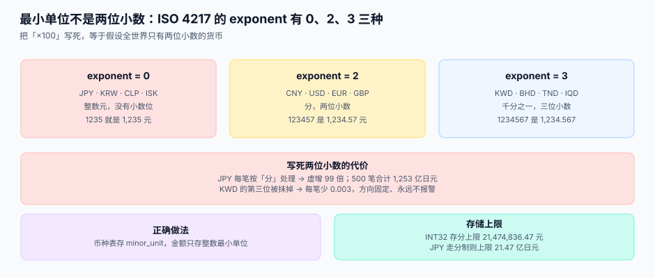

# 金额与最小单位

<p style="text-align:center;"></p>

「金额用两位小数」是这个行业里流传最广的一句错话。日元没有小数位，科威特第纳尔有三位，比特币的 satoshi 有八位，而你的数据库列写的是 `NUMERIC(18,2)`。**三位小数的货币遇上两位小数的列，第三位不是被四舍五入，是被静默丢掉。**

::: tip 一句话理解
**金额 = 整数 × 10^-exponent。** 整数与 exponent 都要存，币种只是它们的外键；把「分」写死在代码里，等于给自己埋了一个只对一半货币成立的假设。
:::

本页判据族 `FXM-A` ~ `FXM-H`，共 8 条，定义在最后一节。

## 一、ISO 4217 给了三样东西，多数人只用了第一样

| 给的 | 是什么 | 常见误用 |
| --- | --- | --- |
| 三位字母码 | `USD`、`CNY`、`KWD` | 用了，正确 |
| 三位数字码 | `840`、`156`、`414` | 不用（但它才是跨语言的稳定键） |
| **exponent（最小单位位数）** | 2 / 0 / 3 | **几乎没人用，全靠猜** |

ISO 4217:2015 明确：对有最小单位的货币，标准里给出**最小单位与货币本身的小数关系**。这个关系就是 exponent，不是「统一两位」。



| exponent | 货币举例 | 1 个单位怎么表示 | 一个典型错误 |
| --- | --- | --- | --- |
| **0** | JPY、KRW、CLP、ISK、VND | `1235` 就是 1,235 元 | 乘 100 → 虚增 99 倍 |
| **2** | CNY、USD、EUR、GBP | `123457` 是 1,234.57 元 | 无（正好是默认假设） |
| **3** | KWD、BHD、JOD、OMR、TND、LYD、IQD | `1234567` 是 1,234.567 | 抹掉第三位 → 每笔少 0.001~0.009 |

本机读数：把 `1234.567` 按「写死两位」处理，JPY 差 **0.43 元**、KWD 差 **−0.003 第纳尔**；500 笔 JPY 按 `×100` 处理，累计虚增 **125,351,561,412 日元**（每笔 250,703,123 日元）。**注意不是 100 倍，是 99 倍**——因为正确值是 1 倍，错误值是 100 倍。

::: danger 这个坑为什么抓不住
1. **错误方向固定。** KWD 少 0.003 是「永远少」，不是随机误差，所以对账时它表现为「一直有一个小缺口」，而不是「某天突然不对」。
2. **金额越大错得越多。** `×100` 的错误与金额成正比，看起来像「这个大客户的数据有点问题」。
3. **测试数据全是 USD。** 单元测试用 `100.00` 跑通，就再也没人碰过 JPY 分支。
:::

## 二、币种元数据表：唯一的事实来源

exponent 不能写在代码里，也不能写在配置里——它必须是一张表，因为它的生命周期比代码长。

```sql
CREATE TABLE currency (
  code        TEXT PRIMARY KEY,          -- ISO 4217 字母码，大写三位
  num_code    TEXT NOT NULL UNIQUE,      -- ISO 4217 数字码，跨语言稳定键
  exponent    INTEGER NOT NULL,          -- 最小单位位数：0 / 2 / 3
  symbol      TEXT NOT NULL,             -- 仅用于展示，不参与计算
  name_zh     TEXT NOT NULL,
  active      INTEGER NOT NULL DEFAULT 1,-- 0 = 已废止（如 TRL、ZWL 旧码）
  valid_from  TEXT NOT NULL,
  valid_to    TEXT,                      -- NULL = 仍有效
  CHECK (exponent BETWEEN 0 AND 4),
  CHECK (length(code) = 3 AND code = upper(code))
);

INSERT INTO currency(code, num_code, exponent, symbol, name_zh, valid_from) VALUES
  ('CNY', '156', 2, '¥',  '人民币',        '1948-12-01'),
  ('USD', '840', 2, '$',  '美元',          '1792-04-02'),
  ('EUR', '978', 2, '€',  '欧元',          '1999-01-01'),
  ('JPY', '392', 0, '¥',  '日元',          '1871-06-27'),
  ('KRW', '410', 0, '₩',  '韩元',          '1962-06-10'),
  ('KWD', '414', 3, 'KD', '科威特第纳尔',   '1961-04-01'),
  ('BHD', '048', 3, 'BD', '巴林第纳尔',     '1965-10-16');
```

三处细节都不多余：

- **`num_code`** 是数字码。同一个币种在中文系统叫「美元」、在日文系统叫「米ドル」，但 `840` 全球一致。做跨系统交换时，数字码比字母码更稳。
- **`valid_to`** 是给废止货币留的。TRL（旧土耳其里拉）在 2005 年被 TRY 取代，兑换比例是 1,000,000:1；如果历史数据里还有 TRL，你必须知道它当时的 exponent 是 0 而不是 2。
- **`CHECK (exponent BETWEEN 0 AND 4)`** 是防线。有人手工往表里插 `exponent = 5`，如果没有这个约束，系统会安静地按 10 万分之一处理。

## 三、金额只存整数，不存小数

```sql
-- 错误：小数列 + 浮点写入
CREATE TABLE invoice_bad (
  amount NUMERIC(18,2) NOT NULL   -- SQLite 里不截断、MySQL 里四舍五入、PG 里精确
);

-- 正确：整数最小单位 + 币种外键
CREATE TABLE invoice (
  id           INTEGER PRIMARY KEY,
  currency     TEXT NOT NULL REFERENCES currency(code),
  amount_minor INTEGER NOT NULL,          -- 最小单位整数
  CHECK (amount_minor >= 0)
);
```

三个数据库对 `NUMERIC(18,2)` 的处理**各不相同**，这是它不能作为金额类型的原因：

| 数据库 | 写 `7.123456` 进 `NUMERIC(18,2)` | 结果 |
| --- | --- | --- |
| PostgreSQL | 存为 `numeric`，按声明精度舍入 | 7.12（精确十进制） |
| MySQL | 按声明精度舍入 | 7.12（精确十进制） |
| **SQLite** | **亲和性不截断** | **7.123456，`typeof` 是 `real`** |

本机实测（SQLite 3.50.4）：`SELECT 0.1+0.2=0.3` 返回 **0**，`typeof(0.1+0.2)` 是 **real**；`NUMERIC(18,2)` 列存 `7.123456`，读回来仍是 `7.123456`。同一份 DDL 在三套数据库上给出三种行为，**这就是「金额用整数」这条纪律的真正理由**——不是因为浮点不精确，而是因为「精度」在 SQL 里不是一个可移植的约束。

::: warning 整数的上限
`INT32` 存「分」的上限是 **21,474,836.47 元**（约 2,147 万元），一张大额合同就能顶穿；`INT64` 的上限是 **9.22e16 元**，足够。但 JPY 走「分」制时，`INT32` 的上限是 **21.47 亿日元**——同一个字段，在不同 exponent 下含义完全不同。
:::

## 四、代码里的金额类型：三种语言的同一件事

```java
// Java：BigDecimal + 显式精度，禁止 double
public record Money(BigDecimal amount, String currency, int exponent) {
    public Money {
        if (amount.scale() > exponent) {
            throw new IllegalArgumentException("金额精度超过币种 exponent");
        }
    }
    public static Money ofMinor(long minor, String currency, int exponent) {
        return new Money(BigDecimal.valueOf(minor, exponent), currency, exponent);
    }
}
```

```python
# Python：Decimal，且从字符串构造（不要从 float 构造）
from decimal import Decimal, ROUND_HALF_UP

def money(text: str, exponent: int) -> Decimal:
    return Decimal(text).quantize(Decimal(1).scaleb(-exponent), rounding=ROUND_HALF_UP)
```

```typescript
// TypeScript：不要用 number 存金额；用 bigint 存最小单位
type Money = { minor: bigint; currency: string; exponent: number };

const fmt = (m: Money) =>
  (Number(m.minor) / 10 ** m.exponent).toFixed(m.exponent);
```

三条纪律在三种语言里是同一件事：

1. **从字符串构造，不从浮点构造。** `Decimal(0.1)` 得到的是 `0.1000000000000000055511151231257827021181583404541015625`，而 `Decimal("0.1")` 才是 0.1。
2. **精度由 exponent 决定，不由常量决定。** 到处写 `.setScale(2)` 的代码，在接入 JPY 的那天要改 200 处。
3. **格式化只发生在展示层。** 数据库里永远是整数，`1,234.57` 是渲染结果，不是存储结果。

## 五、四层模型：把「钱」拆成四个可独立演进的东西

| 层 | 内容 | 变更频率 | 谁能改 |
| --- | --- | --- | --- |
| **币种元数据** | code、num_code、exponent、有效期 | 极低（几年一次） | 主数据管理员 |
| **金额值** | `(minor, currency)` 二元组 | 每笔业务 | 业务代码 |
| **舍入规则** | 模式（HALF_UP/HALF_EVEN）、层级（行/单/汇总） | 低（一次定死） | 架构评审 |
| **展示格式** | 符号、千分位、小数位 | 高（本地化） | 前端/文案 |

拆开的好处很直接：**本地化改展示层不会碰金额，监管改舍入规则不会碰币种表**。四层混成一层（比如把 `exponent` 写进前端格式化函数），任何一层变更都会引发全链路回归。

## 六、本机读数汇总

| 实验 | 读数 | 说明 |
| --- | --- | --- |
| `0.1 + 0.2 == 0.3` | **False**，结果是 `0.30000000000000004` | 浮点比较陷阱 |
| `round(2.675, 2)` | **2.67** | 二进制表示导致「四舍五入」失效 |
| 100 万次累加 0.01 | 误差 **1.7e-7 元** | **float 不足以制造事故** |
| 500 笔 JPY 按 `×100` | 累计虚增 **125,351,561,412 日元** | 单位错 = 99 倍 |
| `NUMERIC(18,2)` 存 `7.123456` | 读回 `7.123456`，`typeof = real` | SQLite 亲和性不截断 |
| `INT32` 存分 | 上限 **21,474,836.47 元** | 大额合同会顶穿 |

第 3 行是这页最重要的一条：**float 的真实误差量级远小于业务容差**，所以「用了 float 所以账不对」这个解释在绝大多数事故里是错的。真正的原因是单位、顺序、层级这三点——它们跟浮点没关系。

## 判据清单

| 编号 | 判据 | 怎么验 |
| --- | --- | --- |
| `FXM-A` | 存在独立的币种表，含 `code`、`num_code`、`exponent`、有效期 | 表存在且 `exponent` 有 `CHECK` 约束 |
| `FXM-B` | 所有金额列都是整数类型，且配有币种外键或同表币种列 | 全库搜 `DECIMAL/NUMERIC/FLOAT` 金额列，应为 0 |
| `FXM-C` | 代码中无硬编码 `* 100`、`/ 100`、`setScale(2)` | `grep -rn "\* 100\|/ 100\|setScale(2)"` 命中处逐个说明 |
| `FXM-D` | 金额从字符串或整数构造，不从浮点构造 | 搜 `Decimal(0.`、`BigDecimal(double)`，应为 0 |
| `FXM-E` | 精度由币种 `exponent` 驱动，函数签名带 `exponent` 参数 | 抽 3 个格式化函数，签名都含 `exponent` |
| `FXM-F` | 金额字段有上限校验，且上限按币种算 | 插一条超 `INT32` 的 JPY 金额，必须被拒 |
| `FXM-G` | 废止币种保留在表中并带 `valid_to`，历史数据可解释 | 查 `valid_to IS NOT NULL` 的行，能被历史单据引用 |
| `FXM-H` | 展示格式化只发生在视图层，数据库无格式化字符串 | 全库搜 `¥`、`$`、`€`，只允许出现在前端与文案 |

## 验证方式

```shell
# 1) 没有浮点金额列（预期 0 行）
sqlite3 /tmp/fx.db "SELECT m.name, p.name, p.type FROM sqlite_master m
  JOIN pragma_table_info(m.name) p
  WHERE m.type='table' AND (p.type LIKE '%REAL%' OR p.type LIKE '%FLOAT%'
        OR p.type LIKE '%DOUBLE%' OR p.type LIKE '%NUMERIC%' OR p.type LIKE '%DECIMAL%');"

# 2) exponent 覆盖三种取值（预期至少各 1 行：0 / 2 / 3）
sqlite3 /tmp/fx.db "SELECT exponent, count(*) FROM currency GROUP BY exponent;"

# 3) 超上限必须被拒（预期 Error: CHECK constraint failed）
sqlite3 /tmp/fx.db "INSERT INTO invoice(currency, amount_minor) VALUES('JPY', 3000000000);"

# 4) 代码里没有写死的两位小数（预期无输出）
grep -rn "setScale(2)\|\* 100\b" --include=*.java --include=*.py --include=*.ts src/ 2>/dev/null
```

## 参考资料

- [汇率来源与快照](../RateSource/index.md)：有了币种，下一步是给它配一条可追溯的汇率
- [取整与分摊](../Rounding/index.md)：`exponent` 决定舍入到哪一位
- ISO 4217:2015 标准页（含维护机构说明）：<https://www.iso.org/standard/64758.html>
- ISO 4217 现行货币与基金代码表（维护机构 SIX 发布）：<https://www.six-group.com/en/products-services/financial-information/data-standards.html>
- Python `decimal` 模块文档（`Decimal` 构造与上下文精度）：<https://docs.python.org/3/library/decimal.html>
