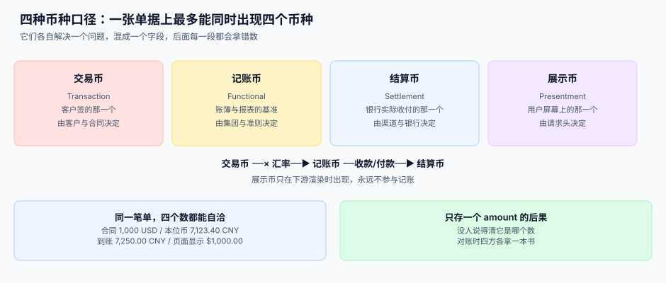
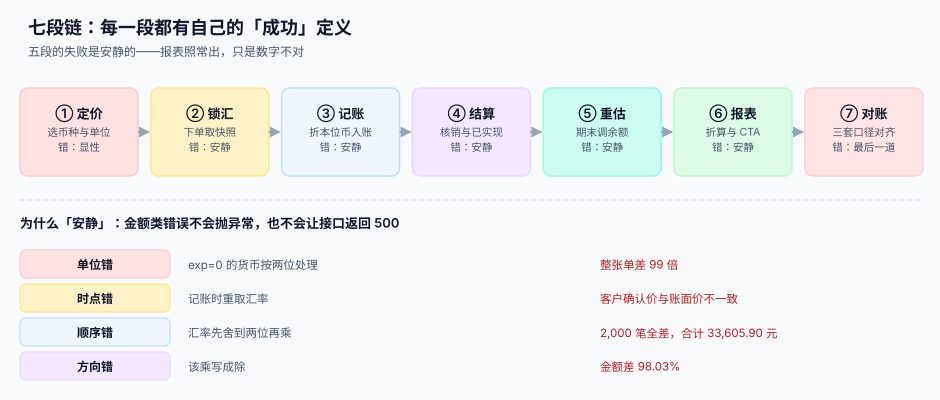

# 总览：七段折算链与四种币种

<p style="text-align:center;"></p>

一个跨境订单在系统里留下的第一个痕迹是 `amount = 1000.00`。三个月后财务问「这单收入多少」，四个人给出四个答案：销售说 1,000 美元、会计说 7,123.40 元、出纳说 7,250.00 元、运营说「后台显示 $1,000.00」。**四个人都没算错，他们说的是四种不同的钱。**

::: tip 一句话理解
**多币种不是「加一个 currency 字段」，而是给每一个金额标注「它属于哪种币种口径」。** 口径一旦缺失，后面每一段都会拿错数，而且不会报错。
:::

本页判据族 `FXO-A` ~ `FXO-H`，共 8 条，定义在最后一节。

## 一、四种币种口径，一张单上最多同时出现四个

| 口径 | 英文 | 谁决定 | 用途 | 存不存 |
| --- | --- | --- | --- | --- |
| **交易币** | Transaction Currency | 客户与合同 | 单据本身的面额，客户看到的就是它 | 存，且在单据头上 |
| **记账币** | Functional Currency | 集团与准则 | 账簿与报表的基准，所有科目都用它 | 存，折算结果落明细 |
| **结算币** | Settlement Currency | 渠道与银行 | 真正发生收付的那个币种 | 存，且与收款流水绑定 |
| **展示币** | Presentment Currency | 请求头/用户设置 | 只影响渲染，不参与记账 | **不存**（存了就一定会被误用） |



这四者的关系是一条单向链，**不能反向推断**：

```text
交易币 --× 汇率--> 记账币 --收款/付款--> 结算币
                      ^
展示币 ---------------+ 只读，永不回写
```

于是同一笔业务在一张表里长得像这样：

```sql
CREATE TABLE invoice (
  id              INTEGER PRIMARY KEY,
  invoice_no      TEXT NOT NULL UNIQUE,
  txn_currency    TEXT NOT NULL,              -- 交易币，三位 ISO 代码
  txn_amount      INTEGER NOT NULL,           -- 最小单位整数（分/元/第纳尔）
  book_currency   TEXT NOT NULL,              -- 记账币
  book_amount     INTEGER NOT NULL,           -- 折本位币后的整数
  fx_rate_id      INTEGER NOT NULL REFERENCES fx_rate(id),  -- 用的是哪一条快照
  fx_rate         TEXT NOT NULL,              -- 快照当时的值（文本，避免浮点）
  settled_currency TEXT,                      -- 结算币，收款后才回填
  settled_amount  INTEGER
);
```

`fx_rate_id` 与 `fx_rate` 必须**同时存在**：前者用于追溯「按哪一次发布」，后者用于复算「当时那个值」。只存值不存 ID，事后没法回答「这个汇率是谁给的」；只存 ID 不存值，汇率表一旦被更正，历史单据会集体变脸。

## 二、七段链：每一段都有自己的「成功」定义

| 段 | 这一段在做什么 | 产物 | 失败是否安静 |
| --- | --- | --- | --- |
| ① 定价 | 选币种、选最小单位、确认金额落在哪个口径 | `currency` + `minor_unit` | **显性**（币种不认识会报错） |
| ② 锁汇 | 下单那一刻把汇率固定下来 | `fx_rate` 快照 + `fx_rate_id` | 安静（取了实时价，隔天就变） |
| ③ 记账 | 交易币折成记账币入账 | `book_amount` + 分录 | 安静（差一分也能过） |
| ④ 结算 | 收款/付款、核销、算已实现损益 | 核销记录 + 损益行 | 安静（差额被当成手续费） |
| ⑤ 重估 | 期末按新汇率调整外币余额 | 重估分录 + 未实现损益 | 安静（重跑一次就翻倍） |
| ⑥ 报表 | 把记账币报表折成列报币种 | 折算表 + CTA | 安静（差额塞进权益） |
| ⑦ 对账 | 三套口径的合计逐层对齐 | 对账日报 | **最后一道**（再不过就没人管了） |



七段里有**五段失败是安静的**。这与订单、支付、库存那类链路完全不同：那些链路的失败会抛异常（库存不足、支付失败、状态非法），而折算链的失败只表现为「这个月的毛利率有点怪」——而那通常被解释成业务波动。

## 三、四个必失接缝

::: danger 四个必失接缝
1. **币种 ≠ 单位。** 以为 `currency = 'JPY'` 就万事大吉，代码里仍写 `amount * 100`。JPY 的 exponent 是 0，乘 100 就是把 1,235 日元变成 123,457「分」——**每笔虚增 99 倍**，而且金额越大越离谱，看起来像「这个客户特别大」。
2. **汇率 ≠ 一个数。** 只存一个 `rate` 字段，丢掉了方向（base/quote）、来源（央行/银行/数据商）、时点（哪一天几点）、精度（几位小数）。本机实测：同一对货币「汇率先舍到两位再乘」，2,000 笔里 **2,000 笔全差**，合计差 **−33,605.90 元**。
3. **换算 ≠ 乘法。** 直接报价、倒数、三角换算三条路给出三个价。20 个币种全连要存 **380 对**，星型只要 **19 对**，但星型意味着大部分换算要过两段。选哪条是设计决策，**必须写死一条，不能运行时随便挑**。
4. **差额 ≠ 误差。** 结算差额、重估差额、折算差额，这三类差额都是**正确的会计结果**，必须各有科目归属。把它们统一塞进「手续费」或「其他」，是三个月后对不上账的头号原因。
:::

## 四、为什么「差一点」很危险

因为金额类错误**不会被任何一层拦住**：

1. **数据库不拦。** `NUMERIC(18,2)` 在多数数据库里只是「建议精度」，SQLite 实测 `NUMERIC(18,2)` 列存 `7.123456` 读回来还是 `7.123456`，`typeof` 是 `real`——**亲和性不是约束**。
2. **类型系统不拦。** 用 `float` 存金额，`0.1 + 0.2 = 0.30000000000000004`，`0.1 + 0.2 == 0.3` 为假；但 1,000,000 次累加 0.01 的误差只有 **1.7e-7 元**——所以 float 本身并不足以制造事故。
3. **真正制造事故的是「单位」与「顺序」**：单位错一位就是 99 倍，顺序错一次就是每笔差 1 分。这两类都不需要精度问题，只需要一次疏忽。
4. **对账是最后一道。** 三套口径的合计天然不相等（记账与结算汇率不同），所以「合计对不上」不能当报警信号——能报警的只有**「差额没有归属」**。

本机读数（[实战](../Practice/index.md)复跑）：500 行混杂 4 个币种的明细，直接 `sum(amount)` 得到 **2,261,805.68**，看起来像一个正经金额；折成本位币后是 **9,546,077.78**，差 **76.3%**。混币种求和不会报错，它只是给出一个没有意义的数。

## 五、三个必须先定下来的口径

| 口径 | 要定什么 | 定错的后果 |
| --- | --- | --- |
| **锁汇时点** | 下单锁、支付锁、还是记账锁 | 客户确认价与账面价不一致，投诉与调账同时来 |
| **取整层级** | 行级、单据级、还是汇总级 | 明细之和 ≠ 总额，凭证永远差一分 |
| **重估范围** | 只货币性项目，还是全部外币余额 | 存货、固定资产被重估，报表直接失真 |

这三条要在**第一次接入外币之前**写进设计文档。事后改的代价不是改代码，是**改历史数据**。

## 判据清单

| 编号 | 判据 | 怎么验 |
| --- | --- | --- |
| `FXO-A` | 每个金额字段都能答出「多少 + 币种 + 最小单位」三件事 | 列出所有金额列，逐个标注 `currency` 与 `minor_unit` 来源 |
| `FXO-B` | 交易币、记账币、结算币三者分列存放，无一字段复用 | 抽 10 单，三列可同时非空且互不相等 |
| `FXO-C` | 展示币不落库，只在下游渲染时计算 | 全库搜展示币代码，只允许出现在前端配置或视图层 |
| `FXO-D` | 每条折算记录同时带 `fx_rate_id` 与 `fx_rate` 快照值 | 抽 10 条，两条都能查到；缺一即不合格 |
| `FXO-E` | 七段各有自己的产物表或字段，缺段能被发现 | 按表清单对齐七段，缺段的段落数为 0 |
| `FXO-F` | 差额有独立科目：结算差额、重估差额、折算差额 | 三类别各查一笔，科目不同且不落「其他」 |
| `FXO-G` | 锁汇时点在单据头写死，且与折算明细一致 | 同一单的 `fx_rate_id` 在多张明细里完全相同 |
| `FXO-H` | 同一单重算三次，得到与已入账完全相同的金额 | 幂等断言：重跑后 `sum(book_amount)` 不变 |

## 验证方式

```shell
# 1) 金额列是否都带币种：应为 0 行（每行都有 currency 或明确的同表币种列）
sqlite3 /tmp/fx.db "SELECT m.name, p.name FROM sqlite_master m
  JOIN pragma_table_info(m.name) p
  WHERE m.type='table' AND p.name LIKE '%amount%'
    AND m.name NOT IN (SELECT m2.name FROM sqlite_master m2
                       JOIN pragma_table_info(m2.name) p2
                       WHERE m2.type='table' AND p2.name LIKE '%currency%');"

# 2) 快照两列是否同时存在：应各有 10 行
sqlite3 /tmp/fx.db "SELECT count(*) FROM invoice WHERE fx_rate_id IS NOT NULL;
                    SELECT count(*) FROM invoice WHERE fx_rate IS NOT NULL;"

# 3) 重算幂等：连跑两次，两个数字必须相同
sqlite3 /tmp/fx.db "SELECT round(sum(book_amount)/100.0, 2) FROM invoice;"
```

## 与本专题的分工

同一个「汇率」在两册里做的是两件事：本册管**一笔业务**折算成记账本位币，合并册管**一整张外币报表**折成母币。

| 你关心的问题 | 该读哪一册 | 为什么 |
| --- | --- | --- |
| 一笔美元应收按哪个汇率入账 | 本册 | 交易日即期汇率、月末重估 |
| 一整家美元子公司的资产按哪个汇率折 | [合并报表与内部抵销](../../Consolidation/Translation/index.md) | 期末 / 平均 / 历史三组汇率并行 |
| 折算差额进损益还是进权益 | 本册只到「汇兑损益」 | 进 CTA 还是进损益由功能货币决定，属合并层判断 |
| 内部往来在折算后金额变了怎么办 | 合并册 | 先折后抵与先抵后折差 28,000 |
| CTA 怎么分给少数股东 | 合并册 | 按有效持股拆分，漏分差 85,600 |

::: danger 本页特有的一处坑：把「记账本位币」当成「功能货币」
本册讲折算时默认两者相同，合并层却不能默认。若子公司功能货币等于母公司报告货币，折算要用**时态法**、差额进当期损益；若功能货币是当地币，才用现行汇率法、差额进 CTA。

选错法不是小事：本机同一张 USD 报表，时态法资产 21,590,000、现行汇率法 21,750,000，差 160,000——而差额最终落在「利润表」还是「其他综合收益」，是两条完全不同的披露路径。
:::

## 与「碳排放核算与 ESG 披露」的分工（第 237 天补充）

| 你关心的问题 | 该读哪一册 | 为什么不是本页 |
| --- | --- | --- |
| 「金额用哪种币、按哪个汇率折」 | 本页 | 判**汇率快照与折算差额** |
| 「碳关税用哪个汇率、怎么报」 | [披露、重述与履约](../../CarbonAccounting/Disclosure/index.md) | 那册判**嵌入排放与凭证价**，汇率只是其中一个因子 |
| 「组织这一年的碳清单」 | [碳排放核算总览](../../CarbonAccounting/Overview/index.md) | 那册判**边界与范围** |
| 「跨境供应链的排放怎么归属」 | [范围三：十五类与两种算法](../../CarbonAccounting/Scope3/index.md) | 那册判**价值链归属**，不做折算 |

::: warning 一页一坑：碳关税的汇率敞口比金额本身更大
本页处理的汇率差是「同一笔金额、两个时点」的差；碳关税多了一层：**凭证价格与汇率同时波动**。

本机实测：出口 8,000 t 钢材、嵌入排放 1.85 tCO₂e/t = 14,800 tCO₂e，按 70 欧元/凭证、7.8 的汇率是 8,080,800 元。凭证价与汇率各动 10%，成本就动 21%（复利）；而报价时用的往往是季度初的汇率与上一期的凭证价。**这笔敞口要单独披露，不能混进「汇兑损益」**——它与商品价格无关，只与碳价和汇率同时相关。
:::

## 与「全球化与时区本地化工程」专题的分工（第 269 天补充）

| 维度 | 本页回答 | 专题回答 |
| --- | --- | --- |
| 对象 | 一种货币怎么建模、汇率从哪来、金额怎么舍入 | [这笔记录按哪个营业日、哪个地区口径归档](../../Globalization/CalendarAndCutoff/index.md) |
| 边界 | 金额、汇率、估值、结算与对账 | 时间字段契约、日切、驻留区与灰度窗口 |
| 不重复 | 不再罗列时区规则与 locale 协商 | 不重复汇率源与舍入规则（[专题分工说明](../../Globalization/index.md)已写死） |

**本页特有的一处坑**：汇率「当日牌价」按 `DATE(occurred_at_utc)` 取，而交易按本地营业日归属，两者并不是同一天。第 269 天实测 10 万笔订单里 **22.60%** 的 UTC 日与本地日归属不同、叠加 04:00 日切后是 **22.87%**；DST 切换周还会出现 23 / 25 小时的日子，按 `+24h` 取「次日牌价」会整体错位。正确写法：汇率查询键带 `biz_date + residency_zone`，从 `calendar_day` 维表取区间，不裸用 UTC 日期；这条与[报表的日期维度口径](../../ReportAnalytics/Overview/index.md)是同一个问题。

## 参考资料

- [金额与最小单位](../MoneyModel/index.md)：第 ① 段，exponent 与整数存储
- [汇率来源与快照](../RateSource/index.md)：第 ② 段，一条快照要存哪些列
- [期末重估](../Valuation/index.md)：第 ⑤ 段，重估范围与闸门
- [多币种对账与报表折算](../Reconciliation/index.md)：第 ⑥⑦ 段，三套口径与 CTA
- ISO 4217:2015 标准页：<https://www.iso.org/standard/64758.html>
- IFRS IAS 21 标准页：<https://www.ifrs.org/issued-standards/list-of-standards/ias-21-the-effects-of-changes-in-foreign-exchange-rates/>
