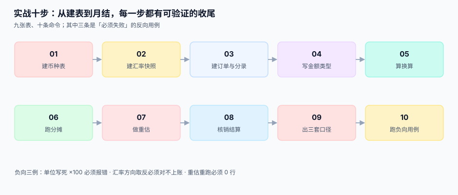

# 实战：本机跑通一条折算闭环

<p style="text-align:center;"></p>

前面九页讲了九件事，这一页把它们连成一条能跑的流水：**建表 → 建快照 → 下单 → 换算 → 分摊 → 重估 → 核销 → 出三套口径 → 跑负向用例 → 闭合校验**。全程只用 Python 3 标准库与 SQLite，不装任何依赖，任何一台机器上十分钟内能复现。

::: tip 一句话理解
**验收不是「看起来对」，而是「三个必须失败的用例真的失败了」。** 一个只会跑通正向流程的实现，说明不了任何事——因为折算链的错误本来就都是安静的。
:::

本页判据族 `FXP-A` ~ `FXP-H`，共 8 条，定义在最后一节。



## 一、目标与九张表

目标：20 张美元发票 + 1 张 1,000 美元发票、6 条汇率快照、100 笔期末余额，跑出一套能自洽的账。

| # | 表 | 作用 | 关键约束 |
| --- | --- | --- | --- |
| 1 | `currency` | 币种元数据 | `exponent` 有 `CHECK`，`num_code` 唯一 |
| 2 | `fx_rate` | 汇率快照 | `UNIQUE(base,quote,kind,source,date,revision)`、`CHECK(base<>quote)` |
| 3 | `invoice` | 发票头 | 同时存 `fx_rate_id` 与 `fx_rate` |
| 4 | `invoice_line` | 发票行 | `UNIQUE(invoice_id, line_no)` |
| 5 | `gl_entry` | 分录 | `subject` 区分未实现/已实现 |
| 6 | `fx_revaluation` | 重估记录 | `UNIQUE(period, account, currency)` |
| 7 | `settlement` | 核销 | 带 `settle_rate` 与 `fx_rate_id` |
| 8 | `settlement_diff` | 差额分解 | 一条核销多条分解 |
| 9 | `fx_policy` | 舍入与锁汇策略 | 单据类型 → 取整层级（本步只建表，暂不参与流水） |

```python
# 建库：SQLite 落在 /tmp/fx.db，可随时删掉重来
import sqlite3
conn = sqlite3.connect("/tmp/fx.db")
conn.execute("PRAGMA foreign_keys = ON")
```

## 二、十步流水

### 第 1 步：建币种表，三种 exponent 都要有

```sql
CREATE TABLE currency(
  code TEXT PRIMARY KEY, num_code TEXT NOT NULL UNIQUE, exponent INTEGER NOT NULL,
  symbol TEXT NOT NULL, name_zh TEXT NOT NULL, active INTEGER NOT NULL DEFAULT 1,
  valid_from TEXT NOT NULL, valid_to TEXT,
  CHECK (exponent BETWEEN 0 AND 4), CHECK (length(code)=3 AND code=upper(code)));
```

```text
== 01 币种表 ==
currency rows = 7 | exponents = 0,2,3
```

**判读**：`exponents = 0,2,3` 是这一页的第一道关。只有 `2` 的币种表，测试永远覆盖不到 JPY 与 KWD 两个分支。

### 第 2 步：建汇率快照，四种 `rate_kind` 分开放

```sql
CREATE TABLE fx_rate(
  id INTEGER PRIMARY KEY, base TEXT NOT NULL REFERENCES currency(code),
  quote TEXT NOT NULL REFERENCES currency(code), rate TEXT NOT NULL,
  rate_kind TEXT NOT NULL, source TEXT NOT NULL, precision INTEGER NOT NULL,
  quoted_at TEXT NOT NULL, effective_date TEXT NOT NULL, revision INTEGER NOT NULL DEFAULT 1,
  path TEXT NOT NULL DEFAULT 'direct',
  UNIQUE(base,quote,rate_kind,source,effective_date,revision),
  CHECK (base<>quote), CHECK (rate_kind IN ('mid','bid','ask','closing')),
  CHECK (precision BETWEEN 2 AND 8));
```

```text
== 02 汇率快照 ==
fx_rate rows = 6 | kinds = bid,closing,mid
```

**判读**：`closing` 单独一类，是给[期末重估](../Valuation/index.md)用的。如果重估时临时去 `mid` 里挑一条，就等于「用估值价重估、用成交价结算」，两者的差永远说不清。

### 第 3 步：下单，同时写死快照

```python
from decimal import Decimal, ROUND_HALF_UP
def q(x, n=2):
    return Decimal(x).quantize(Decimal(1).scaleb(-n), rounding=ROUND_HALF_UP)

RATE, RATE_ID = Decimal("7.1234"), 1
for i in range(1, 21):
    usd = Decimal(random.randrange(10000, 300000)) / 100
    book = int(q(usd * RATE, 2) * 100)          # 本位币，整数分
    conn.execute("""INSERT INTO invoice(invoice_no,txn_currency,txn_amount,book_currency,
                    book_amount,fx_rate_id,fx_rate,total_minor) VALUES(?,?,?,?,?,?,?,?)""",
                 (f"INV{i:04d}", "USD", int(usd * 100), "CNY", book, RATE_ID, str(RATE), book))
```

```text
== 03 发票与分录 ==
invoices = 21 | lines = 63 | USD total = 25377.96 | CNY total = 180777.35
```

**判读**：`fx_rate_id` 与 `fx_rate` 同时落库。前者回答「按哪一次发布」，后者回答「当时那个值是多少」——**只留 ID，汇率被更正后历史会变脸；只留值，出事时查不到来源**。

### 第 4 步：让 `CHECK` 真的拦住非法元数据

```text
== 04 金额校验（负向 1：exponent 越界） ==
OK 拦住: CHECK (exponent BETWEEN 0 AND 4)
```

**判读**：这是第 1 个负向用例。`exponent = 5` 如果插得进去，后面所有 `×10^5` 的计算都会安静地错 1000 倍。

### 第 5 步：换算——直接报价 vs 三角换算

```text
== 05 换算：10 单 USD→CNY，直接 vs 三角 ==
direct = 70723.11 | via_eur = 70723.09 | diff = -0.02 | 不同单数 = 2/10
```

**判读**：10 单里 **2 单**和直接报价差 1 分，合计差 **0.02 元**。数字很小，但它是**系统性的**——放大到 2,000 单就是 537 单差 1 分（见[换算路径](../Conversion/index.md)）。这就是「路径要写死」的理由。

### 第 6 步：分摊——最大余数法让合计闭合

```python
def allocate(total, weights):
    s = sum(weights); raw = [total * w / s for w in weights]
    base = [x.quantize(Decimal("0.01"), rounding=ROUND_DOWN) for x in raw]
    rest = total - sum(base); step = Decimal("0.01") if rest > 0 else Decimal("-0.01")
    order = sorted(range(len(raw)), key=lambda i: raw[i] - base[i], reverse=(rest > 0))
    i = 0
    while rest != 0:
        base[order[i % len(order)]] += step; rest -= step; i += 1
    return base
```

```text
== 06 分摊：最大余数法 ==
naive  = ['33.33', '33.33', '33.33'] sum = 99.99
largest= ['33.34', '33.33', '33.33'] sum = 100.00
```

**判读**：逐行独立取整少 1 分，最大余数法补上。注意补的那 1 分落在**第一行**（余数相同，按原顺序）——所以「谁承担尾差」这件事必须有确定性规则，否则同一张单两次渲染会得到两个结果。

### 第 7 步：期末重估，闸门挡住第二次

```text
== 07 期末重估（100 笔外币应收） ==
fc = 447639.58 USD | old = 3188715.74 | new = 3236434.13 | unrealized = 47718.39
OK 闸门拦住 | 行数 = 1 | 损益 = 47718.39
```

**判读**：汇率 `7.1234 → 7.2300`（+1.50%），未实现损益 **47,718.39 元**。第二次插入被 `UNIQUE(period, account, currency)` 拒绝，表里仍是 **1 行**——**没有这个约束，月结跑两遍就是 95,436.78 元**。

### 第 8 步：核销 1,000 美元，已实现损益落地

```text
== 08 核销：1,000 USD 全额收款 ==
invoice #21 | usd = 1000.00 | book = 7123.40 | settle = 7268.00 | realized = 144.60
```

**判读**：入账 7,123.40、结汇 7,268.00，差 **144.60 元**进已实现损益。这个数与[结算与已实现损益](../Settlement/index.md)里手算的完全一致——一致性本身就是一种验收。

### 第 9 步：三套口径与勾稽

```text
== 09 三套口径 ==
T(交易币折入账) = 7123.40 | B(记账币) = 7123.40 | S(结算币) = 7268.00 | S-B = 144.60
勾稽 S-B-realized = 0.0
```

**判读**：最后一行 `0.0` 是这一页最重要的一个输出。它证明「结算币合计 − 记账币合计」**正好等于**已实现损益科目余额——差额有名字，账就闭了。

### 第 10 步：三个必须失败的用例

```text
== 10 三个负向用例 ==
N1 OK base=quote 被拒
N2 OK: 换算路径过长：3 跳，上限 2
N3 方向取反：right = 180777.35 | wrong = 3562.61 | 差 98.03%
```

| 用例 | 期望 | 实际 | 它防的是什么 |
| --- | --- | --- | --- |
| **N1** 同一币种对换 | 拒绝 | `CHECK` 失败 | 方向缺失导致的「自己换自己」 |
| **N2** 三跳换算 | 拒绝 | `ValueError` | 误差不可控的长链 |
| **N3** 乘除取反 | 差 98% | **98.03%** | 「方向靠注释说明」这一类设计 |

N3 不是「必须失败」，而是**必须差得离谱**：如果取反后只差 1%，说明你测的不是方向问题。

## 三、闭合校验：两条 SQL 收尾

```text
== 闭合校验 ==
不闭合单据 = 0 | 明细合计 = 180777.35 | 单据合计 = 180777.35
```

```sql
-- 1) 明细之和 = 单据总额（预期 0 行）
SELECT i.id FROM invoice i JOIN invoice_line l ON l.invoice_id = i.id
GROUP BY i.id HAVING sum(l.amount_minor) <> i.total_minor;

-- 2) 差额分解之和 = 核销差额（预期 0 行）
SELECT s.id FROM settlement s LEFT JOIN settlement_diff d ON d.settlement_id = s.id
GROUP BY s.id HAVING coalesce(sum(d.amount_minor),0) <> s.realized_gl;
```

两条都空，说明「分摊闭合」与「差额归属」两个不变量成立。**它们能进 CI**——这才是把它们写成 SQL 而不是写成文档的意义。

## 四、本机读数汇总

| 步骤 | 读数 |
| --- | --- |
| 币种 | 7 个，exponent 覆盖 **0 / 2 / 3** |
| 汇率 | 6 条，三类 `rate_kind`（mid / bid / closing） |
| 发票 | 21 张，**25,377.96 USD** → **180,777.35 CNY** |
| 换算 | 直接 70,723.11 vs 三角 70,723.09，**10 单中 2 单差 1 分** |
| 分摊 | 逐行 99.99 vs 最大余数 **100.00** |
| 重估 | 100 笔 447,639.58 USD → 未实现 **47,718.39**，重跑 **1 行** |
| 核销 | 1,000 USD：7,123.40 → 7,268.00，已实现 **144.60** |
| 勾稽 | `S − B − 已实现 = 0.00` |
| 负向 | 3 个用例全部按预期失败/离谱 |
| 闭合 | 不闭合单据 **0** |

::: warning 这套流水没覆盖什么
1. **并发。** SQLite 是单写者，测不出「两个事务同时重估」的竞态。生产环境要用唯一索引 + 串行化隔离级别验证。
2. **多期间。** 只有一个月的数据，测不出「上期重估被冲回、本期重算」的链路。
3. **性能。** 21 张发票的规模看不出索引问题；真实场景要按 10 万张压测（见[复式记账](../../Ledger/DoubleEntry/index.md)的分录写入量级）。

这三项要在第 3 周的联调里补，不能等到上线。
:::

## 判据清单

| 编号 | 判据 | 怎么验 |
| --- | --- | --- |
| `FXP-A` | 十步可以按顺序在一台干净机器上跑通，无外部依赖 | 只装 Python 3，从建表跑到闭合校验 |
| `FXP-B` | 币种表覆盖 exponent 0/2/3 三种取值 | `SELECT DISTINCT exponent` 返回三行 |
| `FXP-C` | 每张发票同时有 `fx_rate_id` 与 `fx_rate` | 计数为 0 的空值查询为空 |
| `FXP-D` | 分摊在随机数据上闭合，不闭合数为 0 | 跑 2,000 组随机分摊，`bad = 0` |
| `FXP-E` | 重估重跑不产生第二行 | 连续插入两次，第二次必须冲突 |
| `FXP-F` | 勾稽式 `S − B − 已实现 = 0` | 差值绝对值 ≤ 0.01 元 |
| `FXP-G` | 三个负向用例全部按预期失败 | 三个 `OK`，一个都不能是 `FAIL` |
| `FXP-H` | 全部步骤可重复执行，结果完全一致 | 删库重跑，每个数字不变 |

## 验证方式

```shell
# 0) 准备（Python 3.9+，无第三方依赖）
rm -f /tmp/fx.db

# 1) 十步流水全跑（把本页的片段按顺序存成 fx_practice.py）
python3 fx_practice.py | tee /tmp/fx_practice.log

# 2) 四行关键输出必须与本文一致
grep -E "exponents = 0,2,3|unrealized = 47718.39|realized = 144.60|不闭合单据 = 0" /tmp/fx_practice.log

# 3) 负向用例必须三个 OK（预期 3）
grep -c "^N[123] OK" /tmp/fx_practice.log
```

## 参考资料

- [金额与最小单位](../MoneyModel/index.md)：第 1 步那张币种表的来由
- [汇率来源与快照](../RateSource/index.md)：第 2 步七列的取舍
- [取整与分摊](../Rounding/index.md)：第 6 步的最大余数法
- [期末重估](../Valuation/index.md)：第 7 步的期间闸门
- Python `sqlite3` 模块文档（`PRAGMA foreign_keys`、`IntegrityError`）：<https://docs.python.org/3/library/sqlite3.html>
- ISO 4217 标准页（币种与最小单位）：<https://www.iso.org/standard/64758.html>
