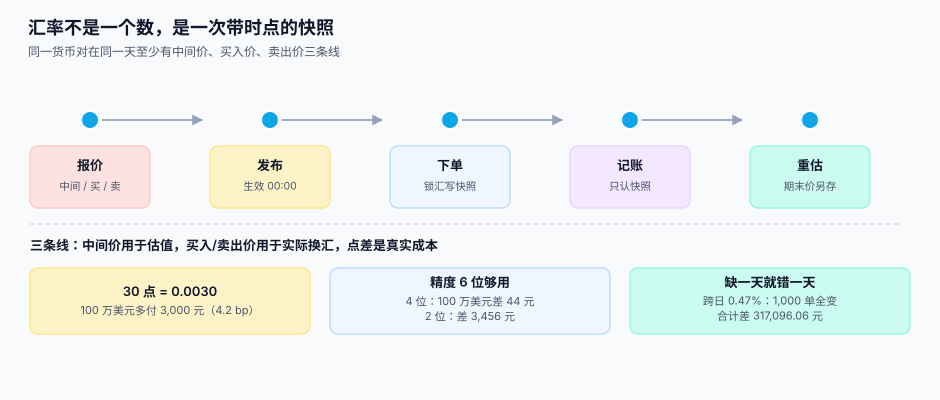

# 汇率来源与快照

<p style="text-align:center;"></p>

汇率表是整套系统里**唯一一个「外部输入」的数值来源**。它不像订单金额那样由你算出来，也不像库存那样由你扣减——它从央行、银行或者数据商那里来，带着一个发布时点、一个方向、一个精度。**你对它的全部义务是：存对、选对、别改。**

::: tip 一句话理解
**一条能用的汇率至少要有七列：base、quote、rate、source、quoted_at、effective_date、precision。** 少任何一列，三个月后都会出现一句「这个数是怎么来的」，而没人答得上。
:::

本页判据族 `FXR-A` ~ `FXR-H`，共 8 条，定义在最后一节。

## 一、一个 `rate` 字段丢掉的信息

```sql
-- 错误：一个字段，谁也说不清它是什么
CREATE TABLE fx_rate_bad (
  pair TEXT,      -- 'USDCNY'
  rate NUMERIC    -- 7.1234……方向呢？谁给的？哪天几点？
);

-- 正确：七列，缺一不可
CREATE TABLE fx_rate (
  id             INTEGER PRIMARY KEY,
  base           TEXT NOT NULL REFERENCES currency(code),   -- 被换出的币种
  quote          TEXT NOT NULL REFERENCES currency(code),   -- 换入的币种
  rate           TEXT NOT NULL,                             -- 十进制字符串，不用 float
  rate_kind      TEXT NOT NULL,                             -- mid / bid / ask / central
  source         TEXT NOT NULL,                             -- ecb / pboc / bank:cmb / vendor:x
  precision      INTEGER NOT NULL,                          -- 报价保留几位小数
  quoted_at      TEXT NOT NULL,                             -- 数据源发布时刻（带时区）
  effective_date TEXT NOT NULL,                             -- 业务生效日（YYYY-MM-DD）
  revision       INTEGER NOT NULL DEFAULT 1,                -- 同日更正计数
  UNIQUE (base, quote, rate_kind, source, effective_date, revision),
  CHECK (base <> quote),
  CHECK (rate_kind IN ('mid','bid','ask','central')),
  CHECK (precision BETWEEN 2 AND 8)
);
```

七列各自对应一个真实问题：

| 列 | 少了它会怎样 |
| --- | --- |
| `base` / `quote` | 7.1234 到底是「1 美元换 7.1234 元」还是「1 元换 7.1234 美元」？差 **50.74 倍** |
| `rate_kind` | 用中间价去换汇，等于让银行白干；用卖出价去估值，等于提前确认了成本 |
| `source` | 两个数据源差 3 个点，出了事不知道以谁为准 |
| `precision` | 报价 4 位还是 6 位，决定了 100 万美元差 44 元还是 0 元 |
| `quoted_at` | 只能答出「哪一天」，答不出「几点」——而盘中一天可能有 4 个价 |
| `effective_date` | 周末与节假日没有报价，业务日期与发布日对不上 |
| `revision` | 数据源当天发过更正，你只留了最后一版，历史单据全部变脸 |

## 二、三个价：中间价、买入价、卖出价



| 价 | 谁发布 | 用途 | 能不能用来换汇 |
| --- | --- | --- | --- |
| **中间价（mid / central）** | 央行、数据商 | 估值、报表折算、内部核算 | **不能**（欧洲央行明确写「不建议用于交易」） |
| **买入价（bid）** | 银行、渠道 | 客户把外币卖给你时用的价 | 能 |
| **卖出价（ask）** | 银行、渠道 | 客户从你这买外币时用的价 | 能 |

买入价与卖出价之间的差就是**点差**，它是换汇的真实成本，不是「手续费」的一种说法。

本机读数：中间价 `7.1234`，点差 30 个点（`0.0030`），客户价 `7.1264`。换 100 万美元，客户多付 **3,000.00 元**，相对成本 **4.2 bp**。这个数字看起来小，但它是**每一笔都要付**的——一年 1 亿美元的换汇量，点差就是 30 万元。

::: danger 三个和汇率有关的必失点
1. **拿中间价去结算。** 系统里只有一条 `mid`，结算时也用它。结果：财报上的换汇成本永远是 0，而银行的账单上永远有一笔差。对不出来的时候，会计会把它记进「财务费用-其他」，于是这笔钱就永久消失了。
2. **正数方向靠猜。** `rate = 7.1234` 没有 base/quote 时，写代码的人按字面理解成「USD → CNY」。半年后接入 EUR，有人按「先乘后除」的直觉写了一遍，金额差 **98.03%**——而报表上只表现为「欧洲区收入暴涨」。
3. **用「昨天的」补今天。** 周末没有报价，工程上最省事的做法是「沿用上一个工作日」。这在估值上勉强可接受，在**结算**上是错的：客户在周日下单，你按周五的价收款，差价由谁承担没有定义。
:::

## 三、精度：为什么 4 位不够，6 位够

欧洲央行发布的欧元参考汇率**保留 4 位小数**，这是公开可查的事实。4 位听起来够用，直到你把它乘上一个大数：

| 报价精度 | USD/CNY 的值 | 100 万美元折算差 | 相对误差 |
| --- | --- | --- | --- |
| 2 位 | 7.12 | **−3,456.00 元** | 4.85 bp |
| 4 位 | 7.1235 | **44.00 元** | 0.06 bp |
| 6 位 | 7.123456 | 0.00 元 | 0 |
| 8 位 | 7.12345600 | 0.00 元 | 0 |

结论不是「精度越高越好」，而是**精度要匹配量级**：

- **结算与记账用 6 位**：6 位已经让 100 万美元级别的误差归零，再高只是浪费。
- **展示用 4 位**：与数据源一致，客户看到的就是公布的数。
- **中间计算用 8 位以上**：`Decimal` 上下文精度设 28~40，避免多步乘法累积截断。

::: warning 一个反直觉的结论
汇率先舍到 2 位再相乘，2,000 笔里 **2,000 笔全差**，合计差 **−33,605.90 元**，最大单笔差 **33.99 元**。而「中间多留 2 位再舍」（先按 4 位算，最后舍到分）只有 **7 笔（0.4%）** 差，合计 **0.07 元**。

**取整的时机比取整的模式重要一个数量级。** 大多数团队在争论 HALF_UP 还是 HALF_EVEN，而真正的差异在「你在第几步舍」。
:::

## 四、时点：四张时间戳，各有各的用途

| 时点 | 谁写入 | 用途 | 改不改 |
| --- | --- | --- | --- |
| `quoted_at` | 数据同步任务 | 追溯「这个价是什么时候发布的」 | 不改（新版本用 `revision`） |
| `effective_date` | 数据同步任务 | 业务按日取价，周末/节假日覆盖 | 不改 |
| 单据上的 `locked_at` | 下单/支付服务 | 锁汇时刻，决定用哪一条 | 不改 |
| 期末的 `closing_date` | 月结任务 | 重估用它取「期末汇率」 | 不改 |

本机读数：两天的汇率从 `7.1234` 变到 `7.1567`（+0.47%），1,000 笔订单**全部**金额变化，合计差 **317,096.06 元**，其中 **828 单**单笔差超过 100 元。也就是说：**「记账时重取一次汇率」这一个动作，足以让 1,000 张单据全部与客户确认的金额不一致**。

::: danger 时点上最容易犯的错
1. **锁汇与记账用了两个时点。** 下单时按 A 价给客户报价，入账时按 B 价折算。差额既不是损益也不是误差，它是一笔**没人认领的差**。正确做法：单据上存 `fx_rate_id`，入账只认这一条。
2. **按 `created_at` 取汇率。** 用业务表的创建时间 join 汇率表，看似合理，实则把「业务时间」与「系统时间」混成一个。补录一张上周的单，会取到今天的汇率。
3. **重估不另存期末汇率。** 重估用完就丢，导致「这个数怎么算的」无法复算。期末汇率必须作为一条独立快照落库，并带 `closing_date`。
:::

## 五、快照不可变：只能追加，不能更新

```sql
-- 数据源当天更正：新增一条 revision，不 UPDATE 旧行
INSERT INTO fx_rate(base, quote, rate, rate_kind, source, precision,
                    quoted_at, effective_date, revision)
VALUES ('USD', 'CNY', '7.1239', 'mid', 'pboc', 4,
        '2026-11-01T09:30:00+08:00', '2026-11-01', 2);
```

三条纪律：

1. **不 UPDATE，只 INSERT。** 一条汇率被引用之后就是历史事实，更正的方式是「新的版本」，不是「改掉旧的」。
2. **取价时按 `revision DESC` 取最新，按 `effective_date` 取当日。** 两个维度分开，不能混在一个排序里。
3. **缺数显式失败，不静默兜底。** 找不到当日的汇率时，抛错比「用昨天的」安全——本机读数里，漏更新一个币种只影响 **5.3% 的单**，报表整体只差 **0.2%**，**肉眼完全看不出来**。

## 六、缺数策略：三种做法，只有一种可接受

| 策略 | 适用 | 风险 |
| --- | --- | --- |
| **抛错，等人工补** | 结算、记账 | 业务中断，但不会错 |
| **取最近一个工作日（标注 `stale_days`）** | 估值、展示 | 差额可解释，需在报表上标出「用了 T-2 的价」 |
| **插值 / 沿用昨天的但当作今天的** | **无** | 差额不可解释，审计无法复核 |

第三条之所以必须禁止，不是因为它错得多，而是因为它**错得不可见**：数据里没有任何标记说明「这一行是猜的」。

## 判据清单

| 编号 | 判据 | 怎么验 |
| --- | --- | --- |
| `FXR-A` | 汇率表含 base、quote、rate、rate_kind、source、precision、quoted_at、effective_date | 八列齐全，缺一即不合格 |
| `FXR-B` | `base <> quote` 有 `CHECK` 约束，方向不可能反 | 插一条 `base = quote`，必须被拒 |
| `FXR-C` | 中间价与买卖价分 `rate_kind` 存放，结算只取 bid/ask | 结算代码里搜 `mid`，应为 0 |
| `FXR-D` | 每条汇率带 `precision`，取价时按它做舍入 | 抽 3 条，`precision` 与 `rate` 的小数位一致 |
| `FXR-E` | 快照只追加：同键存在 `revision > 1` 的行，旧行未被 UPDATE | `git log` 或触发器审计中无 UPDATE 记录 |
| `FXR-F` | 单据同时存 `fx_rate_id` 与 `fx_rate` 值 | 抽 10 单，两者都可查且值一致 |
| `FXR-G` | 期末汇率作为独立快照落库，带 `closing_date` | 查 `rate_kind = 'closing'` 的行，条数 = 期数 |
| `FXR-H` | 缺数时显式失败或标注 `stale_days`，无静默兜底 | 删掉某币种当日汇率，业务必须报错或打上标记 |

## 验证方式

```shell
# 1) 方向约束真实生效（预期 Error: CHECK constraint failed）
sqlite3 /tmp/fx.db "INSERT INTO fx_rate(base,quote,rate,rate_kind,source,precision,quoted_at,effective_date)
  VALUES('USD','USD','1','mid','test',4,'2026-11-01T00:00:00+08:00','2026-11-01');"

# 2) 同一货币对一天内可以有多个 revision（预期 revision 1 与 2 各一行）
sqlite3 /tmp/fx.db "SELECT revision, rate FROM fx_rate
  WHERE base='USD' AND quote='CNY' AND effective_date='2026-11-01' ORDER BY revision;"

# 3) 结算没有用中间价（预期 0 行）
sqlite3 /tmp/fx.db "SELECT count(*) FROM settlement s
  JOIN fx_rate r ON r.id = s.fx_rate_id WHERE r.rate_kind = 'mid';"
```

## 参考资料

- [换算路径](../Conversion/index.md)：有了快照，下一步是决定「用哪条路乘」
- [期末重估](../Valuation/index.md)：`closing` 汇率在哪里被用掉
- 欧洲央行欧元参考汇率页（发布时点 16:00 CET、保留 4 位、不建议用于交易）：<https://www.ecb.europa.eu/stats/policy_and_exchange_rates/euro_reference_exchange_rates/html/index.en.html>
- ISO 4217 标准页（币种代码与最小单位）：<https://www.iso.org/standard/64758.html>
- IFRS IAS 21（即期汇率、期末汇率与货币性项目的定义）：<https://www.ifrs.org/issued-standards/list-of-standards/ias-21-the-effects-of-changes-in-foreign-exchange-rates/>
