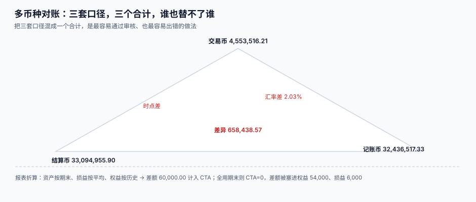

# 多币种对账与报表折算

<p style="text-align:center;"></p>

对账时最常见的争执是：「你这边的合计是 3,243 万，我这边是 3,309 万，差了 65 万，谁错了？」答案是**两个都对**——一个是记账币口径，一个是结算币口径，差的那 65 万就是这一个月真实发生的汇兑损益。**多币种对账的目标不是让三个数相等，而是让三个数的差额有名字。**

::: tip 一句话理解
**三套口径，三个合计，差额必须能勾稽到损益或权益。** 差额解释不出来才是问题，差额存在不是问题。
:::

本页判据族 `FXN-A` ~ `FXN-H`，共 8 条，定义在最后一节。

## 一、三套口径，各自回答不同的问题

| 口径 | 合计回答什么 | 谁在看 | 能不能直接相加 |
| --- | --- | --- | --- |
| **交易币** | 这个月做了多少生意（原币） | 业务、销售 | ❌ 不同币种不能加 |
| **记账币** | 账上记了多少收入/应收 | 财务、审计 | ✅ 同币种可加 |
| **结算币** | 实际收付了多少钱 | 出纳、资金 | ✅ 同币种可加 |

「交易币合计」是唯一一个**必须按币种分组**才能看的数。本机读数：500 行混杂 4 个币种的明细，直接 `sum(amount)` 得 **2,261,805.68**，折成本位币后是 **9,546,077.78**——差 **76.3%**。那个 226 万的数没有任何业务含义，但它长得像一个正经金额，所以最容易被贴进汇报材料。

## 二、勾稽公式：三个合计之间的关系



设：

- `T` = 交易币合计（按币种分组后，各自折算到记账币的**入账时**金额）
- `B` = 记账币合计（账簿余额，已含重估）
- `S` = 结算币合计（实际收付，按结算汇率折记账币）

则有：

```text
S − T = 已实现汇兑损益 + 手续费 + 折扣 + 尾差
B − T = 未实现汇兑损益（期末重估）
S − B = 已实现 − 未实现 + 其他差额
```

这个公式的价值在于：**任何一笔差额都必须落进右边某一项**。落不进去，就说明有一笔记错了。

本机读数（1,000 单，记账 7.1234、结算 7.2680）：

| 量 | 金额（CNY） |
| --- | --- |
| `T`（交易币折入账值） | 32,436,517.33 |
| `S`（结算币合计） | 33,094,955.90 |
| `S − T` | **658,438.57（2.03%）** |
| 逐单不同的单数 | **1,000 / 1,000** |

## 三、对账日报的五段结构

一份能用的多币种对账日报，必须按这个顺序出：

| 段 | 内容 | 出问题时的信号 |
| --- | --- | --- |
| ① 总量对齐 | `T` / `B` / `S` 三个合计 + 勾稽差额 | 差额 ≠ 损益科目之和 |
| ② 逐币种 | 每个币种的 `T`、`B`、`S`、差额 | 某个币种差额比例异常（如 > 5%） |
| ③ 逐单 | 差额 Top 20 的单据 | 同一客户反复出现 |
| ④ 汇率覆盖 | 每个币种当日是否有快照、`stale_days` | 有币种 `stale_days > 3` |
| ⑤ 异常清单 | 无汇率的单、方向不明的单、重估冲突 | 任何一条非空 |

第 ④ 段最容易被省略，也最容易出事：本机读数里漏更新一个币种只影响 **5.3% 的单**，报表整体只差 **0.2%**——**肉眼完全看不出来**，只有覆盖率检查能抓到。

## 四、报表折算：四张表，四种汇率

把记账币报表折成列报币种（比如境外子公司折成集团的本位币），四张表各有各的汇率：

| 报表 | 用什么汇率 | 理由 |
| --- | --- | --- |
| 资产负债表·资产/负债 | **期末汇率** | 这些是「时点上的余额」 |
| 资产负债表·实收资本 | **历史汇率** | 投入的资本不能被后续汇率改写 |
| 利润表 | **平均汇率**（或交易日汇率） | 收入是「期间内发生的」 |
| 现金流量表 | 平均汇率（或交易日汇率） | 与利润表同源 |

四张表折完之后必然不平，差额就是**外币报表折算差额（CTA，Cumulative Translation Adjustment）**，进其他综合收益。

本机读数（资产 1,000,000、负债 600,000、权益 300,000 原币；期末 7.2300、平均 7.1700、历史 7.0500）：

| 项 | 金额（CNY） | 用的汇率 |
| --- | --- | --- |
| 资产 | 7,230,000.00 | 期末 7.2300 |
| 负债 | 4,338,000.00 | 期末 7.2300 |
| 权益 | 2,115,000.00 | 历史 7.0500 |
| 净利润 | 717,000.00 | 平均 7.1700 |
| **CTA（轧差）** | **60,000.00** | — |

::: danger 把 CTA 做成 0
如果图省事，权益与损益也全用期末汇率折算，CTA 会恰好等于 **0**——看起来很完美。但差额没有消失：

- 权益被虚增 **54,000**（2,169,000 vs 2,115,000）
- 净利润被虚增 **6,000**（723,000 vs 717,000）
- 两者合计正好 **60,000**

也就是说：**CTA 不是「差额」，它是「差额的容器」。容器一关，差额就进了权益和损益。** 而这两处恰恰是最容易被解释成「业务增长」的地方。
:::

## 五、披露：三个必须能答出来的数

| 披露项 | 口径 | 数据从哪来 |
| --- | --- | --- |
| 外币货币性项目余额 | 按币种列示原币与本位币 | 重估表按 `currency` 分组 |
| 汇兑损益 | 分已实现/未实现 | 两个损益科目 |
| 折算差额 | CTA 期末余额与本期变动 | 折算工作表 |

三个数都必须能**逐层下钻到单据**。披露表里的一个 785,577.40，要能点开看到它由哪些科目、哪些币种、哪些单据组成——这是审计最先要的东西。

## 六、本机读数汇总

| 实验 | 读数 |
| --- | --- |
| 500 行 4 币种直接求和 | 2,261,805.68 vs 折本位币 9,546,077.78，差 **76.3%** |
| 1,000 单记账 vs 结算 | 差 **658,438.57（2.03%）**，1,000 单全不同 |
| 报表折算 CTA | **60,000.00** |
| 全用期末汇率 | CTA = 0，权益虚增 **54,000**、损益虚增 **6,000** |
| 漏更新 1 个币种 | 影响 **5.3%** 的单，整体差 **0.2%**（不可见） |

## 判据清单

| 编号 | 判据 | 怎么验 |
| --- | --- | --- |
| `FXN-A` | 三套口径分别可查，且不共用一个合计字段 | 报表有 `txn_total`、`book_total`、`settle_total` 三列 |
| `FXN-B` | 交易币合计按币种分组，禁止跨币种直接相加 | 全库搜 `sum(amount)` 无 `group by currency` 的语句逐个说明 |
| `FXN-C` | 勾稽公式 `S − T = 已实现 + 其他` 能对上 | 日报里差额与损益科目之和相等（±1 分） |
| `FXN-D` | 汇率覆盖率每日检查，`stale_days` 有阈值告警 | 覆盖率报表存在，阈值有配置 |
| `FXN-E` | 报表折算四类汇率分开取：期末/平均/历史/交易日 | 折算工作表逐行标注汇率类型 |
| `FXN-F` | CTA 单独列示于其他综合收益，不被并入损益 | 查权益变动表，CTA 有独立行 |
| `FXN-G` | 披露数字可下钻到单据 | 抽 1 个披露数，能追到明细清单 |
| `FXN-H` | 对账日报可重跑，同一期间结果一致 | 重跑两次，五个段落数字完全相同 |

## 验证方式

```shell
# 1) 交易币合计必须分组（预期每个币种一行）
sqlite3 /tmp/fx.db "SELECT txn_currency, round(sum(txn_amount)/100.0, 2)
  FROM invoice GROUP BY txn_currency;"

# 2) 勾稽：结算与记账之差 = 已实现损益（预期 diff 为 0.00）
sqlite3 /tmp/fx.db "SELECT round((SELECT sum(settle_amount)/100.0 FROM settlement), 2)
                      - round((SELECT sum(book_amount)/100.0 FROM settlement), 2)
                      - round((SELECT sum(amount_minor)/100.0 FROM gl_entry
                               WHERE subject='6603_realized'), 2) AS diff;"

# 3) 汇率覆盖率（预期 stale_days 全部 <= 3）
sqlite3 /tmp/fx.db "SELECT c.code, max(julianday('2026-10-31') - julianday(r.effective_date))
  FROM currency c LEFT JOIN fx_rate r ON r.quote = c.code
  GROUP BY c.code;"
```

## 参考资料

- [结算与已实现损益](../Settlement/index.md)：`S − T` 里那一项从哪来
- [期末重估](../Valuation/index.md)：`B − T` 里那一项从哪来
- [三向对账](../../Ledger/Reconciliation/index.md)：单币种场景下的对账骨架
- IFRS IAS 21（折算方法、折算差额计入其他综合收益）：<https://www.ifrs.org/issued-standards/list-of-standards/ias-21-the-effects-of-changes-in-foreign-exchange-rates/>
- 财政部《企业会计准则第 19 号——外币折算》（折算差额列示）：<https://kjs.mof.gov.cn/>
