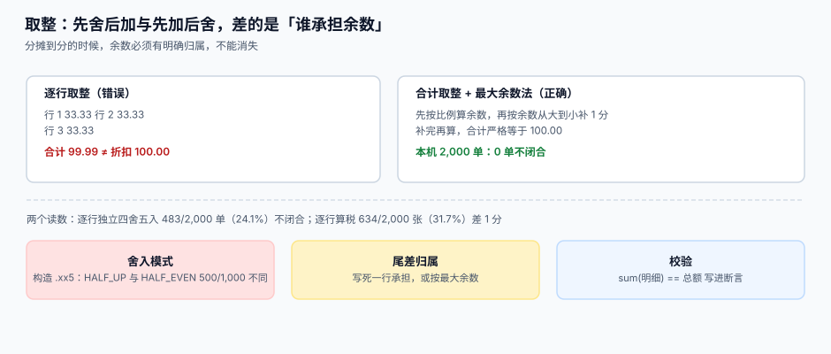

# 取整与分摊

<p style="text-align:center;"></p>

一笔 100.00 元的折扣要摊到三行，每行精确值是 33.333… 元。三行各自舍一次得 `33.33 + 33.33 + 33.33 = 99.99`，比总额少 **1 分**；按最大余数法补一次得 `33.34 + 33.33 + 33.33 = 100.00`。**差的那一分钱没有消失，它只是被分摊到了不同的地方**——而会计要能说出它去了哪。

::: tip 一句话理解
**取整不是「把小数去掉」，而是「把余数分配掉」。** 分配的规则必须写死，且必须保证「明细之和 = 总额」这个等式永远成立。
:::

本页判据族 `FXU-A` ~ `FXU-H`，共 8 条，定义在最后一节。

## 一、三种舍入模式，选一个然后全库统一

| 模式 | 0.5 怎么处理 | 适用 | 本机差异 |
| --- | --- | --- | --- |
| **HALF_UP**（四舍五入） | 远离零，`1.005 → 1.01` | 中国会计惯例、面向客户的金额 | 基准 |
| **HALF_EVEN**（银行家舍入） | 取偶数，`1.005 → 1.00`、`1.015 → 1.02` | 统计、金融批量计算（IEEE 754 默认） | 与 HALF_UP 不同 **50%** |
| **TRUNCATE**（截断） | 直接丢弃 | 只用于「绝不能多给」的场景 | 系统性偏低 |

本机读数（固定种子 `20261101`）：

- 构造 1,000 个 `.xx5` 边界值：两种模式**不同 500 个（50%）**。
- 随机 20 万个金额：两种模式**不同 10,082 个（5.04%）**。

第一行说明「模式选择」在边界上是决定性的；第二行说明**在真实分布里它只影响 5%**——所以「选哪个模式」远不如「是否统一」重要。

::: danger 模式混用比选错更贵
同一个系统里，Java 的 `BigDecimal.setScale(2)` 默认 `HALF_UP`，Python 的 `round()` 是 `HALF_EVEN`，JavaScript 的 `toFixed()` 在部分值上两者都不是。**同一个金额在三个服务里算出三个结果**，然后你会在对账日报上看到「差 1 分的单据 3,412 张」。

纪律：**模式在架构层定一次，写进公共金额库，业务代码不允许自己 `round`。**
:::

## 二、取整层级：行、单据、汇总，三层只能选一层



| 层级 | 做法 | 优点 | 代价 |
| --- | --- | --- | --- |
| **行级** | 每行舍到分，再加总 | 每行金额独立可解释 | 合计 ≠ 总额（本机 **24.1%** 的单不闭合） |
| **单据级** | 合计舍到分，再按比例摊回行 | 合计恒等于总额 | 行金额需要「摊」的规则 |
| **汇总级** | 明细全精度存，只在报表汇总时舍 | 最精确 | 存储与展示分离，实现成本高 |

本机读数：

- 2,000 张 3 行发票，**逐行算税 vs 合计算税**：**634 张（31.7%）差 1 分**，最大差 0.01。
- 2,000 单折扣按行独立四舍五入：**483 单（24.1%）合计 ≠ 总额**，最大差 0.01。
- 同样的 2,000 单改用**最大余数法**：**0 单不闭合**。

这三个数字合起来说明一件事：**「独立四舍五入」在行数少的时候看起来没问题（76% 是对的），但它是错的**——它没有「余数归属」的概念。

## 三、最大余数法：把余数按「谁被舍得最多」补回去

算法只有三步：

1. 按比例算出每行的精确份额（不取整）。
2. 每行先向下取整到分，累加得到 `base`。
3. 计算 `rest = total − base`（单位是分），把 `rest` 个 1 分，按「小数部分从大到小」逐行补上。

```python
from decimal import Decimal, ROUND_DOWN, ROUND_HALF_UP

def allocate(total: Decimal, weights: list[Decimal]) -> list[Decimal]:
    """把 total 按 weights 比例分摊，保证 sum(结果) == total（精确到分）。"""
    s = sum(weights)
    raw = [total * w / s for w in weights]
    base = [x.quantize(Decimal("0.01"), rounding=ROUND_DOWN) for x in raw]
    rest = total - sum(base)                      # 一定是 0.01 的整数倍
    step = Decimal("0.01") if rest > 0 else Decimal("-0.01")
    order = sorted(range(len(raw)), key=lambda i: raw[i] - base[i], reverse=(rest > 0))
    i = 0
    while rest != 0:
        base[order[i % len(order)]] += step
        rest -= step
        i += 1
    return base
```

三个实现细节都不能省：

- **`ROUND_DOWN` 而不是 `ROUND_HALF_UP`**：先全部向下取，余数才是同号的（全正或全负），补的时候方向唯一。
- **`order` 按小数部分排序**：被舍得最多的行先补，这是「最大余数法」名称的来源，也是它比「给最后一行」更公平的原因。
- **`rest` 一定落在 `±0.01 × n` 上**：如果算出来不是 0.01 的整数倍，说明 `total` 本身精度不对，应该直接抛错而不是循环。

## 四、尾差归属：四种写法，只有两种可接受

| 写法 | 描述 | 可接受 | 原因 |
| --- | --- | --- | --- |
| **最大余数法** | 按余数排序分配 | 是 | 公平、可复算、行数无关 |
| **指定行承担** | 全部尾差给金额最大的行 | 是 | 简单、可解释（需在单据上写明） |
| 最后一行承担 | 尾差全给最后一行 | 勉强 | 行顺序变化时结果会变 |
| 差额丢弃 | 不补，让合计差 1 分 | **否** | 凭证永远对不平 |

第三种之所以「勉强」：如果行是按金额排序渲染的，最后一行的身份会随排序变化，**同一张单在两次渲染里可能得到两个分摊结果**。

## 五、税、折扣、汇率的取整顺序

一笔跨境订单上通常有三个乘数：折扣 → 税 → 汇率。**先舍哪一步，决定最终差几分**。

| 顺序 | 结果（示例） | 问题 |
| --- | --- | --- |
| 折扣 → 税 → 汇率，每步都舍 | 三步各舍一次，误差累积 | 最不准 |
| 折扣 → 税 → 汇率，只在最后舍 | 中间保留高精度 | 最准 |
| 税先算（按总额）再摊到行 | 与按行算税差 1 分 | 31.7% 的单会差 |

推荐顺序：**全部用高精度算完，只在「落库」和「展示」两处各舍一次**。落库舍到币种 `exponent`，展示按 locale 格式化。中间任何一步都不要 `round`。

::: warning 税额为什么必须按行算
按总额算税再摊回行，看起来更简单（一次乘法），但它与「按行算税再加总」在 31.7% 的单上差 1 分。而**发票是逐行开具的**，税务系统按行汇总，于是你的账与税局的数据会永久差那几分。这一类差异不会引发报错，只会引发「每个月都有几百张单要手工调」。
:::

## 六、把「闭合」写成断言，而不是写成文档

```sql
-- 单据落库后立即校验：明细之和必须等于单据总额
SELECT i.id, i.total_minor, sum(l.amount_minor) AS line_sum
FROM invoice i JOIN invoice_line l ON l.invoice_id = i.id
GROUP BY i.id
HAVING sum(l.amount_minor) <> i.total_minor;   -- 预期 0 行
```

这条 SQL 的价值在于它能进 CI：每天跑一次，**出现一行就说明分摊逻辑被改坏了**。文档里写「必须闭合」没有用，机器每天检查才有用。

## 判据清单

| 编号 | 判据 | 怎么验 |
| --- | --- | --- |
| `FXU-A` | 全库只有一个舍入模式常量，业务代码无裸 `round` | 搜 `round(`、`setScale(`，命中处必须走公共库 |
| `FXU-B` | 取整层级在单据类型上写死（行级/单据级/汇总级） | 每类单据有 `rounding_level` 字段或配置项 |
| `FXU-C` | 分摊使用最大余数法或指定行承担，有单元测试 | 跑 2,000 组随机数据，不闭合数为 **0** |
| `FXU-D` | `sum(明细) = 总额` 有每日校验任务 | 校验 SQL 存在且历史结果为 0 行 |
| `FXU-E` | 税额按行计算，不按总额摊 | 抽 10 张多行发票，逐行税额之和 = 总税额 |
| `FXU-F` | 中间计算不取整，只在落库与展示各舍一次 | 代码里 `quantize` 只出现在两处 |
| `FXU-G` | 尾差在单据上有可见记录（金额 + 承担行） | 抽查 10 张有尾差的单，能指出尾差落在哪一行 |
| `FXU-H` | 同一单据重算三次，分摊结果完全一致 | 幂等断言：重跑后每行金额不变 |

## 验证方式

```shell
# 1) 不闭合的单据（预期 0 行）
sqlite3 /tmp/fx.db "SELECT i.id FROM invoice i JOIN invoice_line l ON l.invoice_id=i.id
  GROUP BY i.id HAVING sum(l.amount_minor) <> i.total_minor;"

# 2) 最大余数法在 2,000 组随机数据上闭合（预期 bad=0）
python3 - <<'PY'
import random
from decimal import Decimal, ROUND_DOWN
random.seed(20261101)
def allocate(total, weights):
    s = sum(weights); raw = [total*w/s for w in weights]
    base = [x.quantize(Decimal("0.01"), rounding=ROUND_DOWN) for x in raw]
    rest = total - sum(base); step = Decimal("0.01") if rest > 0 else Decimal("-0.01")
    order = sorted(range(len(raw)), key=lambda i: raw[i]-base[i], reverse=(rest > 0))
    i = 0
    while rest != 0:
        base[order[i % len(order)]] += step; rest -= step; i += 1
    return base
bad = 0
for _ in range(2000):
    total = Decimal(random.randrange(100, 999999))/100
    w = [Decimal(random.randrange(1, 100)) for _ in range(3)]
    if sum(allocate(total, w)) != total: bad += 1
print("bad =", bad)
PY
```

## 参考资料

- [换算路径](../Conversion/index.md)：汇率那一次取整发生在哪
- [结算与已实现损益](../Settlement/index.md)：取整差额如何进入损益
- Python `decimal` 模块文档（舍入模式常量与 `quantize`）：<https://docs.python.org/3/library/decimal.html>
- IEEE 754 二进制浮点标准（`roundTiesToEven` 的定义）：<https://standards.ieee.org/ieee/754/6210/>
