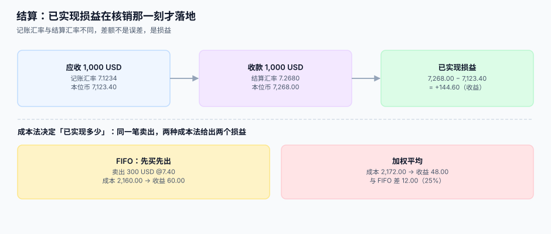

# 结算与已实现损益

<p style="text-align:center;"></p>

应收 1,000 美元入账时按 7.1234 记了 7,123.40 元，两周后客户真的付了 1,000 美元，银行按 7.2680 结汇给了 7,268.00 元。**多出来的 144.60 元不是误差，是这笔生意真实赚到的钱**——只是它来自汇率，不来自商品。

::: tip 一句话理解
**未实现损益是「账面重估出来的」，已实现损益是「真的换掉了」。** 两者的分界线是核销动作，不是时间。
:::

本页判据族 `FXS-A` ~ `FXS-H`，共 8 条，定义在最后一节。

## 一、核销：把「应收」和「收款」对上



| 情况 | 原币 | 本位币 | 差额怎么处理 |
| --- | --- | --- | --- |
| **全额收款，汇率相同** | 1,000 = 1,000 | 7,123.40 = 7,123.40 | 无差额 |
| **全额收款，汇率不同** | 1,000 = 1,000 | 7,123.40 ≠ 7,268.00 | 差 **144.60** → 已实现汇兑损益 |
| **部分收款** | 1,000 > 400 | 按比例结转 | 每次核销各算一次已实现损益 |
| **多收**（客户多付） | 1,000 < 1,050 | 多出的 50 进预收 | 不进损益，进负债 |
| **少收**（折扣/手续费） | 1,000 > 990 | 差 10 进「销售折扣」或「手续费」 | 与汇兑差分开 |

第四、五行是最容易混的：**多收与少收的差额不是汇兑损益**。汇兑损益只来自「同一笔原币金额，在两个时点用两个汇率折算」，跟金额本身对不对无关。

::: danger 把结算差额一律记「财务费用-其他」
这个做法在单币种时代是对的（差额确实只是手续费），在多币种时代是灾难：

1. **手续费、汇兑差、折扣、尾差**四种性质完全不同的钱，被塞进同一个科目。
2. 月末想知道「这个月汇兑损失多少」，答不出来。
3. 审计要求按性质披露，你得把这笔钱重新拆一遍——而明细已经没了。

正确做法：**核销时同时产出多条「差额分解」记录**，每条带自己的性质码。
:::

## 二、结算币 ≠ 记账币：多出来的一层

记账币是账簿的基准，结算币是银行实际收付的币种。两者可以不同：

```text
客户付 1,000 USD  →  银行按 7.2680 结汇  →  到账 7,268.00 CNY
      ↑ 交易币                ↑ 结算动作              ↑ 记账币
```

如果结算币也是 USD（比如境外账户直接收美元），那就没有「结汇」这一步，但**依然有已实现损益**——因为记账币仍是 CNY，重估与核销照样要算。

本机读数（1,000 张单，记账汇率 7.1234、结算汇率 7.2680）：

| 口径 | 合计 | 说明 |
| --- | --- | --- |
| 交易币 | 4,553,516.21 USD | 原币合计，不能直接和本位币比 |
| 记账币 | 32,436,517.33 CNY | 入账时按 7.1234 折 |
| 结算币 | 33,094,955.90 CNY | 实际收付按 7.2680 折 |
| **差额** | **658,438.57 CNY（2.03%）** | 已实现汇兑收益 |

注意最后一行：**1,000 张单里 1,000 张都不同**，差额比例 2.03%。这个比例对单张单来说是「不可忽略」，对汇总来说是「看起来像正常波动」——这就是为什么它必须逐单核销，而不是月末一笔总数冲掉。

## 三、成本法：同一笔卖出，两个损益

外币账户的「成本」怎么算，取决于你选哪种成本流转假设。本机读数（三次买入 100/200/150 USD，汇率 7.10/7.25/7.32；卖出 300 USD，汇率 7.40）：

| 成本法 | 结转成本 | 已实现收益 | 说明 |
| --- | --- | --- | --- |
| **FIFO**（先买先出） | 2,160.00 | **60.00** | 100×7.10 + 200×7.25 |
| **加权平均** | 2,172.00 | **48.00** | 平均汇率 7.24 × 300 |

差 **12.00 元（25%）**。两种都合规，但**必须选一种并写死**：

- 银行、券商多用 FIFO（可追溯到具体批次）。
- 企业外币账户多用加权平均（与存款流水一致）。
- **同一个账户在两年里换过成本法**，是最难解释的一类审计问题。

::: warning 成本法影响的不只是损益
它还决定了「剩余余额的单位成本」。上例中 FIFO 结完 300 后，剩 150 USD、成本 7.32；加权平均结完后，剩 150 USD、成本 7.24。下一次卖出时，两者的起点又不一样了。**成本法一旦选定，历史必须连续。**
:::

## 四、未实现与已实现的边界

| 动作 | 影响未实现 | 影响已实现 | 说明 |
| --- | --- | --- | --- |
| 期末重估 | ✅ | ❌ | 只调余额，不动核销 |
| 实际收款/付款 | ❌（该笔转出） | ✅ | 核销那一刻落地 |
| 部分收款 | ✅（剩余部分继续重估） | ✅（已收部分结转） | 两件事同时发生 |
| 期末后又重估 | ✅ | ❌ | 已核销的不再重估 |

最容易错的是第 3 行：**部分收款之后，剩余部分仍然要被重估**。如果重估的余额取的是「应收账款科目余额」，它会自动扣掉已核销的部分——但如果代码里缓存了一个「原币余额」字段没同步，就会对已收款的部分重复重估。

## 五、核销表设计

```sql
CREATE TABLE settlement (
  id             INTEGER PRIMARY KEY,
  invoice_id     INTEGER NOT NULL REFERENCES invoice(id),
  settle_currency TEXT NOT NULL REFERENCES currency(code),
  settle_amount  INTEGER NOT NULL,              -- 结算币金额（最小单位）
  settle_rate    TEXT NOT NULL,                 -- 结算汇率（快照值）
  fx_rate_id     INTEGER NOT NULL REFERENCES fx_rate(id),
  book_amount    INTEGER NOT NULL,              -- 折记账币后的金额
  allocated_fc   INTEGER NOT NULL,              -- 本次核销的原币金额
  realized_gl    INTEGER NOT NULL DEFAULT 0,    -- 已实现汇兑损益（正=收益）
  diff_kind      TEXT,                          -- fx / fee / discount / rounding / overpay
  settled_at     TEXT NOT NULL
);

CREATE TABLE settlement_diff (                  -- 差额分解，一条核销可有多条
  id            INTEGER PRIMARY KEY,
  settlement_id INTEGER NOT NULL REFERENCES settlement(id),
  kind          TEXT NOT NULL,                  -- fx / fee / discount / rounding / overpay
  amount_minor  INTEGER NOT NULL,
  note          TEXT
);
```

`diff_kind` 与 `settlement_diff` 是同一个信息的两级表达：前者给单条核销一个主分类（便于报表），后者记录全部拆分（便于审计）。**只留一个是不够的**——只看主分类，遇到「既有汇兑差又有手续费」的单就说不清；只看明细，做报表时要每次 `GROUP BY`。

## 六、本机读数汇总

| 实验 | 读数 |
| --- | --- |
| 1,000 单记账 vs 结算 | 差 **658,438.57 元（2.03%）**，1,000 单全部不同 |
| FIFO vs 加权平均（卖 300 USD） | 收益 **60.00** vs **48.00**，差 **12.00（25%）** |
| 单笔全额核销 | 已实现 **+144.60**（7,268.00 − 7,123.40） |
| 中间价当结算价 | 汇兑差恒为 0，成本全部被隐藏 |

## 判据清单

| 编号 | 判据 | 怎么验 |
| --- | --- | --- |
| `FXS-A` | 核销记录带 `settle_rate` 与 `fx_rate_id`，结算汇率可追溯 | 抽 10 条，两列都非空 |
| `FXS-B` | 结算币与记账币分列存放，且允许不同 | 抽 10 条，存在两列不等的记录 |
| `FXS-C` | 差额按性质分解（汇兑/手续费/折扣/尾差/多收） | 抽 10 条有差额的核销，`settlement_diff` 合计 = 差额 |
| `FXS-D` | 已实现损益有独立科目，且与未实现科目不同 | 查两科目余额，均非空且不相等 |
| `FXS-E` | 成本法在账户层写死，历史连续未变 | 查账户配置，`cost_method` 有值且无变更记录 |
| `FXS-F` | 部分核销后剩余原币余额正确递减 | 三次各收 1/3，剩余余额 = 原额 − 已核销累计 |
| `FXS-G` | 多收进预收负债，不进损益 | 构造多收 5%，损益不变、预收 +5% |
| `FXS-H` | 同一笔核销重放三次，结果完全一致 | 幂等断言：重放后 `sum(realized_gl)` 不变 |

## 验证方式

```shell
# 1) 差额分解之和等于核销差额（预期 0 行不一致）
sqlite3 /tmp/fx.db "SELECT s.id FROM settlement s
  LEFT JOIN settlement_diff d ON d.settlement_id = s.id
  GROUP BY s.id
  HAVING coalesce(sum(d.amount_minor),0) <> s.realized_gl;"

# 2) 部分核销后余额正确（预期 remaining 递减且不越界）
sqlite3 /tmp/fx.db "SELECT invoice_id, sum(allocated_fc) AS done
  FROM settlement GROUP BY invoice_id ORDER BY invoice_id LIMIT 5;"

# 3) 已实现与未实现科目分列（预期两行）
sqlite3 /tmp/fx.db "SELECT subject, sum(amount_minor) FROM gl_entry
  WHERE subject LIKE '6603%' GROUP BY subject;"
```

## 参考资料

- [期末重估](../Valuation/index.md)：未实现损益怎么算
- [多币种对账与报表折算](../Reconciliation/index.md)：已实现损益在三套口径里怎么呈现
- [复式记账与分录](../../Ledger/DoubleEntry/index.md)：核销分录的借贷两腿
- IFRS IAS 21（汇兑差额的确认时点）：<https://www.ifrs.org/issued-standards/list-of-standards/ias-21-the-effects-of-changes-in-foreign-exchange-rates/>
- 财政部《企业会计准则第 19 号——外币折算》：<https://kjs.mof.gov.cn/>
