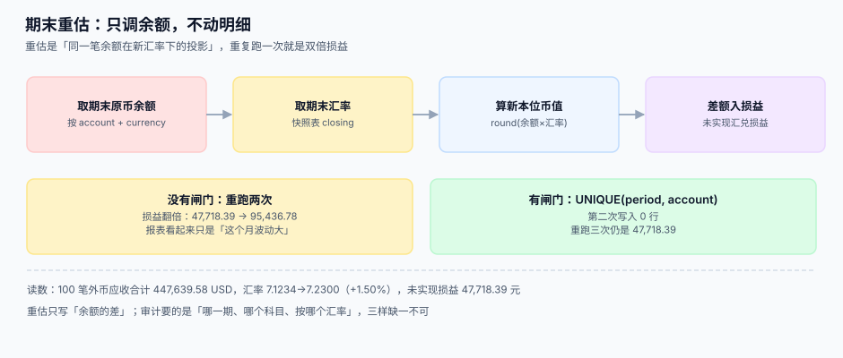

# 期末重估

<p style="text-align:center;"></p>

月结最后一晚，100 笔外币应收还挂在账上。汇率从 7.1234 走到 7.2300，这 1.5% 的变动意味着账面价值要变——**但凭证一张都不能改**。重估要做的，是把这个变化写成一条新的分录，而不是回头去修历史。

::: tip 一句话理解
**重估是「同一笔余额在新汇率下的投影」。** 余额不动、明细不动、历史凭证不动，只追加一条「投影差」。
:::

本页判据族 `FXV-A` ~ `FXV-H`，共 8 条，定义在最后一节。

## 一、哪些项目要重估：货币性 vs 非货币性

这是重估唯一需要判断的事，判断错了整张报表都会偏。

| 项目 | 性质 | 期末怎么处理 | 差额去哪 |
| --- | --- | --- | --- |
| 外币现金、银行存款 | 货币性 | 按期末汇率重估 | 当期损益（财务费用-汇兑） |
| 应收账款、应付账款 | 货币性 | 按期末汇率重估 | 当期损益 |
| 短期借款、长期借款 | 货币性 | 按期末汇率重估 | 当期损益（部分可资本化） |
| **存货**（以外币计价） | 非货币性（按成本计量） | **不重估**，按取得日汇率 | 无 |
| **固定资产** | 非货币性 | **不重估**，按取得日汇率 | 无 |
| 预收/预付（非货币性） | 非货币性 | 不重估 | 无 |

判断标准一句话：**「是不是一笔确定的、要以现金收付的金额」**。是 → 货币性 → 重估；否 → 非货币性 → 用历史汇率。

::: danger 把全部外币余额都重估
最省事的实现是 `UPDATE ... SET book_amount = round(amount * closing_rate)`，对所有带外币的表跑一遍。后果：

1. **存货被重估**：一批还没卖掉的货，账面价值随汇率浮动，毛利跟着乱跳。
2. **固定资产被重估**：折旧基数每月变一次，五年后累计折旧对不上。
3. **差额全部进损益**：本该资本化或递延的部分，一次性砸进当期利润。

三条都不会报错，只会在审计时被逐条问出来。
:::

## 二、四种汇率，各有各的合法用途

| 汇率 | 取哪一天 | 用在哪 | 用错的后果 |
| --- | --- | --- | --- |
| **即期汇率** | 交易发生日 | 初始确认（入账） | 用了期末价 → 当期就产生一笔假损益 |
| **期末汇率** | 资产负债表日 | 货币性项目重估、报表折算（资产负债） | 用了平均价 → 余额与报表对不上 |
| **平均汇率** | 期间加权平均 | 报表折算（利润表） | 用了期末价 → 利润被最后一天的汇率绑架 |
| **历史汇率** | 取得日 | 非货币性项目、实收资本 | 用了期末价 → 权益被重估 |

四种汇率必须**分别落库**，并在重估分录上写明用的是哪一种。`fx_rate.rate_kind` 里的 `closing` 就是为这一页准备的。

## 三、重估的四个步骤



```sql
CREATE TABLE fx_revaluation (
  id            INTEGER PRIMARY KEY,
  period        TEXT NOT NULL,                  -- '2026-10'
  account_code  TEXT NOT NULL,                  -- '1122' 应收账款
  currency      TEXT NOT NULL,
  closing_rate  TEXT NOT NULL,                  -- 期末汇率快照值
  fx_rate_id    INTEGER NOT NULL REFERENCES fx_rate(id),
  fc_balance    INTEGER NOT NULL,               -- 原币余额（最小单位）
  old_book      INTEGER NOT NULL,               -- 重估前本位币余额
  new_book      INTEGER NOT NULL,               -- 重估后本位币余额
  gain_loss     INTEGER NOT NULL,               -- new_book - old_book
  created_at    TEXT NOT NULL,
  UNIQUE (period, account_code, currency)       -- 期间闸门
);
```

那个 `UNIQUE` 是本页最重要的一个约束。它把「重估」从一个**动作**变成了一个**事实**：同一期间、同一科目、同一币种，只可能有一条重估记录。

本机读数（100 笔外币应收，原币合计 **447,639.58** USD，汇率 `7.1234 → 7.2300`，变动 +1.50%）：

| 场景 | 结果 |
| --- | --- |
| 正常跑一次 | 未实现损益 **47,718.39 元** |
| 没有闸门，重跑两次 | 损益 **95,436.78 元**（翻倍） |
| 没有闸门，重跑三次 | 累计 **143,155.17 元**（三倍） |
| 有 `UNIQUE(period, account, currency)` | 第二次写入 **0 行**，始终 **47,718.39** |

第 2 行是这一页的核心：**翻倍后的损益在报表上只表现为「这个月汇兑损失有点大」**，而它完全可能被解释成「美元这个月跌得多」——因为方向是对的，只是量翻了一倍。

## 四、闸门的三种实现，选最不容易被绕过的那种

| 实现 | 位置 | 能不能被绕过 | 评价 |
| --- | --- | --- | --- |
| 先查后写（`SELECT` 再 `INSERT`） | 应用层 | **能**（并发下两个事务同时通过检查） | 不可靠 |
| 幂等键 + 唯一索引 | 数据库 | 不能 | **推荐** |
| 期间状态机（`period.status = 'closed'`） | 应用 + 数据库 | 基本不能 | 适合月结流程 |

第二种是底线，第三种是加固。只做第一种的系统，在「月结跑两遍」这种最常见的运维动作上就会翻车。

```sql
-- 幂等写入：冲突即视为「本期已重估」，不再累加
INSERT INTO fx_revaluation(period, account_code, currency, closing_rate, fx_rate_id,
                           fc_balance, old_book, new_book, gain_loss, created_at)
VALUES (:period, :acct, :cur, :rate, :rate_id, :fc, :old, :new, :gl, :now)
ON CONFLICT (period, account_code, currency) DO NOTHING;
```

`DO NOTHING` 而不是 `DO UPDATE`：重估结果如果允许被覆盖，就等于允许「后跑的那次覆盖先跑的」，而两次之间汇率可能已经变了。

## 五、可回滚：重估必须能被冲掉

月结关账前，重估结果要允许「冲回重做」。做法不是 `DELETE`，而是**写一条反向记录**：

```sql
INSERT INTO fx_revaluation(period, account_code, currency, closing_rate, fx_rate_id,
                           fc_balance, old_book, new_book, gain_loss, created_at, reversal_of)
VALUES (:period, :acct, :cur, :rate, :rate_id, :fc, :new, :old, -:gl, :now, :orig_id);
```

三条理由：

1. **`DELETE` 会破坏审计链**：重估记录是「曾经算过」的证据，删了就说不清「为什么这个月的数变了」。
2. **反向记录自带解释**：`reversal_of` 指向原记录，任何人都能看出这是一次冲回。
3. **重做后能对比**：新旧两次的 `gain_loss` 并排放着，差异原因一目了然（通常是汇率快照被更正了）。

## 六、本机读数汇总

| 实验 | 读数 |
| --- | --- |
| 100 笔外币应收，汇率 +1.50% | 未实现损益 **47,718.39 元** |
| 无闸门重跑两次 | **95,436.78 元**（翻倍） |
| 无闸门重跑三次（SQLite 实测） | 3 行，合计 **143,155.17 元** |
| 有 `UNIQUE(period, acct)` | 插入成功 **1 次**，合计 **47,718.39 元** |

::: warning 重估的粒度
按「科目 + 币种」重估，还是按「每一笔余额」重估？

- **按科目汇总重估**：记录少，但无法回答「这笔应收重估了多少」。
- **按笔重估**：可追溯到单据，但 10 万笔应收就是 10 万条记录，月结会跑很久。

折中方案：**按笔计算、按科目汇总落库**，同时在明细表留 `revaluation_id` 外键。这样既能在科目层看总额，也能在单据层看单笔。
:::

## 判据清单

| 编号 | 判据 | 怎么验 |
| --- | --- | --- |
| `FXV-A` | 重估范围只含货币性项目，非货币性项目有明确排除清单 | 列出被重估的科目，逐个能说出「为什么是货币性」 |
| `FXV-B` | 重估只用 `closing` 类汇率，且汇率快照带 `fx_rate_id` | 抽 10 条，`rate_kind = 'closing'` |
| `FXV-C` | `UNIQUE(period, account, currency)` 存在且生效 | 同期同科目插两次，第二次必须冲突 |
| `FXV-D` | 重估写入用 `ON CONFLICT DO NOTHING` 或等价幂等 | 重跑月结，`gain_loss` 合计不变 |
| `FXV-E` | 冲回用反向记录 + `reversal_of`，不 `DELETE` | 查 `reversal_of IS NOT NULL` 的行，能追到原记录 |
| `FXV-F` | 重估后科目余额 = 原币余额 × 期末汇率（±1 分内） | 抽 10 个科目，逐一手算核对 |
| `FXV-G` | 未实现损益有独立科目，不与已实现混在一起 | 查损益表，两个科目分别有余额 |
| `FXV-H` | 重估记录可按单据追溯（明细带 `revaluation_id`） | 抽 1 笔应收，能查到它本期的重估金额 |

## 验证方式

```shell
# 1) 期间闸门真实生效（预期 Error: UNIQUE constraint failed）
sqlite3 /tmp/fx.db "INSERT INTO fx_revaluation(period,account_code,currency,closing_rate,
  fx_rate_id,fc_balance,old_book,new_book,gain_loss,created_at)
  SELECT period,account_code,currency,closing_rate,fx_rate_id,fc_balance,old_book,new_book,
         gain_loss,created_at FROM fx_revaluation LIMIT 1;"

# 2) 重估后余额与手算一致（预期差值为 0 或 1 分）
sqlite3 /tmp/fx.db "SELECT account_code, currency, new_book,
  round(fc_balance / 100.0 * cast(closing_rate as real), 2) AS manual
  FROM fx_revaluation ORDER BY account_code;"

# 3) 未实现与已实现分列（预期两行，科目不同）
sqlite3 /tmp/fx.db "SELECT subject, sum(amount_minor) FROM gl_entry
  WHERE subject IN ('6603_unrealized','6603_realized') GROUP BY subject;"
```


## 与「资产台账与折旧摊销工程」的分工（第 229 天补充）

| 你关心的问题 | 该读哪一册 | 分界 |
| --- | --- | --- |
| 「哪些科目期末要按新汇率重估」 | 本页 | 讲货币性 / 非货币性的划分与重估范围 |
| 「外币买的设备，折旧基数按哪个汇率」 | [取得成本与资本化](../../FixedAsset/Capitalization/index.md) | 那册讲非货币性项目按取得日汇率入账后不再变动 |
| 「汇率动了，资产净值要不要跟着动」 | [资产卡片与组件拆分](../../FixedAsset/AssetCard/index.md) | 那册把原值与净值分开存，净值不随汇率走 |

::: danger 一页一坑：给固定资产做期末重估，等于给折旧装了个随机数
本页表格里「固定资产不重估」这一行，落到代码上是**一句硬判据**：重估任务的取数查询必须排除非货币性项目。

本机读数：USD 100,000 的设备，取得日 7.1234、期末 7.2300，若跟着重估，资产虚增 **10,660.00**，月折旧从 5,936.17 变成 6,025.00——而且下个月汇率再变一次，折旧基数又变一次。折旧基数一旦每月变，「本期折旧 = 基数 ÷ 剩余期」这个公式就永远收敛不了。
:::

## 参考资料

- [汇率来源与快照](../RateSource/index.md)：`closing` 汇率从哪来、怎么保证唯一
- [结算与已实现损益](../Settlement/index.md)：与未实现损益的边界
- [多币种对账与报表折算](../Reconciliation/index.md)：重估之后的报表怎么折
- IFRS IAS 21（货币性项目、期末汇率与汇兑差额）：<https://www.ifrs.org/issued-standards/list-of-standards/ias-21-the-effects-of-changes-in-foreign-exchange-rates/>
- 财政部《企业会计准则第 19 号——外币折算》：<https://kjs.mof.gov.cn/>
