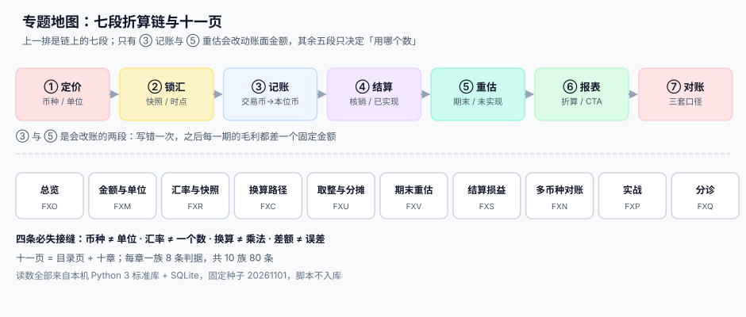

# 多币种与汇率折算工程

<p style="text-align:center;"></p>

一张 1,000 美元的订单，在同一个系统里能同时是四个数：合同上写 1,000.00 美元、账上记 7,123.40 元、银行到账 7,250.00 元、页面显示 $1,000.00。四个数都对，谁也不是「错的那一个」——它们量的是四件不同的事。**这就是多币种工程的全部麻烦：不是算错，是拿错了数。**

这个专题讲的是**钱在换币种的过程中，哪一步会悄悄变掉，以及怎么让它变不掉**。它不讲「对外汇怎么套期保值」（那是资金与风控的业务决策），也不讲「分录怎么借贷」（那是[复式记账与分录](../Ledger/DoubleEntry/index.md)的事）；它讲的是**一条链上有七段，每段各有一个汇率、一个时点、一种取整**，而其中五段的失败是安静的。

::: tip 一句话理解
**汇率不是一个数，是一个「带时点的快照 + 一个方向 + 一个精度」。** 少了任何一样，换算就变成一次不可复核的乘法。
:::

## 与相邻专题的分工

| 专题 | 它回答的问题 | 本专题的回答 |
| --- | --- | --- |
| [复式记账与分录](../Ledger/DoubleEntry/index.md) | 一笔业务怎么拆成借贷两腿 | 这两腿**用什么币种、按哪个汇率**折算；差额记到哪个科目 |
| [结算与分账](../Ledger/Settlement/index.md) | 钱怎么在商户、平台、渠道之间分 | 分账的每一份**各自按哪个币种入账**；换汇成本算谁的 |
| [三向对账](../Ledger/Reconciliation/index.md) | 账单、流水、账簿三方怎么对上 | 三方**各用一套币种口径**，三个合计不能相等，怎么证明它们是对的 |
| [营销计价与优惠分摊](../PricingPromotion/index.md) | 优惠怎么算、怎么摊到行 | 优惠摊完之后**按什么币种落到单据上**，尾差归谁 |
| [订阅计费与周期账单](../SubscriptionBilling/index.md) | 一个周期该收多少、账单怎么出 | 一张账单只能一个币种；多币种客户为什么要拆票 |
| [收入确认与递延收入](../RevenueRecognition/index.md) | 义务怎么消、收入记在哪一期 | 收入确认时的**交易价格**是否需要按新汇率重算（答案是不） |
| [采购到付款（P2P）](../ProcureToPay/index.md) | 三单匹配与付款排程 | 采购订单与发票**跨币种时允差怎么算**，付款日的汇率差进哪里 |
| [供应商协同与价格主数据](../SupplierCollaboration/index.md) | 协议价怎么谈、怎么核 | 协议价里的**币种与汇率基准日**是价格的一部分，不是备注 |

> 一句话记住边界：**别的专题管「钱该是多少」，本专题管「这个数是哪种钱」。**



## 十一页导航

| 页 | 讲什么 | 读完能做什么 |
| --- | --- | --- |
| [总览：七段折算链与四种币种](./Overview/index.md) | 七段链、四种币种口径、四个必失接缝 | 说清自己系统里的「金额」到底是哪一种钱 |
| [金额与最小单位](./MoneyModel/index.md) | ISO 4217、exponent 0/2/3、整数存储、INT32 上限 | 定下一张能支撑 20 年的金额模型 |
| [汇率来源与快照](./RateSource/index.md) | 中间价/买卖价、精度、生效时点、快照表 | 让每一次换算都能答出「按哪条、哪天、几点」 |
| [换算路径](./Conversion/index.md) | 直接、间接、三角、星型拓扑、方向 | 给币种对定一条唯一的换算路径 |
| [取整与分摊](./Rounding/index.md) | 舍入模式、逐行 vs 合计、最大余数法 | 让明细之和严格等于总额 |
| [期末重估](./Valuation/index.md) | 货币性项目、期末汇率、未实现损益、期间闸门 | 让重估可重跑、可回滚、不翻倍 |
| [结算与已实现损益](./Settlement/index.md) | 核销、部分收款、成本法、已实现损益 | 把「汇率差」记成损益而不是误差 |
| [多币种对账与报表折算](./Reconciliation/index.md) | 三套口径、折算差额 CTA、披露 | 三个合计都对不上时，证明它们都正确 |
| [实战：本机跑通一条折算闭环](./Practice/index.md) | 九张表 + 十步流水 + 三个必须失败的用例 | 在本机复现「下单 → 入账 → 结算 → 重估」 |
| [常见问题与分诊](./FAQ/index.md) | 四类现象的入口、处置顺序、自查清单 | 三分钟内判断问题在单位、时点还是顺序 |

## 判据纪律

| 页 | 判据族 | 这一族管什么 | 条数 |
| --- | --- | --- | --- |
| 总览 | `FXO-A` ~ `FXO-H` | 四种币种分列、每段有快照、接缝有断言 | 8 |
| 金额与最小单位 | `FXM-A` ~ `FXM-H` | 币种元数据齐全、金额只存整数、上限有校验 | 8 |
| 汇率来源与快照 | `FXR-A` ~ `FXR-H` | 来源可追、方向显式、时点可查、快照不可变 | 8 |
| 换算路径 | `FXC-A` ~ `FXC-H` | 路径唯一、链长封顶、两段取整有说明 | 8 |
| 取整与分摊 | `FXU-A` ~ `FXU-H` | 模式统一、余数有归属、合计闭合 | 8 |
| 期末重估 | `FXV-A` ~ `FXV-H` | 范围明确、汇率唯一、闸门生效、可回滚 | 8 |
| 结算与损益 | `FXS-A` ~ `FXS-H` | 核销可追、成本法固定、损益单列 | 8 |
| 多币种对账 | `FXN-A` ~ `FXN-H` | 三套口径分列、差额可解释、折算留痕 | 8 |
| 实战 | `FXP-A` ~ `FXP-H` | 十条命令跑通、三个负向必须失败 | 8 |
| 常见问题 | `FXQ-A` ~ `FXQ-H` | 四类现象可判定、处置有顺序 | 8 |

每条判据回答三件事：**看什么现象、判成什么、不满足时改哪里**。编号逐页唯一，可被 `utils/audit` 下的判据类巡检机械核对。

## 三个必须先接受的前提

1. **金额天然是「一对」而不是一个数。** 任何一个金额都必须能答出「多少 + 什么币种 + 什么单位」，三样缺一不可。只存 `amount` 的字段，在接入第二种货币的那一天就会变成历史包袱。
2. **汇率是外部输入，不是系统算出来的。** 它来自央行、银行、数据商，带着发布时点与买卖方向；系统能做的是**记录与选择**，不是「推算」。凡是自己插值、自己平均、自己「按昨天的补一下」的地方，都是审计要问的地方。
3. **差额不一定是错误。** 换算差一分、结算差 2%、重估差 4 万，这些都可能是**正确的**。所以验收不能只看「相等」，必须看「差额有没有归属、有没有解释、能不能重算」。

## 版本组织说明

本专题**不建版本目录**（如 `MultiCurrency2020/`）。三条理由：

1. **换代的是报价习惯与监管口径，不是判据。** 从「一天一个中间价」到「实时买卖价」，从「月末一次重估」到「逐日估值」，改变的是**取数频率**，而「快照 + 方向 + 精度」这三条判据一字未变。
2. **多套口径长期并存于同一集团。** 境内主体按[《企业会计准则第 19 号——外币折算》](https://kjs.mof.gov.cn/)，境外子公司按 IAS 21，美股主体按 ASC 830，三者对「货币性项目按期末汇率、折算差额进其他综合收益」的处理基本一致——这是**同一份代码的三个开关**，不是三个时代。
3. **真正需要按大版本组织的是「同一份代码两套写法」**，比如 [`Spring5`/`Spring6`](../Java/Frame/Spring/index.md)、[`Vue2`/`Vue3`](../../Frontend/Frame/Vue/index.md)。本专题的差异可以在一张对照表里讲完。

库内按大版本建目录的先例见 [`Spring5`/`Spring6`](../Java/Frame/Spring/index.md) 与 [SpringBoot `v2`/`v3`](../Java/Frame/SpringBoot/index.md)。

## 事实与口径速览

| 事项 | 口径 | 出处 |
| --- | --- | --- |
| 货币代码 | **ISO 4217:2015**（第 8 版，2015-08 发布，2021-02 复审确认，现行有效），三位字母码 + 三位数字码 | ISO |
| 最小单位 | ISO 4217 用 **exponent** 表示：多数货币为 2；JPY/KRW/CLP/ISK 等为 **0**；KWD/BHD/JOD/OMR/TND/LYD 为 **3** | ISO 4217 表 A.1 |
| 国际准则 | **IAS 21**《汇率变动的影响》；2023-08 发布「缺乏可兑换性」修订，**2025-01-01** 起生效；2025-11 发布恶性通胀列报币种折算修订，**2027-01-01** 起生效 | IASB |
| 中国准则 | 《企业会计准则第 19 号——外币折算》（财会〔2006〕3 号体系），外币报表折算差额在所有者权益下单独列示 | 财政部 |
| 美国准则 | **ASC 830**《外币事项》，功能货币与列报货币两分，折算调整计入 OCI | FASB |
| 央行参考汇率 | 欧洲央行每个工作日**约 16:00 CET** 发布欧元参考汇率（基于约 14:10 CET 的协调程序），**保留 4 位小数**，官方明确「不建议用于交易」 | ECB |

::: info 本轮的核对方式
上表三条准则与两条标准于 **2026-10-31 联网核对**（IFRS 官网标准页、ISO 4217 标准页与维护机构说明、欧洲央行参考汇率页）。文中的比例与耗时读数**均为本机实测**（Python 3.13.12 标准库 + SQLite 3.50.4，固定种子 `20261101`，脚本不入库、全部可复跑），复现方式见[实战](./Practice/index.md)。
:::

## 验证方式

专题级的验收不看文章数量，看三件事能不能在本机复现：

```shell
# 1) 判据编号唯一、无撞号（预期 E=0）
python3 utils/audit/judgeidcheck.py | tail -1

# 2) 目录页的判据总览表与实际声明一致（预期本专题 W=0）
python3 utils/audit/judgesumcheck.py | grep MultiCurrency

# 3) 页面收尾三件套齐全：验证方式 + 参考资料（预期无输出）
python3 utils/audit/tailcheck.py --root . | grep MultiCurrency
```

三条全过，说明这十一页在结构上「读得通、判得准、收得住」；内容是否正确，要靠[实战](./Practice/index.md)里那三个**必须失败**的反向用例来证明。

## 参考资料

- [复式记账与分录](../Ledger/DoubleEntry/index.md)：折算之后的两腿怎么落账
- [三向对账](../Ledger/Reconciliation/index.md)：多币种对账的上游流程
- [收入确认与递延收入](../RevenueRecognition/index.md)：交易价格与汇率的关系
- ISO 4217:2015《Codes for the representation of currencies》：<https://www.iso.org/standard/64758.html>
- IFRS IAS 21《The Effects of Changes in Foreign Exchange Rates》：<https://www.ifrs.org/issued-standards/list-of-standards/ias-21-the-effects-of-changes-in-foreign-exchange-rates/>
- 欧洲央行欧元参考汇率（含发布时点与「不建议用于交易」声明）：<https://www.ecb.europa.eu/stats/policy_and_exchange_rates/euro_reference_exchange_rates/html/index.en.html>
