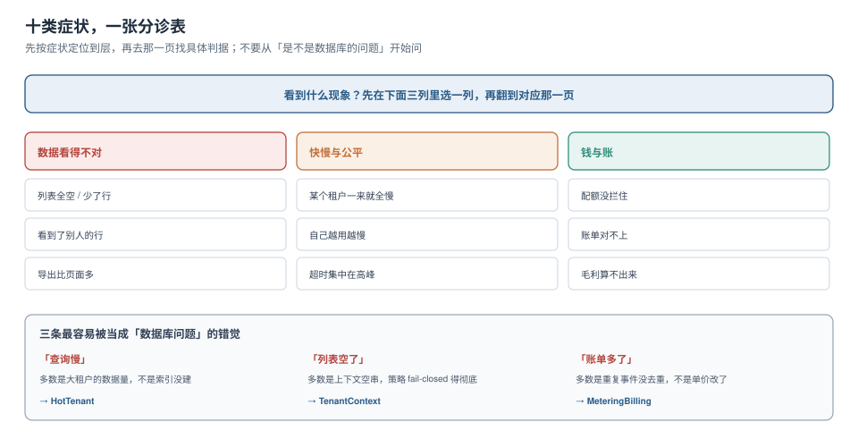

# 常见问题与分诊

多租户的排查有个特点：**症状看起来都是「数据不对」，原因却分布在四个完全不同的层**。所以第一件事不是查，是分诊——先确定「这个问题属于哪条主线」，再去那一页找具体判据。



本页判据族 `MTQ-A` ~ `MTQ-H`，共 8 条。定义表在第七节。

## 一、症状分诊表

### 第一列：数据看得不对

| 症状 | 最可能的原因 | 先去哪 |
| --- | --- | --- |
| 列表全空、详情 404 | 上下文是空串（异步线程丢了上下文），策略 fail-closed 到 0 行 | [租户上下文](../TenantContext/index.md) 第五节 |
| 少了若干行 | 写入时 `tenant_id` 写错；或 `WITH CHECK` 与 `USING` 不一致 | [实战](../Practice/index.md) 的 S6 |
| 看到了别人的行 | 上下文残留（会话级写法）、策略没 `FORCE`、走了 `BYPASSRLS` 角色、视图以所有者执行 | [Overview](../Overview/index.md) 第二节 |
| 导出比页面多 | 导出走的是另一个数据源（分析库 / 只读副本），那边没开策略 | 本节第四问 |
| 跨租户 id 能查到 | 查询只按 `id` 不按租户；策略被误关 | [实战](../Practice/index.md) 的 S3 |

### 第二列：快慢与公平

| 症状 | 最可能的原因 | 先去哪 |
| --- | --- | --- |
| 某个租户一来就全站慢 | 共享 FIFO 队列，轻租户排在积压后面 | [噪声邻居](../NoisyNeighbor/index.md) 第三节 |
| 自己越用越慢 | 自己的数据量涨了，查询计划从索引点查退化为顺序扫描 | [大租户与热点](../HotTenant/index.md) 第一节 |
| 超时集中在高峰 | 容量在膝点之上；或限流阈值设得比容量高 | [噪声邻居](../NoisyNeighbor/index.md) 第四节 |
| 只有大租户的接口慢 | 返回行数没有上限，单查询扫了几万行 | [大租户与热点](../HotTenant/index.md) 第四节 |

### 第三列：钱与账

| 症状 | 最可能的原因 | 先去哪 |
| --- | --- | --- |
| 配额形同虚设 | 扣减是「先查后改」；或本地内存计数被多实例放大 | [配额执行](../QuotaEnforcement/index.md) 第二节 |
| 配额差了「一点点」 | 重试请求被算了两次；或缓存命中也扣了配额 | [配额执行](../QuotaEnforcement/index.md) 第六节 |
| 账单对不上 | 重复事件没去重（+0.5%）；或账期按入库时间切分 | [计量与账单](../MeteringBilling/index.md) 第三、四节 |
| 毛利算不出来 | 分摊口径里有无法归属的公共成本 | [计量与账单](../MeteringBilling/index.md) 第六节 |
| 客户说「这个月多了」 | 上期迟到事件补记，账单上没单列 | [计量与账单](../MeteringBilling/index.md) 第四节 |

## 二、十二个高频问题

**Q1：一定要开 RLS 吗？应用层加 `WHERE tenant_id = ?` 不够吗？**
不够。应用层的 `WHERE` 依赖每一处手写都正确，而 RLS 是**最后一道不可绕过的闸门**。实践中的组合是：应用层写 `WHERE`（为了走索引、为了可读），RLS 兜底（为了防止某处漏写）。两者不是替代关系。

**Q2：为什么开了 RLS 还是查到了别人的数据？**
四个可能，按概率排序：① 上下文是会话级且残留了上一个租户；② 表所有者身份（没 `FORCE`）；③ 走了一个以所有者身份执行的视图或 `SECURITY DEFINER` 函数；④ 连接用了带 `BYPASSRLS` 的角色。

**Q3：`FORCE` 之后性能掉了怎么办？**
先确认是不是真的掉了。本机实测：预热后 `FORCE` 与显式 `tenant_id = 't7'` 分别是 0.049 ms 与 0.054 ms，**几乎没有差别**。如果测出 5 倍差，多半是冷热问题（见 [隔离三档](../IsolationModel/index.md) 第四节的 `::: danger`）。真正会掉性能的是策略里包了非 `STABLE` 函数，导致条件下推失败。

**Q4：分析库/报表库要不要也开策略？**
要，或者干脆不共用。分析库通常是 `BYPASSRLS` 角色在跑，这时**它是唯一能看见全部租户的地方**，必须：① 只有分析服务能连；② 所有查询都带租户条件（由 BI 层强制注入）；③ 单独审计。最差的做法是「分析库和业务库共用一个只读账号」。

**Q5：租户上下文应该放在 JWT 里还是请求头里？**
放在 JWT 的 claim 里，并**与请求头交叉校验**。只信请求头会被伪造；只信 JWT 则无法支持「一个用户属于多个租户、正在切换租户」的场景。正确做法：JWT 里存「这个用户能访问哪些租户」，请求头里存「这次访问哪个租户」，两者取交集。

**Q6：一个用户属于多个租户，缓存键怎么设计？**
`t:{tenant}:u:{user}:…`。不要用 `u:{user}` 做前缀——同一个用户在不同租户下的数据完全不同。

**Q7：分片键能不能用 `tenant_id` 的哈希值？**
能，但要**落表**。`hashtext()` 跨大版本不保证稳定，重算会导致分片重排（见 [大租户与热点](../HotTenant/index.md) 第一节）。

**Q8：配额应该按「请求数」还是「实际用量」？**
按实际用量，但要选一个**可精确计量**的量。请求数容易算但不反映成本（一个请求可能扫 10 万行）；行数反映成本但需要每条路径都埋点。折中：入口按请求数粗限，服务层按实际用量细限。

**Q9：账单和配额对不上，先查哪边？**
先查「单位是否一致」，再查「去重键是否一致」，最后查「窗口是否一致」。三者里前两个是代码问题，第三个通常是设计选择（配额实时、账单按月）。

**Q10：删租户时备份怎么处理？**
备份**无法按租户删除**，只能等过期。所以合同里必须写「备份最长保留 N 天」，且 N ≥ 冷静期。客户的「被遗忘权」请求在备份这一层只能做到「到期不再恢复」。

**Q11：怎么判断该不该做单元化？**
最大租户的数据量超过「其余所有租户之和」的 30%（见 [大租户与热点](../HotTenant/index.md) 第四节）。低于这个数，限流与轮转够用；高于这个数，任何共享资源池都会被它主导。

**Q12：多租户要不要给每个租户独立的应用实例？**
只在两种情况下要：合规要求物理隔离，或租户数极少且都是大客户。其余情况用「共享应用 + 隔离数据 + 每租户配额」更省——应用层是无状态的，横向扩容易，隔离数据的成本远低于隔离应用。

## 三、五条常见的错误建议

::: danger 这些话听起来对，做起来错
1. **「先上共享表，以后需要再拆」**——拆分本身不难，难的是拆分时**所有历史数据都要迁**，而且代码里已经散落了几百处手写的 `WHERE tenant_id`。如果预期三年内会出现大客户，一开始就应该留出分档混用的路由层。
2. **「加个 `tenant_id` 索引就好了」**——索引解决的是「查得快」，解决不了「查得到不该查的」。索引与隔离是两件事。
3. **「用 Redis 存配额，性能好」**——`INCR` 确实是原子的，但「先加再判断再回滚」在并发下会产生瞬时超发；而且 Redis 重启会丢计数。配额的正确位置是**与业务数据同库**，这样能和业务写入同事务。
4. **「账单每月跑一次批处理就行」**——批处理跑的时候才发现某张表少了一列、某个事件没去重，那时已经错过一整个账期。计量要**日对账**，不要月对账。
5. **「租户少，不用做配额」**——租户少的时候恰恰最容易出问题：一个大客户的突发没有任何缓冲，直接把共享资源打满。配额与租户数无关，与「有没有共享资源」有关。
:::

## 四、上线前 14 项自查

| # | 检查项 | 判定 |
| --- | --- | --- |
| 1 | 所有含租户列的表都 `FORCE ROW LEVEL SECURITY` | `relforcerowsecurity` 全为 true |
| 2 | 应用账号不是表所有者、无 `BYPASSRLS` | `rolbypassrls` 为 false |
| 3 | 所有唯一约束都含租户列 | `pg_constraint` 逐条核对 |
| 4 | 上下文用事务级写法 | `set_config` 第三参数为 `true` |
| 5 | 缓存键含租户前缀 | 抽样 10 个 key 检查 |
| 6 | 消息带 `tenant_id` 且消费端校验 | 消费端代码有校验分支 |
| 7 | 日志含 `tenant` 字段 | 能按租户过滤 |
| 8 | 配额扣减是单条原子语句 | 无「先查后改」 |
| 9 | 超额返回 429 且带 `Retry-After` | 抓包可见 |
| 10 | 事件按 `event_id` 去重 | 有唯一索引 |
| 11 | 账期按 `occurred_at` 切分 | 聚合 SQL 核对 |
| 12 | 账单行含单价版本与聚合 ID | 随机一行能追到事件 |
| 13 | 删除传播清单覆盖九类位置 | 清单有负责人 |
| 14 | 十条验收在 CI 里跑 | CI 有这一步且阻断 |

## 五、分诊的顺序（不要跳）

```text
看到「数据不对」
  → 先问：是所有租户都错，还是只有某个租户错？
      所有租户都错     → 策略/上下文整体失效（查 FORCE、查角色）
      只有某个租户错   → 上下文串了，或该租户的写入带了错误的 tenant_id
  → 再问：是「多了」还是「少了」还是「全空」？
      全空  → 上下文为空串（异步链路）
      多了  → 策略被绕过（视图 / 所有者 / BYPASSRLS）
      少了  → WITH CHECK 拦掉了写入，或上下文与数据不匹配
```

这个顺序的价值在于：**它先缩小范围（哪个租户），再定性（多了/少了/全空）**，两个问题问完，剩下的可能不超过三种。

## 六、什么时候该怀疑「不是多租户的问题」

三种情况，先排除掉再回来：

1. **只有某台机器有问题**：先看这台机器的配置、版本、连接串是否与其他机器一致。
2. **只在某个时间段有问题**：先看定时任务、批处理、备份窗口。
3. **重放同样的请求复现不了**：先看是不是并发/时序问题，而不是隔离问题。

## 七、本页判据

| 编号 | 判据 | 看什么现象 | 不满足时改哪里 |
| --- | --- | --- | --- |
| `MTQ-A` | 分诊表覆盖三类症状 | 数据/快慢/钱三列都有条目 | 见第 1 节 |
| `MTQ-B` | 每条症状都指向具体页面 | 条目里有链接而非「见文档」 | 补链接 |
| `MTQ-C` | 「全空/多了/少了」三种定性有区分 | 分诊顺序里先定性再定位 | 见第 5 节 |
| `MTQ-D` | 有「先排除非多租户原因」的三条 | 第 6 节的三条都在 | 补排查前置 |
| `MTQ-E` | 上线自查 ≥ 10 项且可判定 | 每项有明确的通过标准 | 见第 4 节 |
| `MTQ-F` | 错误建议单独成节 | `::: danger` 里有 5 条反例 | 见第 3 节 |
| `MTQ-G` | 高频问题覆盖「选型/实现/运维」三类 | 12 问里三类都有 | 补缺失类别 |
| `MTQ-H` | 每条回答都指回可执行的判据 | 回答末尾有页面链接 | 补链接 |

## 参考资料

- PostgreSQL 18 Documentation：*Row Security Policies*（绕过路径的完整列表）、*CREATE VIEW*（`security_invoker`）
- PostgreSQL 18 Documentation：*Roles and Privileges*（`BYPASSRLS` 与预定义角色）
- 本仓库：[四个维度与五个必失点](../Overview/index.md)、[实战](../Practice/index.md)、[租户上下文](../TenantContext/index.md)
- 本仓库项目侧：[TeamBoard 跨租户矩阵](../../../../project/Complete/TeamBoard/CrossTenantMatrix/index.md)、[TeamBoard 常见问题](../../../../project/Complete/TeamBoard/FAQ/index.md)
