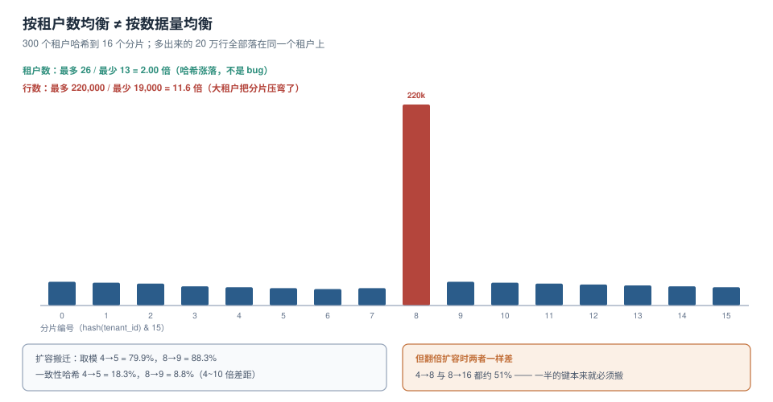

# 大租户与热点：倾斜、分片与单元化

分片表画好之后，多数团队会验一件事：**每个分片上的租户数是不是差不多**。差不多就上线了。然后几个月后某个分片先炸——因为「租户数均衡」和「数据量均衡」是两回事。



本页判据族 `HOT-A` ~ `HOT-H`，共 8 条。定义表在第七节。

## 一、倾斜的三个口径，越往后越接近真话

| 口径 | 怎么算 | 300 租户 / 16 分片的实测 | 能发现什么 |
| --- | --- | --- | --- |
| 租户数 | 每分片几张租户 | 最多 26 / 最少 13 = **2.00** | 哈希函数是否用错（比如用了取模但键有规律） |
| 行数 | 每分片多少行 | 最多 220,000 / 最少 19,000 = **11.6** | 大租户是否把分片压弯 |
| 请求数 | 每分片 QPS | 需要线上数据 | 读热点（小租户也可能是热点） |

2.00 这个倍数**不是 bug**：300 个键随机落到 16 个桶，期望每桶 18.75，标准差约 4.2，最大最小差 2 倍完全在正常涨落范围内。用二项分布估算，300 键 16 桶出现「26 vs 13」的概率并不低。

所以「租户数倾斜 2 倍」可以接受；**「行数倾斜 11.6 倍」才是要处理的**。

```sql
-- 按分片统计真实行数（而不是租户数）
select (hashtext(tenant_id) & 15) as shard, count(*) as rows
  from orders
 group by 1
 order by 2 desc;
```

::: danger `hashtext()` 不能跨版本依赖
`hashtext()` 的值在不同 PostgreSQL 大版本之间**不保证稳定**。如果你用它算分片号：

1. 分片结果必须**落在表里**（`tenant_shard(tenant_id, shard)`），不能在扩容时重新计算；
2. 升级数据库大版本前，要跑一次「重算 vs 表内值」的比对，不一致就不是升级问题，而是分片被重排了；
3. 或者干脆用应用层的确定性哈希（如 `crc32` 或 `xxhash`），把分片规则从数据库里拿出去。
:::

## 二、扩容搬迁：一致性哈希不是万能的

300 个租户，两种分片方式，四种扩容场景：

| 扩容 | 取模搬迁 | 一致性哈希搬迁（100 虚节点） | 理论最优 |
| --- | --- | --- | --- |
| 4 → 5 | **79.9%** | **18.3%** | 20% |
| 4 → 8 | 50.2% | **51.4%** | 50% |
| 8 → 9 | **88.3%** | **8.8%** | 11.1% |
| 8 → 16 | 51.3% | **51.1%** | 50% |

两个结论都很重要：

### ① 加「一个」节点时，一致性哈希好 4~10 倍

4→5 时取模要搬 79.9%（几乎全搬），一致性哈希只搬 18.3%。8→9 时是 88.3% 对 8.8%，差**10 倍**。这是它真正的价值场景：**一次只加一台机器**。

### ② 但「翻倍扩容」时，两者一样差

4→8 与 8→16，两种方式都搬了 **约 51%**。这不是实现问题，是数学：翻倍时有一半的键**本来就应该**去新节点，任何满足「新节点分到 1/2 数据」的算法都要搬 50%。

所以：**如果你的扩容节奏是「翻倍」，一致性哈希帮不上忙**；它是为「一次加一台」设计的。

### 均衡度：100 个虚节点时 1.37

| 节点数 | 最大/最小 |
| --- | --- |
| 4 | 1.37 |
| 8 | 1.37 |
| 16 | 1.35 |

虚节点数决定均衡度：10 个虚节点时这个比值会到 2 以上。100 是个常见的折中——再往上收益递减，而环的查找成本与内存线性增长。

## 三、分片键：三个必须满足的条件

| 条件 | 为什么 | 反例 |
| --- | --- | --- |
| 高基数 | 分片要能均分 | 用 `status`（只有几个值）做键 |
| 查询必带 | 否则每次查询要扫全部分片 | 用 `order_id` 做键，但接口只按 `tenant` 查 |
| 稳定不变 | 键变了就要搬数据 | 用「租户套餐」做键，客户升级就搬家 |

`tenant_id` 通常同时满足三条，**但有一条例外：超级大租户会破坏「高基数」带来的均衡**。这时需要二级拆分。

## 四、大租户的三种处置

| 处置 | 做法 | 适合 | 代价 |
| --- | --- | --- | --- |
| 拆分 | 在租户内部再分片（`tenant_id + bucket`） | 单租户数据量巨大且可分区 | 查询要带二级键，跨桶聚合变复杂 |
| 专属 | 大租户单独一个库/实例（cell） | 客户数少、合同额大 | 运维单元变多，成本上升 |
| 限流 + 降级 | 限制其在线查询能力，导出走异步 | 短期应急 | 客户体验下降，要谈 |

### 单元化（cell）：把「大租户」变成「小集群」

单元化的思路是：把租户按「客户等级」分到若干**独立单元**，每个单元是一套完整的应用 + 数据库 + 缓存。

```text
单元 A：3 个大客户（各 200 GB）
单元 B：300 个中客户（各 2 GB）
单元 C：8,000 个长尾（各 20 MB）
```

三个好处：故障半径小、容量可按单元扩、大租户不再影响别人。
三个代价：跨单元统计要离线做、发布要逐单元滚动、单元路由表成为新的单点。

::: tip 什么时候该做单元化
一个可用的判据：**如果「最大的那个租户」的数据量超过「其余所有租户之和」的 30%，就该考虑单元化**。因为这时任何共享资源池都会被它主导，限流与轮转只能缓解等待时间，缓解不了它占用的 buffer 与磁盘。
:::

## 五、数据层：按租户分区的三种写法

### 写法一：应用层路由（最常用）

```java
// 路由表是唯一事实来源；代码里不出现 if (tier == "big")
DataSource ds = router.dataSourceFor(TenantContext.require());
```

### 写法二：数据库分区表

```sql
-- PostgreSQL 声明式分区，按 tenant_id 哈希分 16 片
create table orders (
  id bigserial,
  tenant_id text not null,
  amount numeric(12,2),
  created_at timestamptz not null default now()
) partition by hash (tenant_id);

do $$
begin
  for i in 0..15 loop
    execute format('create table orders_p%s partition of orders for values with (modulus 16, remainder %s)', i, i);
  end loop;
end $$;
```

分区表的好处是**查询自动裁剪**（`WHERE tenant_id = ?` 只扫一个分区），不需要应用层路由；坏处是**分区数固定**，扩容要重建（`DETACH` / `ATTACH` 或整表重写）。

### 写法三：独立 schema / 独立库

见 [隔离三档](../IsolationModel/index.md)，是「分片粒度 = 租户」的极端情形。

## 六、怎么度量「已经倾斜了」

三条 SQL，按顺序跑：

```sql
-- ① 分片行数分布
select shard, rows, round(rows::numeric / sum(rows) over () * 100, 1) as pct
from (select (hashtext(tenant_id) & 15) as shard, count(*) as rows
        from orders group by 1) s
order by rows desc;

-- ② 前 10 大租户占全库比例
select tenant_id, count(*) as rows,
       round(count(*)::numeric / (select count(*) from orders) * 100, 2) as pct
  from orders group by 1 order by 2 desc limit 10;

-- ③ 单租户查询的计划与耗时（换 tenant_id 反复跑）
explain (analyze, buffers, costs off)
select count(*) from orders where tenant_id = 'big' and created_at > now() - interval '1 day';
```

第 ② 条的结果如果是「前 3 个租户占 60%」，那就不是分片问题，是**商业模式问题**——你要么接受它们专属部署，要么接受它们拖慢别人。

::: danger 三个常见的分片错误
1. **按「租户创建时间」分片**：新租户全落在最后一片，早期分片变成冷数据，但冷数据也要备份与迁移。
2. **用 `id` 的取模做分片**：单租户的数据会散在所有分片上，任何按租户的查询都变成「扫全部分片再聚合」。
3. **分片键与唯一约束不一致**：`unique(order_no)` 在分片表上无法跨片保证，必须改成 `unique(tenant_id, order_no)`，否则会在跨片插入时静默重复。
:::

## 七、本页判据

| 编号 | 判据 | 看什么现象 | 不满足时改哪里 |
| --- | --- | --- | --- |
| `HOT-A` | 倾斜按「行数」度量，不只看租户数 | 有按分片的行数分布 | 见第 6 节第 ① 条 |
| `HOT-B` | 前 10 大租户占比已统计 | 知道最大租户占全库多少 | 见第 6 节第 ② 条 |
| `HOT-C` | 分片键满足高基数、查询必带、稳定 | 分片键在每条高频查询的 `WHERE` 里 | 换键或加二级分片 |
| `HOT-D` | 扩容方案已按「一次加一台」验证搬迁比例 | 搬迁比例接近 1/N 而非接近 100% | 改一致性哈希 |
| `HOT-E` | 翻倍扩容的搬迁量已被接受 | 扩容文档里写明「翻倍要搬一半」 | 提前规划批次 |
| `HOT-F` | `hashtext()` 结果已落表 | 有 `tenant_shard` 表且不可重算 | 见第 1 节 `::: danger` |
| `HOT-G` | 唯一约束包含分片键 | 所有唯一索引都含 `tenant_id` | 改约束 |
| `HOT-H` | 大租户有明确处置（拆分/专属/降级） | 有「鲸鱼客户」清单与对应策略 | 见第 4 节 |

## 参考资料

- PostgreSQL 18 Documentation：*Table Partitioning*（`PARTITION BY HASH`、分区裁剪、`DETACH PARTITION`）
- PostgreSQL 18 Documentation：*System Administration Functions*（`hashtext` 的说明与稳定性注意）
- Karger, D. 等：*Consistent Hashing and Random Trees*（1997）——一致性哈希的原始论文，虚节点在后续实现中补充
- 本仓库：[噪声邻居](../NoisyNeighbor/index.md)、[隔离三档](../IsolationModel/index.md)、[数据库分库分表](../../HighConcurrency/HotspotSplit/index.md)
- 本仓库项目侧：[TeamBoard 租户索引](../../../../project/Complete/TeamBoard/TenantIndexing/index.md)
