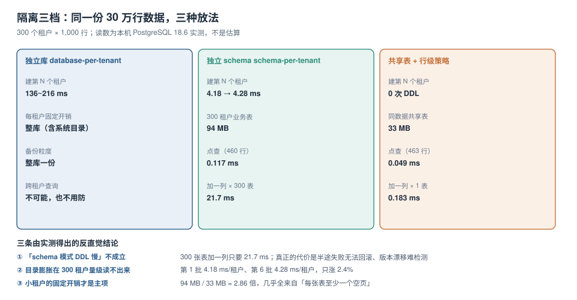

# 隔离三档：成本、体积与迁移路径

隔离选型常见的讨论方式是「哪种更安全」。但三种模式的安全性差距远小于它们的**运维成本差距**：独立库几乎不可能串租户，代价是每加一个租户要建一个库、备一份、迁一次；共享表最省，代价是每一次查询都要靠策略与 `WHERE` 兜住。选型的真正问题是：**在你的租户数量、单租户数据量、变更频率这三个坐标上，哪一档的总成本最低。**



本页判据族 `ISO-A` ~ `ISO-H`，共 8 条。定义表在第八节。

## 一、三档的判定位置

| 档位 | 数据住在哪 | 隔离靠什么 | 一个租户的「边界」是什么 |
| --- | --- | --- | --- |
| 独立库 database-per-tenant | 一个租户一个 database | 物理隔离，连不上就是看不见 | `CREATE DATABASE` 出来的那一个库 |
| 独立 schema schema-per-tenant | 一个库内一个 schema | 权限（`USAGE`）+ 连接时的 `search_path` | schema 名 |
| 共享表 + 行级策略 | 一张表，多一行 `tenant_id` | 策略（`USING` / `WITH CHECK`）+ `FORCE` | 一行数据的 `tenant_id` 值 |

三档之间不是「安全等级」，而是**边界画在哪一层**：库、schema、行。边界越粗，越难越界，也越难做跨租户的统计与运维。

::: info 本节所有读数的环境
PostgreSQL **18.6** 容器，单机空载。构造方式：**300 个租户 × 每租户 1,000 行 = 30 万行**，两种模式装同一份数据。
schema 模式 = 300 个 schema，每个 schema 一张 `orders` 表 + 两个索引；共享表模式 = 一张 `orders` 表，`tenant_id` 列 + `(tenant_id, created_at)` 复合索引 + `FORCE` 策略。
:::

## 二、建租户的成本：4.2 ms 对 200 ms 对 0

### schema 模式：分六批建 300 个租户

```sql
do $$
declare b int; i int; t0 timestamptz; ms numeric;
begin
  for b in 1..6 loop
    t0 := clock_timestamp();
    for i in (b-1)*50+1 .. b*50 loop
      execute format('create schema t%s', i);
      execute format('create table t%s.orders(id bigserial primary key, tenant text not null,
                     amount numeric(12,2), created_at timestamptz not null default now())', i);
      execute format('create index t%s_created_idx on t%s.orders(created_at)', i, i);
      execute format('create index t%s_tenant_idx on t%s.orders(tenant)', i, i);
    end loop;
    raise notice '第 % 批: % ms', b, round(extract(epoch from clock_timestamp()-t0)*1000, 1);
  end loop;
end $$;
```

实测六批（每批 50 个租户）：

| 批次 | 租户号 | 总耗时 | 均摊 |
| --- | --- | --- | --- |
| 1 | 1 ~ 50 | 208.9 ms | 4.18 ms |
| 2 | 51 ~ 100 | 195.6 ms | 3.91 ms |
| 3 | 101 ~ 150 | 191.0 ms | 3.82 ms |
| 4 | 151 ~ 200 | 206.8 ms | 4.14 ms |
| 5 | 201 ~ 250 | 209.0 ms | 4.18 ms |
| 6 | 251 ~ 300 | 214.2 ms | **4.28 ms** |

第 6 批比第 1 批只慢 **2.4%**。这个读数很重要，因为它推翻了「schema 多了以后建表会越来越慢」的常见担心：在 300 这个量级上，目录膨胀的影响**读不出来**。

### 独立库模式：一个库 136 ~ 216 ms

```sql
\timing on
select format('create database mtdb%s', g) from generate_series(1,20) g \gexec
```

前几个库各 **136 ms / 172 ms / 211 ms / 216 ms**，后面落到 **0.6 ms**——因为模板库页已经进了缓存。

所以「独立库」的建租户成本不是稳定的：**冷启动时约 200 ms，热态下不到 1 ms**，但你还要在库里建表，那部分才是主体（每个库的建表成本与上面 schema 模式一样，约 4 ms）。

### 共享表模式：0 次 DDL

新租户只是「表里出现了新的 `tenant_id` 值」，没有 DDL。成本是一次 `INSERT`，或者干脆不用做任何事。

| 模式 | 建一个租户 | 300 个租户总计 |
| --- | --- | --- |
| 独立库 | 136 ~ 216 ms（含建库）+ 建表 | 约 60 秒（20 个实测外推） |
| 独立 schema | 4.18 ~ 4.28 ms | 约 1.3 秒 |
| 共享表 | 0（一次插入） | 0 |

## 三、体积：94 MB 对 33 MB

同一份 30 万行数据，两种装法的实际占用（只算业务表与索引）：

| 模式 | 业务表 + 索引 | 均摊每租户 | 说明 |
| --- | --- | --- | --- |
| schema | **94 MB** | 313 KB | 每张表至少一个 8 KB 空页 + 索引页 |
| 共享表 | **33 MB** | — | 一张表，页填充率正常 |
| 倍数 | **2.86×** | — | 小租户的固定开销是主项 |

2.86 倍不是「浪费」，而是**每种模式的结构性开销**：schema 模式下每个租户都有一份完整的表与索引结构，1,000 行数据撑不满一个索引页，剩下的空间就是固定的。

这条读数有一个直接推论：**租户越小，schema 模式的相对成本越高**。如果你的租户平均只有几十行数据，schema 模式的空间开销可能是共享表的十几倍。

## 四、查询：0.117 ms 对 0.049 ms

同一份数据、同一条谓词（近 500 秒内的订单，约 460 行）：

```sql
-- schema 模式：靠 search_path 或显式 schema 名
select count(*) from t7.orders where created_at > now() - interval '500 seconds';

-- 共享表模式：靠策略里的租户上下文
select set_config('app.tenant_id', 't7', false);
select count(*) from mt_shared.orders where created_at > now() - interval '500 seconds';
```

| 模式 | 500 次均摊 | 返回行数 | 执行计划 |
| --- | --- | --- | --- |
| schema | **0.117 ms** | 460 | `Index Only Scan`，1,000 行的小表 |
| 共享表 + 策略 | **0.049 ms** | 463 | `Index Only Scan`，`Index Cond` 里带 `NULLIF(current_setting(...))` |

共享表更快，因为它的小表扫描深度更浅；schema 模式要额外做 schema 解析。

::: danger 这条读数被误读过很多次
第一轮测量时，同一个共享表查询测出 **0.295 ms**，是 schema 模式的 2.5 倍，于是很容易得出「策略有 5 倍开销」的结论。

第二轮把 500 次跑热之后，同一个查询是 **0.049 ms**——与显式写 `tenant_id = 't7'` 的 **0.054 ms** 几乎相同。

**相差 6 倍的全是冷热，不是策略。** 结论：测策略开销必须先预热，否则量到的是 buffer 与计划缓存的冷启动。这也是「同一组配置能得出相反结论」的典型场景。
:::

执行计划本身值得看一眼：

```text
Aggregate (actual rows=1.00 loops=1)
  Buffers: shared hit=7
  ->  Index Only Scan using mt_shared_tenant_created_idx on orders (actual rows=471.00 loops=1)
        Index Cond: ((tenant_id = NULLIF(current_setting('app.tenant_id'::text, true), ''::text))
                     AND (created_at > (now() - '00:08:20'::interval)))
        Heap Fetches: 0
```

策略条件被**下推进了 `Index Cond`**，这是共享表模式能用的前提。如果策略写成函数调用（`tenant_id = current_tenant()` 且函数不是 `STABLE`），它就落到 `Filter` 里，变成逐行过滤，这时共享表的性能会崩掉一个量级。

## 五、DDL：21.7 ms 对 0.183 ms，但这不是重点

给所有租户加一列：

| 模式 | 语句数 | 总耗时 | 均摊 |
| --- | --- | --- | --- |
| schema | 300 | **21.7 ms** | 0.072 ms |
| 共享表 | 1 | **0.183 ms** | — |

**21.7 ms 很便宜。** 所以「schema 模式 DDL 慢」这个反对理由不成立——至少在这个量级上不成立。

真正的代价在别处，两条：

1. **半途失败无法回滚**：300 条 `ALTER` 里第 187 条失败（比如某个租户的表被人手工改过结构），前 186 个租户已经改了，后 114 个没改。你要么手工补齐，要么写一个「幂等重跑」的迁移器。共享表模式下这是一条语句，要么成功要么失败。
2. **版本漂移无法自动发现**：300 张表可能处在 3 个不同的结构版本上，而没有任何内置机制告诉你哪张表是哪个版本。共享表模式只有一张表，结构天然一致。

所以 schema 模式的判断标准不是「DDL 快不快」，而是**你有没有一个能重跑、能对账的迁移器**。没有的话，第 100 个租户之后就会开始出问题。

::: tip 一条可落地的折中
如果确实要 schema 模式，把「租户表结构版本」记进一张元数据表（`tenant_schema_version(tenant, version, applied_at)`），每次迁移前先对账、迁移后写版本。这样「漂移」从不可见变成一条 SQL 查得出来的事实。
:::

## 六、备份：每个租户 88 行 DDL

```shell
docker exec schemalab-pg bash -c "time pg_dump -U postgres -d mtlab --schema-only -f /tmp/schema.sql"
# real 0m0.523s
wc -l /tmp/schema.sql   # 26560
```

| 指标 | schema 模式（300 租户） | 共享表模式 |
| --- | --- | --- |
| DDL 行数 | **26,560** | 约 90 |
| 备份文件 | 492 KB | 数 KB |
| 耗时 | 0.523 s | 毫秒级 |
| 单租户还原 | 需要过滤出该 schema 的段 | **做不到**（数据混在一张表里） |

这里有一个反直觉的权衡：**schema 模式备份基线大，但单租户还原容易**（把那个 schema 的 DDL + 数据段拿出来即可）；共享表备份基线小，但**单租户还原几乎不可行**——你没法把「一个租户的行」从全量备份里干净地拆出来。

所以「备份」这一列不能用「谁快」来判，要问的是：**你的合同里有没有「单租户数据交付」义务**？有，共享表模式就必须额外设计一套按租户导出的通路（见 [生命周期](../Lifecycle/index.md) 的退出一节）。

## 七、迁移路径：阶梯不是单向的

三档之间可以迁移，而且**迁移方向不只有「往上」**：

| 迁移 | 触发条件 | 主要成本 | 风险点 |
| --- | --- | --- | --- |
| 共享表 → schema | 单租户数据量超过总库 20%，或需要按租户做独立备份 | 数据搬迁 + 代码改造（去掉 `tenant_id` 谓词） | 迁移期间双写一致性 |
| 共享表 → 独立库 | 合规要求物理隔离，或单租户成为「鲸鱼客户」 | 建库 + 全量搬迁 + 连接路由 | 事务跨库边界 |
| schema → 独立库 | 单 schema 体积过大、备份窗口撑不住 | 逻辑复制或 dump/restore | 序列不复制（见 [数据库大版本升级](../../../Ops/DatabaseUpgrade/index.md) 的同类坑） |
| 独立库 → 共享表 | 长尾小客户太多，运维成本压不住 | 合并 + 代码加 `tenant_id` | 主键冲突、序列合并 |

**「降档」是真实存在的需求**：一个 SaaS 跑到第三年，通常会出现「3 个大客户 + 3,000 个长尾小客户」的分布。这时合理的做法是**分档混用**——大客户独立库、中客户独立 schema、长尾共享表，用一张路由表决定一个租户走哪一档。

分档混用的最小要求：

1. **一张租户路由表**（`tenant → tier → 连接/schema`），且它是**唯一**的事实来源；
2. **代码里不出现 `if tier == 'big'`**，而是通过路由层拿连接；
3. **跨档的统计**只能在离线侧做，不能指望一条 SQL 查全部租户。

## 八、本页判据

| 编号 | 判据 | 看什么现象 | 不满足时改哪里 |
| --- | --- | --- | --- |
| `ISO-A` | 隔离档位与租户规模匹配 | 有「租户数 × 单租户数据量」的分布图 | 按第 7 节做分档混用 |
| `ISO-B` | 建租户耗时可测且已记录 | 能量出「第 N 个租户」的耗时 | 见第 2 节的批量建租户脚本 |
| `ISO-C` | 共享表模式下策略条件能下推到索引 | `EXPLAIN` 的 `Index Cond` 含策略表达式 | 策略别包函数；索引把租户列放最前 |
| `ISO-D` | 策略性能结论在预热后得出 | 测过两轮，冷热差异已排除 | 见第 4 节的 `::: danger` |
| `ISO-E` | schema 模式有可重跑的迁移器 | 迁移能幂等重跑，失败可续 | 补迁移器 + 版本元数据表 |
| `ISO-F` | 租户表结构版本可对账 | 一条 SQL 能列出各租户的结构版本 | 建 `tenant_schema_version` |
| `ISO-G` | 备份策略覆盖「单租户交付」义务 | 合同要求的交付粒度 ≤ 备份能提供的粒度 | 共享表需额外做按租户导出 |
| `ISO-H` | 迁移有双写与校验方案 | 迁移期间新旧两处数据可比对 | 见 [在线 Schema 演进](../../../DB/SchemaEvolution/index.md) 的回填纪律 |

## 参考资料

- PostgreSQL 18 Documentation：*CREATE DATABASE*（模板库 `template1` 与复制成本）、*Schemas*（`search_path` 解析顺序）
- PostgreSQL 18 Documentation：*Row Security Policies*（策略条件下推、`LEAKPROOF` 与计划的关系）、*CREATE INDEX*（复合索引列序）
- PostgreSQL 18 Documentation：*pg_dump*（`--schema-only`、`--schema` 过滤）
- Martin Fowler：*MultiTenantData*（database / schema / shared 三种模式及其演化）
- 本仓库：[数据库访问控制](../../../DB/AccessControl/index.md)、[在线 Schema 演进](../../../DB/SchemaEvolution/index.md)、[数据库大版本升级](../../../Ops/DatabaseUpgrade/index.md)
