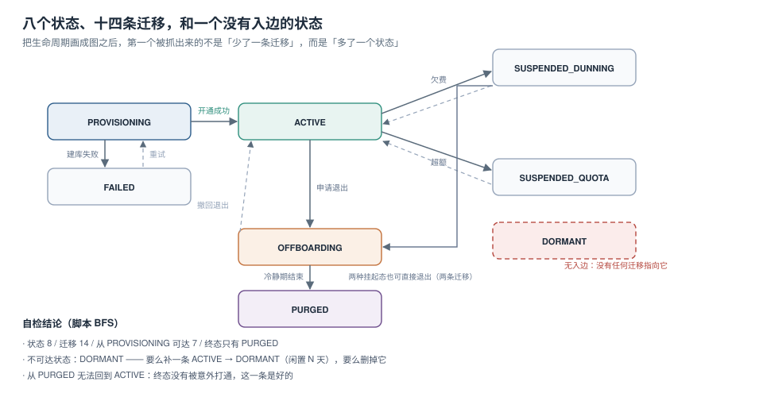

# 生命周期：八个状态与一条没有入边的迁移

把租户生命周期画成状态机之后，第一个被抓出来的往往不是「少了一条迁移」，而是**多了一个状态**：它在文档里存在、在代码里有枚举值、在数据库里有 `CHECK` 约束，但**没有任何迁移指向它**。这类状态永远不会出现，于是「休眠租户自动清理」这类功能写了一年也没生效过。



本页判据族 `LFC-A` ~ `LFC-H`，共 8 条。定义表在第七节。

## 一、把状态机写成数据，而不是写成注释

```python
TRANSITIONS = {
    "PROVISIONING":       ["ACTIVE", "FAILED"],
    "ACTIVE":             ["SUSPENDED_DUNNING", "SUSPENDED_QUOTA", "OFFBOARDING"],
    "SUSPENDED_DUNNING":  ["ACTIVE", "OFFBOARDING"],
    "SUSPENDED_QUOTA":    ["ACTIVE", "OFFBOARDING"],
    "FAILED":             ["PROVISIONING"],
    "DORMANT":            ["ACTIVE", "OFFBOARDING"],
    "OFFBOARDING":        ["PURGED", "ACTIVE"],
    "PURGED":             [],
}
```

写成字典之后，三个问题就可以用 BFS 机械地回答：

```python
from collections import deque

def reach(start):
    seen, dq = {start}, deque([start])
    while dq:
        n = dq.popleft()
        for m in TRANSITIONS.get(n, []):
            if m not in seen:
                seen.add(m); dq.append(m)
    return seen

print(len(TRANSITIONS))                              # 8
print(sum(len(v) for v in TRANSITIONS.values()))     # 14
print(sorted(set(TRANSITIONS) - reach("PROVISIONING")))  # ['DORMANT']
print([k for k, v in TRANSITIONS.items() if not v])  # ['PURGED']
print("ACTIVE" in reach("PURGED"))                   # False
```

输出：

| 检查项 | 结果 | 判定 |
| --- | --- | --- |
| 状态数 | 8 | — |
| 迁移数 | 14 | — |
| 从 `PROVISIONING` 可达 | 7 | — |
| 不可达状态 | **`DORMANT`** | **缺陷**：定义了但没有入边 |
| 终态 | `PURGED` | 正确（唯一终态） |
| 从 `PURGED` 能否回 `ACTIVE` | False | 正确（终态没被打通） |

::: danger 这条缺陷的真实形态
`DORMANT` 在代码里通常长这样：枚举有 `DORMANT`，数据库有 `status in ('ACTIVE','DORMANT',…)`，甚至有一个 `dormant_at` 字段。但**没有任何代码把它写进去**——原计划是「闲置 90 天自动休眠」，结果定时任务只写了 `last_active_at`，忘了更新状态。

于是所有「休眠租户不计费」「休眠租户不占席位」的规则全部失效，而且**没有任何监控会报警**：状态值是合法的、查询不会报错、报表上只是 `DORMANT` 的行数永远为 0。

修法只有两个：补一条 `ACTIVE → DORMANT`（并配上触发条件），或者删掉这个状态。
:::

## 二、六个状态各自的守卫

状态机只定义「能不能迁」，不定义「谁有资格迁」。守卫（guard）才是业务规则：

| 迁移 | 守卫条件 | 不满足时 |
| --- | --- | --- |
| `PROVISIONING → ACTIVE` | 库/schema 已建、初始管理员已创建、初始配额已写入 | 停在 `PROVISIONING`，超时后转 `FAILED` |
| `ACTIVE → SUSPENDED_DUNNING` | 欠费超过宽限期（如 7 天） | 只发提醒，不改状态 |
| `ACTIVE → SUSPENDED_QUOTA` | 用量超过硬限 | 拒绝新请求，但保留读 |
| `SUSPENDED_* → ACTIVE` | 欠费结清 / 提额成功 | 保持挂起 |
| `ACTIVE → OFFBOARDING` | 无未结账单、无进行中的导出任务 | 拒绝，返回待办清单 |
| `OFFBOARDING → PURGED` | 冷静期已过（如 30 天）、导出已完成或已放弃 | 拒绝，延长冷静期 |
| `OFFBOARDING → ACTIVE` | 冷静期内且未开始物理删除 | 拒绝，说明已不可逆 |

::: tip 冷静期是「可逆」与「不可逆」的分界线
`OFFBOARDING` 之前的一切都可以撤销，之后的一切都不可撤销。所以：

- **物理删除只能从 `PURGED` 触发**，不能从 `OFFBOARDING` 直接删；
- `OFFBOARDING → PURGED` 必须是**单向**的，代码里不能有「恢复」入口；
- 冷静期长度写进合同，不要做成可配置项（客户会要求改成 0 天）。
:::

## 三、开通：必须幂等

开通是最容易做出「两个库」的一步：客户端超时重试、消息重复投递、运维手工补开。

```sql
-- 幂等键：一个租户只能有一次开通
create table tenant (
  tenant_id     text primary key,
  slug          text not null unique,          -- 对外标识，也要唯一
  status        text not null default 'PROVISIONING',
  provision_key text not null unique,          -- 幂等键（客户端提交的请求 ID）
  created_at    timestamptz not null default now()
);
```

```sql
-- 重复提交会被主键/唯一键挡住，返回已有记录而不是报错
insert into tenant(tenant_id, slug, provision_key)
values ('t-8f21', 'acme', 'req-7c3a')
on conflict (provision_key) do nothing
returning tenant_id;
-- 0 行 = 已存在，去查一次并返回它
```

三个必须唯一的东西：`tenant_id`（内部）、`slug`（对外，出现在 URL 里）、`provision_key`（幂等键）。少一个就会出现「同一个客户两个租户」。

::: danger 开通失败后的清理
开通到一半失败（建了库、没建表），不能只改状态为 `FAILED` 就完事——**残留的库/ schema 会成为下一次开通的障碍**（同名已存在）。

必须有一个「补偿器」：按 `FAILED` 状态倒序执行建库的反操作。补偿本身也要幂等（删一个不存在的 schema 不报错）。
:::

## 四、升降配：生效边界与计费口径

| 变更 | 生效时点 | 计费口径 | 常见坑 |
| --- | --- | --- | --- |
| 升配（加席位/加配额） | 立即 | 当期按比例折算 | 折算方式没写进合同 |
| 降配 | 下个账期 | 当期按原价 | 客户以为立刻生效 |
| 降配（含数据缩减） | 下个账期 + 人工确认 | 按原价 | 数据删了但账单没降 |

「升配立即、降配下期」是行业惯例，但必须**显式写出来**，否则每次降配都要吵一次。

折算公式（按天）：

```text
当期费用 = 原配置单价 × 已用天数 + 新配置单价 × 剩余天数
```

注意月末天数不同（28/30/31），要么统一按 30 天折算，要么按实际天数——**选一个，写进合同**。

## 五、退出：删除传播清单

「删了租户，数据还在」几乎总是因为**删除只做了一处**。一个租户的数据通常散在九类位置：

| 位置 | 典型载体 | 容易漏的原因 |
| --- | --- | --- |
| 主库 | 业务表 | — |
| 只读副本 | 流复制 | 以为「主库删了副本自动删」，但延迟窗口内仍有 |
| 缓存 | Redis | 没有「按租户前缀删除」的通道 |
| 搜索索引 | ES / 全文索引 | 索引是异步重建的 |
| 数据仓库 | OLAP 表 | 归属「数据团队」，不在清单里 |
| 特征/模型 | 特征库 | 归属「算法团队」 |
| 对象存储 | 附件、导出文件 | 路径里没有租户前缀 |
| 日志 | 应用日志、访问日志 | 只按时间留存，没按租户打标 |
| 备份 | 全量备份 | 无法按租户删除，只能等过期 |

处置方式分两类：

- **可删的**：主库、缓存、对象存储、搜索索引 —— 走「按租户前缀删除 + 对账」；
- **不能删的**：备份、日志 —— 走「墓碑化 + 到期自然过期」，并在合同里写明「备份最长保留 N 天」。

```sql
-- 墓碑：把租户数据标记为已退出，而不是物理删
update orders set tenant_id = 'tombstone' where tenant_id = 't-8f21';
-- 这样外键仍然成立，但业务查询（按 tenant_id）永远查不到
```

::: warning 归档 ≠ 解除引用
把数据 `INSERT INTO audit_archive SELECT *` 之后再 `DELETE` 原表，**外键仍然指向原租户的行**——因为归档表里的行还在引用它。必须把归档行的 `tenant_id` 改成墓碑值，才真正解除引用。

这个坑在 [TeamBoard 租户退出](../../../../project/Complete/TeamBoard/TenantOffboarding/index.md) 有完整复现：先删父表报 `23503`，归档后仍然报同一个错。
:::

## 六、四段的时间常数

| 阶段 | 时间常数 | 定这个数的依据 |
| --- | --- | --- |
| 开通 | 秒级（异步任务 30 秒内完成） | 客户在等，超过 30 秒要有进度反馈 |
| 欠费宽限 | 7 ~ 15 天 | 与财务对账周期对齐 |
| 冷静期 | 30 天（部分行业 90 天） | 合同约定；太短客户反悔就没救 |
| 备份过期 | 35 天（滚动保留） | 必须 ≥ 冷静期 + 恢复演练周期 |

这四个数不是随便定的，它们之间有约束：**备份保留期必须 ≥ 冷静期**，否则客户在冷静期内要求恢复时，备份已经过期了。

## 七、本页判据

| 编号 | 判据 | 看什么现象 | 不满足时改哪里 |
| --- | --- | --- | --- |
| `LFC-A` | 状态机是数据，可被 BFS 检查 | 有一份迁移表，能被脚本读 | 见第 1 节 |
| `LFC-B` | 没有不可达状态 | BFS 的可达集合 = 全部状态 | 删掉 `DORMANT` 或补入边 |
| `LFC-C` | 终态唯一且不可逆 | `PURGED` 出度为 0 | 检查有无「恢复」入口 |
| `LFC-D` | 每条迁移有守卫条件 | 守卫写在第 2 节的表里并落到代码 | 补守卫 |
| `LFC-E` | 开通幂等（三个唯一键） | 重复提交返回同一租户 | 见第 3 节 |
| `LFC-F` | 开通失败有幂等补偿器 | `FAILED` 租户的残留能被清 | 补补偿器 |
| `LFC-G` | 升降配的生效与计费口径已写进合同 | 文档里有折算公式 | 补合同条款 |
| `LFC-H` | 删除传播清单覆盖九类位置 | 清单有负责人与对账 SQL | 见第 5 节 |

## 参考资料

- PostgreSQL 18 Documentation：*Constraints*（`ON CONFLICT DO NOTHING` 与唯一约束）、*Foreign Keys*（删除顺序与 `23503` 错误）
- PostgreSQL 18 Documentation：*Check Constraints*（状态枚举的库层约束写法）
- 本仓库：[隔离三档](../IsolationModel/index.md)、[计量与账单](../MeteringBilling/index.md)、[在线 Schema 演进](../../../DB/SchemaEvolution/index.md)
- 本仓库项目侧：[TeamBoard 租户退出](../../../../project/Complete/TeamBoard/TenantOffboarding/index.md)、[TeamBoard 数据清单](../../../../project/Complete/TeamBoard/TenantDataInventory/index.md)
