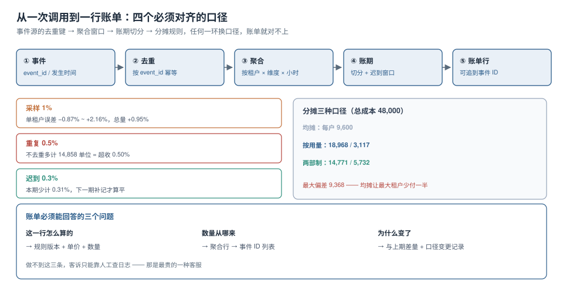

# 计量与账单：从事件到一行可解释的账

账单出问题时，最常见的一句话是「我们的计量没问题，是财务算错了」。但计量的正确性不由「算得准不准」定义，而由**能不能把一行账单还原成一组事件**定义。还原不了，就没法证明自己没错。

本页从一次调用讲到一行账单，中间三个环节各有一个会系统性偏离真值的机制，最后接上成本分摊。



本页判据族 `MTR-A` ~ `MTR-H`，共 8 条。定义表在第八节。

## 一、五段流水线

| 段 | 做什么 | 关键决定 | 错了会怎样 |
| --- | --- | --- | --- |
| ① 事件 | 记录一次业务动作 | `event_id` 用什么生成 | 无法去重，也无法溯源 |
| ② 去重 | 同一 `event_id` 只算一次 | 去重窗口多长 | 重试导致超收 |
| ③ 聚合 | 按租户 × 维度 × 小时累加 | 聚合表的主键 | 迟到事件无处可放 |
| ④ 账期 | 把聚合结果切成「这个月」 | 切分边界与迟到窗口 | 跨期归属错 |
| ⑤ 账单 | 生成可展示的行 | 单价版本与舍入规则 | 客诉无法解释 |

五段里，**②和④是唯一会「改变金额」的两段**，①③⑤只影响可解释性与性能。所以排期时优先做②和④。

## 二、误差一：采样的相对误差与小租户

100 万个事件，5 个租户，真值合计 2,999,971（单位任意）。按不同比例采样后外推：

| 采样率 | 单租户误差区间 | 总量误差 |
| --- | --- | --- |
| 1% | **-0.87% ~ +2.16%** | +0.95% |
| 5% | -0.62% ~ +1.73% | +0.46% |
| 10% | -0.51% ~ +0.54% | +0.12% |

三个读数值得注意：

1. **总量误差总是小于单租户误差**：5 个租户的正负误差会互相抵消。所以「总量对得上」不能证明「每个租户都对」。
2. **1% 采样下单租户误差可达 2.16%**：如果单价高、用量大，这就是一笔真金白银的差异。
3. **误差不随采样率线性下降**：1% → 10% 采样量涨 10 倍，误差从 2.16% 降到 0.54%（约 4 倍），符合 `1/√n` 的规律。

::: danger 采样只能用于「趋势」和「容量规划」，不能用于「计费」
计费必须用全量事件。如果事件量太大，正确的做法是**降低事件的粒度**（按分钟聚合上报，而不是每次调用上报），而不是**抽样**——前者是精确定义的聚合，后者是有偏的估计。
:::

## 三、误差二：重复事件，不去重就超收 0.5%

真实链路里事件会被重复投递：生产者重试、消费者 rebalance、网络超时后的补偿。仿真的重复率 0.5%：

| 处理 | 总量 | 与真值差 | 相对真值 |
| --- | --- | --- | --- |
| 不去重 | 3,014,829 | +14,858 | **+0.50%** |
| 按 `event_id` 去重 | 2,999,971 | 0 | 0 |

0.5% 听起来很小，但对一个月流水 100 万的客户就是 5,000 的无理由多收，而且**每一笔都能被客户对出来**——因为客户侧有完整的调用日志。

去重的三个设计决定：

| 决定 | 选项 | 建议 |
| --- | --- | --- |
| `event_id` 由谁生成 | 客户端 / 服务端 / 数据库序列 | **服务端**在业务动作发生时生成，客户端不可指定 |
| 去重窗口 | 1 小时 / 1 天 / 永久 | 至少覆盖「最大重试跨度」，通常 **72 小时** |
| 去重存储 | 明细表唯一索引 / Redis / 布隆过滤器 | **唯一索引**（可审计），Redis 只做前置加速 |

```sql
-- 事件表：唯一索引就是去重闸门，不需要额外代码
create table usage_event (
  event_id    text primary key,
  tenant_id   text not null,
  metric      text not null,
  quantity    numeric(18,4) not null,
  occurred_at timestamptz not null,
  ingested_at timestamptz not null default now()
);

-- 重复投递会被 ON CONFLICT 吸收，且不报错
insert into usage_event(event_id, tenant_id, metric, quantity, occurred_at)
values ('evt-9f3c', 't7', 'export_rows', 1200, now())
on conflict (event_id) do nothing;
```

::: tip 用 `do nothing` 而不是 `do update`
`ON CONFLICT DO UPDATE` 会让「重复投递」变成「覆盖写入」，看起来更安全，实际上掩盖了上游的重复问题——日志里看不到重复率，就无法判断链路是否健康。`DO NOTHING` + 一个计数器指标，既保证正确性又保留了观测。
:::

## 四、误差三：迟到事件，本期少计 0.31%

事件的发生时间（`occurred_at`）与入库时间（`ingested_at`）可以相差很远：客户端离线缓存、消息堆积、批处理补传。

仿真里 0.3% 的事件在账期结束后才到：

| 项 | 数值 |
| --- | --- |
| 本期少计 | 9,361 单位 |
| 占总量 | **0.31%** |

两种处理方式，各有代价：

| 方式 | 做法 | 代价 |
| --- | --- | --- |
| 延长账期 | 账期结束后留 3~7 天迟到窗口，窗口内的事件仍计入本期 | 账单出具变慢 |
| 下期补记 | 迟到事件计入下一期，账单上单列「上期补记」 | 客户看到「这个月多了」，需要解释 |

**必须选一个，并写进合同**。最差的做法是「迟到的事件直接丢掉」——短期账好看，长期是审计问题。

```sql
-- 按 occurred_at 归属账期，而不是 ingested_at
select date_trunc('month', occurred_at) as period,
       tenant_id, metric, sum(quantity)
  from usage_event
 where occurred_at >= :period_start and occurred_at < :period_end
 group by 1, 2, 3;
```

## 五、一行账单必须能回答三个问题

| 问题 | 需要的字段 | 常见缺失 |
| --- | --- | --- |
| 这一行怎么算的 | 单价、单价版本、数量、计算公式 | 没有版本号，改了价之后历史账单无法复现 |
| 数量从哪来 | 聚合行 ID → 事件 ID 列表 | 只存了聚合结果，明细被 TTL 清掉 |
| 为什么变了 | 与上期的差量、口径变更记录 | 没有差量表，客诉时靠人工翻 |

一张可解释的账单行长这样：

```json
{
  "line_id": "inv-2026-10-t7-003",
  "tenant_id": "t7",
  "metric": "export_rows",
  "period": "2026-10",
  "quantity": 1284000,
  "unit_price": 0.00002,
  "price_version": "2026-07-01",
  "amount": 25.68,
  "aggregation_ids": ["agg-2026-10-t7-export-01", "..."],
  "note": "含上期补记 1,200 行（event evt-9f3c 迟到）"
}
```

## 六、成本分摊：三种口径，三个不同的毛利

计量回答「客户用了多少」，分摊回答「这些用量该背多少成本」。同一个月、同一批数据，三种分摊法给出的毛利完全不同。

设定：总成本 48,000（CPU 70% + 存储 30%），5 个租户。

| 租户 | 均摊 | 按用量 | 两部制 | 收入 | 按用量毛利 | 均摊毛利 |
| --- | --- | --- | --- | --- | --- | --- |
| t1（最大） | 9,600 | **18,968** | 14,771 | 26,000 | 7,032 | 16,400 |
| t2 | 9,600 | 10,710 | 10,357 | 15,000 | 4,290 | 5,400 |
| t3 | 9,600 | 8,650 | 9,306 | 12,000 | 3,350 | 2,400 |
| t4 | 9,600 | 6,555 | 7,834 | 9,000 | 2,445 | **-600** |
| t5（最小） | 9,600 | **3,117** | 5,732 | 4,000 | 883 | **-5,600** |

三个结论：

1. **均摊会让小客户「看起来亏损」**：t5 收入 4,000、分摊 9,600，毛利 -5,600。如果按这个口径做决策，会得出「砍掉小客户」的结论。
2. **按用量下所有租户都盈利**：因为用量小的客户本来就该背更少的成本。
3. **均摊与按用量的最大偏差是 9,368**：对 t1 来说，均摊让它少付了一半成本——它在**补贴**所有人。

关键点：**分摊方法决定了你看问题的角度，而不是事实**。事实是「总成本 48,000」，分摊只是把这个数分配给谁。

| 方法 | 适合 | 陷阱 |
| --- | --- | --- |
| 均摊 | 资源几乎无差别、客户数少 | 大客户被补贴，看不到真实毛利 |
| 按用量 | 用量与成本强相关 | 用量指标选错（用 CPU 分摊存储成本） |
| 两部制 | 有固定成本（平台、运维） | 固定部分比例难定，容易政治化 |

::: warning 单位经济学：把「成本」换成「每单位成本」
比「这个租户赚不赚钱」更有用的指标是：**每 vCPU·小时的成本**、**每 GB·月的成本**、**每千次调用的成本**。
它们与租户无关，可以横向比较，也能直接看出「规模上去之后单位成本有没有降」。
算不出单位成本，说明你的分摊口径里混进了无法归属的公共成本——那部分要单独列「平台成本」，不要摊进租户。
:::

## 七、计量与配额同源：一条对账 SQL

```sql
-- 每天跑：配额侧的计数 vs 计量侧的求和
with q as (
  select tenant_id, metric, sum(used) as used
    from quota_daily where day = current_date - 1 group by 1, 2
), m as (
  select tenant_id, metric, sum(quantity) as qty
    from usage_event
   where occurred_at >= current_date - 1 and occurred_at < current_date
   group by 1, 2
)
select coalesce(q.tenant_id, m.tenant_id) as tenant_id,
       coalesce(q.metric, m.metric) as metric,
       q.used, m.qty, coalesce(q.used, 0) - coalesce(m.qty, 0) as diff
  from q full join m using (tenant_id, metric)
 where coalesce(q.used, 0) <> coalesce(m.qty, 0);
```

差异超过 0.1% 就告警。这条对账能抓到绝大多数「口径错位」类问题，比如：

- 配额按「请求次数」算，计量按「返回行数」算；
- 重试请求被配额算了两次，但计量只记一次；
- 缓存命中的请求没有产生事件，但配额扣了。

## 八、本页判据

| 编号 | 判据 | 看什么现象 | 不满足时改哪里 |
| --- | --- | --- | --- |
| `MTR-A` | `event_id` 由服务端生成且唯一 | 事件表有主键或唯一索引 | 见第 3 节 |
| `MTR-B` | 重复投递被吸收且可观测 | 有「重复率」指标，值 > 0 也不报错 | `ON CONFLICT DO NOTHING` + 计数 |
| `MTR-C` | 计费不用采样 | 计量表里是全量事件 | 降低事件粒度而不是抽样 |
| `MTR-D` | 账期按 `occurred_at` 切分 | 聚合 SQL 用发生时间 | 改成发生时间 |
| `MTR-E` | 迟到窗口有明确长度并写进合同 | 文档里有「账期后 N 天」 | 补窗口定义 |
| `MTR-F` | 账单行含单价版本与聚合 ID | 随机一行能追到事件 | 补齐字段 |
| `MTR-G` | 分摊口径与计量口径同源 | 分摊用的是计量表的量 | 见第 6 节 |
| `MTR-H` | 有每日配额/计量对账 | 对账 SQL 有定时任务与告警 | 见第 7 节 |

## 与本专题的分工（订阅计费）

本页的 `MTR` 族管「计量准不准」，[订阅计费与周期账单工程](../../SubscriptionBilling/index.md)管「拿计量结果怎么算钱、怎么开票、怎么收」。两边最容易重复的是「迟到事件」，边界写在这里：

| 问题 | 归本页（MTR） | 归订阅计费 |
| --- | --- | --- |
| 迟到事件怎么归期 | `occurred_at` 切账期、窗口长度写进合同 | 窗口用完还进来的量：重开账单还是滚下期 |
| 重复投递怎么处理 | `event_id` 唯一 + `ON CONFLICT DO NOTHING` | 不重复处理（对账时按账单行核对） |
| 一行账单要能解释什么 | 单价版本、聚合 ID、差量 | 行项类型、税额口径、信用票据 |
| 配额与计量对账 | 每日 `quota_daily` ⇄ `usage_event` | 三向对账：账单 ⇄ 支付 ⇄ 账务 |

::: danger 一个本页没覆盖、但账单侧必须决定的事
`MTR-E` 要求「迟到窗口有明确长度并写进合同」，但**窗口用完之后的量**仍会到达（上游修数据重放、客户端离线补传）。此时账单侧只有两条路，且代价差一个量级：**重开账单**（本机 20,000 条事件里闭账后到达的涉及 **211/400 个租户，52.8%**）或**滚下期**（下期金额虚高）。选哪一个不写在合同里，客服每次都要找研发确认。见[周期与闭账 · 迟到账的两种处理](../../SubscriptionBilling/Cycle/index.md)。
:::

## 参考资料

- PostgreSQL 18 Documentation：*INSERT … ON CONFLICT*（`DO NOTHING` 与唯一索引的关系）、*Aggregate Functions*（`date_trunc` 与分组聚合）
- PostgreSQL 18 Documentation：*Transaction Isolation*（幂等写入与并发插入的冲突处理）
- OpenCost / FinOps Foundation：*Cost Allocation* 相关方法论（分摊口径的分类与「共享成本」处理）
- 本仓库：[配额执行](../QuotaEnforcement/index.md)、[容量与成本](../../../Ops/CapacityCost/index.md)、[数据治理](../../../DB/DataGovernance/index.md)
- 本仓库项目侧：[TeamBoard 用量计量](../../../../project/Complete/TeamBoard/TenantMetering/index.md)
