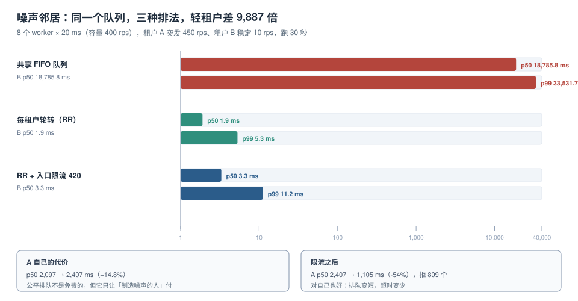

# 噪声邻居：公平排队的代价与收益

「某个租户一上来，全站都慢」是多租户系统最常见的一类投诉，也是最容易被误诊的一类：监控上看是「整体 p99 升高」，于是大家去查慢 SQL、查 GC、查网络，而真正的原因只是**队列的排法不对**。

本页用一组离散事件仿真，把「共享队列」「每租户轮转」「轮转 + 入口限流」三种排法放在同一份负载下对比。



本页判据族 `NNB-A` ~ `NNB-H`，共 8 条。定义表在第七节。

## 一、四种资源维度，坏的方式不一样

| 资源 | 被抢占后的表现 | 隔离手段 | 代价 |
| --- | --- | --- | --- |
| CPU / 线程 | 排队变长，p99 抬升 | 每租户独立线程池（舱壁）、轮转调度 | 线程数变多，上下文切换增加 |
| 连接 | 池被占满，其他租户拿不到连接 | 每租户连接上限、独立数据源 | 池总数变大，数据库侧连接数上升 |
| IO / buffer | 大查询把热数据挤出缓存 | 限制单查询扫描量、只读副本 | 需要路由，读一致性变复杂 |
| 锁 | 一个租户的长事务挡住别人的行 | 短事务、`lock_timeout`、避免跨租户锁 | 业务上要接受「超时重试」 |

四种里，**前两种可以在应用层解决，后两种必须回到数据层**。很多团队只在应用层加了限流，然后发现「限流器没拦住慢查询」，就是因为 IO 与锁这两维漏了。

## 二、仿真设置

```python
# 8 个 worker，每个请求固定 20 ms → 理论容量 400 rps
workers, svc, dur = 8, 0.020, 30.0
# 租户 A：突发 450 rps（超过容量 12.5%）；租户 B：稳定 10 rps
rateA, rateB = 450.0, 10.0
```

三种排法：

1. **共享 FIFO**：一个队列，先到先服务。
2. **每租户轮转（RR）**：每个租户一个逻辑队列，worker 空闲时按轮转顺序取下一个非空队列。
3. **RR + 入口限流 420**：在轮转之外，入口对 A 做每秒 420 次的硬限，超出的直接拒绝。

::: info 为什么用仿真而不是真实压测
真实压测要控制「一个租户严格 450 rps、另一个严格 10 rps」的混合负载，还要保证每次运行的随机性可比。
离散事件仿真把服务时间固定、到达过程固定为泊松，**只改变排法**，这样三组数字的差异只来自策略本身。
真实服务的服务时间有长尾，绝对数字会更大，但策略之间的倍数关系不会反转。
:::

## 三、三组读数

| 排法 | A p50 | A p99 | A 被拒 | B p50 | B p99 | B max |
| --- | --- | --- | --- | --- | --- | --- |
| 共享 FIFO | 2,097 ms | 3,877 ms | 0 | **18,786 ms** | **33,532 ms** | 33,865 ms |
| 每租户轮转 | 2,407 ms | 4,858 ms | 0 | **1.9 ms** | **5.3 ms** | 8.1 ms |
| RR + 限流 420 | **1,105 ms** | **2,115 ms** | 809 | 3.3 ms | 11.2 ms | 12.3 ms |

### 第一个结论：FIFO 下轻租户被拖到 18.8 秒

B 只发了 10 rps，它自己一点都不「重」，但它的 p50 是 **18,786 ms**——等待时间几乎等于「排在自己前面的 A 的积压量 ÷ 吞吐」。A 每秒多进来 50 个请求，30 秒积压 1,500 个，每个 20 ms，排队长度除以 8 个 worker，就是这个量级。

B 的请求并没有变慢，它只是**排在一条被塞满的队里**。

### 第二个结论：轮转让 B 从 18.8 秒降到 1.9 毫秒

**9,887 倍**。而 A 的 p50 只从 2,097 涨到 2,407 ms（**+14.8%**）。

这就是公平排队的核心性质：**它几乎不减少总吞吐，只是重新分配等待时间**。腾出来的等待时间从「无辜的轻租户」转移给「制造积压的重租户」。

::: tip 一句话解释原理
FIFO 的等待时间取决于「前面有多少个请求」；轮转的等待时间取决于「**同一个租户**前面有多少个请求」。
把「全局队列长度」换成「租户内队列长度」，就把跨租户的相互影响切断了。
:::

### 第三个结论：限流对重租户自己也有好处

加上 420 rps 的入口限流后：

- A 的 p50 从 2,407 降到 **1,105 ms**（-54%），因为它不再把队列撑到极限；
- A 被拒 **809** 次（30 秒内 13,500 个请求里约 6%），这些请求快速失败，而不是等 2 秒再超时；
- B 的 p99 从 5.3 升到 11.2 ms——略升，因为限流桶本身有开销，但仍是毫秒级。

**让超额请求快速失败，比让它们排队到超时更省资源**：一个等 2 秒后超时的请求，占用的 worker 时间与一个正常请求一样，但它什么也没换来。

## 四、膝点：加并发不等于加吞吐

噪声邻居的根源是「容量不够」，但**加 worker 的收益在膝点之后会反转**。用 Little 定律可以免费校验一组读数是否自洽：

```text
并发数 ≈ 吞吐 × 平均延迟
```

| 并发 | 吞吐 | 平均延迟 | 吞吐 × 延迟 |
| --- | --- | --- | --- |
| 8 | 2,692 TPS | 2.972 ms | 8.00 |
| 16 | **4,007 TPS** | 3.993 ms | 16.00 |
| 32 | 3,881 TPS | 8.245 ms | 32.00 |
| 64 | 3,400 TPS | 18.825 ms | 64.00 |

（这组读数是连接池专题在同一台机器上量的数据库侧吞吐，用来演示膝点，不是本页仿真的输出。）

16 是膝点：再往上加并发，吞吐下降 3.2%，延迟翻倍。**多租户系统里，膝点之后最先受害的一定是最轻的租户**——因为它没有能力「抢」。

所以容量规划的正确口径不是「平均 QPS / 单 worker 能力」，而是：

```text
所需 worker 数 = 峰值 QPS × 单请求服务时间 / 目标利用率
目标利用率 = 0.6 ~ 0.7（留出突发余量，且必须低于膝点）
```

按上面的数：450 rps × 0.02 s / 0.65 ≈ **13.8**，也就是要 14 个 worker，而不是 8 个。反过来说，8 个 worker 的合理承载上限约 **260 rps**——A 单独一个租户就把它压垮了。

## 五、三种手段，按代价从小到大

| 手段 | 实现成本 | 解决的问题 | 不解决的问题 |
| --- | --- | --- | --- |
| 入口限流（每租户令牌桶） | 低 | 超额请求快速失败 | 限流内的请求仍然互相排队 |
| 每租户轮转 / WFQ | 中 | 等待时间按租户隔离 | 总容量不足时大家一起慢 |
| 舱壁（每租户独立池） | 高 | 完全隔离资源 | 资源利用率下降，空闲浪费 |

实践中通常是**三者叠加**：入口限流挡住突发，轮转保证公平，舱壁留给「鲸鱼客户」。

### 入口限流的最小实现

```java
// 每租户一个令牌桶；桶的容量与速率来自配额表
public boolean tryAcquire(String tenant) {
    Bucket b = buckets.computeIfAbsent(tenant, t -> Bucket.of(quotaOf(t)));
    return b.tryConsume(1);
}
```

三个必须注意的点：

1. **桶要按租户懒创建，并且能回收**：10 万个租户 × 一个桶 = 一份不小的内存，长期不活跃的租户要淘汰。
2. **限流返回 429，不是 503**：429 的语义是「你太快了」，503 是「我坏了」。客户端对这两者的重试策略完全不同。
3. **限流要分层**：全局（保护自己）+ 租户（保护别人）两层，只做租户层会在整体过载时一起崩。

::: danger 三个常见的错误做法
1. **用「响应时间」做限流依据**：延迟是结果不是原因，等延迟升高时队列已经满了。
2. **在数据库层用 `statement_timeout` 代替限流**：超时只是让慢查询死掉，它已经消耗掉的 CPU 与 buffer 不会还回来。
3. **给所有租户同一个配额**：小租户永远用不满，大租户永远不够用，于是大租户持续超发，限流形同虚设。
:::

## 六、大租户：数据层的噪声邻居

应用层限流数的是**请求数**，但数据库承受的是**行数**。同一个接口，普通租户返回 463 行，大租户返回 88,400 行：

| 租户 | 单次查询 | 返回行数 | 执行计划 |
| --- | --- | --- | --- |
| 普通租户 | 0.049 ms | 463 | `Index Only Scan` |
| 大租户（占 40% 数据） | **4.723 ms** | 88,400 | `Parallel Seq Scan` |

**96 倍**。而这两个请求在限流器眼里权重完全一样。

三层应对：

1. **给单查询加返回行数上限**（分页 + 最大页大小），把「一次查完」变成「多次查」；
2. **给大租户单独的数据源**（读副本或独立库），让它的扫描不挤占别人的 buffer；
3. **给大租户的接口做降级**（导出类接口走异步任务，不在线等）。

## 七、本页判据

| 编号 | 判据 | 看什么现象 | 不满足时改哪里 |
| --- | --- | --- | --- |
| `NNB-A` | 排队策略是「每租户轮转」而非全局 FIFO | 代码/网关配置里能找到按租户的队列或权重 | 改调度器；见第 3 节 |
| `NNB-B` | 有每租户的延迟分位数而非只有全局 | 监控能查到单租户 p50/p99 | 指标加租户维度（TOP N） |
| `NNB-C` | 限额按租户配置且可热更新 | 配额表有 `rate` / `burst` 字段 | 见 [配额执行](../QuotaEnforcement/index.md) |
| `NNB-D` | 超额返回 429 且带 `Retry-After` | 抓包能看到 429 与重试建议 | 统一错误码口径 |
| `NNB-E` | 全局与租户两级限流都存在 | 两层都能单独开关 | 补全局层 |
| `NNB-F` | 单查询有返回行数上限 | 分页参数有最大值，超限报错 | 加最大页大小 |
| `NNB-G` | 容量按目标利用率 0.6~0.7 计算 | 容量文档里有算式与膝点 | 见第 4 节的算式 |
| `NNB-H` | 大租户有独立资源或降级路径 | 大租户名单与对应策略可查 | 建「鲸鱼客户」清单 |

## 参考资料

- Little, J. D. C.：*A Proof for the Queuing Formula L = λW*（1961）——本页第 4 节用它校验读数自洽
- PostgreSQL 18 Documentation：*Performance Tips*（`Parallel Seq Scan` 的触发条件与代价模型）
- Nygard, M.：*Release It!* 中 *Bulkheads* 与 *Circuit Breaker* 两章（舱壁与熔断的原始论述）
- 本仓库：[高并发系统设计](../../HighConcurrency/index.md)、[连接池与连接生命周期](../../../DB/ConnectionPool/index.md)、[大租户与热点](../HotTenant/index.md)
