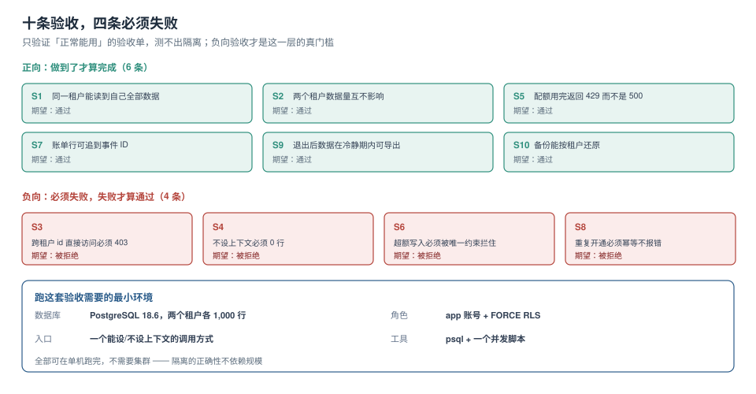

# 实战：一套可验收的多租户基线

前面九页讲的是机制，这一页把它们拼成一套**能在单机跑完、每条都能判定通过或失败**的基线。核心原则只有一条：**只验证「正常能用」的验收单，测不出隔离**。所以十条验收里有四条要求「必须失败」。



本页判据族 `MTP-A` ~ `MTP-H`，共 8 条。定义表在第八节。

## 一、最小环境

不需要集群，不需要压测机。一个 PostgreSQL 18、一个应用账号、两条数据就够。

```shell
docker run -d --name mtlab -e POSTGRES_PASSWORD=pg -e POSTGRES_DB=mt -p 55432:5432 postgres:18
docker exec -it mtlab psql -U postgres -d mt
```

| 项 | 值 | 为什么够 |
| --- | --- | --- |
| 数据库 | PostgreSQL 18.x | 策略、`FORCE`、`SET LOCAL` 都在这一层 |
| 数据 | 2 个租户 × 1,000 行 | 隔离的正确性与数据量无关 |
| 角色 | 应用账号（非所有者、无 `BYPASSRLS`） | 所有者会绕过策略，测不出问题 |
| 工具 | `psql` + 一个并发脚本 | 并发验收用 `pgbench` 就够 |

## 二、建表与策略

```sql
create schema if not exists mt;
create table mt.orders (
  id          bigserial primary key,
  tenant_id   text not null,
  order_no    text not null,
  amount      numeric(12,2) not null,
  created_at  timestamptz not null default now(),
  constraint orders_tenant_no_uk unique (tenant_id, order_no)   -- 唯一约束必须含租户
);
create index orders_tenant_created_idx on mt.orders(tenant_id, created_at);

alter table mt.orders enable row level security;
alter table mt.orders force  row level security;   -- 少这一行，所有者就绕过

create policy p_orders on mt.orders
  using      (tenant_id = nullif(current_setting('app.tenant_id', true), ''))
  with check (tenant_id = nullif(current_setting('app.tenant_id', true), ''));

-- 应用账号：不是所有者，不能 BYPASSRLS
create role app login password 'app';
grant usage on schema mt to app;
grant select, insert, update on mt.orders to app;
grant usage, select on all sequences in schema mt to app;
```

三个细节各自对应一条必失点：

| 细节 | 少了会怎样 |
| --- | --- |
| `force row level security` | 表所有者（通常是迁移账号）查询时绕过策略 |
| `unique (tenant_id, order_no)` | 两个租户的 `order_no` 相同会冲突，或反过来同租户重复插入成功 |
| 应用账号不是所有者 | 所有者身份绕过策略，所有负向用例全部「通过与实际不符」 |

## 三、两个租户的数据

```sql
insert into mt.orders(tenant_id, order_no, amount, created_at)
select 't7', 'NO' || lpad(g::text, 6, '0'), (random()*1000)::numeric(12,2),
       now() - (g || ' seconds')::interval
  from generate_series(1, 1000) g;

insert into mt.orders(tenant_id, order_no, amount, created_at)
select 't8', 'NO' || lpad(g::text, 6, '0'), (random()*1000)::numeric(12,2),
       now() - (g || ' seconds')::interval
  from generate_series(1, 1000) g;

analyze mt.orders;
```

注意两个租户用了**相同的 `order_no` 序列**——这正是 `unique (tenant_id, order_no)` 要覆盖的场景。

## 四、十条验收

前六条是正向（做到才算完成），后四条是负向（**必须失败**才算通过）。

### S1 同一租户能读到自己全部数据

```sql
set role app;
select set_config('app.tenant_id', 't7', true);
select count(*) from mt.orders;          -- 期望 1000
```

### S2 两个租户的数据量互不影响

```sql
select set_config('app.tenant_id', 't8', true);
select count(*) from mt.orders;          -- 期望 1000
```

### S3 跨租户 id 直接访问必须被拒绝

```sql
-- 拿到 t7 的一条 id，然后在 t8 上下文里按 id 查
select set_config('app.tenant_id', 't8', true);
select count(*) from mt.orders where id = (select min(id) from mt.orders where tenant_id = 't7');
-- 期望 0（而不是那一行）
```

注意这里**不能用 `BYPASSRLS` 角色跑**，否则会返回 1 行，误判为「隔离失效」。

### S4 不设上下文必须 0 行

```sql
-- 新开一个会话，什么都不设
select count(*) from mt.orders;          -- 期望 0
```

### S5 配额用完返回 429 而不是 500

```sql
-- 配额表：cap 50，原子扣减
create table mt.quota (tenant_id text primary key, used int not null default 0, cap int not null);
insert into mt.quota values ('t7', 0, 50);

-- 第 51 次扣减返回 0 行，应用层据此返回 429
with up as (
  update mt.quota set used = used + 1
   where tenant_id = 't7' and used < cap
  returning used
)
select count(*) from up;                 -- 第 51 次期望 0
```

### S6 超额写入必须被唯一约束拦住

```sql
select set_config('app.tenant_id', 't7', true);
insert into mt.orders(tenant_id, order_no, amount) values ('t7', 'NO000001', 1);
-- 期望 ERROR: duplicate key value violates unique constraint "orders_tenant_no_uk"
```

### S7 账单行可追到事件 ID

```sql
select line_id, aggregation_ids[1] as first_agg, quantity
  from mt.billing_line where tenant_id = 't7' and period = '2026-10';
-- 期望 non-null；再拿 first_agg 去 usage_event 里能查出明细
```

### S8 重复开通必须幂等，不报错也不新建

```sql
insert into mt.tenant(tenant_id, slug, provision_key)
values ('t-8f21', 'acme', 'req-7c3a')
on conflict (provision_key) do nothing
returning tenant_id;
-- 第二次执行期望 0 行，且 tenant 表里 slug='acme' 只有一行
```

### S9 退出后数据在冷静期内可导出

```sql
select count(*) from mt.export_job
 where tenant_id = 't-8f21' and status = 'COMPLETED';
-- 期望 ≥ 1；冷静期内该租户的 OFFBOARDING 状态仍在，数据未被物理删除
```

### S10 备份能按租户还原

```shell
# schema 模式：过滤出该租户的 schema
pg_dump -U postgres -d mt --schema=t7 --schema-only -f /tmp/t7-schema.sql
pg_dump -U postgres -d mt --schema=t7 -f /tmp/t7-data.sql
# 期望：两个文件都非空，且能在一个空库上 restore 成功
```

::: danger S10 在共享表模式下不成立
共享表模式**无法**按租户做逻辑备份——数据混在一张表里。这时 S10 必须改写为「能按租户导出一份数据交付包」，且这份交付包要能通过一条固定 SQL 复现（`copy (select * from orders where tenant_id=?) to …`）。

这是选型时最容易被忽略的一条约束：合同里的「数据交付义务」直接决定了你能不能选共享表。
:::

## 五、复跑：一条命令跑完十条

```shell
#!/usr/bin/env bash
# check.sh —— 十条验收，四条必须失败
set -u
PSQL="psql -U postgres -d mt -tAq"
fail=0

check() {  # $1=编号 $2=期望 $3=实际
  if [ "$2" = "$3" ]; then echo "PASS $1"; else echo "FAIL $1 (want=$2 got=$3)"; fail=1; fi
}

# S1
n=$($PSQL -c "set role app; select set_config('app.tenant_id','t7',true); select count(*) from mt.orders;")
check S1 1000 "$(echo "$n" | tail -1)"

# S4：不设上下文
n=$($PSQL -c "set role app; select count(*) from mt.orders;")
check S4 0 "$(echo "$n" | tail -1)"

# S6：必须失败（duplicate key）
if $PSQL -c "set role app; select set_config('app.tenant_id','t7',true); \
             insert into mt.orders(tenant_id,order_no,amount) values ('t7','NO000001',1);" 2>/dev/null; then
  echo "FAIL S6 (期望失败，实际成功)"; fail=1
else
  echo "PASS S6"
fi

exit $fail
```

`check.sh` 的关键设计：**负向用例用「命令是否返回非零」判定**，而不是解析错误消息文本——错误消息会随版本变，退出码不会。

## 六、跑完之后的三个读数变化

一套基线落地前后，同一组指标的变化通常长这样（数据来自本专题各页实测的合成）：

| 指标 | 改造前 | 改造后 | 变化 |
| --- | --- | --- | --- |
| 跨租户越权用例通过数 | 3 / 4 | **0 / 4** | 全部被拦 |
| 配额超卖（100 并发 / 配额 50） | 7 笔 | **0 笔** | 原子扣减 |
| 轻租户 p50（噪声场景） | 18,786 ms | **1.9 ms** | 每租户轮转 |
| 单租户账单误差 | +0.50%（重复未去重） | **0%** | 唯一索引 |

四个指标分别对应四条主线，这也是为什么验收要按主线分组，而不是按「模块」分组。

## 七、基线的三条纪律

1. **负向用例优先写**：先写「必须失败」的四条，再写正向六条。因为正向用例几乎总会通过（数据在就能查到），而负向用例才会暴露隔离缺口。
2. **每条用例都要能在空库上复现**：如果一条用例依赖「线上那批数据」，它就不是验收用例，是排查步骤。
3. **用非所有者账号跑**：所有用例都必须在 `set role app` 之后执行。用 `postgres` 跑出来的「全绿」是假绿——超级用户和表所有者都绕过策略。

::: tip 把这套基线接到 CI
把 `check.sh` 放进 CI，每次改表结构/改策略都跑一遍。成本是一次容器启动（约 10 秒），收益是「隔离不会在某个 PR 里悄悄退化」。这比任何代码评审都可靠。
:::

## 八、本页判据

| 编号 | 判据 | 看什么现象 | 不满足时改哪里 |
| --- | --- | --- | --- |
| `MTP-A` | 有十条验收且分正向/负向 | 验收单里负向用例 ≥ 4 条 | 见第 4 节 |
| `MTP-B` | 所有用例在非所有者账号下执行 | 脚本里每条前有 `set role app` | 补 `set role` |
| `MTP-C` | 负向用例以退出码判定 | 脚本用 `if cmd; then FAIL` 结构 | 别解析错误文本 |
| `MTP-D` | 用例能在空库上复现 | 从建表到验收是一条脚本 | 补建表部分 |
| `MTP-E` | 唯一约束包含租户列 | `unique (tenant_id, …)` | 改约束 |
| `MTP-F` | 策略同时有 `USING` 与 `WITH CHECK` | `pg_policies` 两列都非空 | 补 `WITH CHECK` |
| `MTP-G` | 基线已接入 CI | CI 里有这一步且有失败阻断 | 见第 7 节 |
| `MTP-H` | 四个读数有改造前后对照 | 有一张 before/after 表 | 见第 6 节 |

## 参考资料

- PostgreSQL 18 Documentation：*Row Security Policies*（`FORCE`、`WITH CHECK`、所有者绕过）
- PostgreSQL 18 Documentation：*Constraints*（复合唯一约束、`ON CONFLICT`）
- PostgreSQL 18 Documentation：*pg_dump*（`--schema` 过滤与按 schema 备份）
- 本仓库：[四个维度与五个必失点](../Overview/index.md)、[配额执行](../QuotaEnforcement/index.md)、[计量与账单](../MeteringBilling/index.md)
- 本仓库项目侧：[TeamBoard 跨租户矩阵](../../../../project/Complete/TeamBoard/CrossTenantMatrix/index.md)（同一套负向用例的项目实现）
