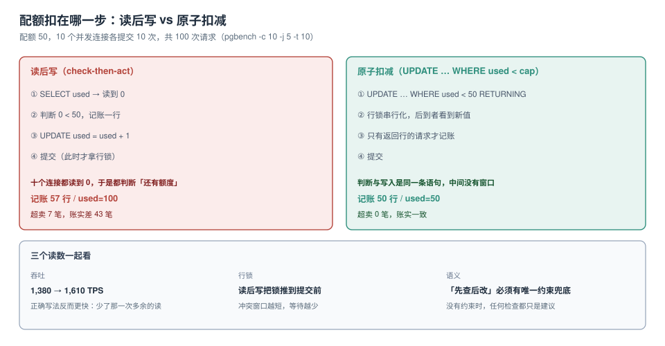

# 配额执行：扣在哪一步决定超不超卖

配额失效几乎从不是「没做配额」，而是**做在了错的位置**。网关上限流了，服务里没扣；服务里扣了，扣的是「先查后改」；扣对了，但没和账单同源。三种「做了」对应三种不同的超卖方式。

本页的全部结论来自一组 100 次并发、配额 50 的实测。



本页判据族 `QTA-A` ~ `QTA-H`，共 8 条。定义表在第七节。

## 一、三层配额，各管一段

| 层 | 管什么 | 判据来源 | 失效方式 |
| --- | --- | --- | --- |
| ① 入口（网关） | 每秒请求数、并发连接 | 内存里的令牌桶 | 多实例各算各的，总配额被放大 N 倍 |
| ② 服务 | 业务动作次数（下单、导出、调用 AI） | 数据库或 Redis 里的计数 | 先查后改，并发下超卖 |
| ③ 数据 | 存储量、行数、表数 | 定期聚合 + 触发器 | 只在账期结算，超了也不知道 |

三层不是「选一层做」，而是**各管不同的量纲**：QPS 只能入口管，存储量只能数据层管。混淆量纲是配额设计里最常见的错——用 QPS 限流器去管「本月导出次数」，怎么配都配不准。

## 二、读后写：100 次请求，记账 57 行，`used` 变成 100

场景：配额 50，10 个并发连接各提交 10 次，共 100 次请求。

```sql
-- 读后写（错误写法）
begin;
insert into usage_log(tenant, note)
  select 't1', 'naive' from quota where tenant = 't1' and used < 50;
update quota set used = used + 1 where tenant = 't1';
commit;
```

```shell
docker exec schemalab-pg pgbench -U postgres -n -c 10 -j 5 -t 10 -f /tmp/q_naive.sql mtlab
# number of transactions actually processed: 100/100
# tps = 1380.605257
```

结果：

| 指标 | 数值 | 说明 |
| --- | --- | --- |
| 记账行数 | **57** | 有 7 笔是在配额已满之后仍然被记账的 |
| `used` 最终值 | **100** | 每一次请求都执行了 `UPDATE used = used + 1` |
| 超卖 | 7 笔 | 记账侧的真实超额 |
| 账实差 | 43 笔 | `used` 比记账多 43——计数与流水对不上 |

**两个错误同时发生**：读的时候 10 个连接都读到 `0`，于是都判断「还有额度」；写的时候无条件 `+1`，于是计数跑到 100。

这类缺陷的特征是「平时对、压测才对不上」：单线程下「读 0 → 判断 → 写 1」是原子的，一旦并发就裂开。

## 三、原子扣减：50 行，0 超卖，而且更快

```sql
-- 原子扣减（正确写法）
begin;
with up as (
  update quota set used = used + 1
   where tenant = 't1' and used < 50
  returning used
)
insert into usage_log(tenant, note) select 't1', 'atomic' from up;
commit;
```

| 指标 | 读后写 | 原子扣减 |
| --- | --- | --- |
| 记账行数 | 57 | **50** |
| `used` 最终值 | 100 | **50** |
| 超卖 | 7 | **0** |
| TPS | 1,380 | **1,610** |

**正确写法反而快 16.7%**。原因是读后写多了一次 `SELECT`，并且 `UPDATE` 无条件执行，导致 100 次行锁竞争；原子扣减只有 50 次真的更新了行，其余 50 次在 `WHERE` 就被挡掉，连锁都不用等。

::: tip 一条可迁移的经验
凡是「判断 + 修改」的组合，先问一句：**能不能把判断写进 `WHERE`**。
能，就变成一条语句；不能，才需要锁。多租户里的配额、库存、席位、余额全是这个形状。
:::

## 四、预留 - 结算 - 释放：三段式

「一次业务动作消耗多少配额」往往在动作开始前不确定（导出多少行？调用了多少 token？）。这时用三段式：

| 阶段 | 动作 | 失败时 |
| --- | --- | --- |
| 预留 | `UPDATE quota SET reserved = reserved + est WHERE used + reserved + est <= cap` | 直接拒绝，无需补偿 |
| 结算 | `UPDATE quota SET reserved = reserved - est, used = used + actual` | 按实际用量修正 |
| 释放 | `UPDATE quota SET reserved = reserved - est` | 业务失败时归还 |

```sql
-- 预留：est 是预估量，actual 是实际量
update quota
   set reserved = reserved + :est
 where tenant = :t and used + reserved + :est <= cap
returning id;
-- 0 行 = 额度不足，直接 429
```

三个必须处理的边界：

1. **结算量超过预估值**：`actual > est` 时要么允许（软限），要么拒绝并把 `est` 调大（硬限）。必须有明确选择，不能「看情况」。
2. **结算永远不来**：进程崩溃、消息丢失。需要一个「预留超时自动释放」的清扫任务，否则 `reserved` 会永久占用额度。
3. **释放两次**：用状态机（`RESERVED → SETTLED / RELEASED`）加唯一约束，保证幂等。

## 五、软限与硬限：两种产品语义，两套代码

| 语义 | 超额时的行为 | 适合 | 实现要点 |
| --- | --- | --- | --- |
| 硬限 | 直接拒绝（429） | 存储量、席位、API 次数 | `WHERE used < cap` 是唯一闸门 |
| 软限 | 允许超额，按超额单价计费 | 流量、调用量 | 需要「超额单价」与「封顶」两道规则 |
| 突发 | 允许短时超过均值，长期受限 | QPS | 令牌桶，`rate` + `burst` |

「软限 + 不封顶」是最危险的一种组合：客户可以在一夜之间产生一张付不起的账单。所以软限必须配一个**绝对上限**（比如月账单的 3 倍），触顶后转为硬限。

::: danger 三条必须避免的配额写法
1. **`if (used < cap) { used++ }`**：这是读后写，并发下必然超卖。改成一条 `UPDATE … WHERE used < cap`。
2. **在 Redis 里 `INCR` 之后再判断**：`INCR` 是原子的，但「先加再判断」会多算一次，需要 `DECR` 回滚；更稳的是 `INCR` 后用返回值判断，超了再 `DECR`，并接受极短窗口内的超发。
3. **配额缓存在本地内存**：多实例部署时，每个实例各有一份配额，实际总配额 = 配置值 × 实例数。至少要「本地做粗限、中心做细限」。
:::

## 六、429 的语义与重试

| 状态码 | 语义 | 客户端应该做什么 |
| --- | --- | --- |
| 429 | 你太快了 / 额度用完了 | 读 `Retry-After`，退避重试，或提示升级 |
| 403 | 你没权限 | 不要重试，去改权限 |
| 503 | 我这边坏了 | 退避重试，或切换备用 |
| 507 | 存储不足 | 提示清理或扩容 |

配额耗尽**必须**用 429，并且带两个信息：`Retry-After`（多久后可以再试）与一个业务错误码（哪个配额耗尽了）。

```http
HTTP/1.1 429 Too Many Requests
Retry-After: 3600
Content-Type: application/json

{"code": "QUOTA_EXCEEDED", "quota": "export_rows", "limit": 1000000, "used": 1000000, "reset_at": "2026-11-01T00:00:00Z"}
```

把 `quota`、`limit`、`used`、`reset_at` 都返回，客户端的「配额提示」就不用问后端了。

## 七、配额与计量的关系：同一个口径

配额和账单必须**同源**：配额按「导出 100 万行」算，账单也按「导出 100 万行」算。如果配额按请求数、账单按行数，就会出现「配额还有、账单已经爆了」。

| 项 | 配额 | 账单 | 必须一致的部分 |
| --- | --- | --- | --- |
| 计量单位 | 行 / 次 / GB | 行 / 次 / GB | **单位定义** |
| 计量窗口 | 实时（滑动或固定） | 按月 | 窗口不同可以，单位必须同 |
| 去重键 | 请求 ID | 事件 ID | 一次动作一个 ID |
| 结算时点 | 动作发生时 | 账期结束 | 可不同，但要能对账 |

对账的做法：每天跑一次「配额计数 vs 计量事件求和」，差异超过阈值就告警。这条对账能抓到 90% 的口径错位。

## 八、本页判据

| 编号 | 判据 | 看什么现象 | 不满足时改哪里 |
| --- | --- | --- | --- |
| `QTA-A` | 配额扣减是单条原子语句 | 代码里没有「先 SELECT 再 UPDATE」 | 改成 `UPDATE … WHERE used < cap` |
| `QTA-B` | 并发下有 0 超卖的实测 | 用 `pgbench` 跑过，记账数等于配额 | 见第 2、3 节 |
| `QTA-C` | 三段式有状态机与幂等 | 预留/结算/释放有状态与唯一约束 | 补状态机 |
| `QTA-D` | 有预留超时的清扫任务 | 定时任务能释放孤儿预留 | 补清扫 + 告警 |
| `QTA-E` | 软限有绝对上限 | 配置里有 `hard_cap` | 补封顶 |
| `QTA-F` | 超额返回 429 + `Retry-After` + 业务码 | 抓包可见四要素 | 统一错误响应 |
| `QTA-G` | 多实例部署时配额是集中的 | 总配额不随实例数放大 | 中心化计数（DB 或 Redis） |
| `QTA-H` | 配额与账单单位同源，且每日对账 | 有对账任务与差异告警 | 见第 7 节 |

## 与「推理请求调度与批处理」专题的分工

| 问题 | 本页回答 | 调度专题回答 |
| --- | --- | --- |
| 每个租户能发多少 | ✅ 令牌桶、配额原子性 | ✅ 限完之后在同一个批里怎么排 |
| 租户之间怎么不互相影响 | ✅ 隔离三档、公平排队 | ✅ 分级与防饿死（配额 + 老化） |
| 单个租户内长短请求混杂 | 不涉及 | ✅ 短优先与饿死边界 |

**本页特有的一个坑**：配额只管「进不进得来」，不管「进来后谁先算」。实测（80% 短请求 / 20% 长请求、8 个批位）：饱和时 FCFS 下短请求 TTFT p50 是 **120,022 ms**，加两级优先后降到 **3,437 ms**（35 倍），代价是长请求 p99 涨 15.6%。也就是说**配额做完了但没做分级，体验仍然会被长请求拖死**。详见[服务分级](../../../AI/InferenceScheduling/SLO/index.md)。

## 参考资料

- PostgreSQL 18 Documentation：*UPDATE*（`RETURNING` 与 `WHERE` 条件下的并发语义）、*Transaction Isolation*（`READ COMMITTED` 下的行锁行为）
- PostgreSQL 18 Documentation：*pgbench*（`-c` / `-j` / `-t` 与自定义脚本 `-f`）
- RFC 6585：*Additional HTTP Status Codes*（429 Too Many Requests 的定义与 `Retry-After`）
- 本仓库：[噪声邻居](../NoisyNeighbor/index.md)、[分布式锁](../../DistributedLock/index.md)、[计量与账单](../MeteringBilling/index.md)
- 本仓库项目侧：[TeamBoard 计量与配额](../../../../project/Complete/TeamBoard/TenantMetering/index.md)
