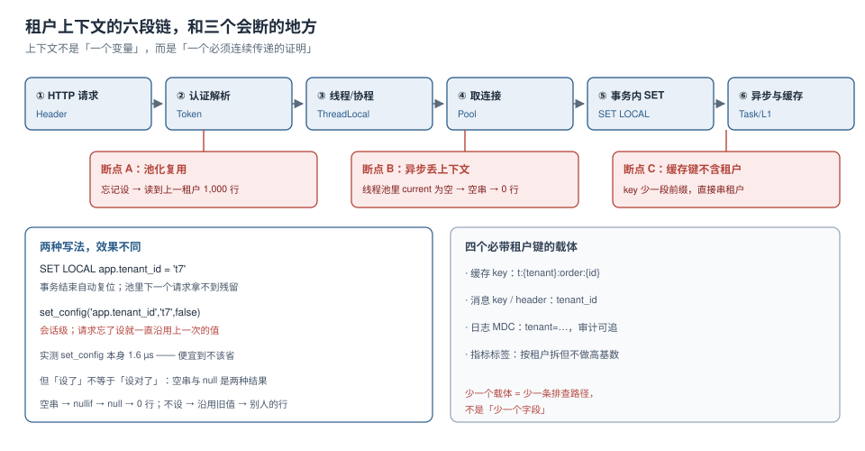

# 租户上下文：六段链与三个断点

租户上下文常被当成「一个变量」——请求进来时解析出来，塞进 `ThreadLocal`，需要的地方取一下。但只要中间有一环没接上，这个变量就会变成三种不同的东西：**正确的值**、**空值**、**上一个请求的值**。第三种最危险，因为它不报错。

本页把上下文当成一条**必须连续传递的证明**，逐段看它在哪儿断。



本页判据族 `CTX-A` ~ `CTX-H`，共 8 条。定义表在第七节。

## 一、六段链，每段都可能断

| 段 | 上下文以什么形式存在 | 谁负责传递 | 断了的后果 |
| --- | --- | --- | --- |
| ① HTTP 请求 | 一个 Header 或路径参数 | 网关 / 客户端 | 整个请求没有租户身份 |
| ② 认证解析 | Token 里的 claim，或 Header 与 Token 的交叉校验 | 认证过滤器 | 用了 Header 里伪造的租户 |
| ③ 线程 / 协程 | `ThreadLocal` / `Context` | 框架的上下文传播 | 异步分支里读到空 |
| ④ 取连接 | 池里的物理连接 | 连接池 / 数据源 | 拿到一条带着旧上下文的连接 |
| ⑤ 事务内 `SET` | 数据库会话变量 | 拦截器 / 事务模板 | 策略读到空串 → 0 行 |
| ⑥ 异步与缓存 | 任务参数、消息头、缓存键 | 每个调用点 | 后台任务串租户，缓存命中串租户 |

前三段是**应用内部**的事，后三段是**跨越进程/存储边界**的事。跨边界的每一段都必须**把租户显式写进参数**，不能指望「上下文会自动跟着走」。

## 二、断点 A：池化复用

这是最常见、也最难复现的一个。

```sql
-- 同一条物理连接，连续服务两个请求
select set_config('app.tenant_id', 't3', false);   -- 请求 1：设了
select count(*) from mt_shared.orders;             -- 1000（正确）

select count(*) from mt_shared.orders;             -- 请求 2：没设 —— 仍是 1000
```

请求 2 拿到了请求 1 的租户。它没有报错，因为策略**认为上下文是合法的**。

### 为什么「忘了设」比「设错了」更常见

因为「设上下文」通常放在一个**拦截器**里，而拦截器有排除名单：健康检查、静态资源、内部回调、缓存预热……每加一条排除路径，就多一个不设上下文的入口。而这些入口里，只要有一个会读数据库，就会读到残留值。

### 两种写法，两种后果

| 写法 | 作用域 | 事务结束 | 池复用风险 |
| --- | --- | --- | --- |
| `SET LOCAL app.tenant_id = 't7'` | 事务 | 自动复位 | 无 |
| `set_config('app.tenant_id', 't7', true)` | 事务 | 自动复位 | 无 |
| `set_config('app.tenant_id', 't7', false)` | **会话** | **不复位** | **有** |

前两种等价，都绑定在事务上；第三种绑定在连接上。**能不能用会话级，取决于你敢不敢保证「每条路径都设」。**

实测 `set_config` 本身的开销是 **1.6 µs**（2,000 次 3.1 ms），所以「为了省一次设置」而用会话级写法，省下的成本可以忽略，风险却是整条链路。

::: danger 三个必须避开的写法
1. **在自动提交模式下用 `set_config(..., true)`**：事务级设置在 autocommit 下**静默失效**——下一条语句读到的是空值，不报错。必须在一个显式事务里设。
2. **把上下文设成空串当作「清空」**：空串经 `nullif` 变成 `null`，策略变成「一行都不返回」。清空的正确做法是 `RESET app.tenant_id` 或让事务结束。
3. **在连接池的 `borrow` 回调里「补设」上下文**：补设只能治「忘了设」，治不了「设了但设成别人的」——后者需要**校验**（Token 里的租户与 Header 里的租户必须一致），不是补设。
:::

## 三、断点 B：异步丢上下文

同步链路里，上下文靠 `ThreadLocal` 传递；一旦进入线程池、`CompletableFuture`、`@Async`、定时任务、消息消费，`ThreadLocal` 就断了。

```java
// 错误：ThreadLocal 不会跟着任务走
executor.submit(() -> orderService.close(orderId));

// 正确：把租户显式放进任务参数
String tenant = TenantContext.require();
executor.submit(() -> TenantContext.runAs(tenant, () -> orderService.close(orderId)));
```

`require()` 与 `get()` 的区别很关键：`get()` 返回 `null` 时，下游会把它当成「没设」；`require()` 直接抛异常，把「静默串租户」变成「快速失败」。

::: tip 判断该用哪个的一句话
**用户请求路径上用 `get()`**（允许缺省），**后台任务与消息消费里用 `require()`**（缺省就是 bug）。
:::

### 消息与定时任务的两个额外要求

1. **消息必须带 `tenant_id`**，且消费端**不信任**消息体的其他字段来自哪个租户——以消息头为准，与库里的记录做一次校验。
2. **定时任务必须按租户遍历**，而不是「一次查全表」。后者在共享表模式下等价于 `BYPASSRLS`，是最容易写出跨租户逻辑的地方。

## 四、断点 C：缓存键不含租户

```text
# 错误
order:1001            → 两个租户的订单 1001 会撞在一起
user:zhangsan

# 正确
t:t7:order:1001
t:t7:user:zhangsan
```

缓存键的问题在于它**不在数据库的审计范围里**：策略再严，缓存命中时根本不会走到数据库。

三个必须带租户的载体，缺一个就少一条排查路径：

| 载体 | 形式 | 缺了会怎样 |
| --- | --- | --- |
| 缓存 key | `t:{tenant}:{biz}:{id}` | 串租户，且无审计痕迹 |
| 消息 key / header | `tenant_id` 字段或消息属性 | 消费端不知道为谁干活 |
| 日志 MDC | `tenant=…` | 出事后无法按租户过滤日志 |
| 指标标签 | 按租户拆，但**慎用** | 高基数，见下 |

::: warning 指标标签的基数陷阱
把 `tenant_id` 直接做成 Prometheus 标签，1 万个租户就是 1 万个时间序列 × 每个指标。常见做法是**三层拆分**：

- 全局指标不带租户标签（总量、错误率）；
- TOP N 租户带标签（按用量取前 20，定期滚动）；
- 单租户排查走日志与链路，不走指标。
:::

## 五、空串与 null：两种失败，两种症状

```sql
-- 策略定义
create policy p_tenant on orders
  using (tenant_id = nullif(current_setting('app.tenant_id', true), ''));
```

| 上下文状态 | `current_setting(..., true)` | `nullif(...)` 后 | 策略结果 | 用户看到 |
| --- | --- | --- | --- | --- |
| 设为 `t7` | `'t7'` | `'t7'` | 匹配 t7 的行 | 正常 |
| 设为空串 | `''` | `null` | `tenant_id = null` → `null` | **0 行** |
| 从未设置 | `null` | `null` | 同上 | **0 行** |
| 会话残留 | `'t3'` | `'t3'` | 匹配 t3 的行 | **别人的数据** |

前两行是「fail-closed」，第三行是「越权」。**同一个策略，三种输入，两种完全不同的故障**——这就是为什么负向验收必须至少两条（见 [实战](../Practice/index.md) 的 S3 / S4）。

::: danger 不要用 `is null` 判「有没有复位」
`SET LOCAL` 在事务结束后留下的不是 `null`，而是**空串**。所以：

```sql
-- 错误：事务结束后这里返回 false
select current_setting('app.tenant_id', true) is null;

-- 正确
select nullif(current_setting('app.tenant_id', true), '') is null;
```

这个差异会让「复位检查」永远通过，从而掩盖真正的残留。
:::

## 六、一套最小可用的实现

### 应用侧：上下文对象

```java
public final class TenantContext {
    private static final ThreadLocal<String> HOLDER = new ThreadLocal<>();

    public static void set(String tenant) {
        if (tenant == null || tenant.isBlank()) {
            throw new IllegalArgumentException("tenant 不能为空");
        }
        HOLDER.set(tenant);
    }

    public static String get() { return HOLDER.get(); }

    public static String require() {
        String t = HOLDER.get();
        if (t == null) throw new IllegalStateException("tenant 上下文缺失");
        return t;
    }

    public static void clear() { HOLDER.remove(); }

    public static <T> T runAs(String tenant, Supplier<T> body) {
        String prev = HOLDER.get();
        set(tenant);
        try { return body.get(); } finally {
            if (prev == null) HOLDER.remove(); else HOLDER.set(prev);
        }
    }
}
```

注意 `runAs` 的 `finally`：**恢复**而不是清空。嵌套调用时清空会把外层的上下文一起抹掉。

### 数据侧：每次取连接就设一次

```java
// 事务模板里，进入事务的第一条语句
jdbcTemplate.execute("select set_config('app.tenant_id', ?, true)", TenantContext.require());
```

`true` 表示事务级：事务结束自动复位，池里下一条连接拿不到残留。

### 三道校验

| 校验 | 位置 | 拦什么 |
| --- | --- | --- |
| Token 的租户 == Header 的租户 | 认证过滤器 | 伪造 Header |
| 路径里的租户 ∈ 当前用户可访问的租户 | 鉴权 | 越权访问别人的租户 |
| 请求的租户 == 数据行的租户 | 库层策略 | 最后一道兜底 |

三层里**只有第三层是库层强制的**，前两层都在应用里。所以第三层不能省——前两层被绕过时，它是唯一还在的。

## 七、本页判据

| 编号 | 判据 | 看什么现象 | 不满足时改哪里 |
| --- | --- | --- | --- |
| `CTX-A` | 上下文用事务级写法而非会话级 | 代码里 `set_config` 第三个参数是 `true` | 改成事务级，或每条路径都设 |
| `CTX-B` | 有「没设上下文」的负向断言 | 不设上下文时查询返回 0 行 | 见 [实战](../Practice/index.md) 的 S4 |
| `CTX-C` | 有「会话残留」的负向断言 | 同一连接连续两请求，第二个读不到第一个的租户 | 见第 2 节 |
| `CTX-D` | 异步任务显式传租户 | 线程池任务参数里有 `tenant` | 用 `runAs` 包装，别靠 `ThreadLocal` |
| `CTX-E` | 消息带 `tenant_id` 且消费端校验 | 消费端从消息头取并与库内记录比对 | 补消息头字段 |
| `CTX-F` | 缓存键含租户前缀 | 所有业务 key 形如 `t:{tenant}:…` | 统一 key 生成器，禁止手拼 |
| `CTX-G` | 日志含 `tenant` 字段 | MDC 里能按租户过滤 | 拦截器里 `MDC.put` |
| `CTX-H` | 指标不按租户做全量标签 | 时间序列数量与租户数不成正比 | 改成 TOP N + 日志下钻 |

## 参考资料

- PostgreSQL 18 Documentation：*SET*（`LOCAL` 的作用域与事务边界）、*System Administration Functions*（`set_config` 的第三个参数）、*Row Security Policies*（策略表达式的求值身份）
- PostgreSQL 18 Documentation：*Customized Options*（`app.*` 前缀的用法与限制）
- 本仓库：[四个维度与五个必失点](../Overview/index.md)、[隔离三档](../IsolationModel/index.md)、[连接池与连接生命周期](../../../DB/ConnectionPool/index.md)
- 本仓库项目侧：[TeamBoard 租户上下文](../../../../project/Complete/TeamBoard/TenantContext/index.md)、[TeamBoard 缓存隔离](../../../../project/Complete/TeamBoard/CacheIsolation/index.md)
