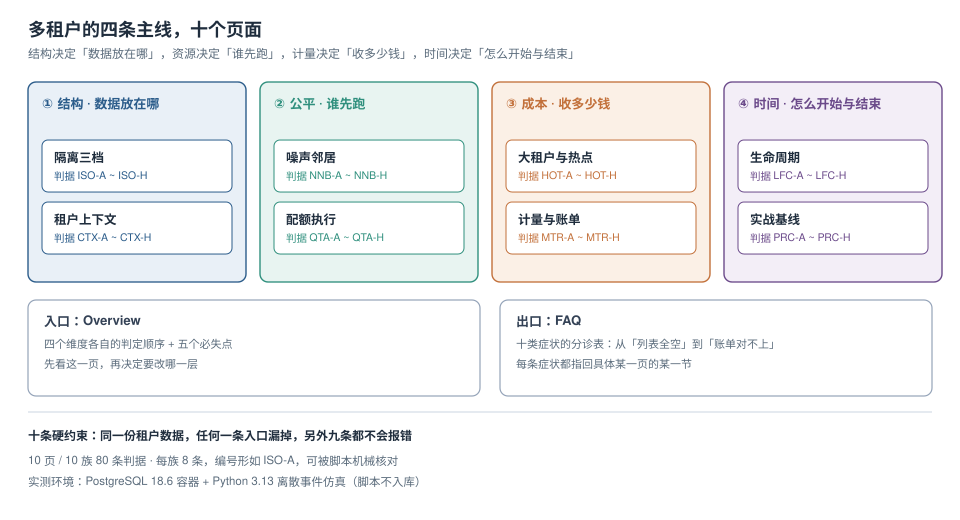

# 多租户 SaaS 架构

「多租户」听起来是一个架构选型问题：库分不分、schema 分不分、要不要加 `tenant_id`。选型做完，代码里到处带上租户条件，似乎就结束了。但真正让系统出事的不是选型，而是**选完之后那四条一直要还的账**：数据有没有真的被隔开、一个租户的突发会不会把别人拖死、这个月收的钱对不对得上他做的事、以及一个租户从开通到退出有没有留下证据。

本专题讲这四条主线各自的判定规则、**在哪儿会静默失效**，以及怎么用一组可复跑的读数把「看起来对」变成「测过对」。

::: tip 一句话理解
多租户不是「一张表加一列」，而是**同一套代码、同一份资源、同一个数据库，对 N 个客户同时承诺四件事**：你看不见别人、你被人挤不到、你付的钱对得上、你来去都有账。
:::

::: info 本专题与相邻专题的分工
本专题只回答「**机制层**的为什么与怎么判」。十处最容易混淆的邻居，边界一次写死：

| 相邻专题 | 那边回答什么 | 本专题回答什么 |
| --- | --- | --- |
| [TeamBoard 多租户](../../../project/Complete/TeamBoard/MultiTenancy/index.md) | 项目侧的租户隔离落地（三级模型、`tenant_id` 进主键、RLS 的完整 DDL） | 三档隔离的**取舍算式**与迁移路径：什么量级该换档 |
| [TeamBoard 计量与配额](../../../project/Complete/TeamBoard/TenantMetering/index.md) | 项目侧的计量表结构与配额执行落地 | 计量口径的三条误差、配额扣减的并发语义 |
| [TeamBoard 租户上下文](../../../project/Complete/TeamBoard/TenantContext/index.md) | 项目侧的上下文四层传播实现 | 传播链的六个断点与「空串 vs null」的判定 |
| [TeamBoard 缓存隔离](../../../project/Complete/TeamBoard/CacheIsolation/index.md) | 项目侧的缓存键改造 | 缓存键、消息 key、日志 MDC 三个载体的统一纪律 |
| [数据库访问控制](../../DB/AccessControl/index.md) | 库层的角色、RLS 策略、审计取证 | 同一套 RLS 在「租户」这个维度上怎么用、性能代价多少 |
| [连接池与连接生命周期](../../DB/ConnectionPool/index.md) | 借还路径、池的数学、泄漏定位 | 池复用后**租户上下文的残留**与复位写法 |
| [分布式锁](../DistributedLock/index.md) | 锁的正确性与续期 | 配额扣减为什么不该用锁，而该用一条 `UPDATE` |
| [高并发系统设计](../HighConcurrency/index.md) | 限流、降级、舱壁的通用手法 | 「按租户」这个维度的公平性：轮转、配额、舱壁三者的差别 |
| [可观测性](../../Ops/Observability/index.md) | 指标、日志、链路的通用体系 | 租户作为标签的基数陷阱与取舍 |
| [容量与成本](../../Ops/CapacityCost/index.md) | 容量规划、成本分摊的通用方法 | 多租户下的分摊口径为什么必须与计量口径同源 |
:::

## 目录

- [四个维度与五个必失点](Overview/index.md)
- [隔离三档：成本、体积与迁移路径](IsolationModel/index.md)
- [租户上下文：六段链与三个断点](TenantContext/index.md)
- [噪声邻居：公平排队的代价与收益](NoisyNeighbor/index.md)
- [配额执行：扣在哪一步决定超不超卖](QuotaEnforcement/index.md)
- [大租户与热点：倾斜、分片与单元化](HotTenant/index.md)
- [计量与账单：从事件到一行可解释的账](MeteringBilling/index.md)
- [生命周期：八个状态与一条没有入边的迁移](Lifecycle/index.md)
- [实战：一套可验收的多租户基线](Practice/index.md)
- [常见问题与分诊](FAQ/index.md)

## 专题地图

## 判据纪律

沿用全库写法：**每页 8 条，编号形如 `ISO-A`**，逐页前缀唯一，可被 `utils/audit` 下的判据类巡检机械核对。每条判据都要能回答三件事：**看什么现象、判成什么、不满足时改哪里**。

| 页 | 判据族 | 条数 | 这一族管什么 |
| --- | --- | --- | --- |
| 四个维度与必失点 | `MTO-A` ~ `MTO-H` | 8 | 四条主线的判定顺序、五个必失点、归属判断 |
| 隔离三档 | `ISO-A` ~ `ISO-H` | 8 | 三档的成本与体积、迁移触发条件、备份与还原 |
| 租户上下文 | `CTX-A` ~ `CTX-H` | 8 | 传播链、复位写法、空串与 null、四个载体 |
| 噪声邻居 | `NNB-A` ~ `NNB-H` | 8 | 共享队列、轮转、限流、舱壁、膝点 |
| 配额执行 | `QTA-A` ~ `QTA-H` | 8 | 扣减原子性、预留与结算、软硬限、429 语义 |
| 大租户与热点 | `HOT-A` ~ `HOT-H` | 8 | 倾斜度量、分片键、扩容搬迁、单元化 |
| 计量与账单 | `MTR-A` ~ `MTR-H` | 8 | 去重键、采样误差、迟到、分摊口径、可解释性 |
| 生命周期 | `LFC-A` ~ `LFC-H` | 8 | 状态机可达性、开通幂等、升降配、退出与冷静期 |
| 实战 | `MTP-A` ~ `MTP-H` | 8 | 基线清单、十条验收、负向断言、复跑方式 |
| 常见问题 | `MTQ-A` ~ `MTQ-H` | 8 | 症状分诊、自查清单、常见错误建议 |

合计 **10 族 80 条**。

## 事实与版本速览（2026-10 核对）

| 项 | 现状 | 对本专题的影响 |
| --- | --- | --- |
| PostgreSQL | 18.x（本机实测 **18.6**） | 所有 SQL 与读数都在 18.6 上跑过；`SET LOCAL`、`current_setting`、行级策略的行为以 18 为准 |
| 行级策略的执行身份 | 表所有者默认绕过，需 `FORCE` | 「开了 RLS」与「真隔离」之间差一个 `FORCE`，本文反复用到这条 |
| `set_config(..., true)` | 事务级，事务外**静默失效** | 自动提交下用它设上下文，等于没设 |
| `hashtext()` 的稳定性 | 跨大版本**不保证**稳定 | 用它算分片号必须把结果落表，不能在扩容时重算 |
| 一致性哈希 | 无标准实现，虚拟节点数决定均衡度 | 100 个虚节点时 8 节点最大/最小约 1.37 |
| 配额语义 | 无标准，取决于产品定义 | 「软限 / 硬限 / 预留」三种语义的代码完全不同 |
| `pgbench` | PostgreSQL 自带，无需额外安装 | 本专题的并发读数用它生成，读者可复跑 |

::: warning 关于「实测」的诚实标注
本专题的数字分两类，正文逐处标注：

- **本机可复跑**：PostgreSQL **18.6** 容器（`docker run postgres:18`）+ Python **3.13** 标准库，macOS x64。
  建表与查询的脚本都写进页面，**脚本本身不入库**；噪声邻居与生命周期用离散事件仿真与 BFS，
  代码片段在对应页给全。用途是比较不同写法的量级差，不是生产绝对值。
- **文档口径**：产品语义（配额、账单、生命周期）没有「官方默认值」，凡是本文给出的写法，
  都是**一种**可验收的约定，不是唯一答案。

三处必须说清的局限：① 本机读数是单机空载，**并发下的行锁等待**会随事务长度变化，不要直接当 SLA；
② 隔离三档的比较以 PostgreSQL 为主，MySQL 的分区表与 schema 语义只在对照处出现，**未做 MySQL 侧实测**；
③ 仿真里的服务时间固定为 20 ms，真实服务的分布长尾会放大 p99，但不会改变策略之间的相对结论。
:::

## 三条底线

1. **隔离的正确性不能依赖应用代码的自觉**：本机实测，同一条连接在「上一个请求设了上下文、这一个请求忘了设」时会静默返回上一个租户的 1,000 行——没有报错、没有日志、没有任何异常。库层能兜住的只有 `FORCE` 策略 + 非所有者身份 + 唯一约束，**三层缺一层就漏**。
2. **公平与吞吐是两笔账，不能同时最大化**：共享 FIFO 队列下，轻租户 p50 被拖到 **18,786 ms**；改成每租户轮转后是 **1.9 ms**，代价是重租户 p50 从 2,097 涨到 2,407 ms（+14.8%）。公平不是免费的，但它应该只让**制造噪声的人**付。
3. **账单必须能一路追到事件**：采样 1% 时单租户估算误差可达 **2.16%**，重复事件不去重会**超收 0.50%**。这两笔钱都不是「四舍五入」，而是能被客户逐条对出来的差异；账算不清时，最先崩的不是财务，是信任。

## 场景跳转

| 你现在的处境 | 从这里开始 |
| --- | --- |
| 刚接手一套已经在跑的多租户系统 | [四个维度与五个必失点](Overview/index.md) → [实战](Practice/index.md) 的十条验收 |
| 正在做隔离选型 | [隔离三档](IsolationModel/index.md) |
| 线上出现「看到别人的数据」 | [租户上下文](TenantContext/index.md) → [FAQ](FAQ/index.md) 第一列 |
| 某个租户一进来全站变慢 | [噪声邻居](NoisyNeighbor/index.md) → [大租户与热点](HotTenant/index.md) |
| 配额形同虚设 / 账单对不上 | [配额执行](QuotaEnforcement/index.md) → [计量与账单](MeteringBilling/index.md) |
| 要做租户开通与退出的自动化 | [生命周期](Lifecycle/index.md) |

## 参考资料

- PostgreSQL 18 Documentation：*Row Security Policies*（`ENABLE` / `FORCE` / `USING`）、*SET*（`SET LOCAL` 的作用域）、*System Administration Functions*（`set_config` / `current_setting`）、*Monitoring Database Activity*（`pg_stat_activity`）
- PostgreSQL 18 Documentation：*CREATE DATABASE*（模板库与复制成本）、*Schemas*、*pg_dump*（`--schema-only`）
- `pgbench` 官方文档：自定义脚本 `-f`、并发与事务数参数
- Martin Fowler：*MultiTenantData*（三种隔离模式的经典分类）、*Segmented Log* 相关讨论中关于分片键的选择
- 本仓库相邻专题：[数据库访问控制](../../DB/AccessControl/index.md)、[连接池与连接生命周期](../../DB/ConnectionPool/index.md)、[高并发系统设计](../HighConcurrency/index.md)、[容量与成本](../../Ops/CapacityCost/index.md)
