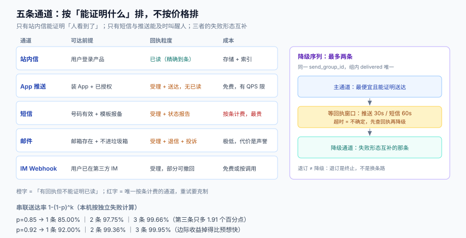

# 通道矩阵：每组通道能保证什么、不能保证什么

选通道的时候，大家比较的是「哪个便宜」「哪个到达率高」。真正决定架构的是另外三个问题：**这条通道能不能证明送到、能不能撤回、失败之后谁来兜**。三个问题都有明确答案的通道只有一种，而它恰好是最贵的那个。

本页给一张按「保证」而不是按「价格」排的通道矩阵，然后回答两个工程问题：降级序列怎么定、降级怎么保证不重复发。



本页判据族 `NDC-A` ~ `NDC-H`，共 8 条。定义表见文末「本页判据」一节。

## 一、五条通道的能力矩阵

下列「回执」一列是本页最重要的一列，它决定了你能承诺给用户的到底是什么。

| 通道 | 可达前提 | 单条上限 | 富文本 | 回执粒度 | 典型时延 | 成本量级 | 可撤回 |
| --- | --- | --- | --- | --- | --- | --- | --- |
| **站内信** | 用户登录产品 | 无硬限（建议 ≤ 2 KB） | 完整（含链接、按钮） | **已读可精确到条** | 实时（同库写入） | 存储 + 索引 | 能（未读可撤） |
| **App 推送** | 装 App + 已授权 + token 有效 | 标题 ~40 字、正文 ~120 字（各家不同） | 受限（图片、按钮看平台） | 受理 + 送达（**无「已读」**） | 秒级，厂商通道可能排队 | 免费，有 QPS 限额 | 不能 |
| **短信** | 手机号有效 + 已报备签名与模板 | 70 字/条（长短信按 67 字/条拼接计费） | 无（纯文本，可带短链） | 提交 + 状态报告（**运营商级，可能缺**） | 秒级到分钟级 | 按条计费，最贵 | 不能 |
| **邮件** | 邮箱存在 + 未进垃圾箱 | 无硬限（建议 ≤ 100 KB） | 完整 HTML + 内联 CSS | 受理 + 退信 + 投诉（**无「已读」可信数据**） | 秒级到分钟级 | 极低（自建）/ 按量（SES 类） | 不能 |
| **IM Webhook** | 用户已在第三方 IM 内 | 看平台（常见 4 KB） | Markdown / 卡片 | 受理 + 部分平台的「已读」 | 秒级 | 免费或按调用 | 有限（部分平台支持撤回） |

三个结论直接从表里读出来：

1. **只有站内信能证明「人看到了」**。这也是为什么所有「消息中心」都必须存在——它是唯一能承载「已读」语义的通道。
2. **推送与短信的可达性前提最脆弱**：一个是「用户授权过且 token 没过期」，一个是「号码还有效且模板报备过」。这两条前提都会**在你不发送的时候悄悄失效**。
3. **邮件是唯一「便宜到可以兜底」的通道**，但它的兜底能力受声誉约束——一封营销投诉会污染整个域（见[邮件送达工程](../../EmailDeliverability/index.md)）。

## 二、回执语义：三种「成功」不能混用

同一个单词 `delivered` 在三条通道上指三件不同的事：

| 状态 | 站内信 | 推送 | 短信 | 邮件 |
| --- | --- | --- | --- | --- |
| `accepted`（已受理） | 已写库 | 通道方返回 `message_id` | 网关返回 `msg_id` | SMTP 250 |
| `delivered`（已送达） | 前端拉取到 | 设备收到（部分厂商可回执） | 运营商状态报告 `DELIVRD` | 无（只能靠「没退信」推断） |
| `read`（已读） | 有 | **无** | **无** | **无**（像素追踪不可信） |
| `failed`（失败） | 写库失败 | token 失效、限额、参数错 | 空号、停机、黑名单、模板不匹配 | 550 类硬退信 |
| `complained`（投诉） | — | 用户关闭通知 | 用户举报（运营商可下发） | 垃圾邮件投诉（FBL） |

::: danger 注意
1. **不要用 `delivered` 做「用户知道了」的判断**。短信 `DELIVRD` 只代表运营商侧投递成功，手机关机时也可能先回 `DELIVRD`；邮件根本没有送达回执。把「已送达」当「已知晓」写进业务规则（例如「发货通知已送达，所以视为用户已知发货」），在纠纷里站不住。
2. **不要把「没有退信」当「已送达」**。邮件有大量静默丢弃（进垃圾箱、被规则归档），`250 OK` 之后的命运你无从得知。判断邮件效果只能用**点击**与**投诉**两个信号。
3. **回执可能永远不来**。运营商状态报告丢失率不是零，Web Push 的 `endpoint` 也可能直接 410 而不给任何解释。所以状态机必须允许 `accepted` 在超时后落成 `unknown`，而不是永远挂着。
:::

## 三、降级序列：什么时候串、串几条

降级（fallback）的本质是**用成本换到达率**。它的算术很朴素：若每条通道独立失败，`k` 条串联的到达率是 `1-(1-p)^k`。本机按此式计算：

| 单通道到达率 p | 1 条 | 2 条串联 | 3 条串联 |
| --- | --- | --- | --- |
| 0.85 | 85.00% | **97.75%** | **99.66%** |
| 0.92 | 92.00% | 99.36% | 99.95% |

从 85% 到 97.75% 只多花一条通道的钱，收益是 12.75 个百分点；从 97.75% 到 99.66% 要再花一条，只多 1.91 个百分点。**边际收益掉得比谁想的都快**，所以三条以上的串联基本不值——除非这条通知的失败成本极高（验证码、扣款失败）。

但「独立失败」这个前提经常不成立，这决定了什么时候**不该串**：

| 场景 | 两条通道的失败是否独立 | 结论 |
| --- | --- | --- |
| 推送 + 短信 | 基本独立（不同基础设施） | 可以串 |
| 邮件 + IM Webhook | 基本独立 | 可以串 |
| 同厂商的双通道（如两个短信供应商） | **部分相关**（同一号段、同一运营商） | 串联收益打折，但仍值得 |
| 站内信 + 推送 | **强相关**（都依赖「用户还在用这个 App」） | 串起来几乎无用：用户卸载后两条都到不了 |

::: tip 一条可执行的选择规则
**主通道 = 该类别里「最便宜且能证明送达」的那条；降级通道 = 失败形态互补的那条，最多一条。**
验证码选「短信主 + 推送降级」（推送失败形态是 token，短信失败形态是号码）；订单通知选「站内信主 + 推送提醒」（站内信保证可回溯，推送保证及时）。**营销活动不串通道**——到不了就是不该打扰，串通道等于绕过用户的沉默。
:::

## 四、降级不重复发：一个 `send_group_id` 解决

降级最典型的 bug 是「两条都发出去了」：主通道超时（实际成功了），系统判定失败，立刻发降级通道，用户收到两条。

三条工程约束可以把它压到接近零：

1. **主通道的「失败」必须区分「确定失败」与「不确定」**。超时属于不确定，此时应**先查回执**（`message_id` 存在即视为已提交），而不是直接降级。本机关于重试放大的读数支持这一点：6 秒总预算下，单次超时设 0.5 秒会把尝试次数放大到 **12 倍**（见[投递与回执](../Delivery/index.md)），降级的触发频率会被同样的机制放大。
2. **降级带同一个 `send_group_id`**，通道侧与自己的投递记录都用它做去重维度。降级不是「再发一条」，而是「同一组的另一个尝试」。
3. **降级有最小间隔**。主通道提交后至少等一个「合理回执窗口」（推送 30 秒、短信 60 秒、邮件 5 分钟）再降级，否则降级会在主通道还在路上时发生。

```sql
-- 投递记录表的关键列：一个 send_group 下最多一条 delivered
create table notification_delivery (
  id             bigserial primary key,
  send_group_id  uuid not null,
  attempt_no     smallint not null,
  channel        text not null check (channel in ('inbox','push','sms','email','im')),
  target         text not null,           -- 地址快照，不引用用户表
  state          text not null check (state in ('accepted','delivered','read','failed','complaint','unknown')),
  provider_msg_id text,
  error_code     text,
  created_at     timestamptz not null default now(),
  updated_at     timestamptz not null default now(),
  unique (send_group_id, attempt_no)
);

-- 同一组内只要有一条 delivered，后续尝试不允许再发出（应用层闸门 + 这条查询）
create index on notification_delivery (send_group_id, state);
```

判据是**一条 SQL 就能验的**：同一 `send_group_id` 下 `state='delivered'` 的行数必须 ≤ 1；若 > 1，说明降级闸门失效。

## 五、失效地址：三种形态与三种动作

通道矩阵里最贵的一列不是成本，是「地址会失效」：

| 失效形态 | 信号 | 该做什么 | 不该做什么 |
| --- | --- | --- | --- |
| 推送 token 失效 | FCM `UNREGISTERED`、Web Push **410/404** | **立刻删除**该 token，并记录「最后一次有效时间」 | 重试（重试一万次也不会变有效） |
| 手机号空号/停机 | 状态报告 `UNDELIV` + 特定错误码 | 标记号码「可疑」，**转人工或降级到其他通道**，连续 N 次后停发 | 直接删除号码（可能是临时停机） |
| 邮箱硬退信 | SMTP 550 类 | 立即停发该地址；软退信（4xx）累计 3~5 次后停 | 对 550 继续重试（伤声誉） |
| 用户主动关闭通知 | 系统设置里关闭 | 尊重，降级到站内信 | 反复弹「请开启通知」 |

这里有一个容易做反的地方：**token 失效要立刻删，手机号失效要延迟删**。原因是 token 是设备级、一次性凭据（重装即换），删了没有副作用；号码是身份级、可能临时不可达，删了会丢掉用户。把两者用同一套「清理策略」处理，一定有一边是错的。

## 六、成本与限额：三条容易踩的线

1. **短信按「条」计费，而「条」由编码决定**。70 个字符（含签名）算一条，超出按 67 字符/条拼接，每条都计费。一条带长链接的营销短信很容易变成 2~3 条——**这也是短链在短信里存在的真正原因**，不是美观。
2. **推送免费但有 QPS 限额**，且限额是「按项目/按应用」而非按用户。活动瞬间打满限额，最先被限流的往往是**同一项目下的验证码**——除非你把事务型与营销型拆成两个应用/两个凭据。
3. **邮件的「成本」是声誉而不是钱**。批量发信人（Gmail/Yahoo 口径 5,000 封/天/服务商）必须满足 SPF+DKIM+DMARC 对齐、一键退订、投诉率 < 0.3%。把营销邮件与事务邮件混在一个域发，等于把验证码的送达率押在营销名单的质量上。

## 七、通道选择的决策顺序

```text
1. category 是否事务型？
     → 是：选「能证明送达且失败形态互补」的两条串联（短信主 + 推送降级）
2. 用户对这条通道是否可达（token/号码/邮箱有效性）？
     → 否：直接走下一顺位，不浪费一次尝试
3. 该通道是否在静默时段？category 是否豁免？
     → 不豁免：压后到窗口开启，转站内信立即发
4. 该用户在该类别该通道是否退订？
     → 是：不发（不是降级，是终止）
5. 频控是否还有配额？
     → 否：折叠进 digest 或丢弃（按类别定）
6. 以上全过：发主通道，进回执状态机，超时按「不确定」处理
```

第 4 步值得单独强调：**退订是终止，不是降级**。把「用户退了短信」实现成「改发推送」，是很多系统真实存在的 bug，也是投诉率的主要来源之一。

## 八、本页判据

| 编号 | 看什么现象 | 判成什么 | 不满足时改哪里 |
| --- | --- | --- | --- |
| `NDC-A` | 通道能力表里是否标出每条通道的「回执粒度」 | 只写「支持回执」即失败 | 拆成受理/送达/已读/投诉四档，逐通道填 |
| `NDC-B` | 是否有任何业务逻辑把 `delivered` 当「用户已知晓」 | 有即失败 | 业务状态只由用户动作驱动，不读 `delivered` |
| `NDC-C` | 降级序列是否 ≤ 2 条通道，且失败形态互补 | 3 条以上串联即失败：边际收益 < 2 个百分点 | 按第六条决策顺序重定 |
| `NDC-D` | 主通道超时（不确定）时是否先查回执再降级 | 直接降级即失败：会双发 | 加 `send_group_id` + 回执查询闸门 |
| `NDC-E` | 同一 `send_group_id` 下 `delivered` 是否唯一 | 出现两条即失败 | 降级闸门 + 唯一性查询进验收 |
| `NDC-F` | token 失效是否立即删除，号码失效是否延迟处理 | 两者同一策略即失败 | 分两套清理策略，见第五节 |
| `NDC-G` | 事务型与营销型是否共用推送凭据/邮件域 | 共用即失败：限额与声誉互相污染 | 拆应用、拆子域、拆 IP |
| `NDC-H` | 退订是否被实现成「降级到别的通道」 | 是即失败：违规发送 | 退订 = 终止，决策链第 4 步短路 |

## 参考资料

- [偏好中心](../Preferences/index.md)（退订与静默的实现）
- [投递与回执](../Delivery/index.md)（降级与重试的边界）
- [邮件送达工程 · 发信流水线](../../EmailDeliverability/SendingPipeline/index.md)（邮件通道的协议细节）
- RFC 8030 §5（Push 订阅失效返回 410/404 的语义）：<https://www.rfc-editor.org/rfc/rfc8030>
- Firebase, *FCM error codes*（`UNREGISTERED` / `SENDER_ID_MISMATCH` 的含义）：<https://firebase.google.com/docs/cloud-messaging/send-message>
- Apple, *APNs payload 与 `apns-push-type`*：<https://developer.apple.com/documentation/usernotifications>
