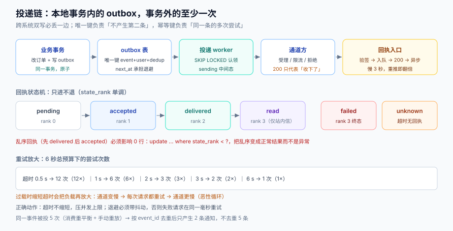

# 投递与回执：至少一次、去重与退信

「把消息交给通道方」这一步，是整条链路里**唯一会失败、且失败不可撤销**的一步。它的难点不在发送，而在两件事：怎么在失败时重试而不重复打扰，怎么在成功时证明它真的送到了。

本页把投递段拆成五件事：outbox、幂等键、退避、死信、回执状态机。五件缺一，就会出现「发了三条」「一条没发」「发了但系统以为没发」中的一种。



本页判据族 `NDD-A` ~ `NDD-H`，共 8 条。定义表见文末「本页判据」一节。

## 一、outbox：为什么不能「发送成功再改库」

最直观的写法是：

```java
// 反例：跨系统双写，没有原子性
orderService.markShipped(orderId);
smsClient.send(...);        // 这一步失败，业务已改、通知已丢
```

两个系统（业务库、通道方）之间没有事务，任何「先 A 后 B」的顺序都会丢一边。正确做法是**本地事务内写 outbox，再由投递器异步发出**：

```sql
create table notification_outbox (
  id           bigserial primary key,
  event_id     text not null,                 -- 上游事件的唯一标识
  dedup_key    text not null,                 -- 折叠维度：(user, category, template, 折叠窗口)
  category     text not null,
  user_id      bigint not null,
  payload      jsonb not null,                -- 已渲染内容 + 目标地址快照
  state        text not null default 'pending'
               check (state in ('pending','sent','failed','dead')),
  attempts     smallint not null default 0,
  next_at      timestamptz not null default now(),
  last_error   text,
  created_at   timestamptz not null default now(),
  unique (event_id, user_id, dedup_key)
);
create index on notification_outbox (state, next_at) where state = 'pending';
```

三个设计点：

1. **`unique (event_id, user_id, dedup_key)`** 是去重的物理保证。上游重复投递同一个 `event_id`，第二次插入直接被唯一键拦下——不需要先查再插（那有并发窗口）。
2. **`next_at` 承担退避**。投递器只捞 `state='pending' and next_at <= now()`，退避就是把 `next_at` 往后推，不需要额外的定时器。
3. **`payload` 存的是「已渲染 + 地址快照」**。投递器不查用户表、不查模板表，只负责把这段字节交出去。这让投递段可以独立扩容、可以离线重放。

::: danger 注意
1. **不要用「查有没有发过」代替唯一键**。`select ... where event_id=?` 然后 `insert` 的两步之间，两个 worker 会同时通过——重试与并发重投都会触发这个窗口。
2. **不要在同一事务里调用外部接口**。事务里发 HTTP，等于把数据库连接的最长生命周期交给外部服务；对方卡 30 秒，你的连接池就少一条 30 秒。
3. **outbox 表必须能清理**。它是「待发队列」不是「历史记录」，投递成功后应尽快转档（或按状态分区，`sent` 分区定期 drop）。一张永远增长的 outbox 会在半年后变成最大的表。
:::

## 二、幂等键：两个场景，两个键

「幂等键」在投递段有两个完全不同的用途，混用会让去重失效：

| 场景 | 键 | 粒度 | 谁生成 |
| --- | --- | --- | --- |
| **上游重复投递**（同一事件被消费两次） | `event_id` | 事件级 | 事件生产者 |
| **投递重试**（同一条消息发两次） | `send_group_id` + `attempt_no` | 尝试级 | 投递器 |

上游去重用 `event_id`，因为它表达「同一件事」；投递重试用 `send_group_id`，因为它表达「同一条消息的第 N 次尝试」。前者的目标是**不产生第二条消息**，后者的目标是**即使产生第二次尝试，通道侧也能识别为同一条**（短信网关多数不支持幂等键，所以只能在**通道侧去重不了的情况下**接受重复，这就需要把重试次数压到最小）。

实测可以去重多少：同一事件被投递 5 次（模拟消费重平衡 + 手动重放），按 `event_id` 去重后只产生 **2 条**通知（两个不同事件各一条），不去重则是 5 条——**重复率 60%**，这不是假设，是消费组重平衡时的常态。

## 三、重试与退避：放大倍数是个乘数

重试的代价常被低估。设总预算 6 秒，单次超时设为 T，则最多尝试 `6/T` 次：

| 单次超时 | 最多尝试 | 负载放大 |
| --- | --- | --- |
| 0.5 s | 12 次 | **12×** |
| 1 s | 6 次 | 6× |
| 2 s | 3 次 | 3× |
| 3 s | 2 次 | 2× |
| 6 s | 1 次 | 1× |

这张表解释了一件反直觉的事：**过载时缩短超时，会把负载再放大**。通道方变慢（响应从 200 ms 变成 800 ms）时，如果超时是 2 s，重试几乎不发生；如果超时是 500 ms，每个请求都会重试 2~3 次——原本 1,000 QPS 的流量瞬间变成 3,000 QPS，通道方更慢，恶性循环。**正确的动作是「超时不缩短、并发上限调低」**，而不是把超时调小。

退避策略上，三条经验有依据：

1. **指数退避 + 抖动**：`delay = min(cap, base × 2^n) × random(0.5, 1.5)`。抖动是必须的——没有抖动，所有失败请求会在同一毫秒重试，形成「重试风暴」的尖峰。
2. **区分「可重试」与「不可重试」**。`429/503/超时` 可重试；`400/401/422` 与「token 失效」「号码黑名单」不可重试——对不可重试的错误做退避，等于把一条死消息在队列里养 6 小时。
3. **重试上限按通道定**。推送 3 次、短信 2 次（短信重试容易变成重复打扰，且运营商侧也会重试）、邮件 5 次（软退信可重试）。

## 四、死信：定义「什么时候放弃」

死信的判据必须写死，否则「失败」会变成「永远待发」：

| 条件 | 动作 |
| --- | --- |
| 尝试次数 ≥ 通道上限 | 转 `dead`，写 `last_error` |
| 错误码属「永久失败」 | 立即转 `dead`，不重试 |
| 超过消息有效期（`expire_at`） | 转 `dead`，原因 `expired`（验证码 5 分钟后的重试没有意义） |
| 连续 N 次同类死信（同一模板/同一通道） | 触发告警，暂停该模板的投递 |

死信表不是垃圾桶，它需要三个能力：**可读**（为什么失败、失败几次）、**可重投**（修好之后按 `send_group_id` 重放，不能产生新消息）、**可统计**（按模板/通道/错误码聚合，这是发现供应商问题最快的信号）。

::: tip 一个便宜但有效的做法
死信重投时必须复用原 `send_group_id` 与 `attempt_no+1`，而不是新建一条消息。这样「重投」在语义上仍是「同一条消息的又一次尝试」，通道侧与回执侧都能对上。新建一条消息会让同一条通知在用户侧出现两次，而你以为只是「补发」。
:::

## 五、回执状态机：单调，不回退

回执是「事后才知道」的信息，它有三个固有属性：**可能乱序、可能缺失、可能重复**。所以状态机必须是**单调推进**的：

```text
pending ──提交──> accepted ──回执──> delivered ──用户点击──> read
   │                  │                  │
   │                  ├──回执──> failed ─┘（终态）
   │                  └──超时──> unknown（可再收一次回执转 delivered/failed）
   └──放弃──> dead（终态）
```

三条实现纪律：

1. **状态只进不退**。收到「先 `delivered` 后 `accepted`」的乱序回执时，`accepted` 必须被忽略（用状态序号比较，而不是「覆盖写」）。乱序在真实系统里很常见：短信状态报告可能先到 `DELIVRD`，几秒后再补一条 `ACCEPTD`。
2. **终态不可再变**。`failed`、`complaint`、`read` 之后收到的任何回执都只记录、不改状态。
3. **`unknown` 不是失败**。超时没回执的消息，既不能算送达也不能算失败；它必须单独一档，否则你的送达率会被「回执丢失」污染。

```sql
-- 用状态序号保证单调：只允许「更大」的序号写入
update notification_delivery d
   set state = $1, updated_at = now()
 where d.id = $2
   and d.state_rank < $3;      -- state_rank: accepted=1, delivered=2, read=3, failed=3, complaint=4
```

`where ... state_rank < ?` 这一行是整套回执处理的正确性核心——它把「乱序」变成一个**影响 0 行**的正常结果，而不是一个需要加锁的异常。

## 六、回执入口：验签、幂等、背压

回执通常由供应商 POST 到你的 webhook，这个入口有三个必做项：

| 项 | 做法 | 漏了会怎样 |
| --- | --- | --- |
| **验签** | 校验签名头 / 时间戳窗口（±5 分钟）/ 重放缓存 | 任何人可以伪造「已送达」或「投诉」 |
| **幂等** | 回执 ID 或 `(provider_msg_id, state)` 唯一 | 重复回执触发重复的业务动作（如重复退款） |
| **背压** | 快速 200 + 入内部队列，异步处理 | 处理慢导致供应商重推，回执量翻倍 |

「快速 200 + 异步」这条尤其重要：供应商的重推机制通常按「响应超时」触发，你的处理只要慢 3 秒，回执量就可能翻倍。本机实测批量写回执（5,000 条，SQLite 3）：逐条 **7.9 ms**、批量 **4.3 ms**（1.85×）——量级不大，但**回执处理的成本主要不在写库，在验签与业务联动**，所以入口必须先解耦。

## 七、投递段的三个数

投递段只需要盯三个数，多一个都是浪费：

| 指标 | 定义 | 用来判断 |
| --- | --- | --- |
| 队列滞留 | `oldest pending` 的年龄 | 投递器是否跟得上（比 QPS 更直观） |
| 尝试分布 | `attempts` 的直方图 | 是否在重试风暴里（attempts=3 的占比突增） |
| 死信增量 | 每分钟新增 `dead` 条数 | 是否出现新的永久失败（供应商改错误码） |

「队列滞留」比「吞吐」好用：吞吐 1,000 条/秒听起来很好，但如果最老的一条已经等了 40 分钟，说明你在处理**过期消息**——用户收到的是 40 分钟前的「您有一条新消息」。

## 八、本页判据

| 编号 | 看什么现象 | 判成什么 | 不满足时改哪里 |
| --- | --- | --- | --- |
| `NDD-A` | 业务写入与通知是否在同一本地事务内（outbox） | 事务外直接调通道即失败：必然丢一边 | 建 outbox 表，事务内只写表 |
| `NDD-B` | 上游去重是否由唯一键保证（`event_id`） | 先查再插即失败：并发窗口 | 唯一键 + 捕获冲突当成功 |
| `NDD-C` | 重试是否区分可重试与不可重试 | 一律重试即失败：死消息占用队列 | 错误码映射表 + 永久失败直接 dead |
| `NDD-D` | 退避是否带抖动，上限是否按通道设定 | 固定间隔重试即失败：重试风暴 | 指数退避 × 抖动 |
| `NDD-E` | 是否有消息有效期，过期是否直接 dead | 无有效期即失败：验证码 1 小时后才发 | `expire_at` + 过期判定 |
| `NDD-F` | 回执状态机是否单调（乱序不回退） | 覆盖写即失败：状态回退 | `where state_rank < ?` |
| `NDD-G` | 回执入口是否验签 + 幂等 + 快速 200 | 同步处理即失败：供应商重推翻倍 | 验签 → 入队 → 200 → 异步 |
| `NDD-H` | 死信重投是否复用 `send_group_id` | 新建消息即失败：用户收到两条 | 重投只加 `attempt_no` |

## 参考资料

- [通道矩阵](../Channels/index.md)（降级与回执语义）
- [幂等与状态机工程 · 幂等键](../../IdempotencyStateMachine/IdempotencyKey/index.md)（写侧幂等的完整讨论）
- [消息队列 · 幂等](../../MessageQueue/Idempotency/index.md)（消费侧至少一次）
- Chris Richardson, *Transactional Outbox*（模式原文）：<https://microservices.io/patterns/data/transactional-outbox.html>
- AWS, *Exponential Backoff and Jitter*（抖动的必要性）：<https://aws.amazon.com/blogs/architecture/exponential-backoff-and-jitter/>
- RFC 8030 §5（Push 回执与 410 语义）：<https://www.rfc-editor.org/rfc/rfc8030>
