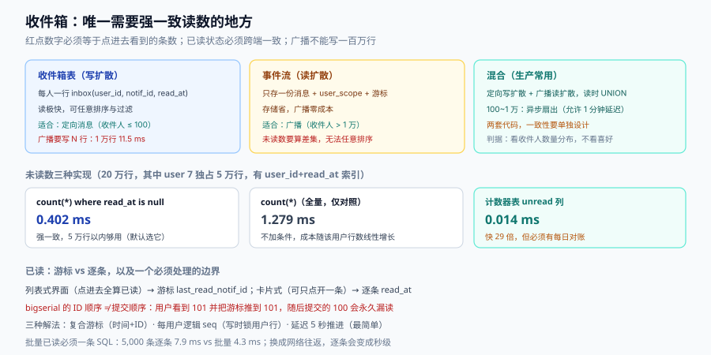

# 收件箱读模型：未读数、游标与扩散方式

「消息中心」这一页看起来只是列表 + 红点，实际是整个通知系统里**唯一需要强一致读数**的地方：红点上的数字必须和你点进去看到的条数一致，已读状态必须在你切到另一台设备时已经生效。

本页讲三个决定的组合：未读数怎么算、已读怎么做、消息怎么落到每个人的收件箱。



本页判据族 `NDI-A` ~ `NDI-H`，共 8 条。定义表见文末「本页判据」一节。

## 一、三种读模型

| 模型 | 存储 | 未读数怎么来 | 优点 | 缺点 |
| --- | --- | --- | --- | --- |
| **收件箱表**（写扩散） | 每人一行 `inbox(user_id, notif_id, read_at)` | `count(*) where read_at is null` 或计数器 | 读极快、可任意排序过滤 | 广播类消息要写 N 行 |
| **事件流 + 读时过滤**（读扩散） | 只存一份消息，配 `user_scope`（谁可见）+ 已读游标 | 需要把「可见消息」与「已读位置」做差集 | 存储省、广播零成本 | 未读数计算复杂，无法任意排序 |
| **混合** | 高频/定向消息写扩散，广播/长尾读扩散 | 两者相加 | 兼顾 | 两套代码，一致性要单独设计 |

选择判据只有一条：**收件人数量分布**。

- 如果 90% 的消息收件人是 1~10 人（订单通知、@ 提醒），**写扩散**是对的；
- 如果 90% 的消息收件人是全站（公告、系统升级），**读扩散**是对的；
- 如果两类都有（绝大多数产品），**混合**是唯一可行解。

本机实测写扩散的成本（SQLite 3，1 万行插入）：**11.5 ms**，约 **1.15 µs/行**；读扩散只插 1 行：**1.19 ms**（其中大部分是事务提交的固定开销）。换算到 100 万收件人的公告：写扩散是 115 秒的纯写入（还没算索引与复制），读扩散是 1 次写入。**这个差距决定了「公告」这类消息永远不该走写扩散。**

## 二、未读数：三种实现的真实代价

`count(*) where user_id=? and read_at is null` 是最直观的实现。它的代价取决于**该用户有多少行**，而不是全表多大。本机实测（20 万行、其中 user 7 独占 5 万行、有 `(user_id, read_at)` 索引）：

| 实现 | 单次耗时 | 一致性 | 适用 |
| --- | --- | --- | --- |
| `count(*) where read_at is null` | **0.402 ms** | 强一致 | 单用户行数 < 10 万 |
| `count(*)`（不加条件，用于对比） | 1.279 ms | 强一致 | — |
| **计数器表**（`unread` 列） | **0.014 ms** | 最终一致（要维护） | 高 QPS 首屏、行数上百万 |

三个数读出来的结论：

1. **`count(*)` 没有想象中慢**：5 万行只要 0.4 ms。对绝大多数产品，**直接用 `count(*)` 是最省事且正确的选择**，不要为了「性能」提前引入计数器。
2. **计数器快 29 倍，但它的成本在写入侧**。每次投递要 `unread+1`、每次已读要 `unread-N`，任何一次漏更新都会让数字永久偏掉，且**没有自愈机制**。
3. **如果一定要用计数器，必须配一个对账任务**：每天低峰期用 `count(*)` 重算一遍，发现偏差就修正并告警。没有对账的计数器，就是一个会慢慢变错的缓存。

::: danger 注意
1. **不要把未读数缓存在客户端**。「本地 +1 / -1」的做法在多端场景下必然错位：手机点开三条，PC 上的红点还是 5。
2. **`read_at is null` 不要用 `read = false`**。布尔值丢掉了「什么时候读的」这个信息，而它是「已读到哪」的游标、是「多久没看」的统计、也是「已读回执」的证据。
3. **不要在未读数上做 `DISTINCT`**。`count(distinct notif_id)` 会让你丢失索引，且掩盖了「同一消息被写了两行」这个真正的 bug。
:::

## 三、已读：游标比逐条更省，但不总是等价

两种已读模型：

| 模型 | 存储 | 已读一条的成本 | 能否表达「只读了中间一条」 |
| --- | --- | --- | --- |
| **逐条已读**（`read_at` 列） | 每行一个时间戳 | 一次 `UPDATE` | 能 |
| **游标已读**（`last_read_notif_id`） | 用户一行 | 一次 `UPDATE` | **不能**（只能表达「读到哪」） |

收件箱的界面决定了该用哪种：**列表式（按时间倒序，点进去全算已读）用游标**；**卡片式（可以只点开其中一条）必须逐条**。

游标方案有一个必须处理的边界：**新消息的 ID 必须单调**。用 `bigserial` 做主键时，并发写入会让 ID 顺序与提交顺序不一致（事务 A 拿到 100、事务 B 拿到 101，但 B 先提交）。用户此时打开收件箱看到 101，游标推到 101，随后 A 提交的 100 就**永远不会显示为未读**。

解决办法有三个，按代价排：

1. **用「创建时间 + ID」复合游标**，比较时先比时间再比 ID（时间由数据库在提交时赋值的 `clock_timestamp()` 仍有微小乱序，但窗口从毫秒级缩到微秒级）。
2. **用逻辑序列**（每个用户一个递增 `seq`，在写入时从用户行上取），代价是写入要锁用户行——只适合低并发场景。
3. **接受极小概率的漏读**，但把游标推进做成「推进到 N，且 N 之前的消息在 5 秒内仍按未读返回」（延迟推进）。简单、够用。

## 四、批量已读：一次点开 500 条

「全部已读」是一个高频操作，也是最容易做慢的操作。本机实测 5,000 条已读回执的写入（SQLite 3）：

| 写法 | 耗时 | 倍数 |
| --- | --- | --- |
| 逐条 `insert` / `update` | 7.9 ms | 1.00× |
| 批量（一条语句多值） | **4.3 ms** | **1.85×** |

倍数不大，但注意这是**本地 SQLite**；换成网络往返的数据库，逐条 5,000 次的 RTT 会把 7.9 ms 变成 5,000 × 0.2 ms ≈ **1 秒**。所以规则是：**批量已读必须一条 SQL**（`update ... where user_id=? and notif_id <= ?` 或 `insert ... on conflict`），不要写成循环。

## 五、写扩散与读扩散的混合边界

一个可落地的混合方案：

| 消息类型 | 扩散方式 | 理由 |
| --- | --- | --- |
| 定向消息（收件人 ≤ 100） | 写扩散（直接写 `inbox`） | 收件人少，写扩散成本可忽略，读模型简单 |
| 群组消息（100 < 收件人 ≤ 1 万） | 写扩散 + 异步扇出（消息先落 `message`，再由 worker 批量写 `inbox`） | 可以削峰，允许 1 分钟延迟 |
| 广播（> 1 万） | **读扩散**（只写 `message` + `user_scope`），收件箱列表 UNION 出来 | 写 100 万行不可行 |

读扩散的收件箱查询会长这样：

```sql
-- 定向消息（写扩散）与广播（读扩散）合并成一个时间序列表
select * from (
  select i.notif_id, i.created_at, i.read_at, 'direct' as src
    from inbox i where i.user_id = $1
  union all
  select m.id, m.created_at,
         case when m.id <= $2 then m.created_at else null end as read_at,  -- 游标判定
         'broadcast' as src
    from message m
   where m.scope = 'all' and m.created_at > $3
) t
order by t.created_at desc, t.notif_id desc
limit 20;
```

`$3` 是「用户注册时间或上次清理时间」——**广播类消息对老用户不需要回溯全部历史**，这个下界能把读扩散的扫描量压下来。

## 六、实时与多端：未读数要在哪一层同步

红点必须「多点一下就消失，且所有端都消失」。三种做法：

| 做法 | 延迟 | 一致性 | 复杂度 |
| --- | --- | --- | --- |
| 轮询（30 秒） | ≤ 30 s | 最终一致 | 最低 |
| 长连接推送（WebSocket/SSE） | 秒级 | 最终一致 | 中（要处理重连、seq） |
| 客户端本地乐观更新 + 服务端确认 | 即时 | 需要冲突处理 | 高 |

工程上最稳的组合是**「乐观更新 + 服务端权威 + 重连对账」**：点开时本地立刻清红点（体验），同时发一个「已读到 X」的请求；服务端返回权威未读数；断线重连时用 `since=last_seq` 拉增量，**以服务端为准覆盖本地**。

一个常被忽略的细节：**多端已读要按「最大游标」合并**。手机读到 100、PC 读到 80，服务端的游标应该是 100 而不是最后写入的那个——否则 PC 的一次刷新会把游标打回 80，红点又冒出来。合并规则写在一处（`max(last_read_id)`），不要在每个端各写一遍。

## 七、收件箱的保留与清理

收件箱会无限增长，而用户只看最近几十条。三条策略的组合：

| 策略 | 做法 | 影响 |
| --- | --- | --- |
| 按时间归档 | 90 天前的消息移出 `inbox`（进冷表或对象存储） | 未读数不受影响（未读的保留） |
| 按数量截断 | 每人只保留最近 500 条（已读的） | 需要「删除」语义，用户可能想找旧消息 |
| 按类别分表 | 营销消息 30 天、事务消息 1 年 | 事务消息是凭证，不能删 |

清理任务必须**分批**且**可中断**：一次 `delete from inbox where created_at < now() - interval '90 days'` 会锁住大量行、产生大量 WAL，与写入高峰相撞时表现为「红点不刷新」。按主键区间每批 5,000 行是安全值。

## 八、本页判据

| 编号 | 看什么现象 | 判成什么 | 不满足时改哪里 |
| --- | --- | --- | --- |
| `NDI-A` | 扩散方式是否按收件人规模分流（≤100 写扩散 / >1 万读扩散） | 全站公告走写扩散即失败：百万行写入 | 引入 `message` + `user_scope` 读扩散 |
| `NDI-B` | 未读数是 `count(*)` 还是计数器，若是计数器是否有对账 | 计数器无对账即失败：偏差永久化 | 每日低峰重算 + 偏差告警 |
| `NDI-C` | 已读是否用 `read_at` 时间戳而非布尔 | 布尔即失败：丢失游标与证据 | 改 `read_at timestamptz` |
| `NDI-D` | 游标已读是否处理了「ID 乱序」（复合游标或延迟推进） | 单 ID 游标即失败：偶发永久漏读 | 复合游标或延迟 5 秒推进 |
| `NDI-E` | 批量已读是否一条 SQL | 循环单条即失败：5,000 次 RTT | `update ... where notif_id <= ?` |
| `NDI-F` | 多端已读是否按最大游标合并 | 按最后写入即失败：红点复活 | 服务端 `max()` 合并 |
| `NDI-G` | 断线重连是否用 `since_seq` 增量对账 | 全量拉取即失败：重连风暴 | 增量接口 + 服务端权威覆盖 |
| `NDI-H` | 收件箱清理是否分批且保留未读/事务消息 | 一次全删即失败：锁表 + 丢凭证 | 分批 5,000 行 + 类别保留策略 |

## 参考资料

- [投递与回执](../Delivery/index.md)（`delivered` 与 `read` 的区别）
- [度量与止血](../Operations/index.md)（未读与打开率的口径）
- [TeamBoard · 通知中心读接口](../../../../project/Complete/TeamBoard/NotificationCenter/index.md)（一个具体项目的收件箱实现）
- PostgreSQL 文档 `count` 与索引扫描代价：<https://www.postgresql.org/docs/18/functions-aggregate.html>
- PostgreSQL 文档 `clock_timestamp` 与 `now()` 的差异：<https://www.postgresql.org/docs/18/functions-datetime.html>
- Martin Kleppmann, *Designing Data-Intensive Applications*（第 11 章：写扩散与读扩散的取舍）
