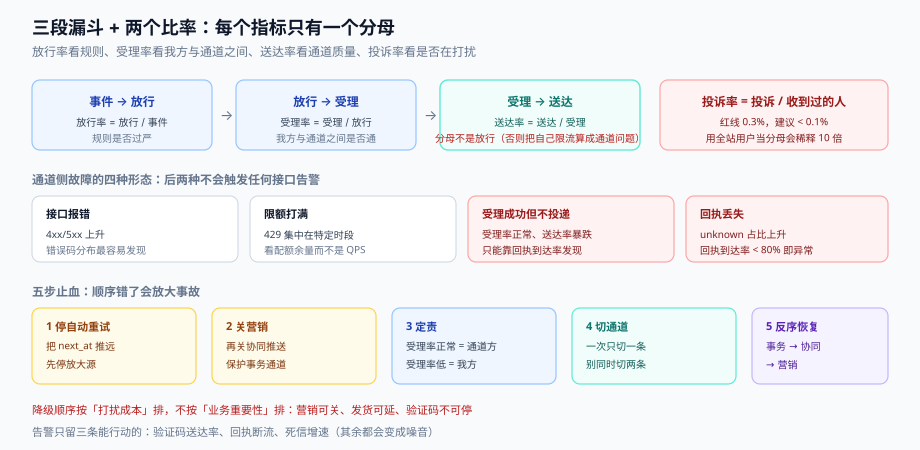

# 度量与止血：送达率的分母、告警与降级

通知系统的监控面板通常长这样：发送量、成功率、失败数。三个数全绿，用户仍在投诉「收不到」——因为这三个数都在量**你这边**，没有在量**用户那边**。

本页给一组「能反映用户感受」的指标，然后回答两个更实际的问题：什么情况下该告警、出事之后按什么顺序止血。



本页判据族 `NDR-A` ~ `NDR-H`，共 8 条。定义表见文末「本页判据」一节。

## 一、五个指标，每个只有一个分母

| 指标 | 分子 | 分母 | 健康区间（示例） | 它回答什么 |
| --- | --- | --- | --- | --- |
| **放行率** | 决策放行条数 | 事件条数 | 视类别 40%~95% | 规则是否过严（用户该收的没收到） |
| **受理率** | 通道方受理成功 | 放行条数 | > 97% | 我们与通道之间是否通 |
| **送达率** | 回执 `delivered` | **受理成功条数** | 短信 > 92%、推送 > 85% | 通道质量 |
| **打开率** | 打开事件数 | 送达条数（或用户数） | 站内信 20%~40% | 内容是否有用 |
| **投诉率** | 投诉数 | **收到过该类别消息的人数** | < 0.1%（红线 0.3%） | 是否在打扰 |

五条口径纪律：

1. **送达率的分母是「受理成功」，不是「放行」**。用放行做分母会把「我们自己的限额拒绝」算进通道质量，导致误判供应商。
2. **投诉率的分母是「收到过的人」**，不是全站用户。用全站用户会把问题稀释 10 倍以上——这正是很多团队「投诉率 0.01%，很健康」却仍在被监管投诉的原因。
3. **打开率必须标明分母是「条」还是「人」**。一次活动发 3 条，用户打开 1 条：按条算是 33%，按人算是 100%（打开过的人 / 收到的人）。两个数都「对」，但不能混着比。
4. **不要用「发送量」做健康指标**。发送量涨 20% 可能是活动，也可能是重试风暴。
5. **所有指标按「类别 × 通道」切片**。总量看不出「营销短信的投诉率是 0.4%、事务短信是 0.002%」这种致命结构。

## 二、告警：三种形态，各有各的用处

| 形态 | 表达 | 适合 | 不适合 |
| --- | --- | --- | --- |
| **绝对阈值** | 送达率 < 90% 持续 5 分钟 | 硬性红线（投诉率、验证码送达率） | 有周期性的量（白天高夜里低） |
| **同比/环比** | 比上周同小时下降 > 30% | 有稳定周期的指标 | 活动期（基线与平时不可比） |
| **燃烧率（burn rate）** | 错误预算消耗速度 > 14.4×（1 小时窗口） | 长周期 SLA | 秒级故障（反应太慢） |

三个告警必须有，其余都可以后加：

1. **验证码送达率**（绝对阈值，最严）。它是唯一「失败即业务损失」的通道指标。
2. **回执断流**（同比）。回执量突然归零，八成是 webhook 挂了或验签失败——此时你的「送达率」会因为分母不变、分子归零而暴跌，但**更早的信号是「回执条数」本身**。
3. **死信增速**（环比）。死信从 10 条/分变成 500 条/分，说明出现了新的永久失败（供应商改了错误码、模板被下架）。

::: warning 说明
告警要绑在**能行动的指标**上。「发送量下降」不是一个能行动的指标（可能是业务没下单）；「验证码送达率 < 90%」是（去查通道或查限额）。判据：**收到告警的人，能不能在 5 分钟内做出一个具体动作？** 不能就删掉这条告警。
:::

## 三、通道侧故障的四种形态

通道方出问题时，你的系统看到的往往不是 5xx，而是更隐蔽的东西：

| 形态 | 现象 | 识别方法 |
| --- | --- | --- |
| **接口报错** | 4xx/5xx 上升 | 错误码分布（最容易发现） |
| **受理成功但不投递** | 受理率正常、送达率暴跌 | 回执到达率（分母是受理数） |
| **限额打满** | 特定时段 429 集中出现 | 429 占比 + 通道配额余量 |
| **回执丢失** | 送达率缓慢下滑、`unknown` 占比上升 | `unknown` 占比单独监控 |

第二、四两种最危险，因为它们**不会触发任何接口告警**。唯一能发现它们的方式是**把回执当成一等公民**：监控「回执到达率 = 收到回执的条数 / 受理成功的条数」。这个比值正常应该在 95% 以上；掉到 80% 说明通道侧出问题了，与你的发送逻辑无关。

## 四、降级方向：先关什么、后关什么

出故障时的降级顺序，本质是**按「打扰成本」从高到低关**：

| 顺序 | 关什么 | 影响 | 不可关的例外 |
| --- | --- | --- | --- |
| 1 | **营销型**（全部通道） | 用户少收广告 | 无 |
| 2 | 协同型的推送（保留站内信） | 用户晚点知道 | 无 |
| 3 | 系统型的邮件 | 用户晚点知道 | 安全类（改密、异地登录） |
| 4 | 协同型的站内信 | 消息中心空 | 无 |
| 5 | 事务型的非验证码（发货、退款） | 有延迟，但可回溯 | 扣款失败、退款到账 |
| — | **事务型的验证码/安全** | **永不降级** | — |

这个顺序与「业务重要性」相反：业务上发货通知比营销重要，但**营销是可关的、发货是可延的、验证码是不可停的**。三者是三种不同的处置方式，不能用一个「开关」处理。

## 五、五步止血：顺序错了会放大事故

事故现场的常见错误是「先修最响的那个」——通常是重启投递器，但投递器重启会把队列重放，把重复消息再发一遍。

| 步 | 动作 | 目的 | 判据 |
| --- | --- | --- | --- |
| 1 | **停自动重试**（把 `state='pending'` 的 `next_at` 推远） | 防止重试风暴把故障放大 | 队列滞留不再增长 |
| 2 | **关营销与协同推送** | 降低总负载，保护事务通道 | 放行率按预期下降 |
| 3 | **定位是「我方」还是「通道方」** | 决定是改代码还是切通道 | 看「受理率」与「回执到达率」两个数：受理率正常 → 通道方 |
| 4 | **切通道或降级**（只切一条，别同时切两条） | 恢复主链路 | 送达率回升 |
| 5 | **恢复顺序反过来**：先事务、再协同、最后营销 | 避免二次冲击 | 各项指标回到基线 |

第 3 步的两个数是最有价值的诊断：**受理率正常 + 回执到达率低 = 通道方受理了但没投**（你只能切通道或等）；**受理率低 = 你被限流或参数错了**（你能自己修）。把这两个数放在同一张图上，方向就明确了。

## 六、值班日报：五行就够

每天一行不多写，五行足够覆盖「今天有没有异常、异常在哪一段」：

```text
1 发送：事件 12,431 → 放行 9,208（74.1%）→ 受理 9,051（98.3%）→ 送达 8,412（92.9%）
2 拒绝：频控 1,903 / 退订 842 / 静默 478 / 商户关闭 0
3 异常：死信 37 条（模板 order_shipped 29 条，错误码 TEMPLATE_MISMATCH）
4 投诉：3 条（营销短信，最近 7 天累计 0.04%）
5 待办：order_shipped 模板变量 eta_date 缺失，已加 schema 校验
```

第 3 行的价值最高：**死信按模板聚合**能在一分钟内告诉你「问题出在哪个模板」，而按通道聚合只能告诉你「短信有问题」。

## 七、容量与限额的三条线

通知系统的容量规划只需要三根线：

| 线 | 含义 | 怎么定 |
| --- | --- | --- |
| **通道配额线** | 供应商给的 QPS / 日上限 | 取合同值的 80%，留 20% 给重试 |
| **投递队列线** | 队列滞留的可接受上限 | 按「消息有效期」反推（验证码 5 分钟 → 队列滞留不能超 1 分钟） |
| **数据库写入线** | outbox 与收件箱的写入 QPS | 按峰值活动的 2 倍压测，观察 p99 而不是均值 |

第二根线最容易被忽略，但它才是用户体验的直接体现：队列滞留 10 分钟意味着「所有通知都晚 10 分钟」，无论你的 QPS 多漂亮。

## 八、本页判据

| 编号 | 看什么现象 | 判成什么 | 不满足时改哪里 |
| --- | --- | --- | --- |
| `NDR-A` | 送达率分母是否为「受理成功」 | 用放行做分母即失败：把自身限流算成通道问题 | 指标定义改成三段漏斗 |
| `NDR-B` | 投诉率分母是否为「收到过该类别的人」 | 用全站用户即失败：问题被稀释 10 倍 | 按收件人集合算 |
| `NDR-C` | 打开率是否标明「按条 / 按人」 | 未标明即失败：两个数不可比 | 指标名带后缀 `_by_msg` / `_by_user` |
| `NDR-D` | 是否监控「回执到达率」 | 只监控送达率即失败：发现不了回执丢失 | 加 `回执数 / 受理数` 指标 |
| `NDR-E` | 告警是否绑在可行动指标上 | 告警「发送量下降」即失败 | 换成验证码送达率、回执断流、死信增速 |
| `NDR-F` | 降级顺序是否按「打扰成本」而非「业务重要性」 | 先关事务即失败 | 固定五级顺序，验证码永不降级 |
| `NDR-G` | 止血第一步是否为「停自动重试」 | 直接重启投递器即失败：重放导致重复 | 先推远 `next_at`，再动别的 |
| `NDR-H` | 日报是否按模板聚合死信 | 只按通道聚合即失败：定位慢 | 死信表加 `template_key` 维度 |

## 参考资料

- [总览](../Overview/index.md)（三个分母的来历）
- [投递与回执](../Delivery/index.md)（回执状态机）
- [监控与告警](../../../Ops/Monitoring/index.md)（告警的技术形态）
- Google, *Email sender guidelines*（投诉率 0.3% 红线）：<https://support.google.com/a/answer/81126>
- Google SRE Workbook, *Alerting on SLOs*（燃烧率告警）：<https://sre.google/workbook/alerting-on-slos/>
- 工业和信息化部《通信短信息和语音呼叫服务管理规定》（商业短信的投诉处置要求）：<https://www.miit.gov.cn/>
